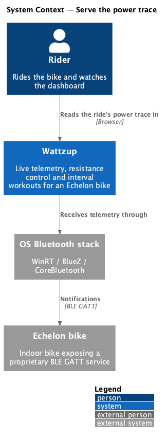
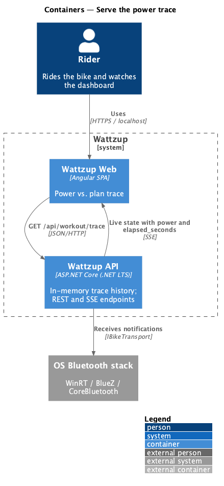
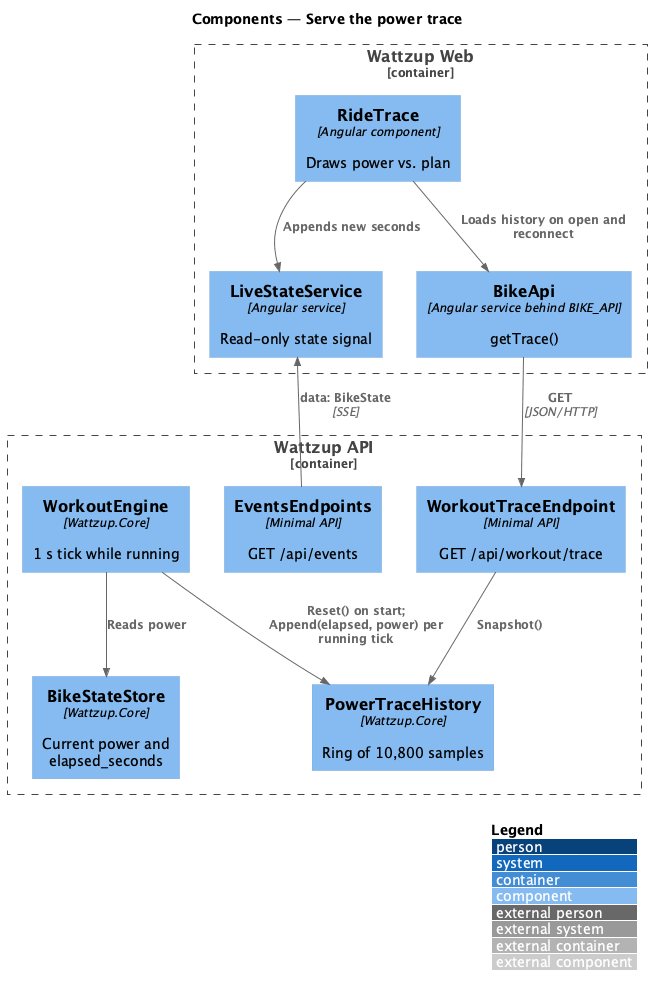
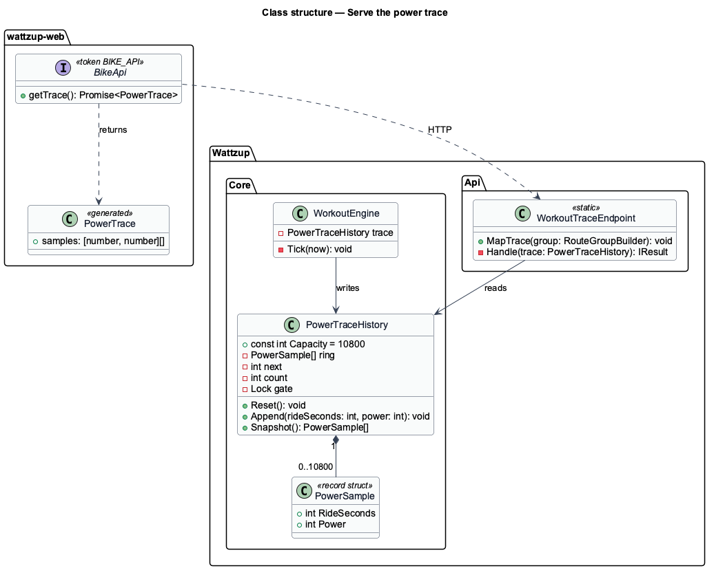
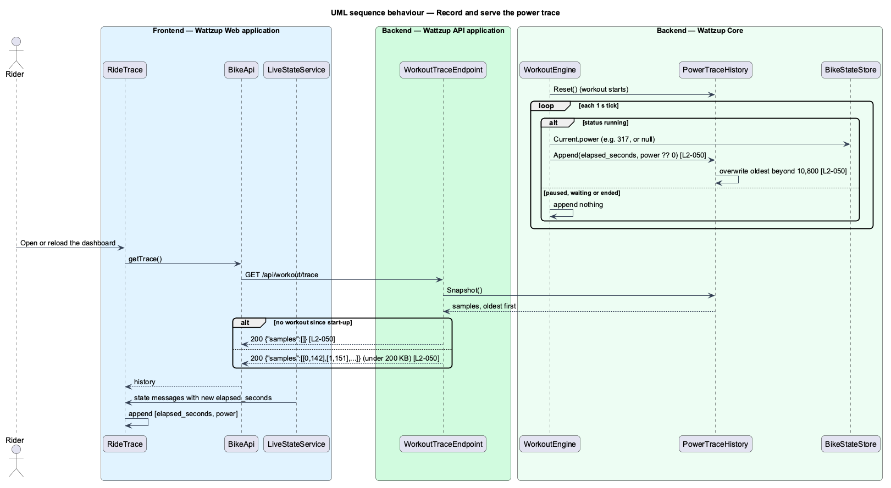

# Serve the power trace

## Overview

The ride dashboard draws a trace of estimated power against the plan for the whole ride (L2-026). The live stream carries only the current state, so a dashboard opened, reloaded or reconnected mid-ride has no history to draw. This feature keeps 1 power sample per running second of the current workout in memory and serves the whole history on request. The dashboard loads it once, then extends it from the live stream.

**power sample** — pair `[ride_seconds, power]` recorded on 1 running tick of the workout engine

**trace history** — ordered list of power samples of the current or last workout, oldest first, at most 10,800 long

**running tick** — 1 s tick of the workout engine while `status` is `running`

10,800 samples cover a 3-hour ride at 1 sample per second. The history is in memory like the rest of the state (ADR 0004) and is lost on restart.

## Description

Backend:

- **`PowerTraceHistory`** (`Wattzup.Core`) — singleton ring buffer of 10,800 `PowerSample(int RideSeconds, int Power)` structs (about 86 KB). It is written only by the workout engine loop and read by the endpoint, so `Append` and `Snapshot` take a short lock.
  - `Reset()` — empties the history. The engine calls it when a workout starts, so each ride has its own trace (L2-013).
  - `Append(rideSeconds, power)` — adds 1 sample, overwriting the oldest at capacity (L2-050).
  - `Snapshot()` — copies the samples, oldest first.
- **`WorkoutEngine`** (see `workouts/run-interval-workout`) — on each running tick, after it updates the ride totals (see `telemetry/estimate-power-and-totals`), it calls `Append(elapsed_seconds, power ?? 0)`. A missing power reading counts as 0, as in the ride average (L2-049). Paused, waiting and ended ticks append nothing, so the history holds 1 sample per running second (L2-050). Ending or stopping the workout keeps the history until the next start.
- **`WorkoutTraceEndpoint`** (`Wattzup.Api`, in the `/api/workout` group) — maps `GET /api/workout/trace` and returns `200 {"samples": [[ride_seconds, power], ...]}`. With no workout since start-up, `samples` is `[]` (L2-050). The response is written with `Utf8JsonWriter` straight from the snapshot. The endpoint holds no rule.
- **Size** — a sample serialises to about 12 bytes (`[10799,317],`), so 10,800 samples stay near 130 KB, under the 200 KB limit of L2-050.

Frontend (`wattzup-web`):

- **`BikeApi.getTrace()`** — reads the endpoint with the generated `PowerTrace` type.
- **`RideTrace`** (see `workouts/show-workout-countdown` and `dashboard`) — loads the history when the dashboard opens and after the event stream reconnects, then appends `[elapsed_seconds, power]` from each state message whose `elapsed_seconds` is new. The drawing itself belongs to L2-026 and L2-028.

Verification:

- `Wattzup.Core.Tests` — `PowerTraceHistory` table: empty, 1 sample, 10,800 samples, 10,801 samples (oldest dropped), reset on start.
- `Wattzup.Api.AcceptanceTests` — with `SimulatedBikeTransport` and `FakeTimeProvider`: `samples` is `[]` before a workout; after a workout runs 10 ticks, `GET /api/workout/trace` holds 10 samples, oldest first; a pause adds none.
- Playwright — the fixture answers `/api/workout/trace` from a recording made against the backend running with `--simulate`; the dashboard spec checks that a reloaded page draws the recorded history.

## Requirements

| L2 ID | Refines (L1) | Requirement |
|-------|--------------|-------------|
| `L2-050` | `L1-005` | Power trace history endpoint. |

## Diagrams

### System context

The rider sees the ride's power history, which Wattzup records from the bike's telemetry.

### Containers

Wattzup Web reads the history from the Wattzup API over JSON/HTTP and extends it from the SSE stream.

### Components

`WorkoutEngine` appends to `PowerTraceHistory` on each running tick. `WorkoutTraceEndpoint` serves its snapshot to `BikeApi`, which feeds `RideTrace`.

### Class structure

`PowerTraceHistory` is a fixed-size ring of value-type samples, so memory stays flat over long rides (L2-038).

### Behaviour — record and serve the trace

A start resets the history, each running tick appends 1 sample, and the endpoint returns the samples oldest first (L2-050).

