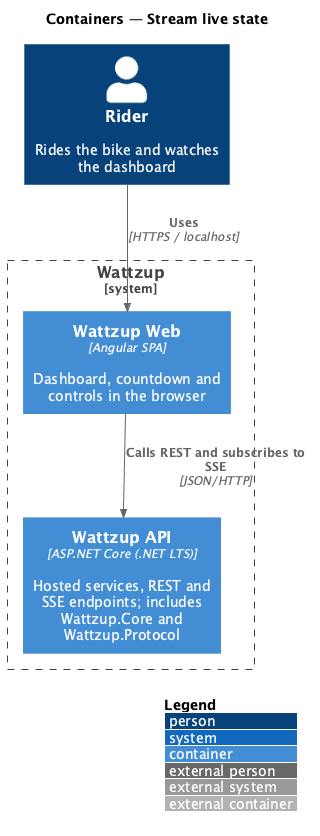
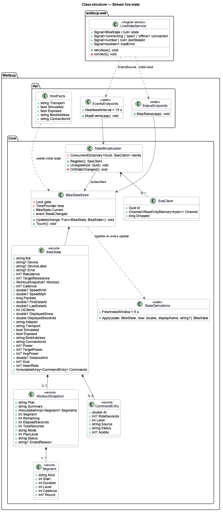
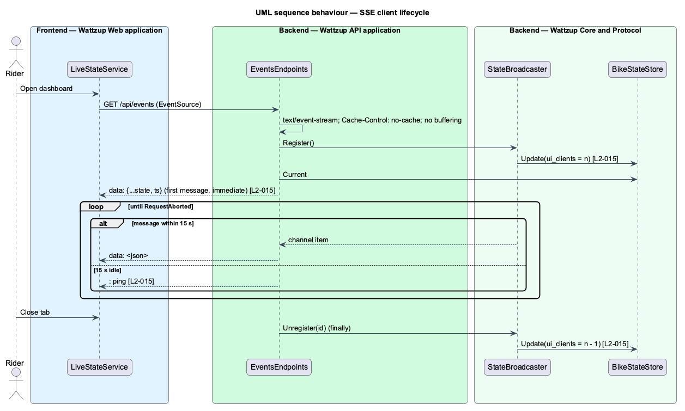

# Stream live state

## Overview

Every number on the dashboard comes from 1 JSON object: the bike state. The backend holds the authoritative copy and pushes the whole object to every open dashboard each time it changes. It uses Server-Sent Events (SSE), a one-way HTTP stream that browsers consume natively through `EventSource` (ADR 0004). A plain `GET` returns the same object on demand. The state also carries `displayed_seconds`, which tracks how long live data has been continuously on screen.

**bike state** — JSON object with the fields listed in L2-014, using the prototype's snake_case names and Unix-epoch-second timestamps

**broadcast** — serialising the current bike state once and queuing it to every connected SSE client

**UI client** — 1 open `/api/events` stream; `ui_clients` counts them

**displayed time** — continuous span during which at least 1 UI client is connected and the last metric is at most 5 s old

The contract keeps the prototype's field names, so the frontend and any existing tools read the same shape. It adds the fields the design needs: the host and transport facts, the estimated power and ride totals, the command log and a `workout` object that describes a finite plan of segments. Pushing the full state rather than deltas keeps each message self-contained: a client that reconnects or drops a message recovers on the next one.

## Description

Backend:

- **`BikeState`** (`Wattzup.Core`) — immutable record of the fields in L2-014. Each field has 1 writer, always through `BikeStateStore`:

  | Fields | Written by | Design |
  |---|---|---|
  | `ble`, `device`, `error`, `adapter` | `BikeConnectionService` | `bike-connectivity/discover-and-connect-bike` |
  | `transport`, `simulated`, `exposed`, `bind_address`, `connection_id` | `HostFacts`, once at start-up | this design |
  | `device_label`, `displayed_since`, `displayed_seconds` | `StateDerivations`, on every update | this design |
  | `resistance`, `cadence`, `speed_kmh`, `speed_mph`, `power`, `packets`, `first_data_at`, `last_data_at` | `TelemetryIngestor` | `telemetry/decode-bike-telemetry`, `telemetry/estimate-power-and-totals` |
  | `target_resistance`, `commands` | `ResistanceCommander`, `TelemetryIngestor` | `resistance-control/set-resistance`, `resistance-control/log-resistance-commands` |
  | `workout`, `target_power`, `avg_power`, `distance_km`, `kcal` | `WorkoutEngine` | `workouts/run-interval-workout`, `telemetry/estimate-power-and-totals` |
  | `ui_clients` | `StateBroadcaster` | this design |
  | `heart_rate` | none; always `null` (ADR 0003) | `telemetry/estimate-power-and-totals` |

- **`WorkoutSnapshot`** — `{plan, summary, segments, segment, remaining, elapsed_seconds, total_seconds, mode, plan_level, status, ended_reason}`. Each segment is `{kind, start, duration, level, cadence, round}`. `status` and `mode` are serialised as the exact strings of L2-014, such as `waiting for bike` and `paused: bike disconnected`. The plan is finite (ADR 0002).
- **`CommandEntry`** — `{at, ride_seconds, level, source, status, ack_ms}` (see `resistance-control/log-resistance-commands`).
- **`BikeStateJsonContext`** — source-generated `System.Text.Json` context with `JsonNamingPolicy.SnakeCaseLower` and `DefaultIgnoreCondition = Never`, so every field is present and nulls are written explicitly (L2-014). The stream and `GET /api/status` share it.
- **Initial state** — `ble` `starting`, `packets` 0, `displayed_seconds` 0, `commands` `[]`, `nearby` `[]`, `adapter` `unknown`, `ui_clients` 0, the host facts set, and every nullable field `null` (L2-014). `device_label` stays `null` until a device is selected, so the initial state has all nullable fields `null` even with a configured display name.
- **`HostFacts`** (`Wattzup.Api`) — builds the start-up fields once. `transport` is the selected transport's name (`CoreBluetooth`, `BlueZ`, `WinRT` or `Simulated`). `simulated` is `true` with `--simulate`. `bind_address` is the configured listen address, such as `127.0.0.1:8787`. `exposed` is `true` when that address is not loopback. `connection_id` is `EchelonUuids.ConnectionId` (`Wattzup.Protocol`), the first 8 hex digits of the service UUID, `0bf669f1`.
- **`BikeStateStore`** — singleton and only writer. `Update(Func<BikeState,BikeState>)` applies the change, then `StateDerivations.Apply(next, now)`, under a short lock. It publishes the result by reference swap and raises `StateChanged`. `Touch()` is an update with no field change, used by the keepalive so time-derived fields stay current (L2-003). `Current` reads without a lock.
- **`StateDerivations`** — pure, with a unit test per case:
  - `device_label` — the chosen machine's display name when configured and a device is selected, else `device` (L2-014): `Wattzup:Bike:DisplayName` (default empty) on the bike, `Wattzup:Treadmill:DisplayName` (default `Echelon Stride`) on the treadmill. The setting is documented in the README with the other `WattzupOptions`.
  - displayed time — when `ui_clients > 0` and `now − last_data_at ≤ 5`, it sets `displayed_since ??= now` and `displayed_seconds = round(now − displayed_since, 1)`. Otherwise it sets `displayed_since` to `null` and keeps `displayed_seconds` (L2-032).
- **`StateBroadcaster`** — subscribes to `StateChanged`. On each event it adds `ts`, serialises once to a UTF-8 buffer and calls `TryWrite` on every client channel. Each client has a `Channel<ReadOnlyMemory<byte>>` bounded at 50 with `FullMode = DropWrite`, so a slow client loses messages without affecting others (L2-015). `Register()` and `Unregister(id)` update `ui_clients` through the store.
- **`SseClient`** — 1 per connection: the channel, a connection id and a dropped-message counter.
- **`EventsEndpoints`** — `GET /api/events` sets `Content-Type: text/event-stream` and `Cache-Control: no-cache`, and disables response buffering. It registers an `SseClient` and writes the current state immediately as the first `data:` message (L2-015). It then loops: it awaits the channel with a 15 s timeout on the injected `TimeProvider` and writes `data: <json>\n\n`, or `: ping\n\n` on timeout. `RequestAborted` ends the loop. The `finally` block unregisters the client. Aborted connections log at Debug only (L2-015). The single-use event token of L2-035 is checked before the stream opens (see `platform/secure-api`).
- **`StatusEndpoints`** — `GET /api/status` returns `BikeStateStore.Current` without `ts` (L2-014).
- **OpenAPI** — `Microsoft.AspNetCore.OpenApi` documents every endpoint and the `BikeState` schema at `/openapi/v1.json` (L2-014). A schema transformer marks every property required and nullable where L2-014 allows `null`, so the generated TypeScript types read `number | null` rather than optional fields.

Frontend (`frontend`):

- **`LiveStateService`** (`frontend/projects/wattzup/src/app/core/`) — the only owner of the `EventSource`. It exposes read-only signals: `state` (`BikeState | null`, generated type), `connection` (`connecting`, `open` or `offline`), `lastStateAt` and `loadError`. On start it loads `GET /api/status` through `BikeApi`; a failure sets `loadError` (L2-058, see `dashboard`). It then opens `EventSource('/api/events')`, with the event token when an API key is set. Each message is parsed into `state`. On `error` it closes the source, sets `offline` and reconnects every 2 s (L2-054); `retryNow()` reconnects at once for the `Retry now` button. No component opens its own connection or polls.

Latency targets (L2-037) shape 3 choices. Serialisation happens once per broadcast, not once per client. Writes skip the MVC formatters. Each SSE write is flushed immediately. A BenchmarkDotNet and k6 harness measures notify-to-browser p95 against `SimulatedBikeTransport`; it runs on demand on the machine next to the bike and does not gate CI (L2-037).

Verification:

- `Wattzup.Core.Tests` — `StateDerivations` table (L2-032 and `device_label`); `StateBroadcaster` with 1 undrained client reaching 50 messages while a second client receives every message (L2-015).
- `Wattzup.Api.AcceptanceTests` — through `WebApplicationFactory` with `SimulatedBikeTransport`: `GET /api/status` at start-up matches L2-014 criterion 1 and carries every field; a real SSE response read in memory delivers the current state first, a broadcast next, and `: ping` after `FakeTimeProvider` advances 15 s; `ui_clients` follows 2 opened and 1 closed streams.
- `frontend` unit tests for `LiveStateService` with a fake `EventSource` and fake timers: parse, offline, 2 s reconnect, `retryNow`.
- Playwright — the shared fixture serves `/api/events` as `text/event-stream` and exposes `pushState(partial)` over a full default state recorded from the backend running with `--simulate`. An unstubbed stream request fails the test.

### Machine-specific fields

The state now carries the chosen machine and both machines' fields (L2-014, L2-070, ADR 0009). On each machine the other machine's fields are written as `null`, never omitted, so the bike's fields keep their names and types:

| Fields | Written by | Design |
|---|---|---|
| `machine` | `MachineSelector`; initial value from `Wattzup:Machine` | `treadmill/choose-machine` |
| `incline`, `belt` (from speed), and `speed_kmh`, `speed_mph` as reported by the treadmill | `TelemetryIngestor`; `belt` also by `BikeConnectionService` on connect and disconnect | `treadmill/decode-treadmill-telemetry` |
| `target_speed`, `target_incline`, and `commands` entries of kind `speed` and `incline` | `TreadmillCommander` | `treadmill/control-speed-and-incline` |
| `belt` (`starting`, and `stopped` on a start timeout), `belt_countdown` | `WorkoutEngine` | `treadmill/control-the-belt` |
| `climb_m`, and `kcal` as the treadmill's ACSM estimate | `WorkoutEngine` | `treadmill/decode-treadmill-telemetry` |
| `nearby` (on both machines; `[]` at start-up) | `NearbyMachines` | `bike-connectivity/list-nearby-machines` |

- `WorkoutSnapshot` segments are `{kind, start, duration, level, cadence, round, speed, incline}`; `level`, `cadence` and `plan_level` are nullable. `status` gains `starting belt` and `paused: belt stopped`; the existing strings stay identifiers on both machines (L2-014).
- `CommandEntry` is `{at, ride_seconds, level, source, status, ack_ms, command, value}`, with `level` nullable (`resistance-control/log-resistance-commands`).
- A machine change resets `device`, `device_label`, `workout`, `speed_kmh`, `speed_mph`, `distance_km`, `kcal`, `commands` and every machine-specific field (`climb_m` among them) in one update, keeping `nearby`, so one broadcast carries the reset (L2-070 criterion 3).
- The OpenAPI schema transformer describes each new field with its type and nullability, and the frontend's generated types in `frontend/projects/api/src/generated/` are regenerated in the same change (L2-070 criterion 4).
- `nearby` is `[{machine, name, label, rssi, signal, seen_at}]`, at most one entry per machine; a change to `nearby` alone is broadcast at most once a second (L2-074).
- `LiveStateService` is unchanged: it remains the only connection, and every machine-aware view reads `state().machine`.
- `workout.plan` carries `video`: `{video_id, start_seconds}` when the plan has a ride-along video, else `null`, written and never omitted (L2-010 criteria 14 and 15, ADR 0012). The OpenAPI transformer describes it and the generated types follow. The dashboard builds the player from it (`workouts/ride-along-video`).

## Requirements

| L2 ID | Refines (L1) | Requirement |
|-------|--------------|-------------|
| `L2-014` | `L1-005` | State model contract. The JSON state must keep the prototype's snake_case field names so the contract is stable across the rewrite, and add the fields the design needs. |
| `L2-015` | `L1-005` | Event stream. `GET /api/events` must return a Server-Sent Events stream (`text/event-stream`, `Cache-Control: no-cache`). |
| `L2-032` | `L1-008` | Displayed-time tracking. `displayed_seconds` measures how long live data has been continuously on screen. |
| `L2-037` | `L1-010` | Live-data latency. |

## Diagrams

### System context

The rider sees live data that Wattzup reads from the bike and pushes to the browser.

### Containers

The Wattzup API pushes state to Wattzup Web over SSE and serves snapshots over REST.

### Components

`BikeStateStore` applies each change and its derivations, then raises `StateChanged`. `StateBroadcaster` serialises once and fans out to `SseClient` channels, which `EventsEndpoints` drains to each browser. `LiveStateService` turns the stream into signals.

### Class structure

One store, one broadcaster, many bounded client channels. `BikeState`, with `WorkoutSnapshot`, `Segment` and `CommandEntry`, is the single wire contract.

### Behaviour — connect, receive and disconnect

A new client receives the current state first, then every broadcast, with pings during quiet periods. Disconnecting frees the client and decrements `ui_clients`. In the browser, a failed stream retries every 2 s (L2-015, L2-054).

### Behaviour — broadcast with display-time tracking

Each change passes through `StateDerivations` inside the store (L2-032), is serialised once, and is offered to every client. A full client channel drops only its own copy (L2-015).

