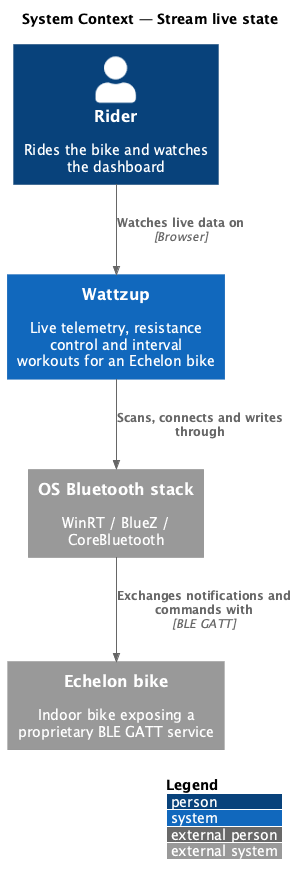
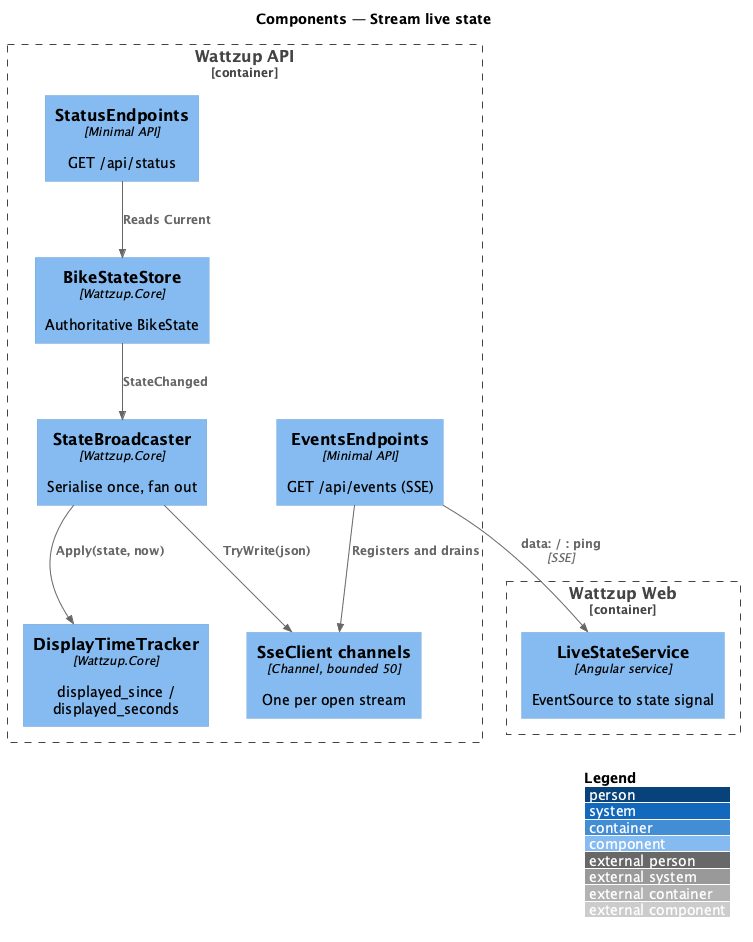
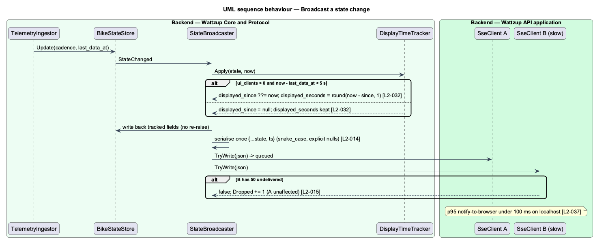

# Stream live state

## Overview

Every number on the dashboard comes from one JSON object: the bike state. The backend holds the authoritative copy and pushes the whole object to every open dashboard each time it changes. It uses Server-Sent Events (SSE), a one-way HTTP stream that browsers consume natively through `EventSource`. A plain `GET` returns the same object on demand. The state also carries `displayed_seconds`, which tracks how long live data has been continuously on screen.

**bike state** — JSON object with the fields listed in L2-014, using the prototype's snake_case names and Unix-epoch-second timestamps

**broadcast** — serialising the current bike state once and queuing it to every connected SSE client

**UI client** — one open `/api/events` stream; `ui_clients` counts them

**displayed time** — continuous span during which at least 1 UI client is connected and the last metric is at most 5 s old

The contract keeps the prototype's field names, so the frontend and any existing tools read the same shape. Pushing the full state rather than deltas keeps each message self-contained: a client that reconnects or drops a message recovers on the next one.

## Description

Backend:

- **`BikeState`** (`Wattzup.Core`) — immutable record of the fields in L2-014. `JsonSerializerOptions` use `JsonNamingPolicy.SnakeCaseLower` and `DefaultIgnoreCondition = Never`, so nulls are written explicitly. `WorkoutSnapshot.Steps` serialises as `int[][]` (L2-014).
- **`BikeStateStore`** — singleton. `Update(Func<BikeState,BikeState>)` swaps the state under a lock and raises `StateChanged`. `Touch()` raises the event without a change. `Current` reads without a lock (reference swap).
- **`DisplayTimeTracker`** — pure. `Apply(state, now)` returns a state with `displayed_since` and `displayed_seconds` updated. When `ui_clients > 0` and `now − last_data_at < 5`, it sets `displayed_since ??= now` and `displayed_seconds = round(now − displayed_since, 1)`. Otherwise it clears `displayed_since` and keeps `displayed_seconds` (L2-032).
- **`StateBroadcaster`** — subscribes to `StateChanged`. On each event it applies `DisplayTimeTracker` (writing the result back to the store without re-raising), adds `ts`, serialises once to a UTF-8 buffer, and calls `TryWrite` on every client channel. Each client has a `Channel<ReadOnlyMemory<byte>>` bounded at 50 with `FullMode = DropWrite`, so a slow client loses messages without affecting others (L2-015).
- **`SseClient`** — one per connection: the channel, a connection id, and a dropped-message counter.
- **`EventsEndpoints`** — `GET /api/events` sets `Content-Type: text/event-stream` and `Cache-Control: no-cache`, and disables response buffering. It registers an `SseClient`, which updates `ui_clients`. It writes the current state immediately as the first `data:` line, then loops: it awaits the channel with a 15 s timeout and writes `data: <json>\n\n`, or `: ping\n\n` on timeout. `RequestAborted` ends the loop. The `finally` block unregisters the client and updates `ui_clients`. Aborted connections log at Debug only (L2-015).
- **`StatusEndpoints`** — `GET /api/status` returns `BikeState.Current` as JSON (without `ts`) (L2-014).
- **OpenAPI** — `Microsoft.AspNetCore.OpenApi` documents every endpoint and the `BikeState` schema at `/openapi/v1.json`. The frontend generates its types from this document (L2-014).

Frontend:

- **`LiveStateService`** — opens `EventSource('/api/events')`, parses each message into the `state` signal, and exposes `connection` (`connecting`, `open` or `offline`). On `error` it closes the source, sets `offline` and reconnects after 2 s (see `show-connection-status`).

Latency targets (L2-037) shape 3 choices. Serialisation happens once per broadcast, not once per client. Writes skip the MVC formatters. Each SSE write is flushed immediately. A BenchmarkDotNet and k6 harness measures notify-to-browser p95 against the simulated transport.

## Requirements

| L2 ID | Refines (L1) | Requirement |
|-------|--------------|-------------|
| `L2-014` | `L1-005` | State model contract. The JSON state must keep the prototype's snake_case field names so the contract is stable across the rewrite. |
| `L2-015` | `L1-005` | Event stream. `GET /api/events` must return a Server-Sent Events stream (`text/event-stream`, `Cache-Control: no-cache`). |
| `L2-032` | `L1-008` | Displayed-time tracking. `displayed_seconds` measures how long live data has been continuously on screen. |
| `L2-037` | `L1-010` | Live-data latency. |

## Diagrams

### System context

The rider sees live data that Wattzup reads from the bike and pushes to the browser.

### Containers

The Wattzup API pushes state to Wattzup Web over SSE and serves snapshots over REST.

### Components

`BikeStateStore` raises changes. `StateBroadcaster` applies display-time tracking, serialises once and fans out to `SseClient` channels, which `EventsEndpoints` drains to each browser.

### Class structure

One store, one broadcaster, many bounded client channels. `BikeState` is the single wire contract.

### Behaviour — connect, receive and disconnect

A new client receives the current state first, then every broadcast, with pings during quiet periods. Disconnecting frees the client and decrements `ui_clients` (L2-015).

### Behaviour — broadcast with display-time tracking

Each state change updates displayed time (L2-032), is serialised once, and is offered to every client. A full client channel drops only its own copy (L2-015).

