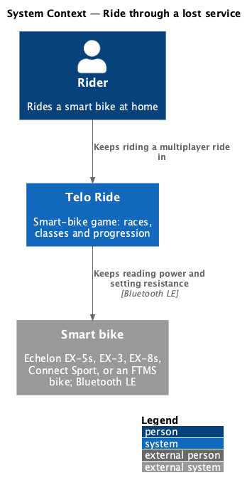
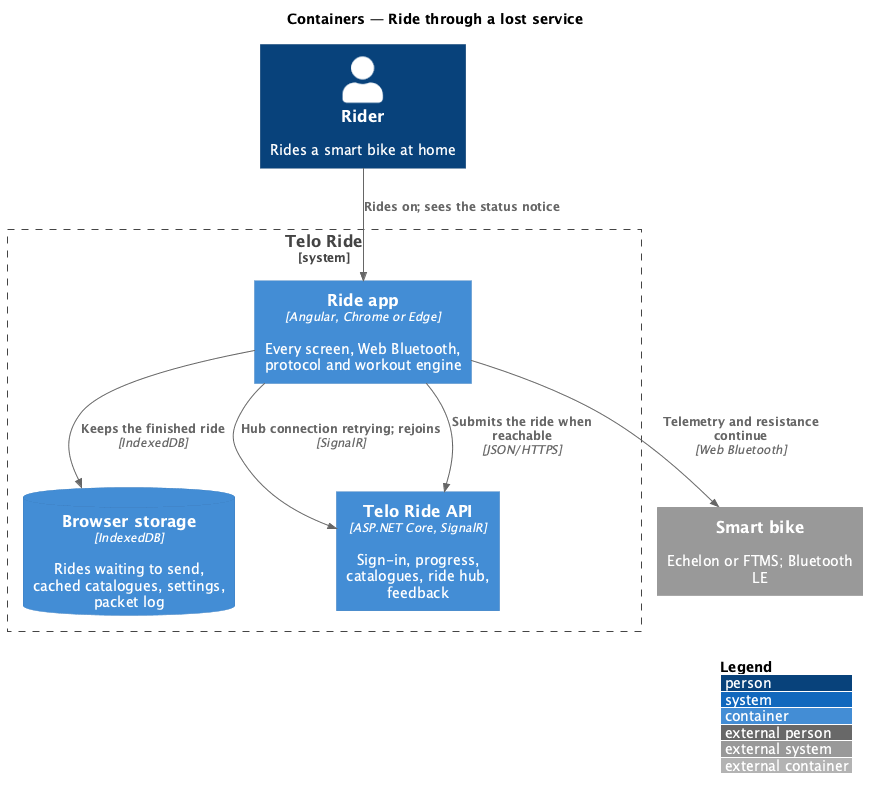
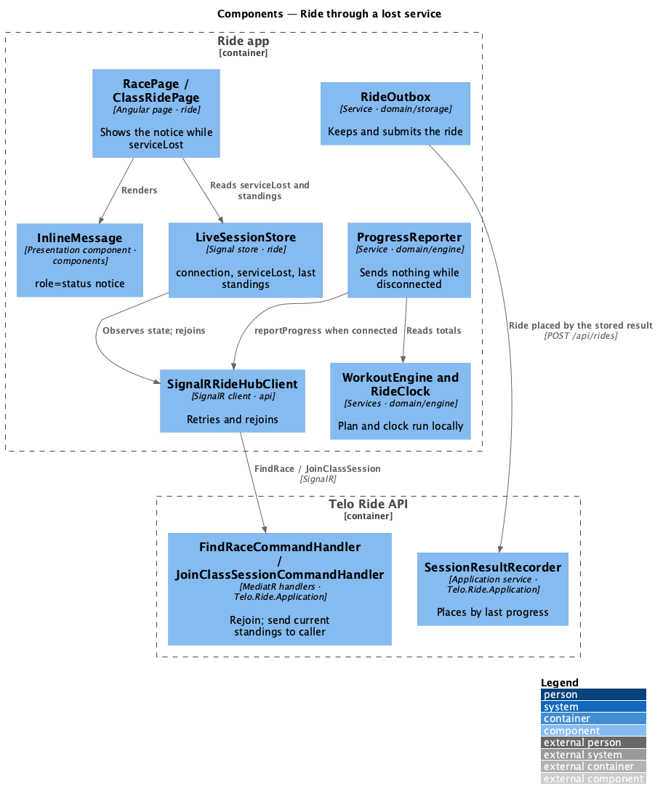
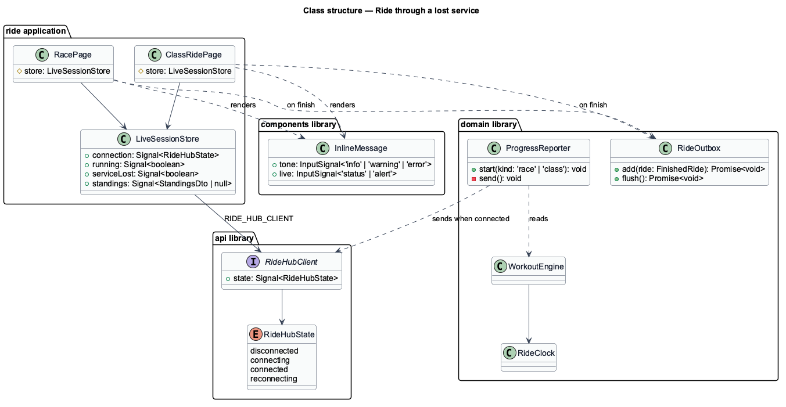
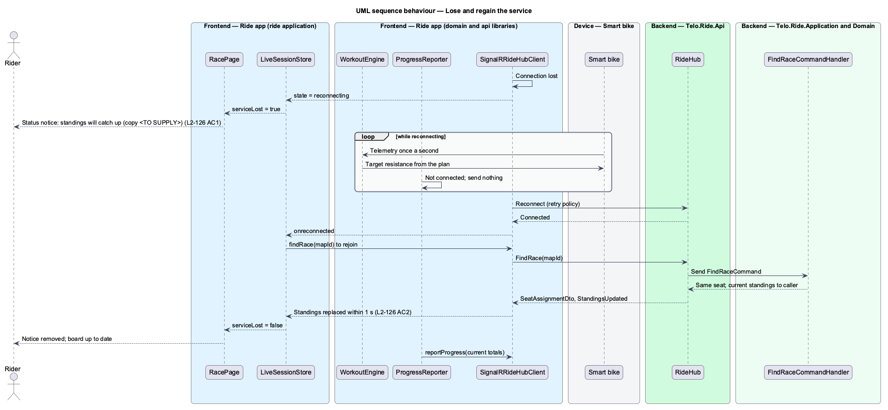
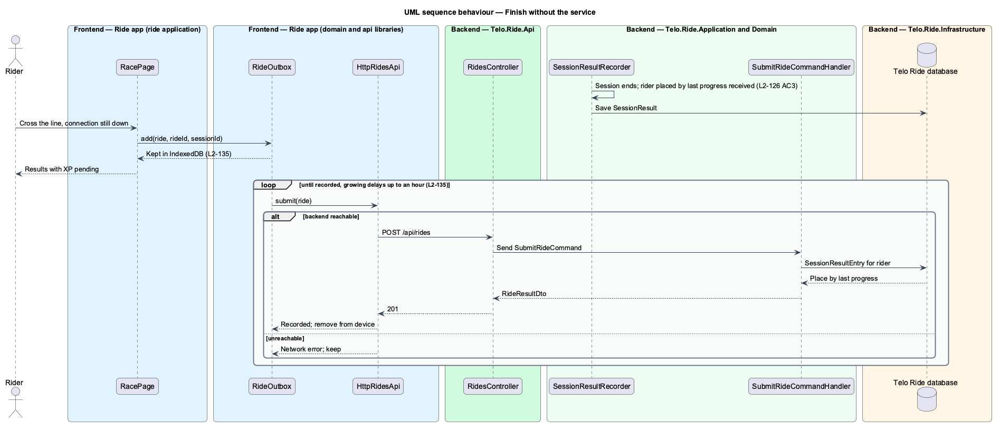

# Ride through a lost service

## Overview

A riders-online race or a group class depends on the multiplayer service only for the shared
board. The bike, the plan and the ride clock all run in the browser. This feature covers what
happens when the hub connection drops in the middle of such a ride: the ride carries on, the
rider is told the standings will catch up, and the ride still counts if the connection never
comes back.

**lost service** — state of a multiplayer ride whose hub connection has dropped and is retrying

**status notice** — short message announced politely to assistive technology (`role="status"`)
that tells the rider about a state without interrupting the ride

When the connection drops, the Ride app keeps driving the bike through the plan and keeps its own
clock. A status notice says the standings will catch up. When the connection returns, the app
rejoins its session (`multiplayer/connect-to-the-ride-hub`) and the standings update within one
second. When the connection is still down at the rider's finish, the ride is kept on the device
and submitted later (`L2-135`), and the service places the rider by the progress it last
received. The notice has no mock yet (`docs/specs/L2.md`, "Mock gaps"); its exact copy is
`<TO SUPPLY>`.

## Description

**Frontend (Ride app)**

- **`LiveSessionStore`** — exposes `connection` (the `RideHubState` signal) and a computed
  `serviceLost` that is true while the state is `reconnecting` during a running session. It never
  pauses the `WorkoutEngine` or the `RideClock` because of the hub (`L2-126` AC1).
- **`RacePage`** and **`ClassRidePage`** — `ride` pages. While `serviceLost` is true they render
  an `InlineMessage` with `role="status"` saying the standings will catch up, and the board keeps
  its last standings.
- **`InlineMessage`** — `components` presentation component (design-system block
  `inline-message`), with a tone input; the notice uses the informational tone, and an icon and
  text carry the state, never colour alone.
- **`ProgressReporter`** — while the connection is not `connected`, it sends nothing and keeps
  nothing; the next report after the rejoin carries the current totals. Nothing queues during the
  outage, so memory stays bounded.
- **`RideOutbox`** — keeps the finished ride in IndexedDB with its ride id and session id, and
  submits it when the backend is reachable (`L2-135`, `multiplayer/record-results-nobody-can-change`).

**Backend**

- **`FindRaceCommandHandler`** and **`JoinClassSessionCommandHandler`** — on a rejoin, after
  re-adding the connection to the group, send the session's current standings to the caller
  alone, so the board updates without waiting for the next tick (`L2-126` AC2).
- **`SessionResultRecorder`** — places a rider who never came back by the last progress the
  service received (`L2-126` AC3). How this placement relates to the race's 15-second DNF rule
  (`L2-124` AC2) is an open contradiction in the specs: `<TO SUPPLY>`.

## Requirements

The feature realizes the following level-2 (L2) requirements. Each L2 requirement refines a
level-1 (L1) requirement, cited by identifier.

| L2 ID | Refines (L1) | Requirement |
|-------|--------------|-------------|
| `L2-126` (AC1) | `L1-020` | When the hub connection drops during a riders-online race or group class, the ride shall carry on with the bike, and a status notice shall say the standings will catch up. |
| `L2-126` (AC2) | `L1-020` | When the connection is back and rejoins, the standings shall update within one second. |
| `L2-126` (AC3) | `L1-020` | When the connection is not back by the rider's finish, the ride shall be kept and submitted (`L2-135`), and the service shall place it by the progress it last received. |

## Diagrams

### System context

The rider keeps riding the smart bike through Telo Ride while the shared board is unavailable.

### Containers

The Ride app keeps the bike link and the ride local, holds the finished ride in browser storage,
and resumes the hub connection and ride submission when the Telo Ride API is reachable.

### Components

`LiveSessionStore` derives `serviceLost` from the hub state; the pages show the notice while the
engine and clock run on.

### Class structure

The pages read `serviceLost` from `LiveSessionStore`; `ProgressReporter` and `RideOutbox` decide
what to send once the connection returns.

### Behaviour — lose and regain the service

The ride keeps going while the notice shows; the rejoin brings the standings back at once
(`L2-126` AC1, AC2).

### Behaviour — finish without the service

The finished ride waits in the outbox and is submitted when the backend answers; the service has
already placed the rider by their last progress (`L2-126` AC3).

