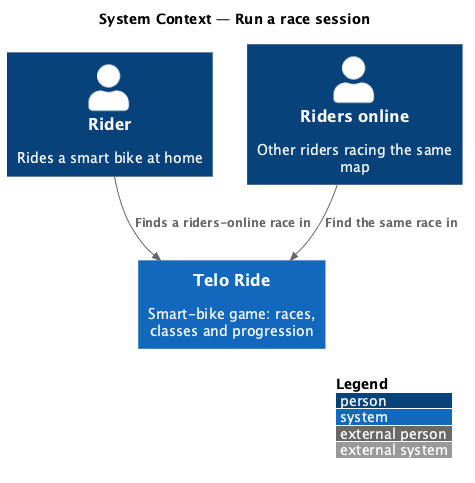
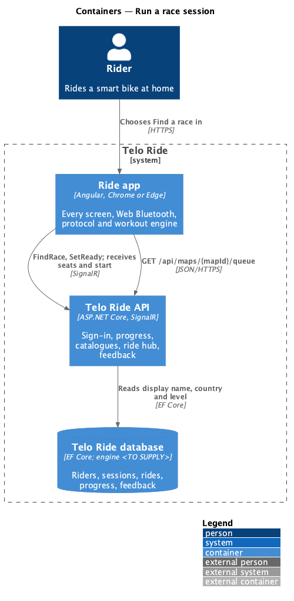
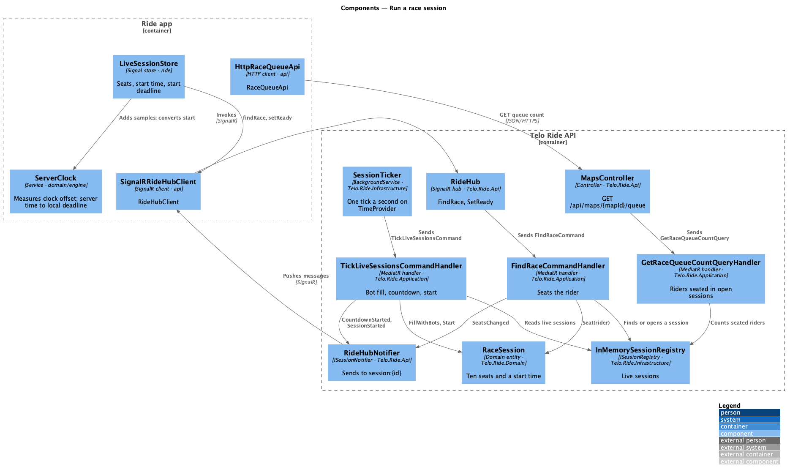
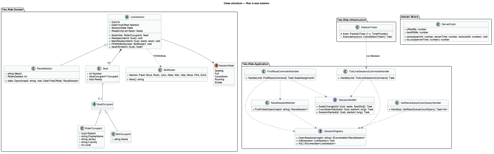
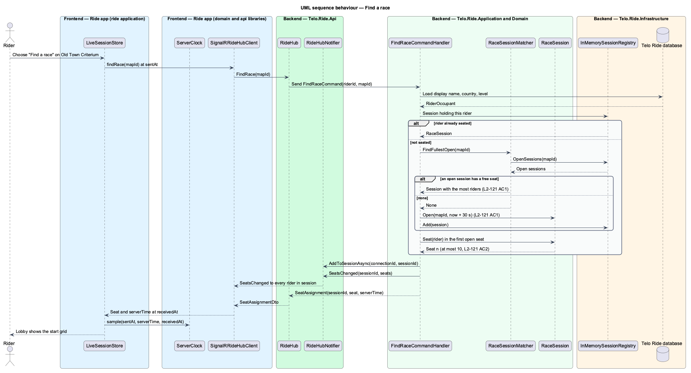
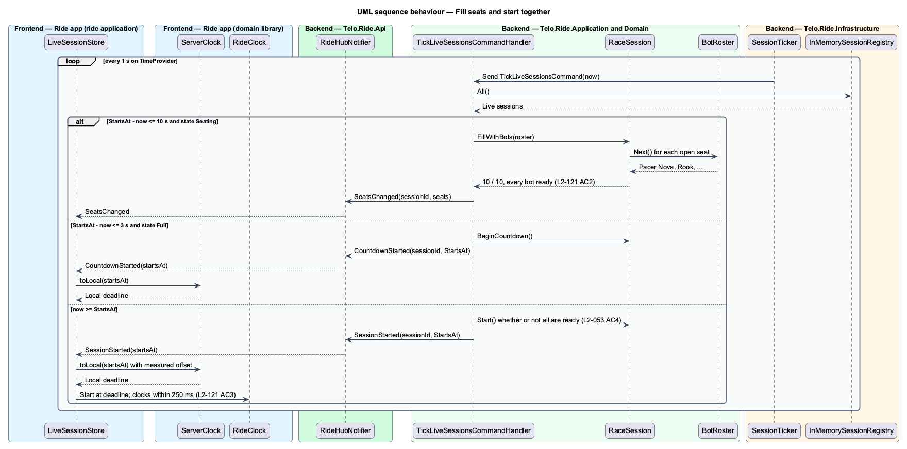
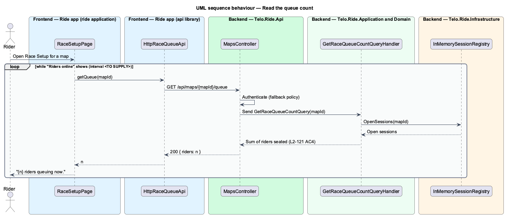

# Run a race session

## Overview

Telo Ride offers three ways to race a map: against the rider's best-time ghost, against bots run
in the browser, or against riders online. Only the third needs the backend. This feature covers
how the multiplayer service gathers riders online into a race, fills the empty seats and starts
everyone together.

**race session** — one live riders-online race on one map, holding up to 10 seats and a start
time set by the service

**open session** — race session still seating riders, before bots fill its empty seats

**seat** — numbered place on the start grid, held by a rider, a bot or nobody

**server time** — the Telo Ride API's UTC clock, in milliseconds, against which every client
measures its own clock offset

When a rider chooses "Find a race" on a map, the service seats them in the open session for that
map with the most riders, or opens a new session that starts 30 seconds later. Riders who join
later fill the remaining seats. Ten seconds before the start, bots take every seat still open, so
every race starts with 10 riders. The service then sends the start as a server time; each client
corrects for its measured clock offset, so all race clocks start within 250 ms of each other. Race
Setup also shows how many riders are queuing for a map, and the service supplies that count. The
race lobby (`docs/detailed-designs/race/wait-in-the-race-lobby`) presents what this feature
produces.

## Description

**Frontend (Ride app)**

- **`RideHubClient`** — `api` contract (see `multiplayer/connect-to-the-ride-hub`). `findRace`
  and `setReady` return the server time with each answer.
- **`ServerClock`** — service in `domain/engine`. It takes a sample from each hub round trip:
  `offset = serverTime − (sentAt + receivedAt) / 2`. It keeps the offset of the sample with the
  shortest round trip and converts a server time to a local `performance.now()` deadline
  (`L2-121` AC3).
- **`LiveSessionStore`** — signal store in the `ride` application. It holds the seats from
  `SeatsChanged`, the start time from `CountdownStarted`, and hands the start deadline to the
  `RideClock` when `SessionStarted` arrives.
- **`RaceQueueApi`** — `api` contract, token `RACE_QUEUE_API`, implementation `HttpRaceQueueApi`.
  It reads `GET /api/maps/{mapId}/queue`, which Race Setup polls for the "{n} riders queuing now"
  line while the "Riders online" option shows (`L2-121` AC4, `L2-048` AC3). Race Setup holds no
  hub connection (`L2-120` AC4), so the count travels over HTTP.

**Backend**

- **`RideHub.FindRace(mapId)`** and **`RideHub.SetReady(ready)`** — `Telo.Ride.Api` hub methods.
  Each sends one MediatR request.
- **`MapsController.GetQueue(mapId)`** — `Telo.Ride.Api` action for `GET /api/maps/{mapId}/queue`.
  It sends `GetRaceQueueCountQuery`.
- **`FindRaceCommandHandler`** — `Telo.Ride.Application`. It returns the seat the rider already
  holds, if any. Otherwise it asks `RaceSessionMatcher` for the open session on the map with the
  most riders and a free seat, or opens a new `RaceSession` whose `StartsAt` is now plus 30
  seconds (`L2-121` AC1). It seats the rider, adds the connection to the session group and sends
  `SeatsChanged` to the group.
- **`SetReadyCommandHandler`** — marks the caller's seat ready or not ready and sends
  `SeatsChanged`.
- **`TickLiveSessionsCommandHandler`** — runs once a second for every live session. For a race
  session it applies three time rules: at 10 seconds to the start it calls `FillWithBots`
  (`L2-121` AC2); at 3 seconds it sends `CountdownStarted` with `StartsAt`; at the start it sends
  `SessionStarted` with `StartsAt` and moves the session to running. The start does not wait for
  ready riders (`L2-053` AC4).
- **`GetRaceQueueCountQueryHandler`** — counts the riders seated in open sessions for the map
  (`L2-121` AC4).
- **`SessionTicker`** — `BackgroundService` in `Telo.Ride.Infrastructure`. A `PeriodicTimer` of
  1 second on the injected `TimeProvider` sends `TickLiveSessionsCommand`. Tests advance a
  `FakeTimeProvider` instead of waiting.
- **`LiveSession`** — abstract domain type in `Telo.Ride.Domain` with `Id`, `StartsAt`, `State`
  and exactly 10 `Seat`s. `Seat(rider)` places a rider in the first open seat; `Release(riderId)`
  empties it; `FillWithBots(BotRoster)` seats bots, ready, in roster order (`L2-054` AC2).
- **`RaceSession`** — `LiveSession` for one `MapId`.
- **`SessionState`** — `Seating`, `Full`, `Countdown`, `Running`, `Ended`.
- **`Seat`** and **`SeatOccupant`** — a seat holds a `RiderOccupant` (rider id, display name,
  jersey, country, level), a `BotOccupant` (name) or nothing, and a `Ready` flag.
- **`BotRoster`** — the bots in order: Pacer Nova, Rook, Juno, Atlas, Kite, Vale, Moss, Flint and
  Echo.
- **`ISessionRegistry`** — Application port over live sessions; `InMemorySessionRegistry`
  implements it. Live sessions are not persisted; only results are (see
  `multiplayer/record-results-nobody-can-change`).

## Requirements

The feature realizes the following level-2 (L2) requirements. Each L2 requirement refines a
level-1 (L1) requirement, cited by identifier.

| L2 ID | Refines (L1) | Requirement |
|-------|--------------|-------------|
| `L2-121` (AC1) | `L1-020` | On "Find a race" for a map, the service shall seat the rider in the open session for that map with the most riders, or shall open a new one that starts 30 seconds later. |
| `L2-121` (AC2) | `L1-020` | A session shall hold at most 10 riders. At 10 seconds to the start, bots shall fill every open seat, so the session starts with 10. |
| `L2-121` (AC3) | `L1-020` | The service shall send the start as a server time. Each client shall correct for its measured clock offset, so every client's race clock starts within 250 ms of the others'. |
| `L2-121` (AC4) | `L1-020` | The queue count shown on Race Setup shall be the number of riders seated in open sessions for that map. |

## Diagrams

### System context

The rider races other riders through Telo Ride; no external system takes part in seating or
starting a race.

### Containers

The Ride app finds a race over the hub connection and reads the queue count over HTTPS. The Telo
Ride API keeps live sessions in its own memory and reads riders' display names and levels from
the database.

### Components

`RideHub` and `MapsController` dispatch to Application handlers. `SessionTicker` drives the time
rules once a second, and `RideHubNotifier` sends each change to the session group.

### Class structure

`RaceSession` specializes `LiveSession`, which owns exactly 10 `Seat`s; the handlers work on
sessions through `ISessionRegistry` and report through `ISessionNotifier`.

### Behaviour — find a race

The handler returns a seat already held, else seats the rider in the fullest open session, else
opens a session that starts 30 seconds later (`L2-121` AC1).

### Behaviour — fill seats and start together

Each tick applies the 10-second bot fill, the 3-second countdown and the start at a server time;
each client turns that server time into a local deadline with `ServerClock` (`L2-121` AC2, AC3).

### Behaviour — read the queue count

Race Setup reads the number of riders seated in open sessions for the map over HTTPS
(`L2-121` AC4).

