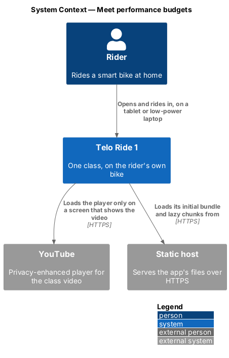
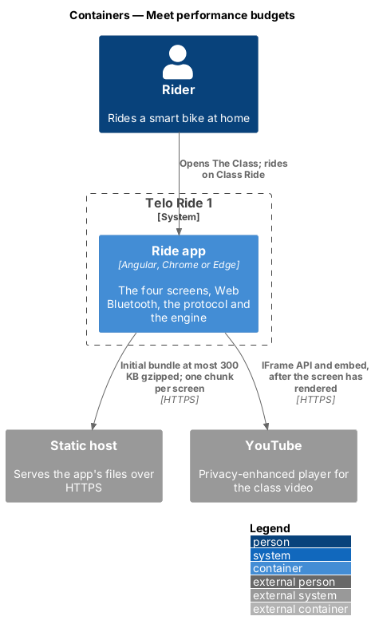
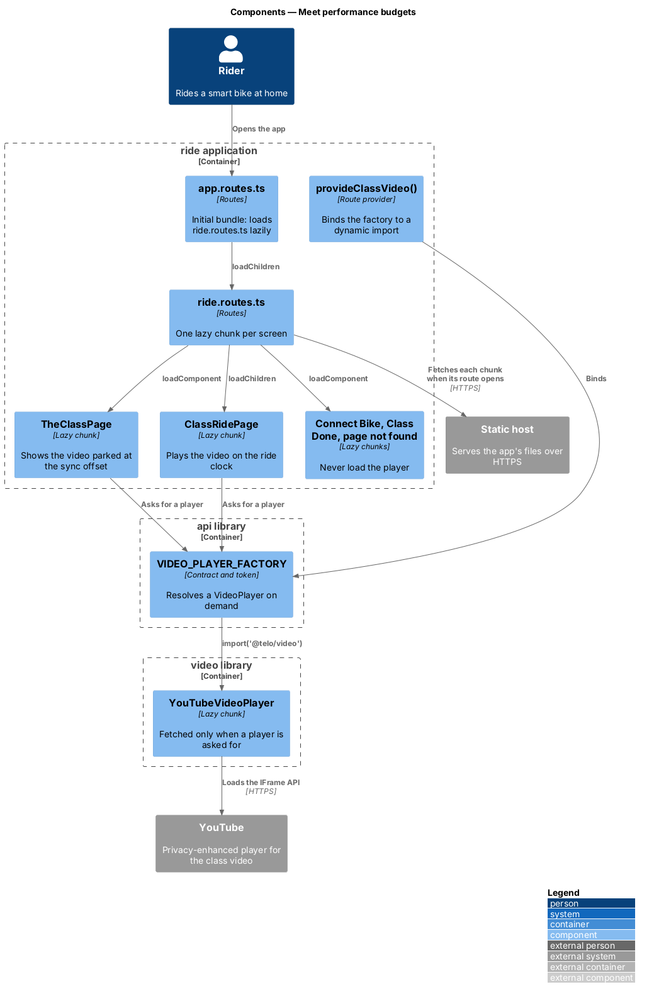
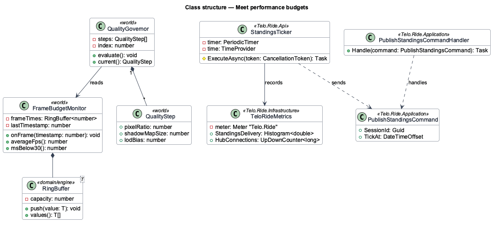
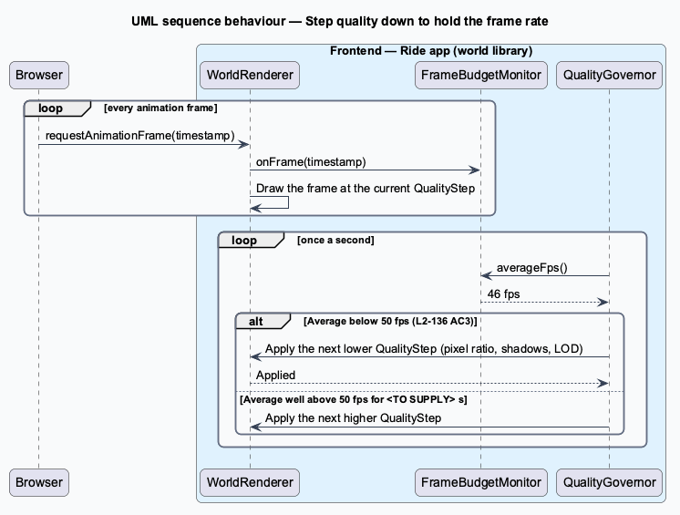
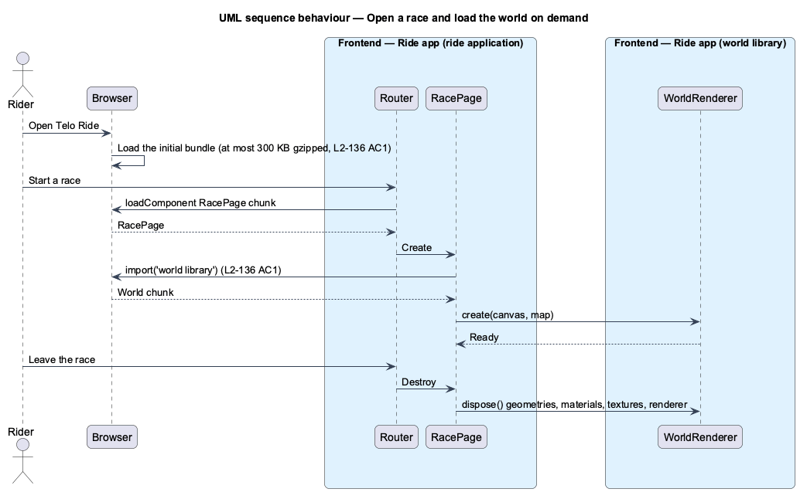
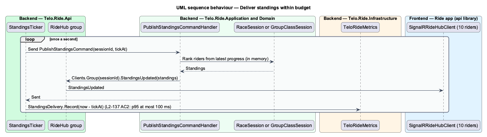

# Meet performance budgets

## Overview

Telo Ride runs for an hour or more on a tablet or low-power laptop beside the bike. It loads over a
mobile connection, draws its 3D world on integrated graphics, and answers every rider in a live
session at once. This feature turns those expectations into measured
budgets, names the parts that keep each budget, and names how each is measured.

- **initial bundle** — JavaScript and CSS the browser downloads before the first screen renders
- **Largest Contentful Paint (LCP)** — time until the largest visible element renders
- **Interaction to Next Paint (INP)** — delay from a rider's input to the next frame
- **quality step** — one notch of rendering detail (pixel ratio, shadow resolution, level of detail) that the 3D world gives up to keep its frame rate
- **standings tick** — once-a-second moment at which the backend ranks a session and sends standings
- **reference laptop** — the integrated-GPU laptop against which the race frame budget is measured; model `<TO SUPPLY>`

The feature belongs to the performance subsystem. It spans both the Ride app and the Telo Ride
API. The 3D world itself is designed in `race/render-the-race-world`; this slice covers how its
frame budget is held and measured.

## Description

### Frontend

- **Route-level lazy loading** — every route in `ride`'s `app.routes.ts` uses `loadComponent` or
  `loadChildren`. Heavy, below-the-fold parts use `@defer`.
- **World library** — the race's 3D world (Three.js, WebGPU with WebGL 2 fallback) is a separate
  library imported with dynamic `import()` from `RacePage` only, so it is never in the initial
  chunk.
- **Bundle budgets** — `angular.json` sets `budgets` of type `initial` on the production
  configuration. The Angular CLI measures raw bytes, so the budget value that corresponds to
  300 KB gzipped is `<TO SUPPLY>` until the first production build measures the ratio. The
  script `tools/verify/bundle-size.mjs` gzips the initial chunks listed in the build's
  `stats.json` and fails above 300 KB. `node tools/verify/verify.mjs` and CI run it.
  The raw `initial` budget warns at 288 kB and fails at 300 kB since slice 5.2: the first use of
  `HttpClient` (the class catalogue client, bound on the lazy class ride route) adds about
  20.7 kB raw, 5.3 kB transferred, to `main` wherever it is provided, because
  `@angular/platform-browser` and `@angular/router` import `@angular/common/http`, so esbuild
  places that module in the initial chunk. Every backend client needs it.
- **`FrameBudgetMonitor`** — class in the world library. It keeps a fixed-size ring buffer of the
  last 120 frame times from `requestAnimationFrame` timestamps and reports the moving average and
  the time spent below 30 frames a second.
- **`QualityGovernor`** — class in the world library. When the average falls below 50 frames a
  second it applies the next lower `QualityStep`; when the average holds well above it for
  `<TO SUPPLY>` seconds it raises one step. Frame rate is protected by giving up detail first.
- **Web Vitals measurement** — a Lighthouse run (`tools/perf/home-vitals.mjs`) with a mobile
  device profile and a 4G throttling profile measures Home cold. The device and network profile
  values are `<TO SUPPLY>`. Like the heap checks, it runs only when a person asks.

### Backend

- **ASP.NET Core metrics** — the built-in `http.server.request.duration` histogram, exported through
  OpenTelemetry with the route template as its only route attribute.
- **`TeloRideMetrics`** — class in `Telo.Ride.Infrastructure` holding instruments on the
  `Telo.Ride` meter: the histogram `telo.ride.standings.delivery` (milliseconds from the standings
  tick to the send completing) and the up-down counter `telo.ride.hub.connections`.
- **`StandingsTicker`** — hosted service in `Telo.Ride.Api` that, once a second, sends a
  `PublishStandingsCommand` per running session through MediatR. Its handler ranks the session
  (designed in `multiplayer/share-progress-and-standings`) and sends `StandingsUpdated` to the
  session's SignalR group.
- **Load test** — a scripted load test under `tools/load/` drives 200 requests a second across the
  API and 2,000 hub connections in sessions of 10 against one instance. The load-test tool and the
  instance size are `<TO SUPPLY>`. It runs only when a person asks.

## Requirements

| L2 ID | Refines (L1) | Requirement |
|-------|--------------|-------------|
| `L2-136` AC1 | `L1-022` | The production build's initial bundle shall be at most 300 KB gzipped, and the 3D world shall be loaded only when a race opens. |
| `L2-136` AC2 | `L1-022` | Home, loaded cold on a mid-range phone over a 4G profile, shall reach Largest Contentful Paint within 2.5 s and keep Interaction to Next Paint under 200 ms. |
| `L2-136` AC3 | `L1-022` | A race at 1920 × 1080 on the reference laptop (integrated GPU) shall hold at least 50 frames a second on average and shall not drop below 30 for more than one second; quality shall step down before frame rate does. |
| `L2-137` AC1 | `L1-022` | At 200 requests a second across the API, 95 % of requests shall answer within 200 ms. |
| `L2-137` AC2 | `L1-022` | In a session of 10 riders, standings shall reach every rider within 100 ms of the once-a-second tick at the 95th percentile. |
| `L2-137` AC3 | `L1-022` | One API instance shall hold 2,000 concurrent hub connections within those budgets. |

## Diagrams

### System context

The rider uses Telo Ride; the budgets are properties of Telo Ride itself, measured by a person on
request.

### Containers

The Ride app carries the bundle, Web Vitals and frame budgets; the Telo Ride API carries the
request and standings budgets.

### Components

On the frontend, lazy routes and the dynamically imported world library keep the initial bundle
small, and `QualityGovernor` reacts to `FrameBudgetMonitor`. On the backend, `StandingsTicker`
drives the standings and `TeloRideMetrics` records their delivery time.

### Class structure

`QualityGovernor` reads `FrameBudgetMonitor` and walks an ordered list of `QualityStep`s.
`StandingsTicker` sends one command per session and records into `TeloRideMetrics`.

### Behaviour — step quality down to hold the frame rate

When the moving average drops below 50 frames a second, the governor lowers one quality step
before frame rate falls further (`L2-136` AC3).

### Behaviour — open a race and load the world

The initial bundle holds no 3D code; opening a race imports the world library on demand
(`L2-136` AC1).

### Behaviour — deliver standings within budget

Each second the ticker ranks every running session and sends its standings; the delivery time is
recorded for the 95th-percentile budget (`L2-137` AC2).

