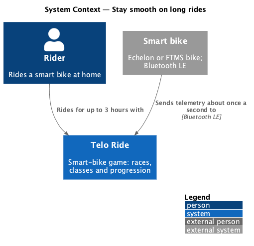
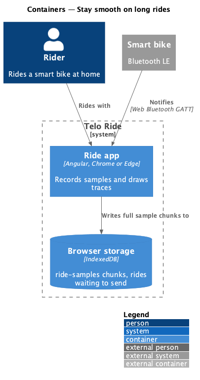
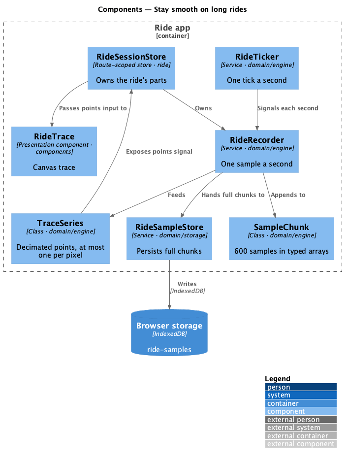
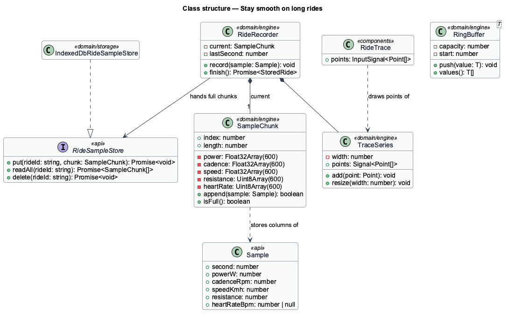
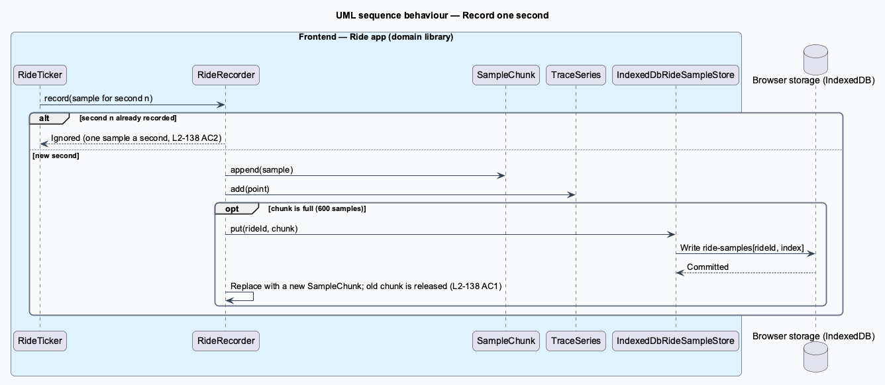
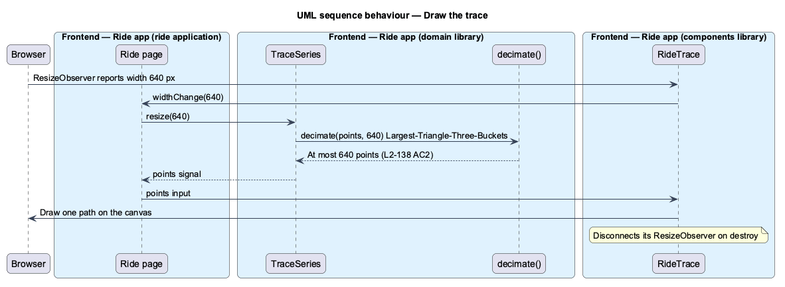
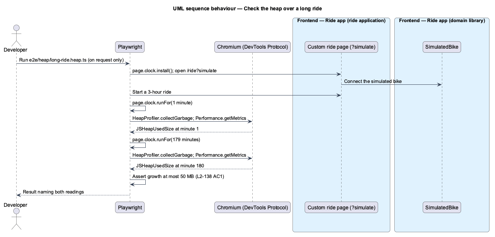

# Stay smooth on long rides

## Overview

A ride on Telo Ride may last three hours. During that time the app receives a bike notification
about once a second, records the rider's power and cadence, and draws them as a trace. Anything
the app keeps without a limit grows for the whole ride. On a tablet or low-power laptop that
growth makes the app slower toward the end of the ride, and may end the tab.

This feature bounds what a ride keeps in memory and what a trace draws, and names the check that
proves memory stays flat.

- **sample** — one second of ride data: elapsed time, power, cadence, speed, resistance and heart rate
- **trace** — chart of a metric over the ride, drawn by the `RideTrace` component
- **chunk** — fixed-size block of 600 samples (10 minutes) held in typed arrays
- **decimation** — reduction of a series to at most one point per horizontal pixel of a chart
- **heap check** — measurement of the page's JavaScript heap at the first and last minute of a simulated ride

The feature belongs to the performance subsystem and is frontend-only. The bounded packet log is
designed in `diagnostics/record-the-packet-log`.

## Description

- **`RideRecorder`** — service in `domain/engine`, owned by the route-scoped `RideSessionStore`.
  On each `RideTicker` second it appends one sample. It never appends more than one sample for
  the same second.
- **`SampleChunk`** — class in `domain/engine`. It holds 600 samples as one `Float32Array` per
  metric. A full chunk is handed to `RideSampleStore` and dropped from memory.
- **`RideSampleStore`** — service in `domain/storage` (contract and token `RIDE_SAMPLE_STORE` in
  `api`). It writes chunks to the IndexedDB object store `ride-samples`, keyed by ride id and chunk
  index. At the end of the ride it reads the chunks back to build the stored ride of one sample a
  second, then deletes them once the ride is in the outbox (`performance/ride-without-a-network`).
- **`TraceSeries`** — class in `domain/engine`. It keeps the decimated points the trace draws, one
  per pixel column of the chart's current width. When the ride grows past the width, adjacent
  buckets merge, so the series stays at most as long as the chart is wide.
- **`decimate(points, width)`** — pure function in `domain/engine`. It applies
  Largest-Triangle-Three-Buckets to choose one point per bucket and keep the peaks a rider looks
  for.
- **`RideTrace`** — presentation component in `components` (`wz-ride-trace`). It takes the
  decimated points as an input and draws them on a `<canvas>`; it allocates nothing per frame.
- **`RingBuffer<T>`** — fixed-capacity buffer in `domain/engine` for every other live window
  (command log, frame times, recent power for the 3-second average).
- **Teardown** — every part registers its cleanup with `DestroyRef`: timers, listeners,
  `ResizeObserver`s and object URLs end with the ride route.
- **Long-ride heap check** — Playwright script `e2e/heap/long-ride.heap.ts` with the simulated bike
  (`?simulate`) and `page.clock`. It reads `JSHeapUsedSize` through the Chrome DevTools Protocol
  after a forced garbage collection at minute 1 and at minute 180. It runs only when a person
  asks.

## Requirements

| L2 ID | Refines (L1) | Requirement |
|-------|--------------|-------------|
| `L2-138` AC1 | `L1-022` | During a 3-hour ride, the page's memory shall grow by at most 50 MB from the first minute to the last. |
| `L2-138` AC2 | `L1-022` | The stored ride shall hold one sample a second, and the chart shall draw at most one point per pixel of width. |

## Diagrams

### System context

The smart bike feeds a long ride; Telo Ride records it on the device.

### Containers

The Ride app moves full chunks of samples to browser storage instead of holding them in memory.

### Components

`RideRecorder` fills the current `SampleChunk`, passes full chunks to `RideSampleStore`, and feeds
`TraceSeries`, whose decimated points the `RideTrace` component draws.

### Class structure

`RideRecorder` composes one current `SampleChunk` and one `TraceSeries`; the store owns persisted
chunks; `RingBuffer` bounds every other live window.

### Behaviour — record one second

Each tick appends one sample; a full chunk leaves memory for IndexedDB (`L2-138` AC1, AC2).

### Behaviour — draw the trace

The trace receives at most one point per pixel of its width, recomputed when the width changes
(`L2-138` AC2).

### Behaviour — check the heap over a long ride

A person runs the heap check: a simulated three-hour ride under a fake clock, measured at the
first and last minute (`L2-138` AC1).

