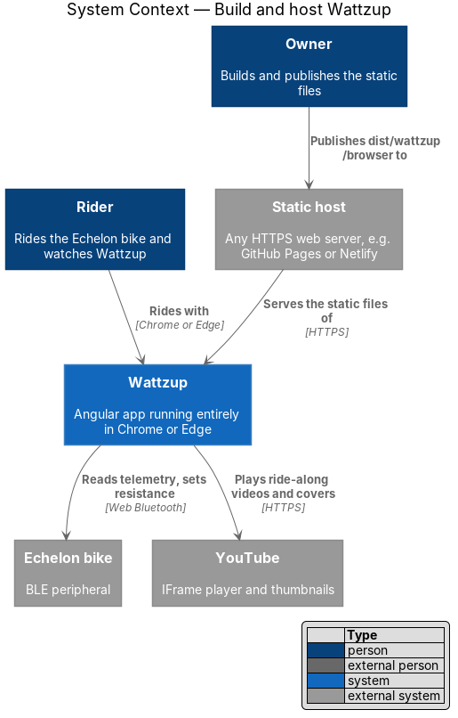
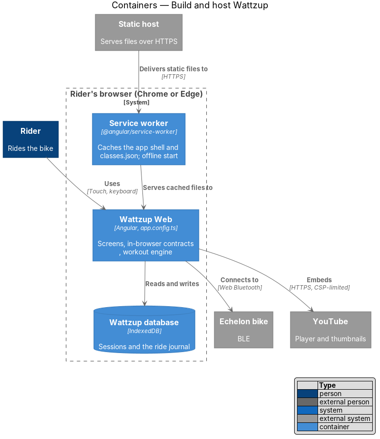
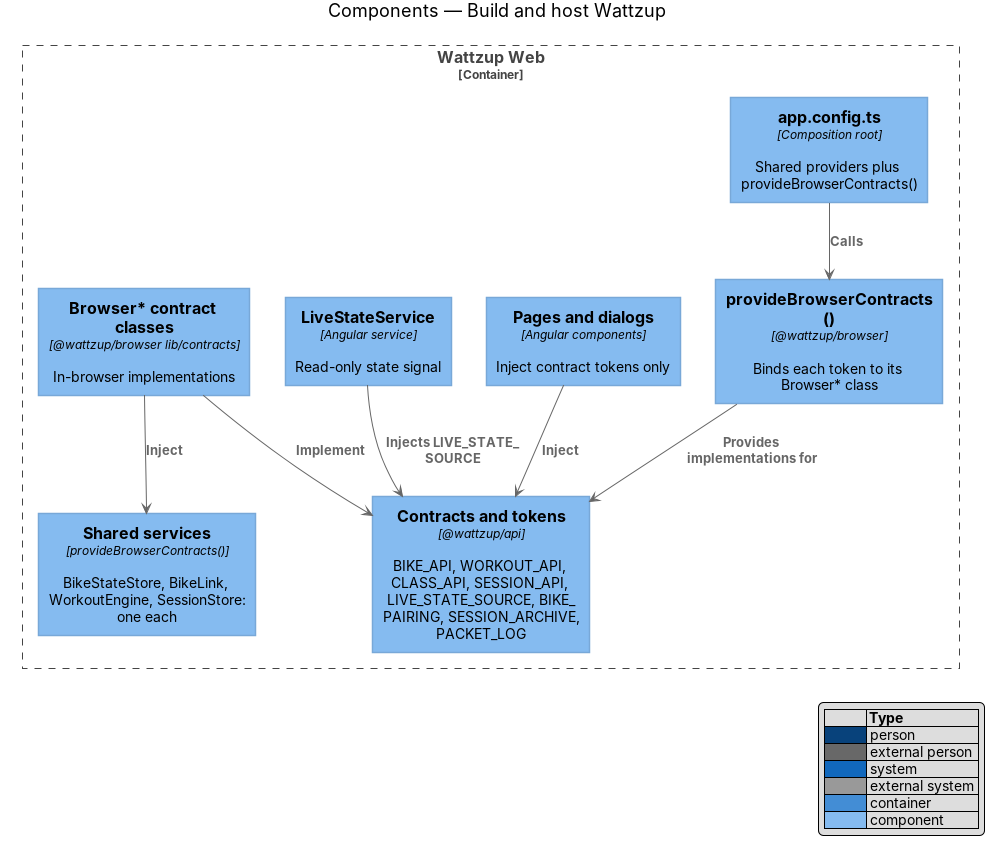
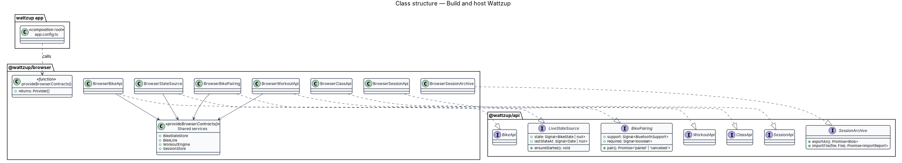
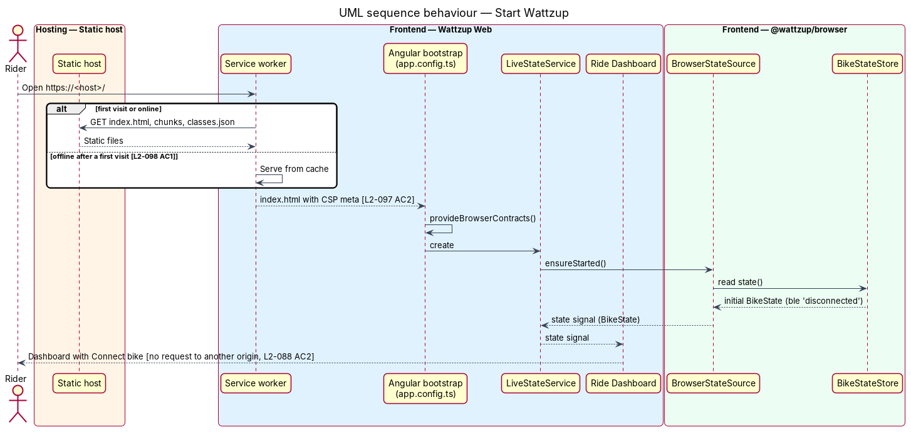
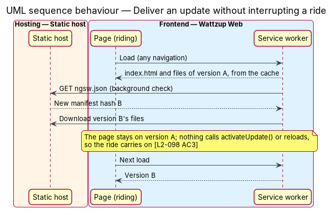

# Build and host Wattzup

## Overview

Wattzup is one Angular application that runs entirely in the rider's browser (ADR 0019): a folder of static files that any HTTPS host serves, with no Wattzup process to install or run. This feature describes how that folder is built, how the app binds its contracts to the in-browser implementations, and how it is secured, installed and kept available offline (L2-088, L2-097, L2-098).

**contract** — TypeScript interface in `@wattzup/api` with an injection token, such as `BikeApi` and `BIKE_API`, that every app component depends on instead of an implementation

**composition root** — `app.config.ts`, the one file that binds every contract token to an implementation

**in-browser implementation** — class in `@wattzup/browser` that fulfils a contract with Web Bluetooth, IndexedDB and in-memory state

**static host** — any web server that serves files as they are, such as GitHub Pages, Netlify or `npx http-server`, with no Wattzup code running on it

The app's components and services depend only on contract tokens (ADR 0013). The composition root binds each token to its `@wattzup/browser` implementation; the screens never see an implementation.

## Description

Build:

- **`npm run build`** (`frontend/`) — `ng build wattzup` with the production configuration, then `scripts/check-bundle-size.mjs`, which fails above 300 KB gzipped of initial JavaScript (L2-088 criterion 6). The output is `dist/wattzup/browser` (L2-088 criterion 1).
- **Assets** — everything in `frontend/public/` (fonts, icons, images and the default `classes.json`, see `classes/load-class-catalogue`) and `manifest.webmanifest`.
- **`npm start`** — `ng serve wattzup` with the development configuration. Only a development build honours `?simulate` (see `bike-connectivity/simulate-the-bike`).
- **`tools/verify/verify.mjs`** — runs the build and the Playwright specs with the other checks, side by side.

Wiring:

- **`app.config.ts`** (`frontend/projects/wattzup/src/app/`) — the composition root: zoneless change detection, router, theme, YouTube player, the service worker and `provideBrowserContracts()`. It provides no `HttpClient`. It is the only file of the app that imports `@wattzup/browser`.
- **`provideBrowserContracts()`** (`@wattzup/browser`, `lib/contracts/provide-browser-contracts.ts`) — returns the providers that bind each contract token:

  | Token (`@wattzup/api`) | Implementation (`@wattzup/browser`) |
  |---|---|
  | `BIKE_API` | `BrowserBikeApi` |
  | `WORKOUT_API` | `BrowserWorkoutApi` |
  | `CLASS_API` | `BrowserClassApi` |
  | `SESSION_API` | `BrowserSessionApi` |
  | `LIVE_STATE_SOURCE` | `BrowserStateSource` |
  | `BIKE_PAIRING` | `BrowserBikePairing` |
  | `SESSION_ARCHIVE` | `BrowserSessionArchive` |
  | `PACKET_LOG` | `PacketLog` |

- **`LIVE_STATE_SOURCE`** (`@wattzup/api`) — `LiveStateSource` exposes the read-only signals `state` and `lastStateAt` and the call `ensureStarted()`. `LiveStateService` re-exposes its signals (see `live-state/run-rides`).
- **Contract failures** — an implementation that refuses a call rejects with a `ContractError` (`@wattzup/api`) carrying a `code` (`invalid_level`, `bike_not_connected`, `send_failed`, `already_connected`, `invalid_workout`, `no_active_workout`) and, for a plan, per-field `errors`; the screens branch on the `code` (L2-097 criterion 6).
- **Shared services** — `provideBrowserContracts()` provides `BikeStateStore`, `TelemetryIngestor`, `BikeLink`, `ResistanceCommander`, `WorkoutEngine`, `SessionStore`, `WakeLockKeeper` and `PacketLog` once, in the environment injector, and environment initializers start the pieces that run from load (the bike pairing, the journal recovery, the wake lock). Every contract implementation injects them, so 1 bike connection and 1 engine serve every screen.

Hosting, security and offline:

- **Routing on a static host** — routes use the path location strategy. The README's hosting section gives the fallback setting for common hosts (Netlify `_redirects`, nginx `try_files`, `http-server --proxy`) so a deep link such as `/sessions/<id>` serves `index.html` (L2-088 criterion 3). The project publishes no hosted copy of its own: whoever deploys Wattzup chooses the host, and the README gives the settings for it.
- **`index.html`** — carries `<meta http-equiv="Content-Security-Policy">` with `default-src 'self'`, `script-src 'self' https://www.youtube.com`, `style-src 'self' 'unsafe-inline'`, `font-src 'self'`, `connect-src 'self'`, `img-src 'self' data: https://i.ytimg.com`, `frame-src https://www.youtube-nocookie.com`, `object-src 'none'` and `base-uri 'self'`, and `<meta name="referrer" content="no-referrer">` (L2-097 criterion 2). A static host cannot mint a per-response nonce, so styles allow `'unsafe-inline'` for the `<style>` elements Angular injects, and `frame-ancestors` has no `<meta>` form (ADR 0018). The hosting example sends the same policy plus `frame-ancestors 'none'`, `X-Content-Type-Options: nosniff` and `Referrer-Policy: no-referrer` as headers.
- **Privacy** — Wattzup makes no request after loading except `classes.json`, its own static files and YouTube's player and thumbnails (L2-097 criterion 3). It has no analytics, error reporting or remote logging. Bluetooth names, error strings, catalogue text and imported text are bound as text, never as HTML (L2-097 criterion 4).
- **`manifest.webmanifest`** (`projects/wattzup/src/`) — `name` `Wattzup`, `short_name` `Wattzup`, `start_url` and `scope` `/`, `display` `standalone`, `theme_color` and `background_color` `#0b0c0e` (the dark canvas, `--palette-neutral-950`), and the icons in `public/icons/`: `icon-192.png` and `icon-512.png`, the favicon's volt tile, and `icon-maskable-512.png`, full bleed with the mark inside the central 80 % (L2-098 criterion 2). `index.html` links it, with `apple-touch-icon` and `theme-color`. `install.spec.ts` reads the manifest and decodes each icon at its stated size.
- **Angular service worker** (`@angular/service-worker`, `frontend/ngsw-config.json`) — `provideServiceWorker('ngsw-worker.js')` in `app.config.ts` registers it once the app is stable, at most 30 s after load, and never in a development build. It prefetches the app shell (`index.html`, the manifest, every `.js` and `.css` file, the favicon) and the fonts, icons and images, and keeps `classes.json` in a data group with the freshness strategy: the network first, the cached copy when offline. YouTube is not cached (L2-098 criterion 1).
- **Class videos offline** — `OnlineStatus` (`projects/wattzup/src/app/core/`, root-provided) holds `navigator.onLine` as a signal and follows the window's `online` and `offline` events. While it is false, the class page puts the `offline` state of its mock in the video frame (*You’re offline, so the video can’t play.*, a `status` region) instead of mounting the YouTube player, and mounts the player again when the device is back online; the plan and **Start ride** are unchanged (L2-098 criterion 1). `classes.spec.ts` takes a class page offline and back.
- **Updates** — the worker checks `ngsw.json` in the background on each load and downloads a new version. It keeps each page on the version that page loaded with and serves the new one from the next load. Nothing in the app calls `SwUpdate.activateUpdate()` or reloads the page, so an update never interrupts a ride, and no update service is needed (L2-098 criterion 3).

Verification:

- `security.spec.ts` reads the policy's directives. Every spec fails on a console error, so a violation of the policy on any page fails the suite (L2-097 criterion 2).
- The Playwright specs (`frontend/e2e/`) run against `dist/wattzup/browser` served by `scripts/serve-dist.mjs`. Every spec fails on any request to an origin other than its own and the faked YouTube (L2-088 criterion 2, L2-097 criterion 3).
- A spec opens `/classes/<id>` and `/sessions/<id>` directly (L2-088 criterion 3).
- `offline.spec.ts` proves L2-098 criterion 1. It loads Wattzup, waits until the worker reports its installed version and the network is idle, goes offline, reloads, connects to the faked bike and starts a ride from `/setup`. Playwright makes a page with any route bypass its service worker, so the spec drops the fixtures' routes before going offline. Every other spec blocks service workers (`serviceWorkers: 'block'` in the project), so their route fakes see every request.
- `install.spec.ts` reads the manifest and decodes each icon (L2-098 criterion 2).

## Requirements

| L2 ID | Refines (L1) | Requirement |
|-------|--------------|-------------|
| `L2-088` | `L1-012` | Build and hosting. `npm run build` shall produce static files in `dist/wattzup/browser` that run Wattzup on any HTTPS static host, or on `http://localhost`; Wattzup shall make no request to another origin except YouTube, shall open deep links, and shall keep its initial JavaScript within 300 KB gzipped. |
| `L2-097` | `L1-009` | Security and privacy. Wattzup shall carry a Content-Security-Policy allowing only its own origin plus the 3 YouTube exceptions, with inline styles allowed because a static host cannot mint a nonce; shall send no state, packet, session or device name off the device; shall render untrusted text as text; shall request only the Echelon service; and shall validate contract input, refusing it with named `code` values. |
| `L2-098` | `L1-012` | Installable and offline. Once loaded over HTTPS, Wattzup shall load and run a ride from `/setup` offline, with class videos and covers unavailable; it shall be installable as an app; and a new version shall be used from the next load, never reloading a ride in progress. |

## Diagrams

### System context

The rider opens Wattzup in Chrome or Edge. The static host delivers the files once; afterwards the browser talks only to the bike over Bluetooth and to YouTube for videos and covers.

### Containers

The build turns the Angular workspace into a static folder. In the rider's browser, that folder runs as 1 app with a service worker, IndexedDB storage and a Web Bluetooth link. No container runs on a server.

### Components

`app.config.ts` calls `provideBrowserContracts()`, which binds each `@wattzup/api` token to its in-browser implementation. Each implementation injects the shared services that `provideBrowserContracts()` provides once. App components keep depending on the tokens only.

### Class structure

The contracts and tokens live in `@wattzup/api`. The `Browser*` classes implement them and inject the shared services.

### Behaviour — start Wattzup

The browser loads `index.html` from the host or the service-worker cache. Angular bootstraps with `app.config.ts`, the shared services start, and the dashboard renders from `LiveStateService` with no request to another origin (L2-088, L2-097).

### Behaviour — deliver an update without interrupting a ride

The service worker finds and downloads a new version in the background. The page keeps the version it loaded with, so a ride carries on, and the next load uses the new one (L2-098 criterion 3).

