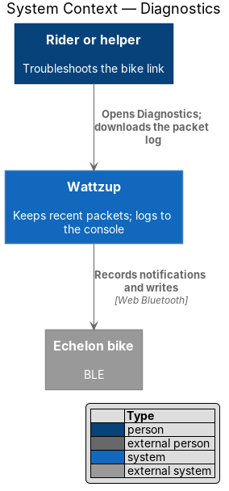
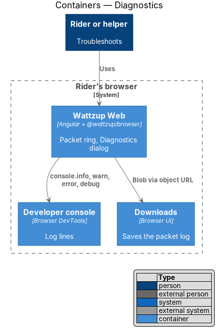
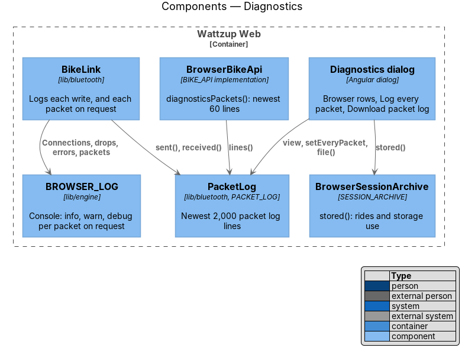
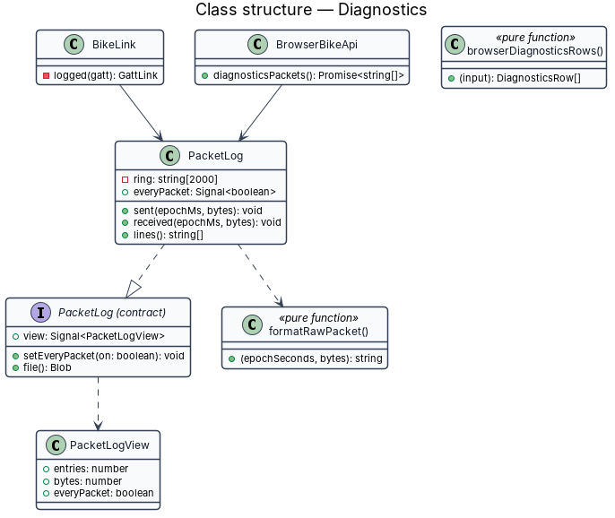
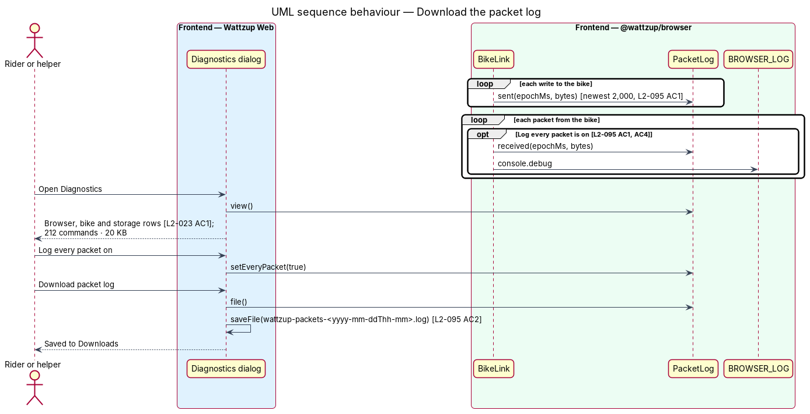

# Diagnostics

## Overview

When the bike misbehaves, the rider or someone helping needs to see what Wattzup sees. A web page cannot write files on its own or keep a server log, so Wattzup keeps the recent packets in memory, lets the rider download them in the line format of the prototype's `raw_packets.log`, logs connection changes, commands and errors to the browser console, and shows what it knows in the Diagnostics dialog (L2-023, L2-095).

**raw packet** — 1 Bluetooth notification or written command, kept as its time, direction and bytes in hex

**packet ring** — fixed-size in-memory buffer that keeps the newest 2,000 raw packets and drops the oldest

**packet debugging** — Diagnostics-dialog switch that also logs each packet to the console, off by default

## Description

- **`PacketLog`** (`@wattzup/browser`, `lib/bluetooth/packet-log.ts`) — a ring of the newest 2,000 lines. `BikeLink` wraps each GATT link so every write is logged (`sent`), and logs each notification (`received`) only while `everyPacket` is on (L2-095 criterion 1). `formatRawPacket(epochSeconds, bytes)` writes `<epoch seconds, 3 decimals> <hex bytes>` (L2-095 criterion 2); its tests cover the format and the ring at 2,000.
- **`PACKET_LOG`** (`@wattzup/api`) — the contract the dialog reads: `view` (`entries`, `bytes`, `everyPacket`), `setEveryPacket(on)` and `file(): Blob`. Bound to `PacketLog`.
- **Diagnostics dialog** (app, `dashboard/`) — renders the `default`, `packets` and `bluetooth-off` Diagnostics mocks:
  - rows from `browserDiagnosticsRows` (`core/browser-diagnostics.ts`): Browser (`browserLabel` of the user agent, such as `Chrome 126 · macOS`), Web Bluetooth (`Available`, `Supported · adapter off`, or why it cannot be reached), Page, Bike (`None connected`, or the bike and its connection id), Connection and Last command while a bike is picked, and Rides stored (`SESSION_ARCHIVE.stored()`: the rides and the origin's storage use) (L2-023 criterion 1);
  - a footnote that nothing leaves the device;
  - **Log every packet**, a switch bound to `PacketLog.setEveryPacket` (L2-095 criterion 4);
  - the log's count (`212 commands · 20 KB`, or `packets` with *Recording* while every packet is logged) and **Download packet log**, which saves `wattzup-packets-<yyyy-mm-ddThh-mm>.log` (local time) through `saveFile` and reads *Saved to Downloads* for 1.6 s (L2-095 criterion 2);
  - **Done** only.
- **`BROWSER_LOG`** (`lib/engine/browser-log.ts`) — the console: `info` for connections and drops, `warn` for retried Bluetooth errors, `debug` for each packet only while every packet is logged. Nothing leaves the device (L2-097).

Verification: `PacketLog` unit tests (line format; the ring at 0, 1, 2,000 and 2,001; packets only while every packet is logged; the file text); a `BikeLink` test that its writes reach the log; `browserDiagnosticsRows`, `browserLabel`, `packetLogCount` and `packetLogFileName` tests; Playwright specs (`diagnostics.spec.ts`) that check the rows, download the log and check each line's format, and turn on **Log every packet** to see a packet counted.

## Requirements

| L2 ID | Refines (L1) | Requirement |
|-------|--------------|-------------|
| `L2-023` | `L1-008` | Diagnostics dialog. The Diagnostics button shall open a dialog listing the browser, Web Bluetooth, the page, the bike, its connection and last command, and the rides stored, with **Log every packet**, **Download packet log** and **Done**, returning focus to the button on close. |
| `L2-095` | `L1-008` | Packet log and console logging. Every command written to the bike shall be kept in a packet log of the newest 2,000 entries in memory, with the bike's packets too while **Log every packet** is on, and the Diagnostics dialog shall show the log's count and size; **Download packet log** shall download it as `<epoch seconds> <hex bytes>` lines; connection changes, commands and errors shall be logged to the console at the matching level, without per-packet entries unless **Log every packet** is on. |

## Diagrams

### System context

The rider, or someone helping, opens Diagnostics and downloads the packet log to share it.

### Containers

The app keeps the packets in memory and hands a file to the browser's download; the console receives the log lines.

### Components

`BikeLink` writes to `PacketLog`; the dialog reads its count and downloads it; `BROWSER_LOG` writes to the console.

### Class structure

`PacketLog` implements the `PACKET_LOG` contract and keeps `formatRawPacket` lines; its `everyPacket` switch gates the bike's packets, in the log and in the console.

### Behaviour — download the packet log

Commands, and packets while every packet is logged, accumulate in the ring; the dialog counts them and downloads them as a file (L2-095).

