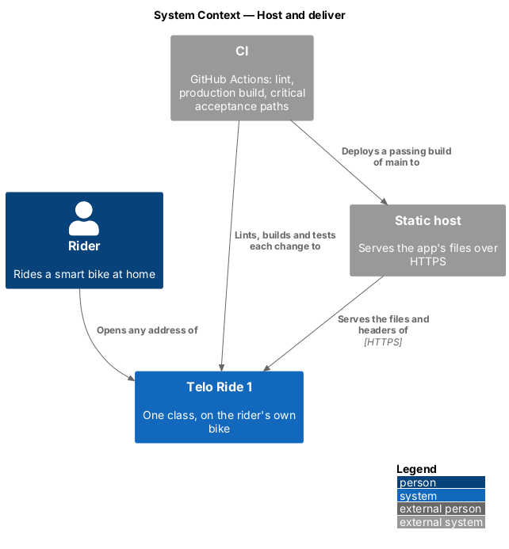
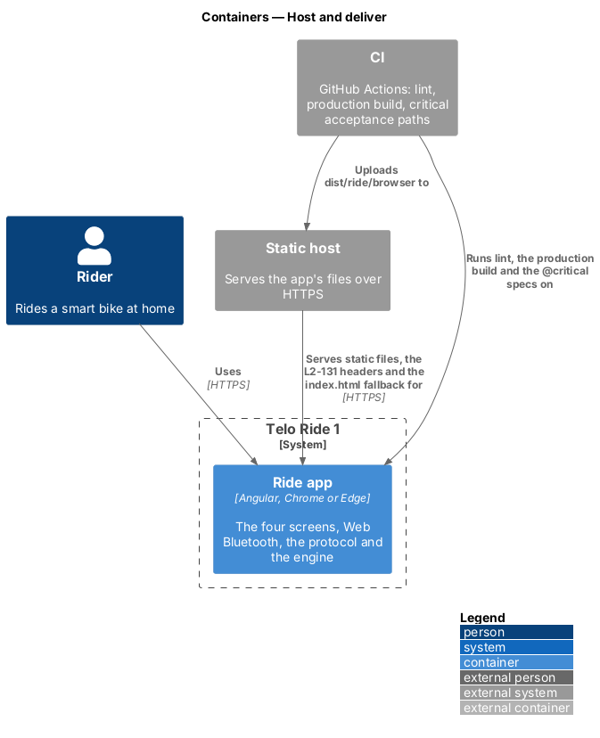
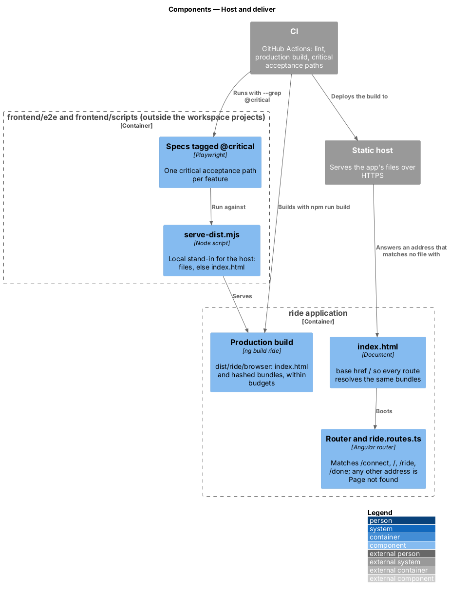
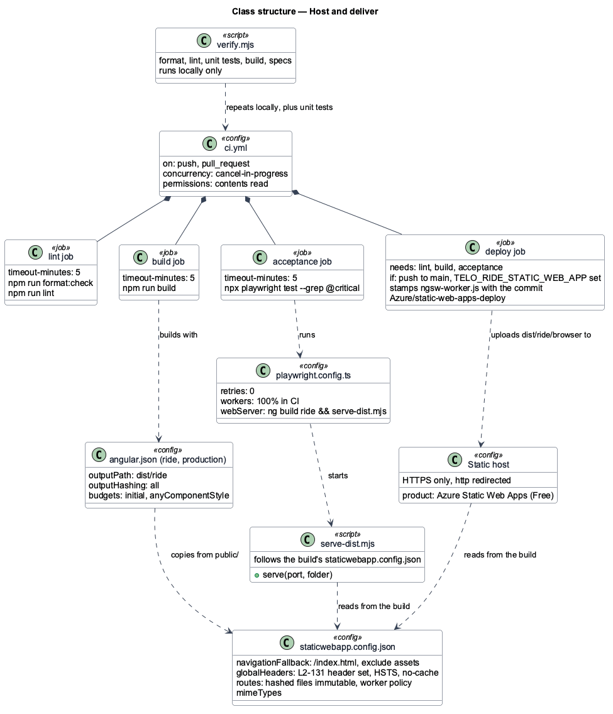
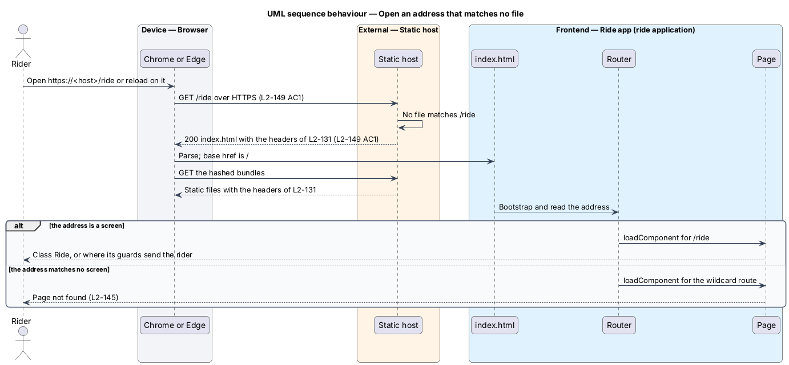
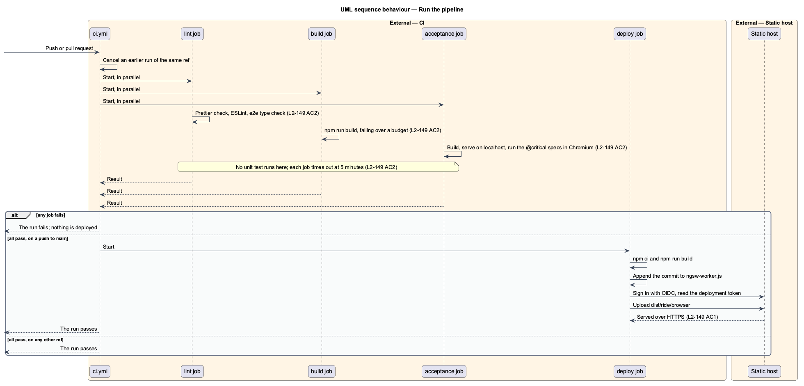

# Host and deliver

## Overview

Telo Ride 1 is a folder of static files. A rider reaches it at one HTTPS address, Web Bluetooth
works only on a secure page, and the four screens have their own addresses that a rider can open or
reload directly. This feature covers the two halves of getting the app to that address: how the
files are served, and how a change is checked before it is served. It refines `L1-024`.

Local terms:

- **static host**: service that returns the built files over HTTPS and runs no application code
- **fallback**: rule by which the host answers an address that matches no file with `index.html`, so the app's router can resolve it
- **header set**: the Content Security Policy, `X-Content-Type-Options` and `Referrer-Policy` of `L2-131`
- **pipeline**: GitHub Actions workflow that runs on every push and pull request
- **critical acceptance path**: one Playwright behaviour spec per feature, tagged `@critical`, that proves the feature's main flow
- **production build**: output of `ng build ride` in `frontend/dist/ride/browser/`

Neighbouring features own the adjacent concerns:

- [Restrict third parties](../../security/restrict-third-parties/README.md) owns the content of
  the header set (`L2-131`).
- [Check bike and browser support](../../bike/check-bike-and-browser-support/README.md) owns what
  the app shows when the page is not secure (`L2-009`).
- [Show page not found](../../ui/show-page-not-found/README.md) owns the screen for an address
  that matches no screen (`L2-145`).
- [Structure the frontend workspace](../structure-the-frontend-workspace/README.md) owns the lint
  rules the pipeline runs (`L2-146`).
- [Test without hardware](../test-without-hardware/README.md) owns the fixtures that let the
  pipeline run with no bike and no real network (`L2-148`).
- [Meet performance budgets](../../performance/meet-performance-budgets/README.md) owns the
  budgets the production build enforces (`L2-136`).
- [Ride without a network](../../performance/ride-without-a-network/README.md) owns what happens
  after the files are loaded and the network is lost (`L2-135`).

## Description

### Hosting (`L2-149` AC1)

- **Production build**: exists. `npm run build` runs `ng build ride` with the `production`
  configuration of `frontend/angular.json`: output in `dist/ride/browser/`, `outputHashing` `all`,
  and the `initial` and `anyComponentStyle` budgets. `index.html` has `<base href="/">`, so the
  bundles resolve from any route.
- **Static host**: the product and its configuration file are `<TO SUPPLY>`. Today the build is
  served by the carried-over backend: `Telo.Ride.Api` serves it from `wwwroot` on one Azure App
  Service (ADR 0026), and `docs/deployment.md` describes that service and its settings. `L2-149`
  AC1 asks for static files, and `AGENTS.md` leaves open whether Telo Ride 1 keeps the backend
  (`L2.md` open question 1). The change that decides it brings an ADR that supersedes ADR 0026,
  names the host and rewrites `docs/deployment.md` for Telo Ride 1.
- **What the host shall do**, whichever product is chosen:
  - serve the files of `dist/ride/browser/` over HTTPS only;
  - send the header set of `L2-131` on every response, `index.html` and files alike, with
    `frame-ancestors 'none'` in the policy;
  - answer every address that matches no file with `index.html` and status 200, so `/connect`,
    `/ride` and `/done` open directly and an unknown address reaches Page not found.
- **Caching**: `index.html` should be served with `Cache-Control: no-cache` so a deploy reaches
  riders on the next visit; the hashed bundles may be cached long. ADR 0026 sets the same rule for
  the current host. The values for the new host are `<TO SUPPLY>` with it.
- **Routes**: `/connect`, `/`, `/ride` and `/done` are assumptions the mocks share (`L2.md` open
  question 7). The fallback does not depend on them: it applies to any address that is not a file.
- **`frontend/scripts/serve-dist.mjs`**: exists. It is the local stand-in for the host in the
  behaviour specs. It serves a build folder on `127.0.0.1` and falls back to `index.html` for any
  path that is not a file. It sends no security header today;
  [Restrict third parties](../../security/restrict-third-parties/README.md) proposes that it send
  the header set.

### Delivery (`L2-149` AC2)

- **`.github/workflows/ci.yml`**: exists. It runs on `push` and `pull_request`, cancels an earlier
  run of the same ref, and holds three jobs that run in parallel, each with
  `timeout-minutes: 5`:
  - **`lint`**: `npm run format:check` (Prettier) and `npm run lint` (`ng lint` and the type check
    of `e2e/`).
  - **`build`**: `npm run build`, which fails when a budget is exceeded.
  - **`acceptance`**: `npx playwright test --grep @critical`. Playwright builds the app, serves it
    with `serve-dist.mjs` and runs the tagged specs in Chromium with `retries: 0`.
- **Under 5 minutes**: the checkout is sparse, `node_modules` and the Playwright browser are
  cached by the hash of `package-lock.json`, the jobs run side by side, and nothing is retried. A
  slow or flaky check is fixed or removed.
- **No unit tests in CI**: `npm test` runs locally. `node tools/verify/verify.mjs` exists and runs
  the format check, lint, unit tests, the production build and the behaviour specs before a push.
- **One critical path per feature**: a spec carries `{ tag: '@critical' }` and a header comment
  naming the L2s it covers. 40 spec files carry the tag today, most of them for Telo Ride features.
  For Telo Ride 1 each feature in this design tree that has a screen behaviour has one tagged
  spec; the specs of removed features leave with them.
- **What changes in the workflow**: the `dotnet format`, `dotnet build` and `dotnet test` steps,
  the .NET set-up and NuGet cache belong to the carried-over backend. They leave the workflow in
  the change that removes it (28.8). Until then they count against the 5 minutes. The marketing
  build left with the `marketing` application (ADR 0041).
- **`deploy` job**: exists. It runs on a push to `main` after the three jobs pass. Today it
  publishes the API with the build in `wwwroot`, migrates the database and deploys to the App
  Service named by the repository variable `TELO_RIDE_WEBAPP`, and is skipped until that variable
  is set. For Telo Ride 1 it builds the app and uploads `dist/ride/browser/` to the static host.
  Its target, sign-in and variables are `<TO SUPPLY>` with the host.

## Requirements

The feature realizes the following level-2 (L2) requirement, which refines the level-1 (L1)
requirement cited beside it.

| L2 ID | Refines (L1) | Requirement |
|-------|--------------|-------------|
| `L2-149` | `L1-024` | The deployed frontend shall be static files served over HTTPS with the headers of `L2-131`, and every address that matches no file shall serve the app so its routes work. For each pushed change, CI shall run lint, the production build and one critical acceptance path per feature, shall fail on any of them, and shall finish in under 5 minutes. Unit tests shall run locally and shall not run in CI. |

## Diagrams

### System context

The static host serves Telo Ride 1 to the rider. CI checks every change and deploys a passing build
of `main` to the host.

### Containers

The Ride app is the only container, and it is delivered as files. The host adds HTTPS, the header
set and the fallback; CI produces the files.

### Components

CI builds the production build and runs the `@critical` specs against `serve-dist.mjs`, the local
stand-in for the host. On the host, an address that matches no file is answered with `index.html`,
which boots the router. The spec and script folders are outside the workspace projects and are
drawn as their own boundary.

### Class structure

`ci.yml` composes the `lint`, `build`, `acceptance` and `deploy` jobs. The static host and the
workflow are configuration and are modelled with the `config` and `job` stereotypes; the host's
product and the deploy target are `<TO SUPPLY>`.

### Behaviour: open an address that matches no file

A rider opens or reloads `/ride`. The host finds no such file and answers `index.html` with the
header set; the router then resolves the address to a screen or to Page not found.

### Behaviour: run the pipeline

A push starts the three jobs in parallel. Any failure fails the run and blocks the deploy; a
passing push to `main` uploads the build to the static host.

