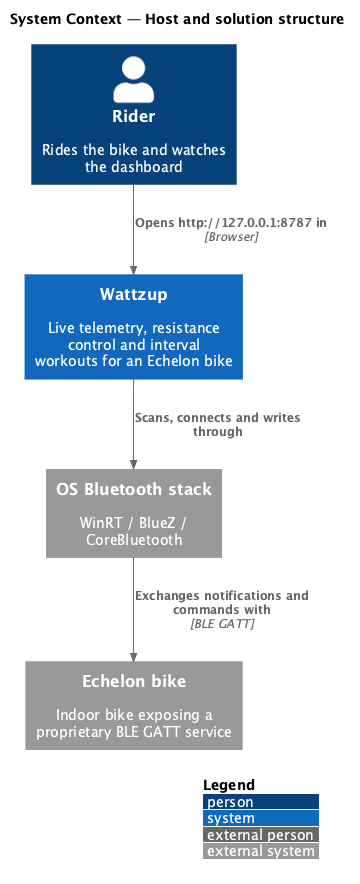
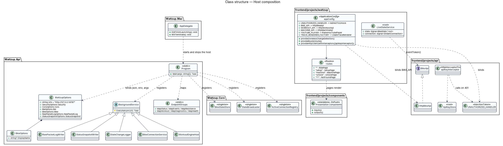

# Host and solution structure

## Overview

This feature describes how the Wattzup code base is organised and how it runs. It covers the .NET projects and their dependencies, the Angular application, configuration, bundled assets, and the host process lifecycle. Every other feature design names types inside the projects defined here.

**solution** — the .NET `backend/Wattzup.sln` and its projects

**hosted service** — long-running background task started and stopped by the ASP.NET Core generic host

**single origin** — the Angular build is served by the same ASP.NET Core process and port as the API, so the browser needs no CORS

**composition root** — the one place that binds contracts to implementations: `Program.cs` for the backend, `app.config.ts` for the frontend

The dependency rule points inward. `Wattzup.Protocol` depends on nothing. `Wattzup.Ble.Abstractions` depends on nothing but the base library. Platform transports depend only on the abstractions. `Wattzup.Core` depends on Protocol and the abstractions. `Wattzup.Api` composes everything, and `Wattzup.Mac` bundles it as a macOS app (ADR 0007). The backend is one process on one machine next to the bike, with all state in memory (ADR 0004).

## Description

Repository layout, as fixed in `AGENTS.md`:

```
wattzup/
├── README.md
├── backend/
│   ├── Wattzup.sln, Directory.Build.props
│   ├── src/
│   │   ├── Wattzup.Protocol/  Wattzup.Ble.Abstractions/
│   │   ├── Wattzup.Ble.CoreBluetooth/  Wattzup.Ble.BlueZ/  Wattzup.Ble.Windows/  Wattzup.Ble.Simulated/
│   │   └── Wattzup.Core/  Wattzup.Api/  Wattzup.Mac/
│   └── tests/
│       └── Wattzup.Protocol.Tests/  Wattzup.Core.Tests/  Wattzup.Api.AcceptanceTests/
├── frontend/                      one Angular workspace (ADR 0013)
│   ├── projects/components/src/   library: lib/ (presentation components, format/), styles/design-system/
│   ├── projects/api/src/          library: generated/schema.d.ts, lib/ (contracts, tokens, HTTP, interceptor)
│   ├── projects/wattzup/src/      application: app/{core,dashboard}/, app/app.config.ts, tokens.css, styles.scss
│   ├── e2e/ (fixtures/, pages/, specs), scripts/, public/
│   └── angular.json, tsconfig.json, proxy.conf.json
└── docs/
```

.NET solution (`Directory.Build.props` sets the current LTS, `net10.0`, with nullable enabled and warnings as errors):

| Project | Target | Contains |
|---|---|---|
| `Wattzup.Protocol` | `net10.0` | `EchelonUuids`, `EchelonCommands`, `EchelonDeviceFilter`, `PacketDecoder`, `TelemetryUpdate`, `SpeedCalculator` |
| `Wattzup.Ble.Abstractions` | `net10.0` | `IBikeTransport`, `IBikeConnection`, `BikeAdvertisement`, `BluetoothAdapterState`, `BluetoothUnavailableException` |
| `Wattzup.Ble.CoreBluetooth` | `net10.0` (macOS only at run time) | First real transport, through the Objective-C runtime (ADR 0007, ADR 0008, `bluetooth-platform-transports`) |
| `Wattzup.Ble.BlueZ` | `net10.0` | BlueZ transport, built but not yet supported |
| `Wattzup.Ble.Windows` | `net10.0-windows10.0.19041.0` | WinRT transport, built but not yet supported |
| `Wattzup.Ble.Simulated` | `net10.0` | `SimulatedBikeTransport`, `SimulationControl` (`--simulate`) |
| `Wattzup.Core` | `net10.0` | State store, broadcaster, display-time tracker, telemetry ingestion, power and ride-total estimates, command log, plan expansion and validation, workout engine, trace history, raw-packet and snapshot writers; types are named in their feature designs |
| `Wattzup.Api` | `net10.0`; `net10.0-windows10.0.19041.0` when built on Windows | `Program.cs`, hosted services, endpoint groups, security, `wwwroot`; registers the transport for the operating system |
| `Wattzup.Mac` | `Info.plist` + `bundle.sh` | Builds `Wattzup.app` around the published `Wattzup.Api` with `NSBluetoothAlwaysUsageDescription` in `Info.plist`, signed ad hoc; inside it the host writes runtime output to `~/Library/Application Support/Wattzup/` (ADR 0008) |
| `Wattzup.Protocol.Tests`, `Wattzup.Core.Tests` | `net10.0` | xUnit unit tests, one case per table row |
| `Wattzup.Api.AcceptanceTests` | `net10.0` | ATDD through the API with `WebApplicationFactory`, `SimulatedBikeTransport` and `FakeTimeProvider` |

Every project builds with the plain .NET SDK (ADR 0008). CI builds every project but runs no transport against hardware (ADR 0007).

- **`Program.cs`** — builds the host with minimal APIs (L2-042):
  - It registers singletons (`BikeStateStore`, `StateBroadcaster`, `ActiveConnectionRegistry`, `RawPacketLogger`, `EventTokenService`) and `TimeProvider.System`, which tests replace with `FakeTimeProvider`.
  - It registers hosted services (`BikeConnectionService`, the workout engine loop, `RawPacketLogWriter`, `StatusSnapshotWriter`, `StateChangeLogger`, `BindAddressGuard`) and the transport through `TransportSelector`.
  - It maps the endpoint groups under `/api` (status, events, resistance, workout, diagnostics), plus `/health` and `/openapi/v1.json`.
  - Each endpoint validates its input and calls one Core service. Errors are ProblemDetails with a `code` extension where a client branches on them.
- **Thread safety** — `BikeStateStore` is the only writer of `BikeState`. It applies changes under a short lock and publishes by reference swap. Workout run state is touched only by the engine loop (L2-042).
- **`WattzupOptions`** — bound from `appsettings.json`, then `WATTZUP__*` environment variables, then the command line (L2-042). The README documents every setting in the same change that adds it.

| Setting | Default | Used by |
|---|---|---|
| `Wattzup:Urls` | `http://127.0.0.1:8787` | Kestrel, `BindAddressGuard` |
| `Wattzup:Security:ApiKey` | empty | `secure-api`, `unlock-and-not-found` help text |
| `Wattzup:Cors:Origins` | empty | `secure-api` |
| `Wattzup:Ble:Transport` | by operating system | `bluetooth-platform-transports` |
| `Wattzup:Bike:DisplayName` | empty | `device_label` (`discover-and-connect-bike`, `show-connection-status`) |
| `Wattzup:RawPacketLog:*` | `raw_packets.log`, 10 MB, 5 files | `log-raw-packets` |
| `Wattzup:StatusSnapshot:*` | `status.json` | `persist-status-snapshot` |
| `--simulate` | off | `TransportSelector`, `simulated` |

- **Graceful shutdown** — `HostOptions.ShutdownTimeout = 5 s`. On stop, in reverse start order:
  1. The workout engine cancels its run.
  2. `BikeConnectionService` disposes the connection, which disconnects the bike.
  3. `EventsEndpoints` loops end through `ApplicationStopping`.
  4. `StatusSnapshotWriter` performs its final write.
  This realises L2-039, recorded in `discover-and-connect-bike`.
- **Static hosting** — `UseStaticFiles` serves `wwwroot`, the Angular `dist/wattzup/browser` output copied at publish. The `AppShell` middleware, at the end of the pipeline, handles requests no endpoint matched: it serves `index.html` for `/` and every client route, excluding `/api`, `/health`, `/openapi` and paths with a file extension (L2-044). It is middleware rather than `MapFallbackToFile` because a catch-all fallback endpoint would take part in routing and replace the 415 and 405 answers of known endpoints, and because `index.html` must be rewritten per response with the style nonce. An unknown `/api/*` path answers a 404 ProblemDetails, while an unknown client route loads the app, which shows the not-found page (L2-056). `index.html` is served with the per-response CSP style nonce described in `secure-api`.

Angular workspace in `frontend/` (L2-044, ADR 0013). One workspace holds three projects, all under `frontend/projects/`:

| Project | Type | Path alias | Holds |
|---|---|---|---|
| `components` | library | `@wattzup/components` | Every presentation component, each named as its design-system component or as a named part of one; the display-formatting helpers in `lib/format/` (`formatDuration`, `formatLive`, `formatPace`, `epochClock`…); the shared SCSS partials in `src/styles/design-system/` |
| `api` | library | `@wattzup/api` | The generated OpenAPI types in `src/generated/schema.d.ts`; the type aliases (`api-types.ts`); the contracts `BikeApi`, `WorkoutApi`, `MachineApi` with their tokens `BIKE_API`, `WORKOUT_API`, `MACHINE_API`; the HTTP implementations; `apiKeyInterceptor`, `ApiKeyStore`, `SafeStorage` and the `UNAUTHORIZED_HANDLER` token; the `StreamConnection` type |
| `wattzup` | application | — | Pages and orchestrating dialogs (`src/app/dashboard/`), services, stores and pure helpers (`src/app/core/`), routes and `app.config.ts`; the global foundations `tokens.css` and `styles.scss` |

- **Dependency direction** — `wattzup` → `components` and `wattzup` → `api`. `components` → `api` for types only (`import type`). `api` depends on nothing in the workspace, and no library imports the application. `no-restricted-imports` rules in `frontend/eslint.config.js` enforce it; `npm run lint` fails on a breach.
- **Path aliases** — `frontend/tsconfig.json` maps `@wattzup/components` and `@wattzup/api` to each library's `src/public-api.ts`. The application compiles the library source directly, so `ng serve`, `ng test`, `ng build` and tree-shaking need no library build. Each library keeps the CLI's `ng-packagr` `build` target, which `npm run build` never runs.
- **Presentation components** — a component in `components` renders a design-system component from its inputs and reports interactions through outputs. It injects no application service, no API token and never the `Router`; a link to a screen uses `RouterLink` with the target passed in (`setupLink`). Values a component once injected (the countdown, the cues, the theme, the connection status) are read by the page and passed in. The mapping of every former `src/app/dashboard/` folder is in the appendix below.
- Current Angular version, standalone components only, `ChangeDetectionStrategy.OnPush` everywhere, signals for state, and zoneless change detection (`provideZonelessChangeDetection`).
- Each component is `name.ts` + `name.html` + `name.scss` with `templateUrl` and `styleUrl`, selector `wz-<name>` (both libraries set `prefix: "wz"`), in its own folder: `projects/components/src/lib/<name>/` for presentation, `projects/wattzup/src/app/dashboard/<name>/` for pages, dialogs and containers. Each stylesheet is one encapsulated BEM block named as in the mocks. Every project's `stylePreprocessorOptions.includePaths` lists `projects/components/src/styles`, so `@use 'design-system/btn'` resolves in all three.
- **`app.config.ts`** — the one composition root, in `projects/wattzup/src/app/`.
  - It provides the router with the routes `/` (`RidePage`), `/setup` (`SetupPage`), `/machine` (`MachinePage`), `/unlock` (`UnlockPage`) and `**` (`NotFoundPage`).
  - It provides `HttpClient` with `withInterceptors([apiKeyInterceptor])`, binds `BIKE_API`, `WORKOUT_API` and `MACHINE_API` to `HttpBikeApi`, `HttpWorkoutApi` and `HttpMachineApi`, `YOUTUBE_PLAYER` to `IframeYouTubePlayer`, and `UNAUTHORIZED_HANDLER` to `redirectToUnlock`, which sends the rider to `/unlock` with the return URL after a 401 (L2-055). `api` itself knows no route.
- `projects/wattzup/src/app/core/` holds the services and pure helpers with their unit tests:
  - live state: `LiveStateService`, the one owner of the `EventSource` and the reconnect logic (L2-044 AC2), `safeReturnUrl`, `redirectToUnlock`;
  - dialogs and notifications: `DialogLauncher`, `ConnectionBannerService`, `ToastService`, `diagnosticsReport`;
  - dashboard helpers: `connectionStatus`, `rideViewState`, `powerDelta`, `resistanceView`, `segmentLabels`;
  - the trace: `FrameScheduler`, `MotionPreference`, `TraceRenderer`, `createTraceRenderer`, `TraceRendererStatus`, `traceGeometry`, `PowerTraceStore`;
  - the workout helpers named in the workouts designs.
- `projects/api/src/generated/schema.d.ts` holds types generated from `/openapi/v1.json` by `openapi-typescript` (`npm run generate:api`). It is never hand-edited. CI regenerates it and fails on a diff.
- **Unit tests** — each project has its own `test` target (`@angular/build:unit-test`, Vitest), and specs sit beside their code. `npm test` runs all three projects.
- **Build output** — only the application is built for production. Its `outputPath` is `dist/wattzup`, so the output is `dist/wattzup/browser`, which `npm run build:api` copies into `backend/src/Wattzup.Api/wwwroot`.
- `proxy.conf.json` forwards `/api` to `127.0.0.1:8787` during `ng serve`.
- **Fonts** (ADR 0005) — Inter, Archivo and JetBrains Mono ship as Latin-subset WOFF2 variable fonts under `frontend/public/fonts/`, with their SIL Open Font License 1.1 files beside them. The global foundations declare them with `@font-face` and `font-display: swap`. No font is loaded from a CDN, which the `font-src 'self'` policy enforces.
- **Budgets** — `angular.json` sets the application's raw `initial` budget as an early warning, and `scripts/check-bundle-size.mjs`, run by `npm run build`, fails when the initial files exceed 300 KB gzipped (L2-044). Fonts count against the build size but not the JavaScript budget.
- **Global styles** — foundations only, in `projects/wattzup/src/tokens.css` and `styles.scss`: tokens from `docs/design-system/tokens/`, `@font-face`, reset and utilities. Components read tokens by role, never by hex value.

### Component mapping (ADR 0013)

Every folder of the former `frontend/src/app/dashboard/`, with its project and its name there. A library component takes the design-system name (`docs/design-system/components/`); a named part of a design-system component keeps the BEM block the design system gives it. BEM classes are unchanged in every row. "Lifted" names what the page now passes in instead of the component injecting it.

| Former folder | Project | Now | Design-system component | Notes |
|---|---|---|---|---|
| `alert` | components | `alert` | Alert and banner | |
| `app-bar` | components | `app-bar` | App bar | Lifted: status, clock text, badge, beeps, theme, `setupLink`/`homeLink`; actions are outputs |
| `auth-card` | components | `auth-card` | Page layout (centred single card) | Part, BEM block `auth-card` |
| `cmd-log` | components | `command-log` | Command log | Lifted: title; `commandLog` helpers move with it |
| `connection-banner` | wattzup | `dashboard/connection-banner` | Alert and banner | Container: reads `ConnectionBannerService`, `LiveStateService`, `DialogLauncher` |
| `design-system/` (SCSS partials) | components | `src/styles/design-system/` | — | Resolved through `includePaths` |
| `diagnostics-dialog` | wattzup | `dashboard/diagnostics-dialog` | Dialog | Orchestrating dialog |
| `dialog-shell` | components | `dialog` | Dialog | Injects only the CDK `DialogRef` |
| `edit-set-dialog` | wattzup | `dashboard/edit-set-dialog` | Dialog | Orchestrating dialog |
| `edit-stretch-dialog` | wattzup | `dashboard/edit-stretch-dialog` | Dialog | Orchestrating dialog |
| `effort-row` | components | `effort-row` | Effort row (page added) | Lifted: pace, incline and step limits (`effortRowView`) |
| `end-ride-dialog` | wattzup | `dashboard/end-ride-dialog` | Dialog | Orchestrating dialog |
| `form-summary` | components | `form-summary` | Form layout | Part, BEM block `form-summary` |
| `icon` | components | `icon` | Iconography (foundation) | |
| `incline-control` | components | `incline-control` | Speed and incline control | Part |
| `interval` | components | `interval` | Interval | Lifted: segment labels, time left, progress, pulse, `setupLink` |
| `level-control` | components | `level-control` | Level control | View types move with it |
| `level-picker` | components | `level-picker` | Level picker | `levelPickerInput` helper moves with it |
| `level-slider` | components | `slider` | Slider | |
| `load-error` | components | `empty-state` | Empty state | |
| `machine-card` | components | `machine-card` | Machine card (page added) | View types move with it |
| `machine-page` | wattzup | `dashboard/machine-page` | — | Page |
| `main-view-tabs` | components | `main-view-tabs` | Video ride-along (view switch) | Part |
| `metrics-strip` | components | `metric-list` | Metric list | |
| `mode-cards` | components | `radio-group` | Radio group (mode cards) | |
| `not-found-page` | wattzup | `dashboard/not-found-page` | Error page | Page |
| `num-stepper` | components | `number-stepper` | Number stepper | |
| `phase-banner` | components | `phase-banner` | Step-change banner | Lifted: banner and announcement |
| `plan-note` | components | `plan-note` | Level control, speed control | Part |
| `plan-strip` | components | `plan-strip` | Ride profile (`profile--strip`) | Part; lifted: the strip (`stripOf`) |
| `presets` | components | `presets` | Chip | Part |
| `quick-speeds` | components | `quick-speeds` | Speed and incline control | Part; lifted: the speeds |
| `readout` | components | `readout` | Readout | |
| `replace-ride-dialog` | wattzup | `dashboard/replace-ride-dialog` | Dialog | Orchestrating dialog |
| `ride-clock` | components | `ride-clock` | Ride clock | Lifted: elapsed text |
| `ride-overlay` | components | `overlay-panel` | Overlay panel | Lifted: `setupLink` |
| `ride-page` | wattzup | `dashboard/ride-page` | — | Page |
| `ride-preview` | components | `ride-profile` | Ride profile | View type moves with it |
| `ride-trace` | wattzup | `dashboard/ride-trace` | Power trace | Container: owns the render loop over the trace stores (ADR 0006) |
| `ride-video` | wattzup | `dashboard/ride-video` | Video ride-along | Container: drives the YouTube player (ADR 0012) |
| `set-list` | components | `set-list` | Set list | Lifted: rows and stretch lines (`setListView`) |
| `setup-page` | wattzup | `dashboard/setup-page` | — | Page |
| `signal-bars` | components | `signal-bars` | Machine card | Part |
| `speed-control` | components | `speed-control` | Speed and incline control | |
| `status-line` | components | `status-line` | Status line | Lifted: the status (`connectionStatus`) and reduced motion |
| `toast` | components | `toast` | Toast | `toastQueue` helper moves with it |
| `toast-region` | wattzup | `dashboard/toast-region` | Toast | Container: reads `ToastService` |
| `toggles` | components | `switch` | Switch | |
| `unlock-page` | wattzup | `dashboard/unlock-page` | — | Page |
| `video-link` | wattzup | `dashboard/video-link` | Video ride-along | Container: checks the link through `YOUTUBE_PLAYER` |

### Open questions

- The power trace, the ride video and the video link are containers in the application. Splitting each into a presentation component in `components` and a container in the application is deferred.
- Design-system components with no Angular counterpart yet, which exist only as SCSS partials or markup (button, chip, link, badge, tooltip, skeleton, spinner, progress bar, description list, code block, lockup, skip link, divider, inline message), are deferred.
- Publishing the libraries, Storybook or a component gallery are out of scope (ADR 0013).

## Requirements

| L2 ID | Refines (L1) | Requirement |
|-------|--------------|-------------|
| `L2-042` | `L1-012` | Backend technology and structure. |
| `L2-044` | `L1-012` | Frontend technology and structure. |

## Diagrams

### System context

The rider opens Wattzup in a browser on the same machine that talks to the bike.



### Containers

One process serves both Wattzup Web and the Wattzup API from a single origin, and writes local files. On macOS the process runs inside the `Wattzup.Mac` app bundle.


### Components

The projects form an inward-pointing dependency graph with `Wattzup.Api` at the edge and `Wattzup.Mac` around it. In the frontend workspace the `wattzup` application depends on the `components` and `api` libraries, `components` takes only types from `api`, and neither library depends on the application (ADR 0013).


### Class structure

`Program` composes options, singletons and hosted services. Each hosted service is a separate class with its own lifecycle. `app.config.ts` does the same for the frontend: it binds the `api` library's tokens to their implementations and the 401 reaction to `redirectToUnlock`, and pages pass values into the `components` library's presentation components.



### Behaviour — start-up, serve and graceful shutdown

The host binds, starts background services without blocking, serves the SPA and API, and on stop shuts everything down within 5 s (L2-042, L2-044).


