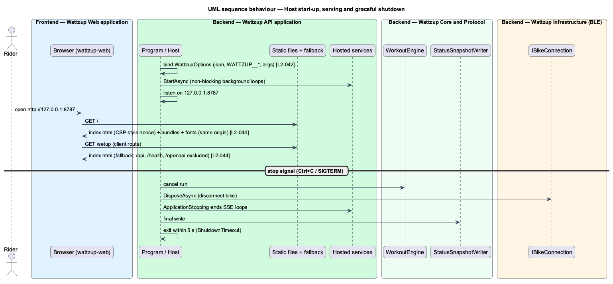

# Host and solution structure

## Overview

This feature describes how the Wattzup code base is organised and how it runs. It covers the .NET projects and their dependencies, the Angular application, configuration, bundled assets, and the host process lifecycle. Every other feature design names types inside the projects defined here.

**solution** — the .NET `backend/Wattzup.sln` and its projects

**hosted service** — long-running background task started and stopped by the ASP.NET Core generic host

**single origin** — the Angular build is served by the same ASP.NET Core process and port as the API, so the browser needs no CORS

**composition root** — the one place that binds contracts to implementations: `Program.cs` for the backend, `app.config.ts` for the frontend

The dependency rule points inward. `Wattzup.Protocol` depends on nothing. `Wattzup.Ble.Abstractions` depends on nothing but the base library. Platform transports depend only on the abstractions. `Wattzup.Core` depends on Protocol and the abstractions. `Wattzup.Api` composes everything, and `Wattzup.Mac` bundles it as a macOS app (ADR 0007). The backend is one process on one machine next to the bike, with all state in memory (ADR 0004).

## Description

Repository layout, as fixed in `AGENTS.md`:

```
wattzup/
├── README.md
├── backend/
│   ├── Wattzup.sln, Directory.Build.props
│   ├── src/
│   │   ├── Wattzup.Protocol/  Wattzup.Ble.Abstractions/
│   │   ├── Wattzup.Ble.CoreBluetooth/  Wattzup.Ble.BlueZ/  Wattzup.Ble.Windows/  Wattzup.Ble.Simulated/
│   │   └── Wattzup.Core/  Wattzup.Api/  Wattzup.Mac/
│   └── tests/
│       └── Wattzup.Protocol.Tests/  Wattzup.Core.Tests/  Wattzup.Api.AcceptanceTests/
├── frontend/                    one Angular workspace (ADR 0013)
│   ├── projects/
│   │   ├── components/src/{lib,styles}/, public-api.ts   presentation components, SCSS partials
│   │   ├── api/src/{lib,generated}/, public-api.ts        types, contracts, tokens, HTTP, interceptor
│   │   └── wattzup/src/app/{core,dashboard}/, app.config.ts   pages, dialogs, services, helpers
│   ├── e2e/ (fixtures/, pages/, specs), scripts/, public/
│   └── proxy.conf.json
└── docs/
```

.NET solution (`Directory.Build.props` sets the current LTS, `net10.0`, with nullable enabled and warnings as errors):

| Project | Target | Contains |
|---|---|---|
| `Wattzup.Protocol` | `net10.0` | `EchelonUuids`, `EchelonCommands`, `EchelonDeviceFilter`, `PacketDecoder`, `TelemetryUpdate`, `SpeedCalculator` |
| `Wattzup.Ble.Abstractions` | `net10.0` | `IBikeTransport`, `IBikeConnection`, `BikeAdvertisement`, `BluetoothAdapterState`, `BluetoothUnavailableException` |
| `Wattzup.Ble.CoreBluetooth` | `net10.0` (macOS only at run time) | First real transport, through the Objective-C runtime (ADR 0007, ADR 0008, `bluetooth-platform-transports`) |
| `Wattzup.Ble.BlueZ` | `net10.0` | BlueZ transport, built but not yet supported |
| `Wattzup.Ble.Windows` | `net10.0-windows10.0.19041.0` | WinRT transport, built but not yet supported |
| `Wattzup.Ble.Simulated` | `net10.0` | `SimulatedBikeTransport`, `SimulationControl` (`--simulate`) |
| `Wattzup.Core` | `net10.0` | State store, broadcaster, display-time tracker, telemetry ingestion, power and ride-total estimates, command log, plan expansion and validation, workout engine, trace history, raw-packet and snapshot writers; types are named in their feature designs |
| `Wattzup.Api` | `net10.0`; `net10.0-windows10.0.19041.0` when built on Windows | `Program.cs`, hosted services, endpoint groups, security, `wwwroot`; registers the transport for the operating system |
| `Wattzup.Mac` | `Info.plist` + `bundle.sh` | Builds `Wattzup.app` around the published `Wattzup.Api` with `NSBluetoothAlwaysUsageDescription` in `Info.plist`, signed ad hoc; inside it the host writes runtime output to `~/Library/Application Support/Wattzup/` (ADR 0008) |
| `Wattzup.Protocol.Tests`, `Wattzup.Core.Tests` | `net10.0` | xUnit unit tests, one case per table row |
| `Wattzup.Api.AcceptanceTests` | `net10.0` | ATDD through the API with `WebApplicationFactory`, `SimulatedBikeTransport` and `FakeTimeProvider` |

Every project builds with the plain .NET SDK (ADR 0008). CI builds every project but runs no transport against hardware (ADR 0007).

- **`Program.cs`** — builds the host with minimal APIs (L2-042):
  - It registers singletons (`BikeStateStore`, `StateBroadcaster`, `ActiveConnectionRegistry`, `RawPacketLogger`, `EventTokenService`) and `TimeProvider.System`, which tests replace with `FakeTimeProvider`.
  - It registers hosted services (`BikeConnectionService`, the workout engine loop, `RawPacketLogWriter`, `StatusSnapshotWriter`, `StateChangeLogger`, `BindAddressGuard`) and the transport through `TransportSelector`.
  - It maps the endpoint groups under `/api` (status, events, resistance, workout, diagnostics), plus `/health` and `/openapi/v1.json`.
  - Each endpoint validates its input and calls one Core service. Errors are ProblemDetails with a `code` extension where a client branches on them.
- **Thread safety** — `BikeStateStore` is the only writer of `BikeState`. It applies changes under a short lock and publishes by reference swap. Workout run state is touched only by the engine loop (L2-042).
- **`WattzupOptions`** — bound from `appsettings.json`, then `WATTZUP__*` environment variables, then the command line (L2-042). The README documents every setting in the same change that adds it.

| Setting | Default | Used by |
|---|---|---|
| `Wattzup:Urls` | `http://127.0.0.1:8787` | Kestrel, `BindAddressGuard` |
| `Wattzup:Security:ApiKey` | empty | `secure-api`, `unlock-and-not-found` help text |
| `Wattzup:Cors:Origins` | empty | `secure-api` |
| `Wattzup:Ble:Transport` | by operating system | `bluetooth-platform-transports` |
| `Wattzup:Bike:DisplayName` | empty | `device_label` (`discover-and-connect-bike`, `show-connection-status`) |
| `Wattzup:RawPacketLog:*` | `raw_packets.log`, 10 MB, 5 files | `log-raw-packets` |
| `Wattzup:StatusSnapshot:*` | `status.json` | `persist-status-snapshot` |
| `--simulate` | off | `TransportSelector`, `simulated` |

- **Graceful shutdown** — `HostOptions.ShutdownTimeout = 5 s`. On stop, in reverse start order:
  1. The workout engine cancels its run.
  2. `BikeConnectionService` disposes the connection, which disconnects the bike.
  3. `EventsEndpoints` loops end through `ApplicationStopping`.
  4. `StatusSnapshotWriter` performs its final write.
  This realises L2-039, recorded in `discover-and-connect-bike`.
- **Static hosting** — `UseStaticFiles` serves `wwwroot`, the Angular `dist/wattzup/browser` output copied at publish. The `AppShell` middleware, at the end of the pipeline, handles requests no endpoint matched: it serves `index.html` for `/` and every client route, excluding `/api`, `/health`, `/openapi` and paths with a file extension (L2-044). It is middleware rather than `MapFallbackToFile` because a catch-all fallback endpoint would take part in routing and replace the 415 and 405 answers of known endpoints, and because `index.html` must be rewritten per response with the style nonce. An unknown `/api/*` path answers a 404 ProblemDetails, while an unknown client route loads the app, which shows the not-found page (L2-056). `index.html` is served with the per-response CSP style nonce described in `secure-api`.

Angular workspace in `frontend/` (L2-044, ADR 0013). One `angular.json` holds three projects, all under `projects/`, generated with the Angular CLI:

| Project | Type | Holds | May depend on |
|---|---|---|---|
| `components` | library, prefix `wz` | Every presentation component, one folder each under `src/lib/`, named as the design-system component it renders, and the design-system SCSS partials under `src/styles/design-system/` | `@wattzup/api`, for types only |
| `api` | library, prefix `wz` | The generated OpenAPI types (`src/generated/schema.d.ts`), the type aliases (`api-types.ts`), the contracts `BikeApi`, `WorkoutApi`, `MachineApi` with their tokens `BIKE_API`, `WORKOUT_API`, `MACHINE_API`, the HTTP implementations (`http-api.ts`), `apiKeyInterceptor` with the `UNAUTHORIZED_HANDLER` token, `ApiKeyStore`, `SafeStorage`, and the event-stream type `StreamConnection` | nothing in the workspace |
| `wattzup` | application, prefix `wz` | Pages, dialogs and orchestrating components under `src/app/dashboard/`; services, stores and pure helpers under `src/app/core/`; routes and `app.config.ts`; `main.ts`, `index.html`, `tokens.css`, `styles.scss` | `@wattzup/components`, `@wattzup/api` |

- **Path aliases** — `frontend/tsconfig.json` maps `@wattzup/components` and `@wattzup/api` to each library's `src/public-api.ts`. The app compiles library source directly, so `ng serve`, `ng test` and tree-shaking need no library build. The libraries are not published and have no `ng-packagr` target.
- **Dependency direction** — an ESLint `no-restricted-imports` rule in `frontend/eslint.config.js` (`@typescript-eslint/no-restricted-imports`) rejects, in either library, a relative import that leaves the project, the router, and the library's own barrel; in `api`, `@wattzup/components`; in `components`, a value import of `@wattzup/api`. In the app it rejects a relative import into a library's internals.
- **Presentation components** — standalone, `ChangeDetectionStrategy.OnPush`, inputs and outputs only. A component injects only framework services (`ElementRef`, `Injector`, the CDK `DialogRef`), never an app service, an API token or the router. The type of each input is exported with the component from `public-api.ts`; the app's helpers that compute it import it from `@wattzup/components`.
- Current Angular version, standalone components only, `ChangeDetectionStrategy.OnPush` everywhere, signals for state, and zoneless change detection (`provideZonelessChangeDetection`).
- Each component is `name.ts` + `name.html` + `name.scss` with `templateUrl` and `styleUrl`, selector `wz-<name>`, in its own folder. Each stylesheet is one encapsulated BEM block named as in the mocks. Every project's `stylePreprocessorOptions.includePaths` is `projects/components/src/styles`, so a stylesheet reads a partial as `@use 'design-system/btn'`.
- **`app.config.ts`** — the composition root, in the app and nowhere else.
  - It provides the router with the routes `/` (`RidePage`), `/setup` (workouts), `/machine` (`MachinePage`), `/unlock` (`UnlockPage`) and `**` (`NotFoundPage`).
  - It provides `HttpClient` with `withInterceptors([apiKeyInterceptor])`, binds `UNAUTHORIZED_HANDLER` to the app's redirect to `/unlock?returnUrl=…` (L2-055), and binds `BIKE_API`, `WORKOUT_API` and `MACHINE_API` to `HttpBikeApi`, `HttpWorkoutApi` and `HttpMachineApi`, and `YOUTUBE_PLAYER` to `IframeYouTubePlayer`.
- `projects/wattzup/src/app/core/` holds the services and pure helpers with their unit tests:
  - live state: `LiveStateService`, the one owner of the `EventSource` and its reconnect policy (L2-044 criterion 2), and `safeReturnUrl`;
  - dialogs and notifications: `DialogLauncher`, `ConnectionBannerService`, `ToastService`, `toastQueue`, `diagnosticsReport`;
  - dashboard helpers: `connectionStatus`, `liveConnectionStatus`, `rideViewState`, `powerDelta`, `metricFormat`, `estimateWatts`, `commandLogView`, `metricItems`;
  - the trace: `FrameScheduler`, `MotionPreference`, `TraceRenderer`, `createTraceRenderer`, `TraceRendererStatus`, `traceGeometry`, `PowerTraceStore`;
  - the workout helpers named in the workouts designs.
- `projects/api/src/generated/schema.d.ts` is generated from `/openapi/v1.json` by `openapi-typescript` (`npm run generate:api`). It is never hand-edited. CI regenerates it and fails on a diff. `api-types.ts` is the only module that names its types.
- **Unit tests** — each project has a `test` target (`@angular/build:unit-test`, Vitest, jsdom). The libraries' targets take their build options from `wattzup:build:development`. Specs sit beside their code. `npm test` runs `ng test`, which runs all three targets.
- **Library `package.json`** — each library has a private `package.json` with `"sideEffects": false` so the bundler drops what the app does not import from the barrel.
- **Build output** — `npm run build` runs `ng build wattzup` to `frontend/dist/wattzup/browser`, then `scripts/check-bundle-size.mjs`. `npm run build:api` copies that folder to `backend/src/Wattzup.Api/wwwroot`.
- `proxy.conf.json` forwards `/api` to `127.0.0.1:8787` during `ng serve`.
- **Fonts** (ADR 0005) — Inter, Archivo and JetBrains Mono ship as Latin-subset WOFF2 variable fonts under `frontend/public/fonts/`, with their SIL Open Font License 1.1 files beside them. The global foundations declare them with `@font-face` and `font-display: swap`. No font is loaded from a CDN, which the `font-src 'self'` policy enforces.
- **Budgets** — `scripts/check-bundle-size.mjs` fails `npm run build` when the initial files listed in `index.html` exceed 300 KB gzipped (L2-044 criterion 5). Angular's own raw-byte budgets in `angular.json` remain as an early warning. Fonts count against the build size but not the JavaScript budget.
- **Global styles** — foundations only: tokens from `docs/design-system/tokens/`, `@font-face`, reset and utilities. Components read tokens by role, never by hex value.

## Requirements

| L2 ID | Refines (L1) | Requirement |
|-------|--------------|-------------|
| `L2-042` | `L1-012` | Backend technology and structure. |
| `L2-044` | `L1-012` | Frontend technology and structure. |

## Diagrams

### System context

The rider opens Wattzup in a browser on the same machine that talks to the bike.


### Containers

One process serves both Wattzup Web and the Wattzup API from a single origin, and writes local files. On macOS the process runs inside the `Wattzup.Mac` app bundle.


### Components

The projects form an inward-pointing dependency graph with `Wattzup.Api` at the edge and `Wattzup.Mac` around it.


### Class structure

`Program` composes options, singletons and hosted services. Each hosted service is a separate class with its own lifecycle. `app.config.ts` does the same for the frontend.


### Behaviour — start-up, serve and graceful shutdown

The host binds, starts background services without blocking, serves the SPA and API, and on stop shuts everything down within 5 s (L2-042, L2-044).



## Appendix: component mapping (ADR 0013)

Every folder that was in `frontend/src/app/dashboard/`, its project and its name there. *Part of* means the design system documents it inside another component's page; it keeps its own name and BEM block. *Lifted* names the value the parent now computes and passes in, so the component injects nothing of the app's.

| Former folder | Project | Name | Design-system component | Notes |
|---|---|---|---|---|
| `alert` | `components` | `alert` | Alert and banner | |
| `auth-card` | `components` | `auth-card` | Page layout (part) | The centred single-card shell of `/unlock` |
| `cmd-log` | `components` | `command-log` | Command log | Lifted: the title and the entries (`commandLogView`) |
| `dialog-shell` | `components` | `dialog` | Dialog | Injects only the CDK `DialogRef` |
| `effort-row` | `components` | `effort-row` | Effort row (page added) | Lifted: pace, incline and the step limits (`effortRowView`) |
| `form-summary` | `components` | `form-summary` | Form layout (part) | The error summary |
| `icon` | `components` | `icon` | Iconography (foundation) | |
| `incline-control` | `components` | `incline-control` | Speed and incline control (part) | |
| `level-control` | `components` | `level-control` | Level control | Owns `ResistanceView` and `ControlsState` |
| `level-picker` | `components` | `level-picker` | Level picker | Brings its key and pointer helper `level-picker-input` and its spec |
| `level-slider` | `components` | `slider` | Slider | |
| `load-error` | `components` | `empty-state` | Empty state | The loading-failed variant (block `empty`) |
| `machine-card` | `components` | `machine-card` | Machine card (page added) | The radio card of `/machine`; owns `MachineCardView` and `CardStatus` |
| `main-view-tabs` | `components` | `main-view-tabs` | Video ride-along (part) | Block `view-switch` |
| `metrics-strip` | `components` | `metric-list` | Metric list | Lifted: the metric items (`metricItems`) |
| `mode-cards` | `components` | `radio-group` | Radio group (mode cards) | |
| `num-stepper` | `components` | `number-stepper` | Number stepper | |
| `phase-banner` | `components` | `phase-banner` | Step-change banner | Lifted: the banner and the announcement from `CueDirector` |
| `plan-note` | `components` | `plan-note` | Level control, Speed and incline control (part) | |
| `plan-strip` | `components` | `plan-strip` | Video ride-along (part) | Block `profile--strip`. Lifted: the strip (`stripOf`) |
| `presets` | `components` | `presets` | Chip (part) | The preset chip row |
| `quick-speeds` | `components` | `quick-speeds` | Chip (part) | Lifted: the speeds (`QUICK_SPEEDS`) |
| `readout` | `components` | `readout` | Readout | |
| `ride-clock` | `components` | `ride-clock` | Ride clock | Lifted: elapsed and total text from `CountdownService` |
| `ride-preview` | `components` | `ride-profile` | Ride profile | Owns the `RidePreview` view type |
| `set-list` | `components` | `set-list` | Set list | Lifted: the set lines, the stretch rows and `full` (`setListView`) |
| `signal-bars` | `components` | `signal-bars` | Machine card (part) | |
| `speed-control` | `components` | `speed-control` | Speed and incline control | |
| `status-line` | `components` | `status-line` | Status line | Lifted: the status (`liveConnectionStatus`) and reduced motion |
| `toast` | `components` | `toast` | Toast | Owns the `Toast` view type |
| `toggles` | `components` | `switch` | Switch | |
| `app-bar` | `wattzup` | `app-bar` | App bar | Injects `CueService`, `DialogLauncher`, `RideActions`, `ThemeService` |
| `connection-banner` | `wattzup` | `connection-banner` | Alert and banner | Injects `ConnectionBannerService`, `LiveStateService` |
| `interval` | `wattzup` | `interval` | Interval | Links to `/setup`; reads `CountdownService`, `CueDirector` |
| `ride-overlay` | `wattzup` | `ride-overlay` | Overlay panel | Links to `/setup` |
| `ride-trace` | `wattzup` | `ride-trace` | Power trace | Hosts the renderer; injects the trace stores and `TRACE_RENDERER_FACTORY` |
| `ride-video` | `wattzup` | `ride-video` | Video ride-along | Injects `VideoSync` |
| `video-link` | `wattzup` | `video-link` | Video ride-along | Injects `YOUTUBE_PLAYER` |
| `toast-region` | `wattzup` | `toast-region` | Toast | Reads `ToastService` |
| `diagnostics-dialog`, `edit-set-dialog`, `edit-stretch-dialog`, `end-ride-dialog`, `replace-ride-dialog` | `wattzup` | unchanged | Dialog | Orchestrating dialogs |
| `machine-page`, `not-found-page`, `ride-page`, `setup-page`, `unlock-page` | `wattzup` | unchanged | Page layout | Routed pages |
| `design-system/` (SCSS partials) | `components` | `src/styles/design-system/` | Foundations and partials | |

## Open questions

- Design-system components with no Angular component today (button, chip, link, badge, tooltip, skeleton, spinner, progress bar, description list) stay SCSS partials in `components`. Making them components is deferred.
- `interval`, `ride-overlay`, `ride-trace`, `ride-video` and `app-bar` render design-system components but orchestrate; splitting each into an app container and a `components` part is deferred.
- The libraries are not published and have no Storybook or gallery; deferred.
