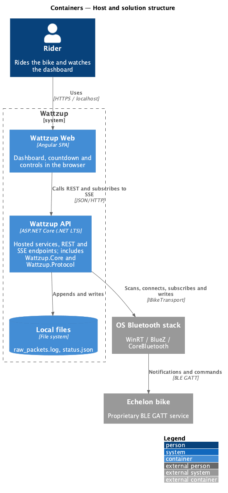
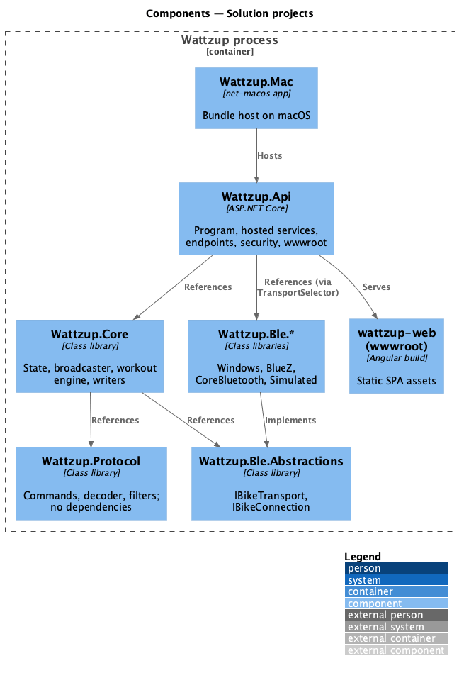

# Host and solution structure

## Overview

This feature describes how the Wattzup code base is organised and how it runs. It covers the .NET projects and their dependencies, the Angular application, configuration, and the host process lifecycle. Every other feature design names types inside the projects defined here.

**solution** — the .NET `Wattzup.sln` and its projects

**hosted service** — long-running background task started and stopped by the ASP.NET Core generic host

**single origin** — the Angular build is served by the same ASP.NET Core process and port as the API, so the browser needs no CORS

The dependency rule points inward. `Wattzup.Protocol` depends on nothing. `Wattzup.Core` depends on Protocol and the BLE abstractions. Platform transports depend only on the abstractions. `Wattzup.Api` composes everything.

## Description

.NET solution (current LTS, `Directory.Build.props` with nullable enabled and warnings as errors):

| Project | Kind | Contains |
|---|---|---|
| `Wattzup.Protocol` | class library | `EchelonUuids`, `EchelonCommands`, `EchelonDeviceFilter`, `PacketDecoder`, `TelemetryUpdate`, `SpeedCalculator` |
| `Wattzup.Ble.Abstractions` | class library | `IBikeTransport`, `IBikeConnection`, `BikeAdvertisement`, `BluetoothUnavailableException` |
| `Wattzup.Ble.Windows` / `.BlueZ` / `.CoreBluetooth` / `.Simulated` | class libraries | Platform transports (see `bluetooth-platform-transports`) |
| `Wattzup.Core` | class library | `BikeState`, `BikeStateStore`, `StateBroadcaster`, `DisplayTimeTracker`, `TelemetryIngestor`, `IResistanceCommander`, `WorkoutEngine`, `WorkoutValidator`, `RawPacketLogger`, `StatusSnapshotWriter` |
| `Wattzup.Api` | ASP.NET Core web app | `Program.cs`, hosted services, endpoint groups, security, `wwwroot` |
| `Wattzup.Mac` | `net*-macos` app | Bundles `Wattzup.Api` with `Info.plist` (`NSBluetoothAlwaysUsageDescription`) |
| `Wattzup.Protocol.Tests`, `Wattzup.Core.Tests`, `Wattzup.Api.AcceptanceTests` | xUnit | Unit tests; acceptance tests over `WebApplicationFactory` + `SimulatedBikeTransport` |

- **`Program.cs`** — builds the host with minimal APIs (L2-042):
  - It registers singletons (`BikeStateStore`, `StateBroadcaster`, `ActiveConnectionRegistry`, `RawPacketLogger`, `EventTokenService`).
  - It registers hosted services (`BikeConnectionService`, `WorkoutEngine` loop, `RawPacketLogWriter`, `StatusSnapshotWriter`, `StateChangeLogger`) and the transport through `TransportSelector`.
  - It maps the endpoint groups under `/api`, plus `/health` and `/openapi/v1.json`.
- **Thread safety** — `BikeStateStore` is the only writer of `BikeState`. It applies changes under a short lock and publishes by reference swap. Workout run state is touched only by the engine loop (L2-042).
- **`WattzupOptions`** — bound from `appsettings.json`, then `WATTZUP__*` environment variables, then the command line (L2-042). It covers:
  - `Urls` (default `http://127.0.0.1:8787`)
  - `Security:ApiKey` and `Cors:Origins`
  - `Ble:Transport`
  - `RawPacketLog:*` and `StatusSnapshot:*`
- **Graceful shutdown** — `HostOptions.ShutdownTimeout = 5 s`. On stop, in reverse start order:
  1. `WorkoutEngine` cancels its run.
  2. `BikeConnectionService` disposes the connection, which disconnects the bike.
  3. `EventsEndpoints` loops end through `ApplicationStopping`.
  4. `StatusSnapshotWriter` performs its final write.
  This realises L2-039, recorded in `discover-and-connect-bike`.
- **Static hosting** — `UseDefaultFiles` and `UseStaticFiles` serve `wwwroot` (the Angular `dist/browser` output, copied at publish). `MapFallbackToFile("index.html")` serves client routes, excluding `/api` (L2-044).

Angular application `wattzup-web` (L2-044):

- Current Angular version, standalone components only, `ChangeDetectionStrategy.OnPush` everywhere, signals for state, and zoneless change detection where supported.
- `src/app/core/` holds `LiveStateService`, `BikeApi`, `CueService`, `MetricHistory`, `WorkoutDraftStore`, `MotionPreference` and `ThemeService`. `src/app/dashboard/` holds the components. `src/app/api/` holds types generated from `/openapi/v1.json` by `openapi-typescript`. CI regenerates them and fails on a diff.
- `proxy.conf.json` forwards `/api` to `127.0.0.1:8787` during `ng serve`.
- `angular.json` budgets set `initial` to an error at 300 KB (gzipped size measured in CI with `gzip -9`), and shader source is lazy-loaded with the ring renderer.

## Requirements

| L2 ID | Refines (L1) | Requirement |
|-------|--------------|-------------|
| `L2-042` | `L1-012` | Backend technology and structure. |
| `L2-044` | `L1-012` | Frontend technology and structure. |

## Diagrams

### System context

The rider opens Wattzup in a browser on the same machine that talks to the bike.

### Containers

One process serves both Wattzup Web and the Wattzup API from a single origin, and writes local files.

### Components

The projects form an inward-pointing dependency graph with `Wattzup.Api` at the edge.

### Class structure

`Program` composes options, singletons and hosted services. Each hosted service is a separate class with its own lifecycle.

### Behaviour — start-up, serve and graceful shutdown

The host binds, starts background services without blocking, serves the SPA and API, and on stop shuts everything down within 5 s (L2-042, L2-044).

