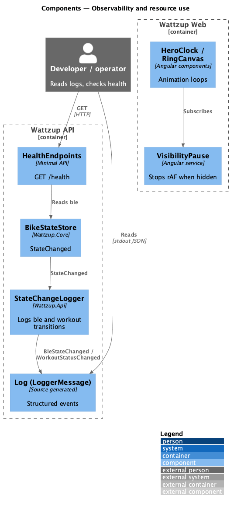
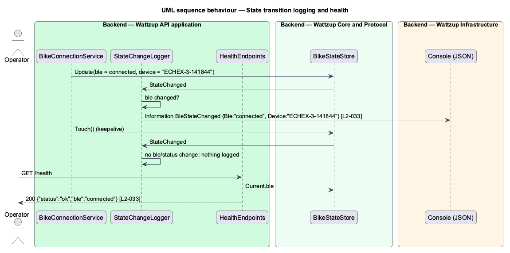

# Observability and resource use

## Overview

A ride lasts from 20 minutes to several hours, and Wattzup runs unattended throughout. Two needs follow. When something goes wrong, the logs explain what happened without drowning in per-packet noise. And over a long ride, neither the backend process nor the browser tab grows in memory or burns CPU. This feature defines structured logging, a health endpoint, and the resource budgets with the tests that hold the system to them.

**structured log** — log event with named properties (for example `Ble`, `Device`, `Error`) rather than text alone, so tools can filter and aggregate

**soak test** — long automated run, 4 hours here, that measures memory and CPU trends against fixed budgets

**warm-up level** — memory reading taken 5 minutes after start, used as the baseline for growth

## Description

Backend:

- **Logging** — `ILogger<T>` with source-generated `LoggerMessage` methods in `Log.cs` for each event (L2-033):
  - `BleStateChanged(Ble, Device, Error)` at Information.
  - `WorkoutStatusChanged(Status, Step, Cycle)` at Information.
  - `ApiRequestFailed(Path, StatusCode, Error)` at Warning.
  - `PacketReceived(Length, Type)` at Trace.
  Console output uses the JSON formatter in production and the simple formatter in development. The default minimum level is Information, so per-packet events are off unless enabled.
- **`StateChangeLogger`** — subscribes to `BikeStateStore.StateChanged` and logs only when `ble` or `workout.status` actually changes. Keepalive touches therefore produce no log lines.
- **`HealthEndpoints`** — `GET /health` returns `200 {"status":"ok","ble":"<state>"}` whenever the HTTP host is serving. Bluetooth trouble is reported in the body, not as a failure code, because the API remains usable (L2-033).
- **Resource design** (L2-038):
  - Every buffer is bounded: SSE channels at 50, the raw-packet channel at 10,000 and history at 150.
  - State is an immutable record swapped by reference.
  - Serialisation uses pooled `ArrayBufferWriter` buffers.
  - The process runs with Server GC off and `DOTNET_GCConserveMemory=5`.
- **`SoakTests`** — xUnit test category `Soak`. It runs the host with `SimulatedBikeTransport` and 1 SSE client for 4 hours, and samples `Process.WorkingSet64` and CPU time every minute. It asserts memory growth of at most 20 MB over the warm-up level, and mean idle CPU below 2 % of one core (L2-038).

Frontend:

- **`VisibilityPause`** — service listening for `visibilitychange`. `HeroClock` and `RingCanvas` stop their `requestAnimationFrame` loops while hidden and restart on return. `MetricHistory` keeps sampling (L2-038).
- **Allocation discipline** — the render loop reuses one `Float32Array` uniform buffer and one `RingVisuals` object. Sparklines redraw on the history `version` signal only, not on every state message.
- **Playwright soak** — keeps the dashboard open for 4 hours against the simulator. It records `performance.memory.usedJSHeapSize` (Chromium) every 5 minutes and frame timing through a `PerformanceObserver`. It asserts growth of at most 50 MB and at least 55 fps on the reference laptop. The reference hardware is `<TO SUPPLY>` (L2-038).

## Requirements

| L2 ID | Refines (L1) | Requirement |
|-------|--------------|-------------|
| `L2-033` | `L1-008` | Structured logging and health. |
| `L2-038` | `L1-010` | Resource use over long rides. |

## Diagrams

### System context

Wattzup runs for the length of a ride with no operator attention.

### Containers

Both the Wattzup API and Wattzup Web carry resource budgets. The API writes logs and exposes health.

### Components

`StateChangeLogger` turns state transitions into structured events. `HealthEndpoints` reports liveness. `VisibilityPause` throttles the browser when the tab is hidden.

### Class structure

Log events are source-generated methods. The soak tests are ordinary test classes driving the simulated host.

### Behaviour — state transition logging and health

A Bluetooth state change produces one structured Information event, keepalives produce none, and `/health` reports the current state (L2-033).

### Behaviour — hidden tab

Hiding the tab stops animation frames, and showing it resumes them (L2-038).

