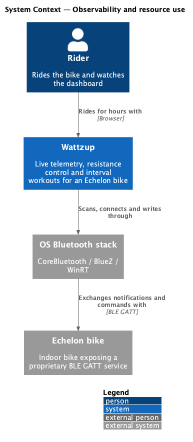
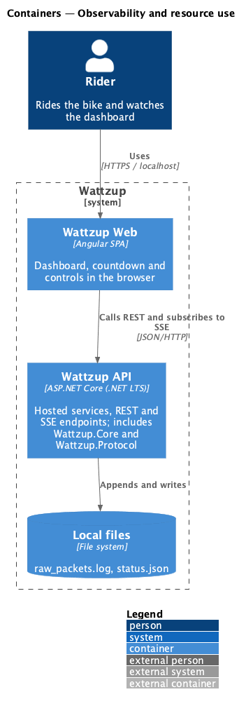
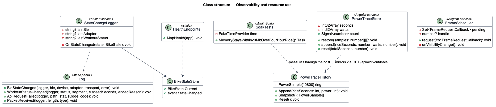
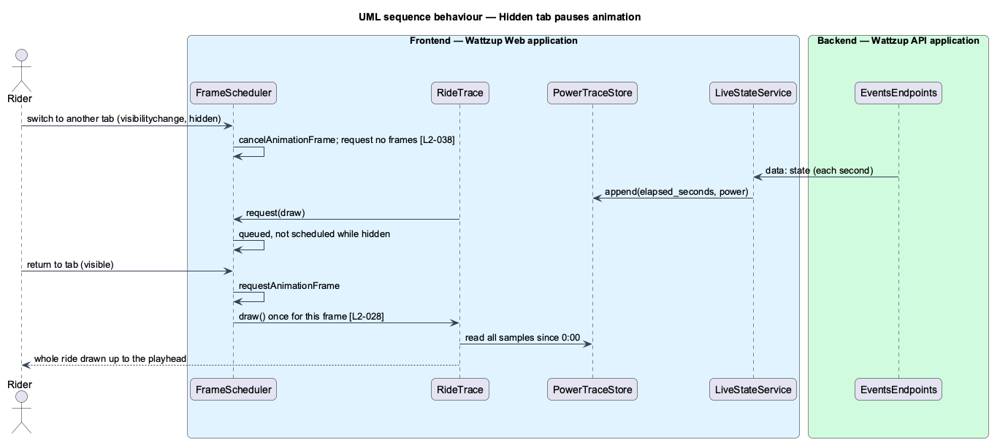

# Observability and resource use

## Overview

A ride lasts from 20 minutes to several hours, and Wattzup runs unattended throughout. Two needs follow. When something goes wrong, the logs explain what happened without drowning in per-packet noise. And over a long ride, neither the backend process nor the browser tab grows in memory or burns CPU. This feature defines structured logging, a health endpoint, the memory bound of every buffer that grows with a ride, and the checks that hold the system to its resource budgets.

**structured log** — log event with named properties (for example `Ble`, `Device`, `Error`) rather than text alone, so tools can filter and aggregate

**soak test** — long run, a 4-hour ride here, that measures memory and CPU trends against fixed budgets

**warm-up level** — memory reading taken 5 minutes into the ride, used as the baseline for growth

**trace history** — per-ride list of `[ride_seconds, power]` samples behind the "Power vs. plan" trace, held by the backend (L2-050) and mirrored in the browser

**frame scheduler** — single browser service that owns `requestAnimationFrame` for the dashboard and stops it while the tab is hidden

## Description

Backend logging and health (L2-033):

- **`Log`** — `ILogger<T>` with source-generated `LoggerMessage` methods, one per event:
  - `BleStateChanged(Ble, Device, Adapter, Transport, Error)` at Information.
  - `WorkoutStatusChanged(Status, Segment, ElapsedSeconds, EndedReason)` at Information.
  - `ApiRequestFailed(Path, StatusCode, Code)` at Warning.
  - `PacketReceived(Length, Type)` at Trace.
  `Path` never carries the query string, so no event token reaches a log. No event carries the API key. Console output uses the JSON formatter in production and the simple formatter in development. The default minimum level is Information, so per-packet events are off unless enabled.
- **`StateChangeLogger`** — hosted service subscribed to `BikeStateStore.StateChanged`. It logs only when `ble`, `adapter` or `workout.status` actually changes. Keepalive touches and per-second workout ticks therefore produce no log lines.
- **`HealthEndpoints`** — `GET /health` returns `200 {"status":"ok","ble":"<state>"}` whenever the HTTP host is serving. Bluetooth trouble is reported in the body, not as a failure code, because the API remains usable. The endpoint sits outside the `/api` group, so it needs no API key.

Backend memory bounds (L2-038). Each buffer that a ride can grow has a fixed bound:

| Buffer | Owner feature | Bound |
|---|---|---|
| Event-stream channel per client | `live-state/stream-live-state` | 50 messages, drop newest for that client (ADR 0004) |
| Raw-packet write channel | `telemetry/log-raw-packets` | 10,000 lines |
| `RecentPacketBuffer` for `GET /api/diagnostics/packets` | `telemetry/log-raw-packets` | 60 packets (L2-057) |
| Command log in the state | `resistance-control/log-resistance-commands` | 5 entries (L2-048) |
| `PowerTraceHistory` | `live-state/serve-power-trace` | ring of 10,800 samples, 1 per running second |
| Event tokens | `platform/secure-api` | pruned at 60 s |

- `PowerTraceHistory` is a fixed ring of 10,800 `PowerSample` structs, about 86 KB allocated once. A 3-hour ride fills it, and a longer ride overwrites the oldest samples, so a 4-hour ride adds no memory. The response stays near 130 KB, under the 200 KB of L2-050.
- A new workout resets the history and the ride totals, so no ride's data outlives the next ride.
- State is an immutable record swapped by reference. Serialisation writes into pooled `ArrayBufferWriter<byte>` buffers.

Frontend (L2-038):

- **`FrameScheduler`** — root service in `src/app/core/`. It is the only caller of `requestAnimationFrame` on the dashboard.
  - `RideTrace` and the countdown (`workouts/show-workout-countdown`) call `request(callback)`, and each frame runs each pending callback once, so redraws never exceed one per frame (L2-028).
  - It listens for `visibilitychange`. While `document.hidden` is true it requests no frames, and it requests the next frame when the tab is visible again.
- **`PowerTraceStore`** — holds the browser copy of the trace history in 2 `Int32Array`s of 10,800 entries, matching the backend ring. It is filled from `GET /api/workout/trace` on load and appended from each state message (`dashboard/show-live-metrics`). It is cleared when a new workout starts, so its size is bounded by one plan.
- **Allocation discipline** — the renderers reuse one vertex buffer (WebGL) or one `Path2D` per redraw (Canvas 2D). Segment geometry is recomputed only when the plan changes. The toast queue shows at most 3 toasts (L2-053).

Checks:

- **Backend soak** — xUnit category `Soak`, run only on request. It hosts the API with `SimulatedBikeTransport` and 1 in-memory event-stream client. It advances a `FakeTimeProvider` through a 4-hour HIIT ride (14,400 ticks with telemetry) and reads `GC.GetTotalMemory(forceFullCollection: true)` every simulated minute. It asserts growth of at most 20 MB over the warm-up level.
- **Idle CPU** — measured by a person with `dotnet-counters` against the running host for 10 minutes with no client, against the budget of 2 % of one core. A CPU budget cannot be measured without waiting in real time, so no automated test covers it.
- **Frontend soak** — Playwright spec tagged `@soak`, run only when a person asks. The stubbed event stream pushes 4 hours of state messages under Playwright's clock, and the spec reads `JSHeapUsedSize` through the Chrome DevTools Protocol every simulated 5 minutes. It asserts growth of at most 50 MB.
- **Frame rate** — measured by a person on the reference laptop with a `PerformanceObserver` over frame timing, against at least 55 fps. The reference hardware is the machine next to the bike; each measurement records its model, CPU and browser version.
- **Hidden tab** — a behaviour spec sets `document.hidden` through the page and asserts that `FrameScheduler` requests no frame until the tab is visible again.

## Requirements

| L2 ID | Refines (L1) | Requirement |
|-------|--------------|-------------|
| `L2-033` | `L1-008` | Structured logging and health. |
| `L2-038` | `L1-010` | Resource use over long rides. |

## Diagrams

### System context

Wattzup runs for the length of a ride with no operator attention.

### Containers

Both the Wattzup API and Wattzup Web carry resource budgets. The API writes logs and exposes health.

### Components

`StateChangeLogger` turns state transitions into structured events. `HealthEndpoints` reports liveness. `FrameScheduler` stops animation in the browser when the tab is hidden, and `PowerTraceStore` holds the bounded trace history.

### Class structure

Log events are source-generated methods. The bounded buffers are owned by their features, and the soak tests drive the simulated host.

### Behaviour — state transition logging and health

A Bluetooth state change produces one structured Information event, keepalives produce none, and `/health` reports the current state (L2-033).

### Behaviour — hidden tab

Hiding the tab stops animation frames, and showing it resumes them. The trace history keeps growing from state messages while hidden, so the first visible frame draws the whole ride (L2-038).

