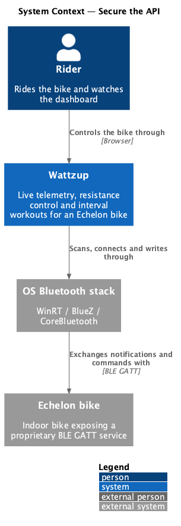
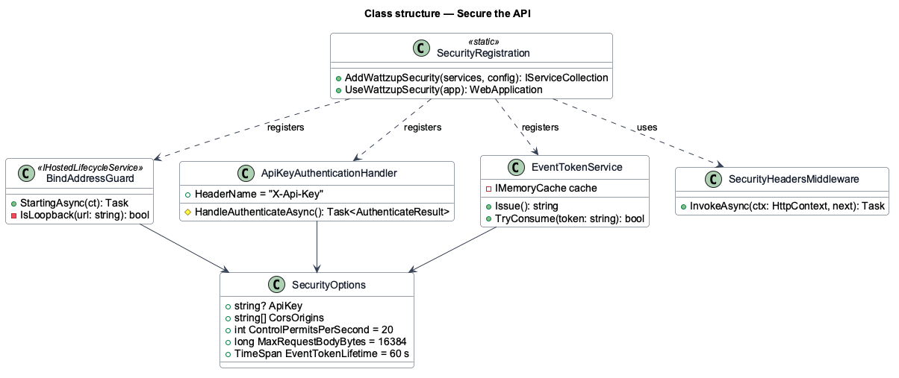
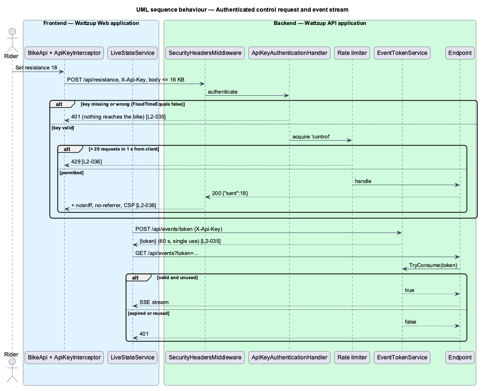

# Secure the API

## Overview

The Wattzup API can physically change a piece of exercise equipment. A sudden jump to resistance 32 mid-ride is a safety issue, not only a nuisance. The prototype listened on loopback only and had no authentication, which is safe only while nothing else on the machine misbehaves. The rewrite keeps loopback as the default. It requires an API key before the service may listen on any other address, and it hardens every endpoint against malformed or abusive input.

**loopback-only mode** — the default deployment, listening on `127.0.0.1:8787` only and requiring no key

**API key** — shared secret configured on the server and sent by clients in the `X-Api-Key` header

**event token** — short-lived, single-use token that authorises one `EventSource` connection, because `EventSource` cannot send custom headers

**control endpoint** — `POST /api/resistance`, `POST /api/workout` or `POST /api/workout/stop`

## Description

- **`BindAddressGuard`** — runs at start-up, before Kestrel binds. When any configured URL resolves to a non-loopback address and `Wattzup:Security:ApiKey` is empty, it logs a Critical message and stops the host with a non-zero exit code (L2-034).
- **`ApiKeyAuthenticationHandler`** — ASP.NET Core `AuthenticationHandler`, registered when a key is configured. It reads `X-Api-Key` and compares it with `CryptographicOperations.FixedTimeEquals` over the UTF-8 bytes. A missing or wrong key yields 401 before any endpoint code runs. In loopback-only mode with no key, an `AllowAnonymous` policy applies (L2-035).
- **`EventTokenService`** — `POST /api/events/token` (requires the API key) issues a 32-byte random token, base64url-encoded and held in `IMemoryCache` with a 60 s absolute expiry. `GET /api/events?token=…` accepts the request only when `TryConsume` removes the token, which makes each token single-use (L2-035).
- **`LiveStateService`** (frontend) — when the app is configured with an API key, it requests an event token before each (re)connect. `BikeApi` adds `X-Api-Key` through an `HttpInterceptor`. The key is entered once and kept in `sessionStorage`.
- **CORS** — `AddCors` with a named policy built from `Wattzup:Cors:Origins`. The list is empty by default, which allows no cross-origin calls. Development settings list `http://localhost:4200` only (L2-034).
- **Input limits** — Kestrel `MaxRequestBodySize = 16 KB` (413 above that). Minimal API binding rejects malformed JSON and wrong content types with 400 or 415 (L2-036).
- **Rate limiting** — `AddRateLimiter` with a fixed-window policy `control` (20 permits per 1 s, partitioned by remote IP) applied to the 3 control endpoints. Rejected requests get 429 (L2-036).
- **`SecurityHeadersMiddleware`** — adds `X-Content-Type-Options: nosniff`, `Referrer-Policy: no-referrer` and `Content-Security-Policy: default-src 'self'; script-src 'self'; style-src 'self'; connect-src 'self'; img-src 'self' data:; object-src 'none'; frame-ancestors 'none'` to every response (L2-036).
- **Error handling** — `AddProblemDetails` plus `UseExceptionHandler`. Unhandled exceptions return a generic 500 `ProblemDetails`, and details go to the log only (L2-036).
- **Output encoding** — Angular interpolation escapes all text. No component uses `innerHTML` with state values, so device names and error strings cannot inject markup (L2-036).

## Requirements

| L2 ID | Refines (L1) | Requirement |
|-------|--------------|-------------|
| `L2-034` | `L1-009` | Network exposure. |
| `L2-035` | `L1-009` | API authentication. When an API key is configured, every `/api/*` endpoint must require it. |
| `L2-036` | `L1-009` | Input validation and hardening. |

## Diagrams

### System context

The rider, and only the rider, controls the bike through Wattzup.

### Containers

Wattzup Web calls the Wattzup API, which enforces binding, authentication and input rules.

### Components

Requests pass through the security headers, CORS, authentication and rate limiting before they reach an endpoint. `BindAddressGuard` acts once, at start-up.

### Class structure

Each protection is a separate, individually testable type registered in the ASP.NET Core pipeline.

### Behaviour — authenticated control request and event stream

With a key configured, a control request is checked for its key and rate. The event stream obtains a single-use token first (L2-035, L2-036).

### Behaviour — start-up binding check

A non-loopback binding without a key stops the host before it listens (L2-034).

