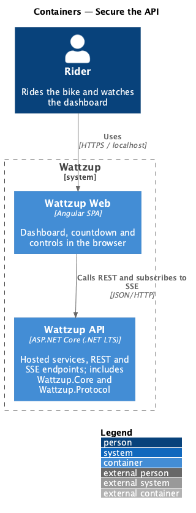
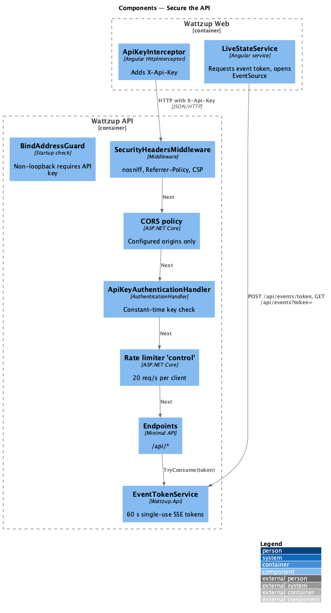
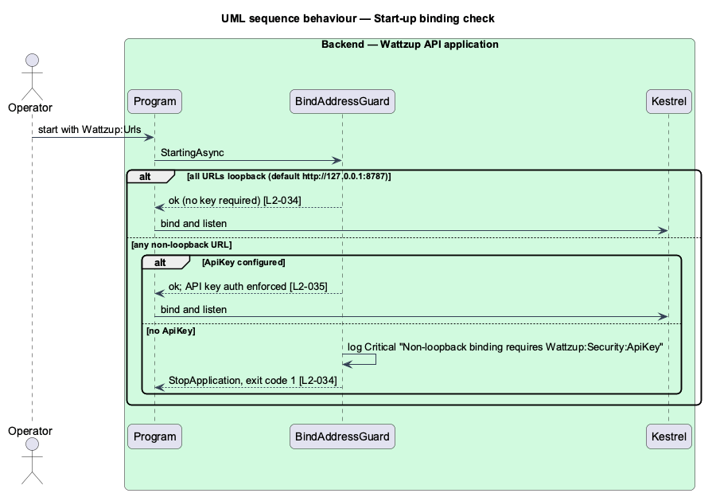

# Secure the API

## Overview

The Wattzup API can physically change a piece of exercise equipment. A sudden jump to resistance 32 mid-ride is a safety issue, not only a nuisance. The prototype listened on loopback only and had no authentication, which is safe only while nothing else on the machine misbehaves. The rewrite keeps loopback as the default. It requires an API key before the service may listen on any other address, and it hardens every endpoint against malformed or abusive input.

**loopback-only mode** — the default deployment, listening on `127.0.0.1:8787` only and requiring no key

**exposed mode** — deployment bound to a non-loopback address, which requires an API key; the state reports it as `exposed = true` with its `bind_address`

**API key** — shared secret configured on the server in `Wattzup:Security:ApiKey` and sent by clients in the `X-Api-Key` header

**event token** — short-lived, single-use token that authorises one `EventSource` connection, because `EventSource` cannot send custom headers (ADR 0004)

**control endpoint** — an endpoint that changes the bike or the ride, or reads ride data on the control path: `POST /api/resistance`, `POST /api/workout`, `POST /api/workout/stop`, `POST /api/workout/pause`, `POST /api/workout/resume`, `POST /api/workout/back-to-plan`, `GET /api/workout/trace` and `POST /api/bike/reconnect`, the control requests listed in L2-036

The browser side of the key, the `/unlock` page and the 401 redirect, belongs to `dashboard/unlock-and-not-found`. The `Shared on your network` banner that warns the rider in exposed mode belongs to `dashboard/show-connection-status`.

## Description

- **`BindAddressGuard`** — `IHostedLifecycleService` that runs in `StartingAsync`, before Kestrel binds. When any configured URL resolves to a non-loopback address and `Wattzup:Security:ApiKey` is empty, it logs a Critical message and stops the host with a non-zero exit code (L2-034). `HostFacts` (`live-state/stream-live-state`) reports the same address as `bind_address` and `exposed`, which drive the `Shared on your network` banner.
- **`ApiKeyAuthenticationHandler`** — ASP.NET Core `AuthenticationHandler`, registered when a key is configured. It reads `X-Api-Key` and compares it with `CryptographicOperations.FixedTimeEquals` over the UTF-8 bytes (L2-035).
  - A missing or wrong key yields 401 before any endpoint code runs, so no command reaches the bike.
  - The `/api` route group carries `RequireAuthorization` when a key is configured. That covers every `/api/*` endpoint: status, events, events token, resistance, every workout endpoint including pause, resume, back-to-plan and trace, `GET /api/diagnostics/packets`, `GET /api/classes` and `GET /api/classes/{id}` (L2-078 criterion 6), and `GET /api/sessions`, `GET /api/sessions/{id}` and `GET /api/progress` (L2-083 criterion 5).
  - In loopback-only mode with no key, the group allows anonymous requests.
  - `/health` and the static files stay outside the group.
- **`EventTokenService`** — `POST /api/events/token` (requires the API key) issues a 32-byte random token, base64url-encoded. The service holds it in a `ConcurrentDictionary` with an expiry 60 s ahead of the injected `TimeProvider`, pruning expired entries on each issue. `GET /api/events?token=…` is accepted only when `TryConsume` removes an unexpired token, which makes each token single-use (L2-035). The token is never logged, because the request logging excludes query strings.
- **CORS** — `AddCors` with a named policy built from `Wattzup:Cors:Origins`. The list is empty by default, which allows no cross-origin calls. Development settings list `http://localhost:4200` only (L2-034).
- **Input limits** — Kestrel `MaxRequestBodySize = 16 KB` (413 above that). Minimal API binding rejects malformed JSON with 400 and a wrong content type with 415, as ProblemDetails with no stack trace (L2-036).
- **Rate limiting** — `AddRateLimiter` with a fixed-window policy `control` (20 permits per `SecurityOptions.ControlWindow` of 1 s, partitioned by remote IP), applied to every control endpoint. Rejected requests get 429 as ProblemDetails with `code` = `rate_limited` (L2-036). `GET /api/status`, `GET /api/events`, `POST /api/events/token`, `GET /api/diagnostics/packets`, `GET /api/classes`, `GET /api/classes/{id}` and the three session reads (L2-083) are not control requests under L2-036 and carry no rate limit.
- **`SecurityHeadersMiddleware`** — adds `X-Content-Type-Options: nosniff`, `Referrer-Policy: no-referrer` and a Content-Security-Policy to every response (L2-036).
  - The policy is `default-src 'self'; script-src 'self'; style-src 'self' 'nonce-<n>'; font-src 'self'; connect-src 'self'; img-src 'self' data: https://i.ytimg.com; object-src 'none'; base-uri 'self'; frame-ancestors 'none'`.
  - `font-src 'self'` holds because the fonts are bundled and self-hosted (ADR 0005).
  - Angular adds component styles as `<style>` elements at run time. The host therefore serves `index.html` with a fresh per-response nonce in the `ngCspNonce` attribute and the same nonce in `style-src`. The production build turns off critical-CSS inlining so no other inline style exists.
  - The policy allows exactly 3 origins beyond `'self'`, all YouTube's (L2-036 criterion 4, ADRs 0012 and 0014):
    - `frame-src https://www.youtube-nocookie.com` for the embedded player;
    - `https://www.youtube.com` in `script-src` for the IFrame player API;
    - `https://i.ytimg.com` in `img-src` for class covers.

    `connect-src`, `style-src` and `font-src` stay same-origin. The frontend loads the player script only when a valid link is entered on setup or on a class page, or when the workout has a video (`workouts/ride-along-video`). It builds each cover URL from a validated `video_id` only (`classes/browse-classes`). `Every_response_allows_only_the_YouTube_origins_beyond_self` reads the header.
- **Error handling** — `AddProblemDetails` plus `UseExceptionHandler`. Unhandled exceptions return a generic 500 `ProblemDetails`, and the detail goes to the server log only (L2-036).
- **Output encoding** — Angular interpolation escapes all text. No component binds `innerHTML` with state values, so device names, the device label and error strings cannot inject markup (L2-036).
- **Frontend key handling** — `apiKeyInterceptor` adds `X-Api-Key` from `ApiKeyStore` (session storage) to every `/api` request. `LiveStateService` requests an event token before each (re)connect when a key is held. The key is never put in a URL or a log (`dashboard/unlock-and-not-found`).

Acceptance tests in `Wattzup.Api.AcceptanceTests` use `WebApplicationFactory` with `SimulatedBikeTransport`:

- **Binding** — a non-loopback URL with no key fails host start. Loopback with no key serves `/api/status` anonymously.
- **Key** — with a key configured, a request without the key or with a wrong one gets 401, and the simulated connection records no write. A representative set of endpoints (`/api/resistance`, `/api/workout/pause`, `/api/workout/trace`, `/api/diagnostics/packets`) is checked.
- **Event token** — a token works once. A second use gets 401, as does a token after `FakeTimeProvider` advances 61 s.
- **Rate limit** — the test configures a long `ControlWindow` so no time passes during the burst. The 21st control request gets 429.
- **Hardening** — a 17 KB body gets 413. Malformed JSON gets 400 and a wrong content type gets 415, neither with a stack trace. Each response carries the 3 security headers.

The single-use token and constant-time comparison have unit tests in `Wattzup.Core.Tests` or the API test project, one case per rule.

## Requirements

| L2 ID | Refines (L1) | Requirement |
|-------|--------------|-------------|
| `L2-034` | `L1-009` | Network exposure. |
| `L2-035` | `L1-009` | API authentication. When an API key is configured, every `/api/*` endpoint must require it. |
| `L2-078` | `L1-005` | Class endpoints. Criterion 6: given an API key is configured, when either endpoint is called without it, then it answers 401. |
| `L2-083` | `L1-005` | Sessions API. Criterion 5: given an API key is configured, the session and progress endpoints answer 401 without it. |
| `L2-036` | `L1-009` | Input validation and hardening, with the three Content-Security-Policy exceptions for YouTube (criterion 4): the player and its script for the ride-along video (ADR 0012), and `img-src https://i.ytimg.com` for class covers (ADR 0014). |

## Diagrams

### System context

The rider, and only the rider, controls the bike through Wattzup.

### Containers

Wattzup Web calls the Wattzup API, which enforces binding, authentication and input rules.

### Components

Requests pass through the security headers, CORS, authentication and rate limiting before they reach an endpoint. `BindAddressGuard` acts once, at start-up.

### Class structure

Each protection is a separate, individually testable type registered in the ASP.NET Core pipeline.

### Behaviour — authenticated control request and event stream

With a key configured, a control request is checked for its key and rate. The event stream obtains a single-use token first (L2-035, L2-036).

### Behaviour — start-up binding check

A non-loopback binding without a key stops the host before it listens (L2-034).

