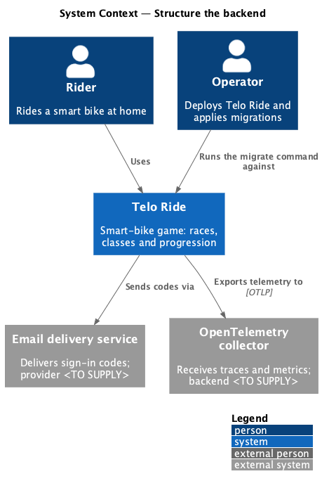
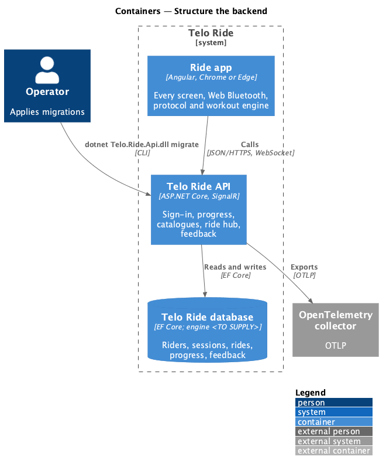
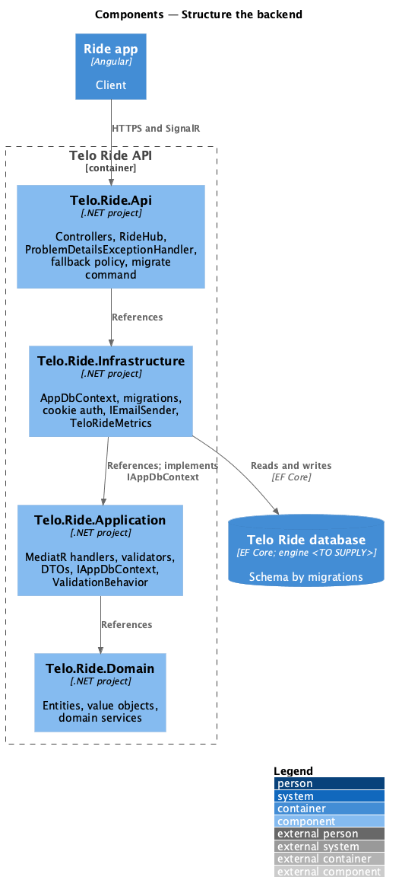
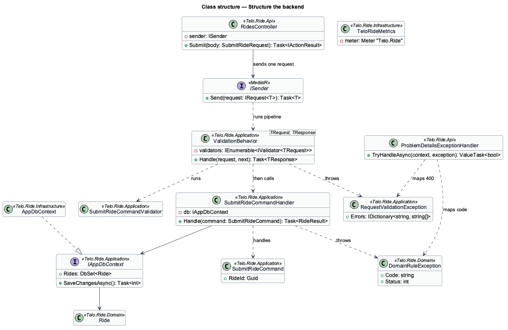
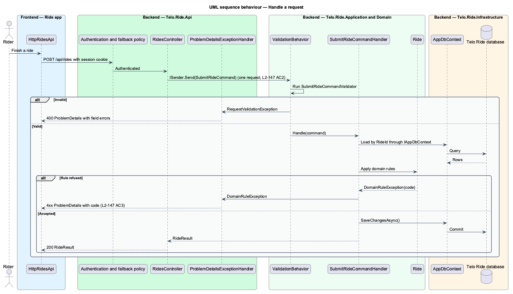
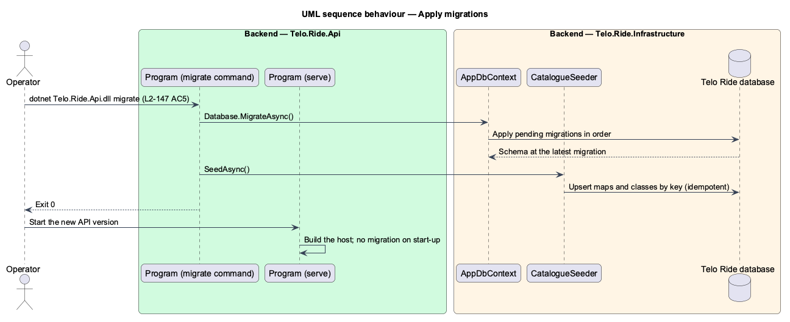

# Structure the backend

## Overview

The Telo Ride backend is thin. It does only what one browser cannot do alone: email sign-in,
rider progress, live races and group classes, and feedback. It never talks to the bike. A thin
service still needs a firm shape, so that each rule lives in one place and the rules can be tested
without the web host. This feature defines the clean-architecture layout of the backend, the single
path every request takes, the error format, the telemetry and how the schema changes.

- **clean architecture** — layering in which inner layers (domain, application) know nothing of outer layers (infrastructure, API)
- **MediatR request** — command or query object dispatched to exactly one handler
- **pipeline behaviour** — MediatR step that runs around every handler, such as validation
- **ProblemDetails** — RFC 9457 JSON error body; Telo Ride adds a `code` extension a client branches on
- **migration** — EF Core class that changes the database schema from one version to the next

The feature belongs to the platform subsystem. It is a backend-only slice that every backend
feature builds on. ADR 0019 (no backend) is superseded by an ADR `<TO SUPPLY>` before the backend
lands.

## Description

- **`Telo.Ride.Domain`** — entities, value objects and domain services. It references no other
  project and no package beyond the base class library.
- **`Telo.Ride.Application`** — MediatR handlers, FluentValidation validators, DTOs and
  `IAppDbContext`. It references `Telo.Ride.Domain` only.
- **`Telo.Ride.Infrastructure`** — `AppDbContext : IAppDbContext` (EF Core), migrations, cookie
  authentication, `IEmailSender` implementation, rate-limiting stores and `TeloRideMetrics`. It
  references `Telo.Ride.Application`.
- **`Telo.Ride.Api`** — `Program.cs`, controllers, the `RideHub` SignalR hub, the exception
  handler and the fallback authorization policy. It references `Telo.Ride.Infrastructure`. Project
  references enforce the direction at compile time.
- **Controllers and hub methods** — each action binds its input, sends one MediatR request with
  `ISender.Send` and maps the result to a response. It checks nothing itself.
- **`ValidationBehavior<TRequest, TResponse>`** — MediatR pipeline behaviour in
  `Telo.Ride.Application`. It runs every validator for the request and throws
  `RequestValidationException` with the failures.
- **`DomainRuleException`** — exception in `Telo.Ride.Domain` carrying a `Code` (for example
  `session_full`, `ride_not_plausible`) and an HTTP status class.
- **`ProblemDetailsExceptionHandler`** — `IExceptionHandler` in `Telo.Ride.Api`. It maps
  `RequestValidationException` to 400 with field errors and `DomainRuleException` to its status
  with the `code` extension, using `IProblemDetailsService`. Unexpected exceptions become 500
  without detail.
- **`TeloRideMetrics`** — instruments on the OpenTelemetry meter `Telo.Ride`. `Program.cs`
  registers OpenTelemetry tracing and metrics with ASP.NET Core and EF Core instrumentation. No
  attribute carries a contact detail, token, message text, query string or body; routes are
  recorded as templates.
- **Migrations** — added with `dotnet ef migrations add` into `Telo.Ride.Infrastructure`. The API
  binary accepts a `migrate` command (`dotnet Telo.Ride.Api.dll migrate`) that applies pending
  migrations with `Database.MigrateAsync()`, runs the idempotent `CatalogueSeeder` and exits.
  Normal start-up never migrates.
- **Database engine** — `<TO SUPPLY>`.

## Requirements

| L2 ID | Refines (L1) | Requirement |
|-------|--------------|-------------|
| `L2-147` AC1 | `L1-024` | `backend/` shall hold `Telo.Ride.Domain`, `Telo.Ride.Application`, `Telo.Ride.Infrastructure` and `Telo.Ride.Api`, each depending only on the layers before it. |
| `L2-147` AC2 | `L1-024` | A controller action or hub method shall check nothing itself and shall send one MediatR request. |
| `L2-147` AC3 | `L1-024` | Errors shall be ProblemDetails with a `code` where a client branches on them. |
| `L2-147` AC4 | `L1-024` | Telemetry shall use OpenTelemetry instruments on the `Telo.Ride` meter. |
| `L2-147` AC5 | `L1-024` | When the database schema changes, a migration shall be added and applied by a CLI command, never on API start-up. |

## Diagrams

### System context

The Ride app calls the backend; an operator applies migrations; telemetry goes to an OpenTelemetry
collector.

### Containers

The Telo Ride API is one deployable over one database.

### Components

The four projects stack in one direction: API to Infrastructure to Application to Domain.

### Class structure

A controller depends on `ISender`; the pipeline runs `ValidationBehavior` before the handler; the
handler works through `IAppDbContext` and domain types; the exception handler shapes errors.

### Behaviour — handle a request

Every request takes the same path: authenticate, send one MediatR request, validate, handle, and
answer with a result or ProblemDetails (`L2-147` AC2, AC3).

### Behaviour — apply migrations

An operator runs the `migrate` command before starting the new version; the API itself never
migrates (`L2-147` AC5).

