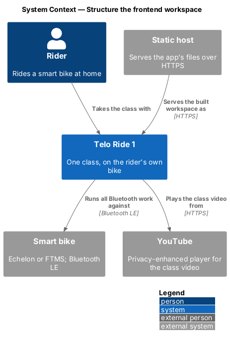
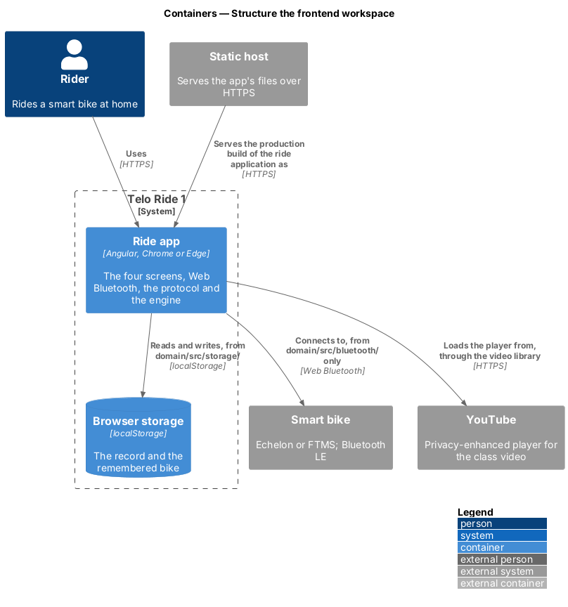
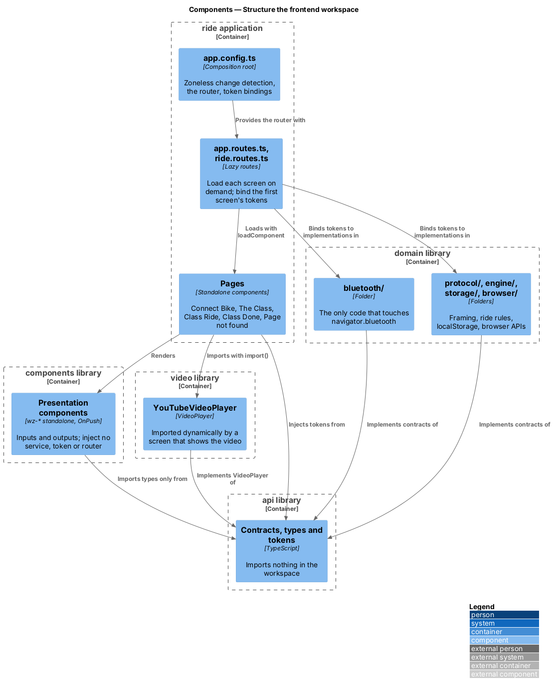
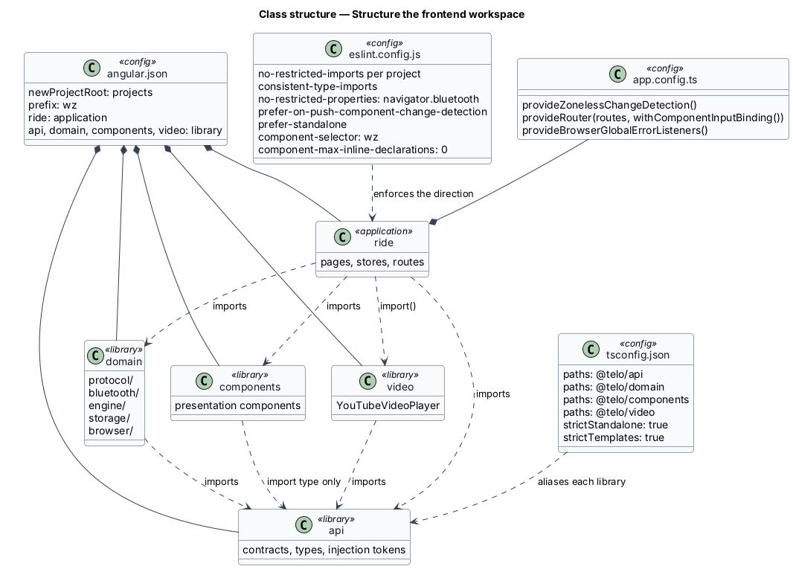
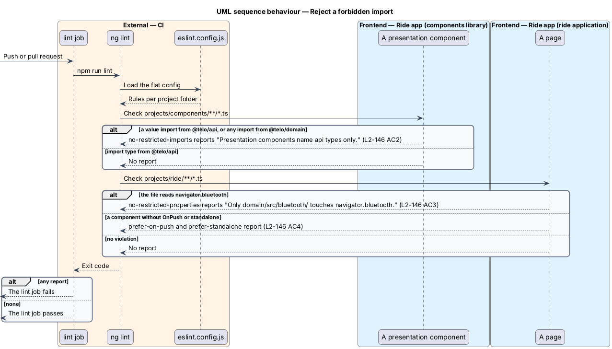
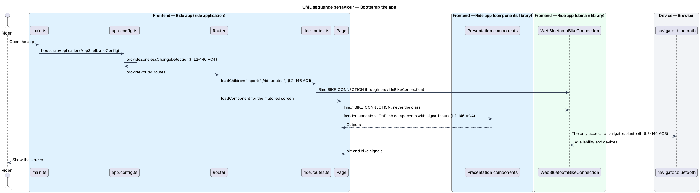

# Structure the frontend workspace

## Overview

Telo Ride 1 is a frontend product: the four screens, the Bluetooth link, the protocol and the ride
rules all run in the browser on the device (`L1-024`). This feature describes how that code is
organised so that the rules stay enforceable: one Angular workspace, one application, four
libraries with a fixed dependency direction, Web Bluetooth confined to one folder, and current
Angular throughout. The structure is checked by lint, not by tests.

Local terms:

- **workspace**: Angular CLI workspace in `frontend/`, described by `angular.json`, that holds every frontend project
- **application**: workspace project that is built and served, here `ride`
- **library**: workspace project compiled from source by the application through a path alias
- **dependency direction**: rule that states which project may import which
- **composition root**: single place that binds injection tokens to implementations, here `app.config.ts`
- **presentation component**: component that takes inputs, emits outputs and injects no app service, token or router

Neighbouring features own the adjacent concerns:

- [Test without hardware](../test-without-hardware/README.md) owns the Playwright fixtures and
  the fake clocks (`L2-148`).
- [Host and deliver](../host-and-deliver/README.md) owns the CI workflow that runs lint and the
  production build (`L2-149`).
- [Meet performance budgets](../../performance/meet-performance-budgets/README.md) owns the
  `angular.json` budgets and the rule that each screen and the video player load on demand
  (`L2-136`).
- [Connect a bike](../../bike/connect-a-bike/README.md) owns the Bluetooth code that lives in
  `domain`'s `bluetooth/` folder (`L2-011` to `L2-014`).
- [Open the app](../../the-class/open-the-app/README.md) owns the routes of the four screens
  (`L2-167`).

## Description

### Projects (`L2-146` AC1)

- **`frontend/angular.json`**: exists. One workspace with `newProjectRoot` `projects` and the
  prefix `wz` on every project. It holds the application `ride` and the libraries `api`, `domain`,
  `components` and `video`, which are the five projects `L2-146` AC1 names. It also holds the
  library `world` and the application `marketing`, carried over from Telo Ride. Telo Ride 1 does
  not use or extend them; each is removed in a change of its own, with an ADR where it reverses
  ADR 0027 or ADR 0030.
- **Path aliases** (`frontend/tsconfig.json`): exist. `@telo/api`, `@telo/domain`,
  `@telo/components` and `@telo/video` each map to the library's `src/public-api.ts`. The
  application compiles library source directly, so no library has a build target (ADR 0013,
  ADR 0024). The `@telo/world` alias leaves with the `world` library.
- **Library `package.json`**: exists in each library, private, with `"sideEffects": false`, so the
  bundler drops unused exports of a barrel.
- **`api`**: exists. Contracts, types and injection tokens, for example `BikeConnection` and
  `BIKE_CONNECTION`, `RememberedBike` and `REMEMBERED_BIKE`, `VideoPlayer` and
  `VIDEO_PLAYER_FACTORY`, `MonotonicTime` and `MONOTONIC_TIME`, `Ticker` and `TICKER`, `Fullscreen`
  and `ScreenWakeLock`. The carried-over HTTP and SignalR clients (`auth/`, `riders/`, `rides/`,
  `progress/`, `live/`, `maps/`) are not part of Telo Ride 1. Whether `classes/` keeps an HTTP
  client is `<TO SUPPLY>` (`L2.md` open question 1).
- **`domain`**: exists. `protocol/` (`EchelonFrameDecoder`, `IndoorBikeDataDecoder`, the Echelon
  and FTMS command builders), `bluetooth/` (`WebBluetoothBikeConnection`, `EchelonLink`,
  `FtmsLink`, `GattWriteQueue`, `KeepaliveScheduler`, `DeviceReconnector`,
  `SimulatedBikeConnection`), `engine/` (`WorkoutEngine`, `RideClock`, `ResistanceController`,
  `BikeTelemetry`), `storage/` (`RememberedBikeStore`) and `browser/` (`BrowserFullscreen`,
  `BrowserScreenWakeLock`).
- **`components`**: exists. One folder per design-system block, each a standalone component as
  `name.ts`, `name.html` and `name.scss`. The blocks for the four screens are owned by the screen
  features; blocks for Telo Ride's other screens are carried over.
- **`video`**: exists. `YouTubeVideoPlayer` implements `VideoPlayer`. The application reaches it
  only through a dynamic `import()` bound to `VIDEO_PLAYER_FACTORY`.
- **`ride`**: exists. `app.config.ts`, `app.routes.ts`, `ride.routes.ts`, the shell `AppShell`
  (selector `wz-root`) and one folder per page. The pages for Telo Ride 1 are reshaped or new and
  are owned by the screen features.

### Dependency direction (`L2-146` AC2)

- **`frontend/eslint.config.js`**: exists. One flat config for every project.
  `@typescript-eslint/no-restricted-imports` is configured per project folder:
  - `projects/api/**`: no `@telo/*` import and no `@angular/router`.
  - `projects/domain/**` and `projects/video/**`: `@telo/api` only.
  - `projects/components/**`: `@telo/api` with `allowTypeImports: true`, and no `@telo/domain`,
    `@telo/video` or `@angular/router`. `@typescript-eslint/consistent-type-imports` makes a
    type-only import explicit.
  - Every library: no relative path that leaves its project (`^(\.\./){3,}`) and no path under
    `ride`.
  - `projects/ride/**`: libraries by alias only, never by relative path.
- **What changes**: the `world` and `marketing` blocks of the config, and each `@telo/world`
  entry, leave with those projects. `AGENTS.md` still states the direction with `world` and
  `marketing` in it; `L2-146` AC2 names neither. The change that removes each project updates
  `AGENTS.md` and the config together.
- **Lint, not a test**: the direction is enforced by `ng lint` only (ADR 0013). No architecture
  test exists or is added.

### Web Bluetooth in one folder (`L2-146` AC3)

- **`no-restricted-properties`** (`eslint.config.js`): exists. It reports any read of
  `navigator.bluetooth` with the message "Only domain/src/bluetooth/ touches
  navigator.bluetooth.", and is switched off for `projects/domain/src/bluetooth/**/*.ts` only.
- **`WebBluetoothBikeConnection`** and **`WebBluetoothSupport`** (`domain`, `bluetooth/`): exist.
  They read `navigator.bluetooth` for Telo Ride 1; the carried-over `WebBluetoothHeartRateStrap`
  in the same folder leaves with heart rate. Pages and stores inject `BIKE_CONNECTION` and
  `BLUETOOTH_SUPPORT`.

### Current Angular (`L2-146` AC4)

- **`app.config.ts`**: exists. It calls `provideZonelessChangeDetection()`,
  `provideRouter(routes, withComponentInputBinding())` and
  `provideBrowserGlobalErrorListeners()`. `zone.js` is not a dependency of `package.json`.
- **`ride.routes.ts`**: exists and changes. `app.routes.ts` loads it with `loadChildren`, and its
  parent route binds the tokens the first screen brings through `provideBikeConnection()`
  (`TICKER`, `REMEMBERED_BIKE`, `BIKE_CONNECTION`, `BLUETOOTH_SUPPORT`). Its children become the
  four screens and Page not found.
- **angular-eslint rules**: exist. `prefer-standalone`, `prefer-on-push-component-change-detection`,
  `use-component-view-encapsulation`, `component-selector` and `directive-selector` with the prefix
  `wz`, and `component-max-inline-declarations` at 0 for templates and styles. `tsconfig.json`
  sets `strictStandalone` and `strictTemplates`.
- **Signals**: state is held in `signal`, `computed` and `input()`; contracts expose `Signal<T>`
  (for example `BikeConnection.ble`). No lint rule checks this criterion; review does.
- **Formatting**: Prettier owns formatting (`npm run format:check`).

## Requirements

The feature realizes the following level-2 (L2) requirement, which refines the level-1 (L1)
requirement cited beside it.

| L2 ID | Refines (L1) | Requirement |
|-------|--------------|-------------|
| `L2-146` | `L1-024` | `frontend/` shall build as one Angular workspace in which Telo Ride 1 is the application `ride`, built on the libraries `api`, `domain`, `components` and `video`. Lint shall fail on any import outside these rules: `ride` imports the libraries; `domain` and `video` import `api`; `components` imports `api` types only; `api` imports nothing in the workspace. Code that uses `navigator.bluetooth` shall live in `domain`'s `bluetooth/` folder only. Components shall be standalone and shall use signals and `OnPush`, and the app shall run zoneless. |

## Diagrams

### System context

Telo Ride 1 is the built workspace. It reaches the bike, YouTube and the browser from the device,
and a static host serves it.

### Containers

The whole workspace builds into one container, the Ride app. Each external reach has one home in
the workspace: Bluetooth in `domain/src/bluetooth/`, storage in `domain/src/storage/`, the player
in `video`.

### Components

The five projects and their allowed imports. `ride` depends on every library, `domain` and `video`
on `api`, `components` on `api` types only, and `api` on nothing.

### Class structure

`angular.json` holds the five projects, `tsconfig.json` aliases the libraries, and
`eslint.config.js` enforces the direction and the Angular rules. Configuration files are modelled
as classes with the `config` stereotype.

### Behaviour: reject a forbidden import

The lint job loads `eslint.config.js` and checks each project folder against its rules. A value
import from `api` in a presentation component, a read of `navigator.bluetooth` outside
`bluetooth/`, or a component without `OnPush` fails the job.

### Behaviour: bootstrap the app

`main.ts` bootstraps `AppShell` with `appConfig`, which runs zoneless. The router loads
`ride.routes.ts`, which binds `BIKE_CONNECTION`; the page injects the token and renders
presentation components.

