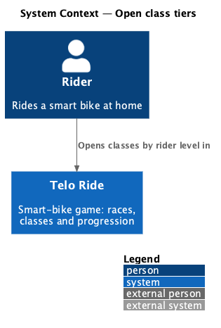
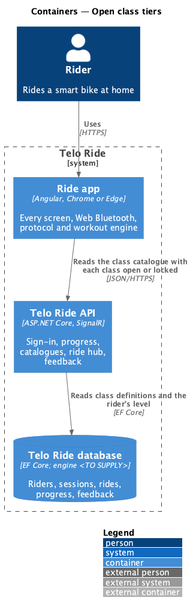
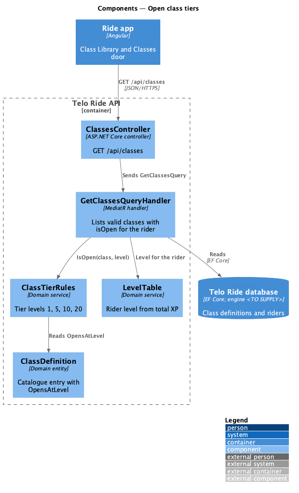
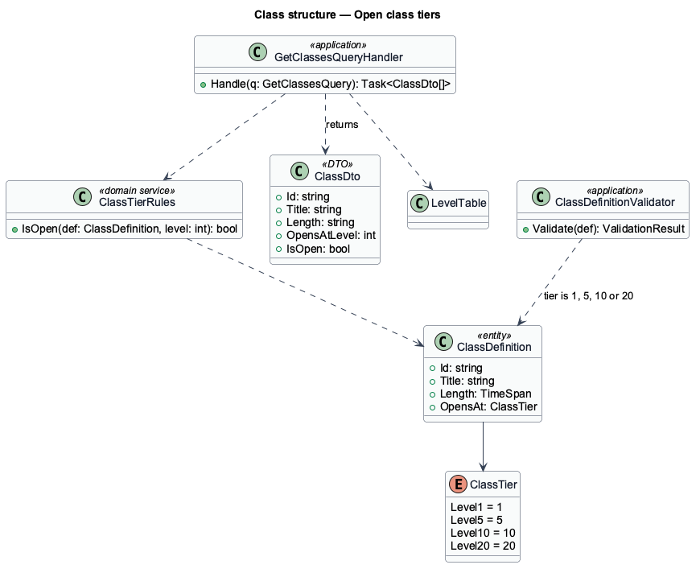
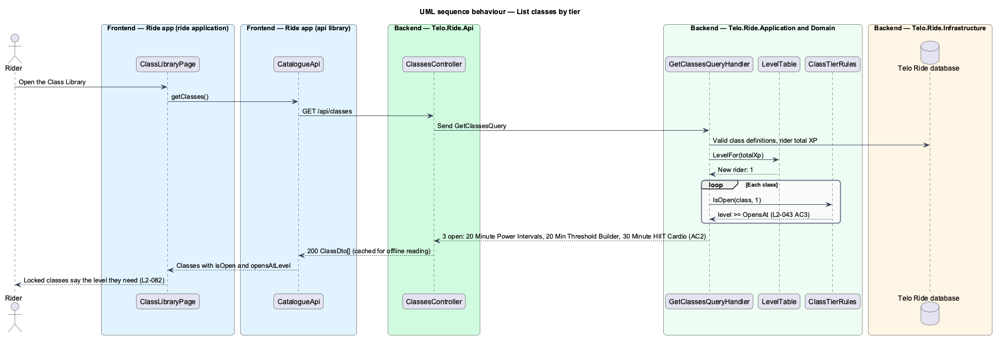

# Open class tiers

## Overview

Telo Ride's Classes door offers video classes, each with a bike plan that follows its video.
Classes open by rider level, so a new rider starts with short, approachable classes and longer
ones open as the rider progresses (L1-008, L1-014).

- **class tier** — rider level at which a class opens: 1, 5, 10 or 20
- **open class** — class whose tier the rider's level has reached
- **locked class** — class whose tier is above the rider's level; it shows the level it needs
  (`classes/browse-the-class-library`, L2-082)

A new account has three classes open: 20 Minute Power Intervals, 20 Min Threshold Builder and
30 Minute HIIT Cardio. The backend decides which classes are open from the rider's level, so the
answer is the same on every device (L2-044). This feature defines the tier rule; listing and
showing the classes belong to the classes subsystem.

## Description

- **`ClassDefinition`** — catalogue entity in `Telo.Ride.Domain` with the class's id, title,
  length and `OpensAt` tier. The catalogue is data served by `GET /api/classes`
  (`classes/browse-the-class-library`, L2-080).
- **`ClassTier`** — enumeration of the four tiers: 1, 5, 10 and 20.
- **`ClassDefinitionValidator`** — validator in `Telo.Ride.Application`. It refuses a tier other
  than 1, 5, 10 or 20. A class that fails validation is not listed (L2-080 AC4).
- **`ClassTierRules`** — domain service. `IsOpen(definition, level)` returns `level >=
  OpensAt`.
- **`GetClassesQueryHandler`** — MediatR handler behind `ClassesController`. It resolves the
  rider's level with `LevelTable` and returns each valid class as a `ClassDto` with
  `opensAtLevel` and `isOpen`.
- **`CatalogueApi`** — HTTP client in the Ride app's `api` library. The Ride app caches the last
  answer in IndexedDB for offline reading (L2-135); after a level-up the next refresh lists the
  newly opened tier.

Tier unit tests cover levels 1, 4, 5, 9, 10, 19 and 20 against each tier.

## Requirements

| L2 ID | Refines (L1) | Requirement |
|-------|--------------|-------------|
| `L2-043` | `L1-008` | A class's tier in the catalogue shall open it at level 1, 5, 10 or 20. |
| `L2-043` (AC2) | `L1-008` | A new account shall have 20 Minute Power Intervals, 20 Min Threshold Builder and 30 Minute HIIT Cardio open. |
| `L2-043` (AC3) | `L1-008` | When the rider reaches a tier's level, that tier's classes shall be open. |

## Diagrams

### System context

The rider opens classes by levelling up in Telo Ride. No external system takes part.

### Containers

The Ride app reads the class catalogue from the Telo Ride API, which marks each class open or
locked from the rider's level in the database.

### Components

`GetClassesQueryHandler` resolves the rider's level with `LevelTable` and asks `ClassTierRules`
whether each `ClassDefinition` is open.

### Class structure

`ClassDefinition` holds a `ClassTier`; the validator restricts it to four values, and the handler
returns `ClassDto` with `isOpen`.

### Behaviour — list classes by tier

For a new rider at level 1, the handler marks the three level-1 classes open (L2-043 AC2) and the
rest locked with the level each needs.

