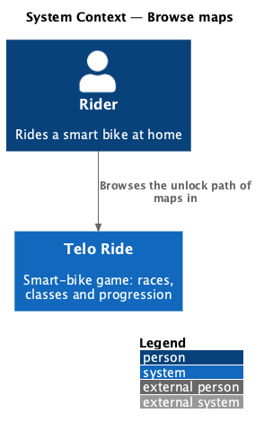
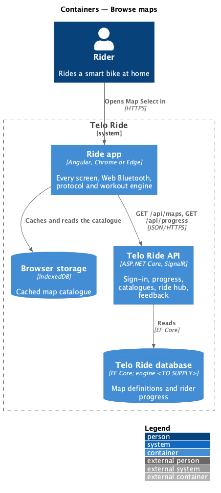
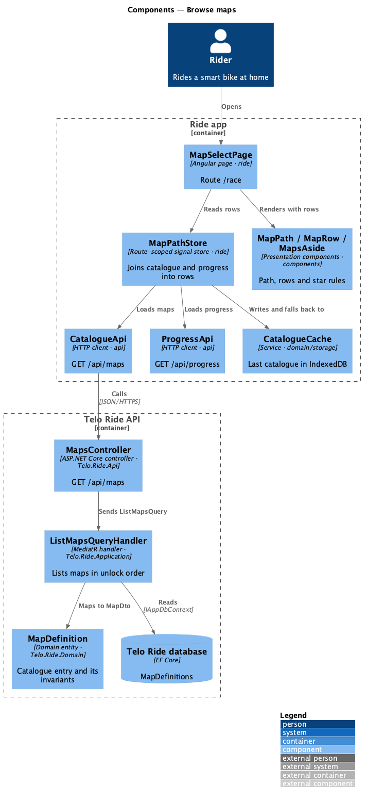
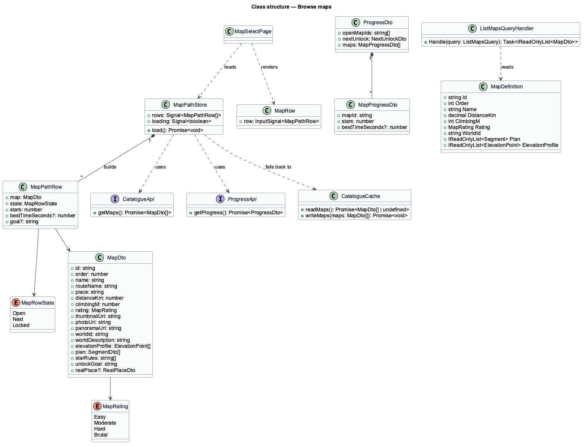
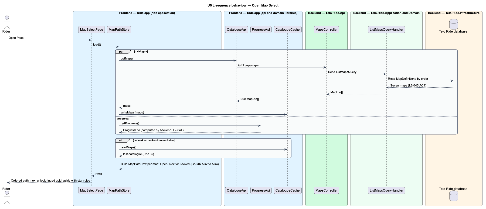

# Browse maps

## Overview

Telo Ride turns a smart bike at home into a game with two doors, Race and Classes. Behind the
Race door sits a catalogue of maps, ridden one after another as the rider improves.

> **map** — named route through a 3D world, with fixed distance, climbing, rating, elevation profile and 30:00 plan of intervals

> **map catalogue** — ordered list of every map, in the order in which maps unlock

> **unlock path** — sequence of maps in catalogue order, each map open, next or locked for one rider

> **next unlock** — first locked map, the one whose goal the rider is working towards

This feature covers two things. The first is the catalogue itself: which maps exist, what each
holds, and how a catalogue change ships without a change to app code. The second is Map Select
(`/race`), the screen that draws the unlock path. Map Select shows every map in order. An open
map links to Race Setup. The next unlock is ringed gold and names its goal. Every other locked
map is greyed with a lock.

The backend owns the catalogue and the rider's progress (L2-044). The Ride app reads both,
caches the catalogue for offline reading (L2-135), and composes the path from them. Stars,
unlock rules and the next unlock are computed by the progression subsystem; this feature only
reads their results.

## Description

The slice runs from the Map Select page to the catalogue and progress endpoints.

**Ride app (`frontend/projects/`)**

- **`MapSelectPage`** (`ride`, selector `wz-map-select-page`) — routed page at `/race`, loaded
  with `loadComponent`. It reads the catalogue and progress through `MapPathStore` and renders
  the heading, the path and the aside.
- **`MapPathStore`** (`ride`, provided on the `/race` route) — signal store. It joins the map
  catalogue with the rider's progress into one `MapPathRow` per map and exposes `rows` and
  `loading`. It is released when the rider leaves Map Select.
- **`MapPath`** (`components`, block `map-path`) — presentation component for the ordered list.
  It takes `rows` and renders one `MapRow` per entry.
- **`MapRow`** (`components`, block `map-row`) — one map. For an open map it renders a link to
  `/race/:mapId` with the thumbnail, name, facts line ("18.4 km · 90 m climbing · Easy"), stars
  and "Best 31:42". For a locked map it renders a disabled button with the goal, and the hidden
  text ", locked" or ", locked, your next unlock". The next unlock carries the
  `map-row--next` modifier (gold ring); other locked rows carry `map-row--locked` (greyed photo
  and lock). Colour is never the only carrier: the lock icon and the hidden text say the state.
- **`MapsAside`** (`components`, block `maps-aside`) — "Stars on every map" with the three star
  rules (`star-rules`) and "Racing against people opens at level 3. Until then, the bots are
  good practice."
- **`CatalogueApi`** (`api`, token `CATALOGUE_API`, implementation `HttpCatalogueApi`) —
  `getMaps(): Promise<MapDto[]>` over `GET /api/maps`.
- **`ProgressApi`** (`api`, token `PROGRESS_API`, implementation `HttpProgressApi`) —
  `getProgress(): Promise<ProgressDto>` over `GET /api/progress`; owned by the progression
  subsystem and read here.
- **`CatalogueCache`** (`domain/storage`) — keeps the last map catalogue in IndexedDB. The
  store reads the network first and falls back to the cache when the request fails.
- **`MapDto`** (`api`) — one catalogue entry: `id`, `order`, `name`, `routeName`, `place`,
  `distanceKm`, `climbingM`, `rating` (`Easy`, `Moderate`, `Hard`, `Brutal`), `thumbnailUrl`,
  `photoUrl`, `panoramaUrl`, `worldId`, `worldDescription`, `elevationProfile`, `plan` (segments of the 30:00
  plan), `starRules`, `unlockGoal` and an optional `realPlace` for real-world scenery.

**Telo Ride API (`backend/`)**

- **`MapsController`** (`Telo.Ride.Api`) — `GET /api/maps`. It sends `ListMapsQuery` and
  returns the result; it checks nothing itself.
- **`ListMapsQueryHandler`** (`Telo.Ride.Application`) — reads `MapDefinition` rows in unlock
  order and maps them to `MapDto`.
- **`MapDefinition`** (`Telo.Ride.Domain`) — catalogue entry. Its invariant is the L2-045 AC2
  shape: a non-empty elevation profile, a plan whose length is 30:00, and a world identifier.
- **Catalogue seed** (`Telo.Ride.Infrastructure`) — the seven maps of L2-045 AC1 as idempotent
  seed data. A catalogue change is a data change (seed or migration) and needs no change to app
  code (L2-045 AC3). A map whose world is new also needs that world's assets, bundled under
  `frontend/public/worlds/<worldId>/` (ADR 0021); how such assets ship without a frontend
  release is `<TO SUPPLY>`.

The path state of each row comes from `ProgressDto`: `openMapIds`, `nextUnlock` (map id and
goal text), and per-map `stars` and `bestTimeSeconds`.

## Requirements

The feature realizes the following level-2 (L2) requirements. Each L2 requirement refines a
level-1 (L1) requirement, cited by identifier.

| L2 ID | Refines (L1) | Requirement |
|-------|--------------|-------------|
| `L2-045` | `L1-009` | The map catalogue shall hold, in unlock order: Prairie Paceline (18.4 km, 90 m, Easy, Route 9 Wind Farm · Open farmland at golden hour), Old Town Criterium (14.2 km, 140 m, Easy, Cathedral Circuit · A cobbled European old town on race day), Cliffside Coast (32 km, 410 m, Moderate, Headland Road · A clifftop road above the sea at sunset), Neon Docklands (21.6 km, 120 m, Moderate, Harbour Bridges Loop · A harbour city after dark), Dolomites (38.5 km, 860 m, Hard, Val Gardena Valley Road · An alpine valley under pale limestone peaks), Vice City (24 km, 60 m, Moderate, Ocean Drive to the Causeway · A neon beachfront city at a magenta sunset) and Col du Granit (16.1 km, 1240 m, Brutal, A high mountain pass at first light). Each map shall have an elevation profile, a 30:00 plan of intervals and a 3D world. A catalogue change shall ship with no change to app code. |
| `L2-046` | `L1-009` | Map Select (`/race`) shall read "Maps" and "Each map opens the next. Race well on the ones you have to unlock the rest." above an ordered list of every map. An open map shall link to Race Setup with its thumbnail, name, "18.4 km · 90 m climbing · Easy", stars and "Best 31:42", and no best line when unridden. The next unlock shall be a disabled button ringed gold with the hidden text ", locked, your next unlock", its facts and its goal. Another locked map shall be a disabled button with a greyed photo, a lock, the hidden text ", locked" and its goal. The aside "Stars on every map" shall list the three star rules and "Racing against people opens at level 3. Until then, the bots are good practice." At lg or wider the list shall sit beside a 280 px aside; at sm or wider rows shall have a 176 px thumbnail and a chevron. |

## Diagrams

### System context

The rider browses maps in Telo Ride. No external system takes part: the catalogue and progress
both come from Telo Ride's own backend.

### Containers

The Ride app reads the catalogue and progress from the Telo Ride API, which reads the Telo Ride
database. The app keeps the last catalogue in browser storage for offline reading.

### Components

`MapSelectPage` reads through `MapPathStore`, which joins `CatalogueApi` and `ProgressApi` and
falls back to `CatalogueCache`. On the backend, `MapsController` sends `ListMapsQuery` to its
handler, which reads `MapDefinition` rows.

### Class structure

`MapPathStore` composes `MapDto` and `ProgressDto` into `MapPathRow` values, each with a
`MapRowState` of open, next or locked. `MapDefinition` is the backend entity behind `MapDto`.

### Behaviour — open Map Select

The page asks the store for the path. The store fetches the catalogue and progress together,
caches the catalogue, and falls back to the cached catalogue when the network fails (L2-135).
Each row's state follows the progress the backend computed (L2-044).

