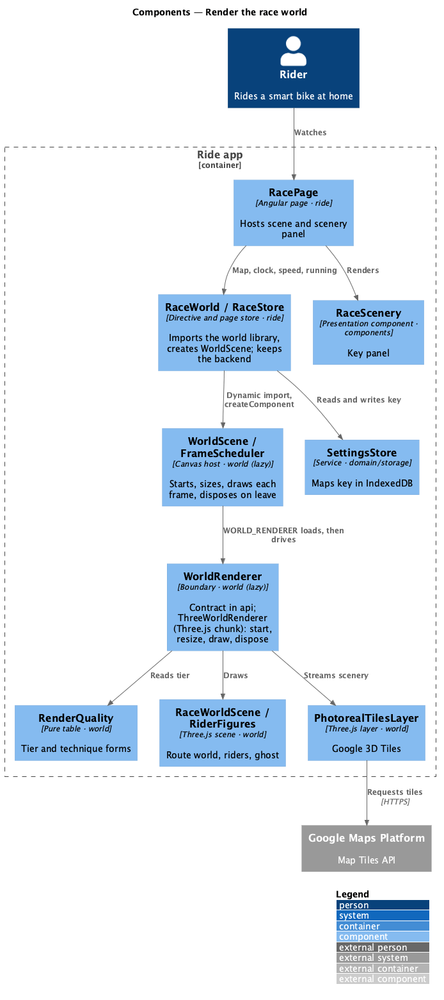
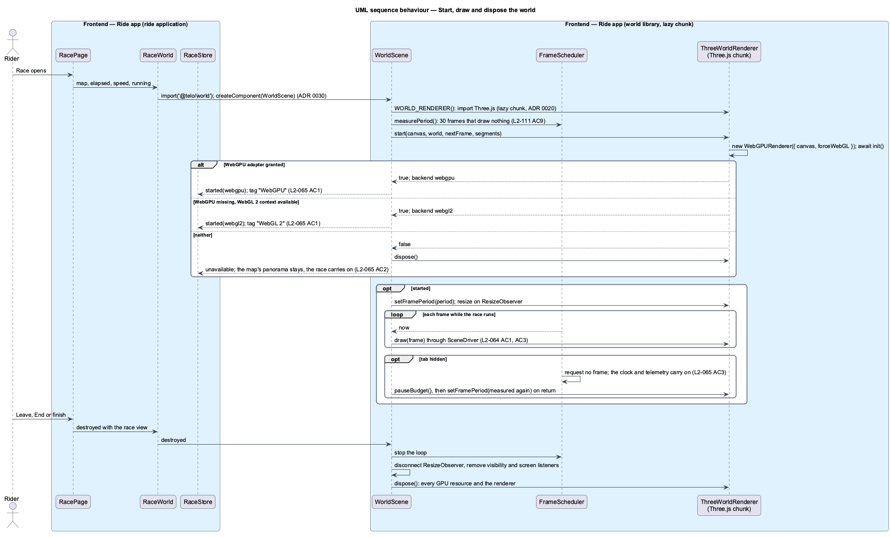
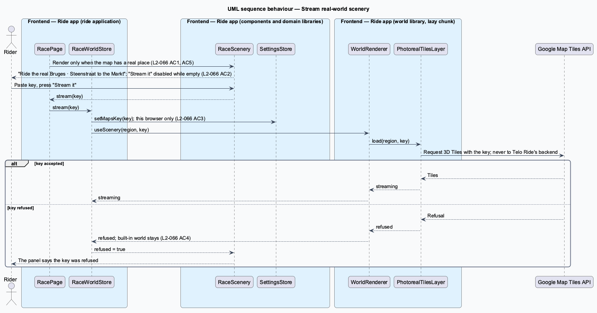

# Render the race world

## Overview

Every map is a route through a 3D world. During a race the world fills the screen behind the
HUD and moves with the rider: the camera sits at the rider's place on the route and travels
forward at the rider's virtual speed. Other riders appear at their places in their jersey
colours; the ghost appears translucent gold.

> **world** — lit, textured 3D scene of one map's route, drawn behind the race HUD

> **renderer tag** — label in the race top bar naming the GPU API that draws the world, "WebGPU" or "WebGL 2"

> **panorama** — still photograph of a map's world, shown when the browser can draw neither WebGPU nor WebGL 2

> **real-world scenery** — optional photorealistic 3D Tiles of a real place, streamed from Google Maps Platform with the rider's own key

The world is the heaviest part of the app. It loads only when a race opens, in its own lazy
chunk, and releases every GPU resource when the race ends. It draws with WebGPU where the
browser grants an adapter and with WebGL 2 otherwise, through one Three.js `WebGPURenderer`
(ADR 0020, ADR 0021). It stops drawing while the tab is hidden; the race clock and telemetry
carry on regardless (L2-133). Its detail is scaled to the device, cheap forms of each technique
first (AGENTS.md, Low-power rendering).

Some maps follow a real place. On those maps a scenery panel offers to stream the real place as
photorealistic 3D Tiles with a Google Maps Platform key the rider pastes. The key stays in the
browser and goes only to Google's Map Tiles API. If Google refuses the key, the built-in world
stays.

## Description

**`world` library (`frontend/projects/world`, new)** — the boundary for Three.js, copied from
`main` (ADR 0030). It is imported only by dynamic `import()`, so neither Three.js nor the scene
enters the initial bundle. Adding it adds `ride → world` and `world → api` to the dependency rule
in `AGENTS.md` and to the ESLint boundaries in the same change.

- **`WorldRenderer`** (contract and `WORLD_RENDERER` token in `api`, `main`'s
  `world-renderer-port.ts`) — `start(canvas, world, nextFrame, segments)` resolves false when
  neither WebGPU nor WebGL 2 starts; `resize(width, height, pixelRatio)`, `draw(frame)`,
  `setFramePeriod(ms)`, `pauseBudget()` and `dispose()`. Telo Ride adds `backend`, the GPU API
  drawing the world, for the tag. `ThreeWorldRenderer` implements it with one `WebGPURenderer`,
  which takes a WebGPU adapter when the browser grants one and runs its own WebGL 2 backend
  otherwise (`forceWebGL` only for the performance sweep's test hook); it is the only type that
  names a Three.js type, and `dispose()` releases every GPU resource and the renderer
  (L2-065 AC1, AC2). The loader (`loadWorldRenderer`) imports it, and Three.js with it, on demand.
- **`WorldScene`** (block `world-scene`) — `main`'s canvas host: it loads the renderer after its
  view is in place, measures the display's frame period through `FrameScheduler` (the only
  `requestAnimationFrame` caller), starts the renderer, resizes it on a `ResizeObserver`, draws one
  frame per tick through `SceneDriver` while the race runs, and on destroy stops the loop,
  disconnects the observer, removes its listeners and disposes the renderer. It emits `started`
  with the backend, or `unavailable` once. Its canvas is hidden from assistive technology: the race
  scene around it is the one image.
- **`RenderQuality`** — pure tier table (ADR 0021): the tier for the device and backend, and
  which form of each technique the tier uses. `ultra` is WebGPU only.
- **`RaceWorldScene`** — road, terrain, sky and props of the map's world, loaded from
  same-origin assets under `frontend/public/worlds/<worldId>/` (ADR 0021). The road bends in
  the vertex stage (ADR 0023). The camera follows the rider's distance and keeps its framing in
  a portrait viewport by widening the vertical field of view, never stretching (L2-064 AC5).
- **`RiderFigures`** — one instanced mesh for the riders in view, each in its jersey colour;
  the ghost uses a translucent gold material (L2-064 AC3).
- **`PhotorealTilesLayer`** — loads Google's photorealistic 3D Tiles for the map's real place
  through the Map Tiles API with the rider's key, and reports `refused` when Google rejects it.
  The 3D Tiles loader package is `<TO SUPPLY>`; under ADR 0021 a new runtime dependency needs
  an amendment that names and pins it.

**Ride app**

- **`RaceWorld`** (`ride`, a directive in the race scene) — imports the `world` library when the
  race opens and creates its `WorldScene` in place, handing it the map's world, plan, the race
  clock, the virtual speed and whether the race runs. The scene goes with the race view when the
  rider leaves. `RaceStore` keeps `backend` for the tag and `worldUnavailable`, which removes the
  scene and leaves the map's photo. The race route binds `WORLD_RENDERER`.
- **Race scene** (block `race-scene` of the race page) — one image (`role="img"`) labelled with
  the map's world description ("The Old Town Criterium world: a cobbled old town under a blue sky,
  its cathedral spire on the horizon"). The map's photo (`race-scene__photo`) lies under the
  world's canvas and stays alone as the panorama when neither backend starts (L2-065 AC2).
- **Renderer tag** (element of `RaceBar`) — "WebGPU" or "WebGL 2", title "The GPU API drawing
  this world".
- **`RaceScenery`** (`components`, block `race-scenery`) — rendered only on a map with a real
  place. It reads "Ride the real Bruges · Steenstraat to the Markt" and "Paste a Google Maps
  Platform key to stream it as photorealistic 3D Tiles. It stays on this device.", with a key
  field (placeholder "AIza…") and "Stream it", disabled while the field is empty. It emits
  `stream(key)` and shows a refused message when told. From 640 px to 1023 px no HUD panel
  covers it (L2-066 AC6).
- **`SettingsStore`** (`domain/storage`) — keeps the Maps key in this browser only. The key is
  never sent to Telo Ride's backend (L2-066 AC3).
- **`MapDto.realPlace`** and **`MapDto.worldDescription`** (`api`) — catalogue fields read
  here: the real place's title, subtitle and tile region, and the world's text description.

The Content Security Policy that admits the Map Tiles API origin is designed by
security/restrict-third-parties.

## Requirements

The feature realizes the following level-2 (L2) requirements. Each L2 requirement refines a
level-1 (L1) requirement, cited by identifier.

| L2 ID | Refines (L1) | Requirement |
|-------|--------------|-------------|
| `L2-064` | `L1-012` | During a race the map's 3D world shall be drawn from the rider's place on the route, with the camera moving forward at the rider's virtual speed, computed by a documented power-to-speed model whose constants are an open question. Other riders within view shall be drawn in their jersey colours at their places on the route, the ghost translucent gold. Assistive technology shall read the world as one image with a description ("The Old Town Criterium world: a cobbled old town under a blue sky, its cathedral spire on the horizon"). In a portrait viewport the world shall be reframed to fill the screen without stretching. |
| `L2-065` | `L1-012` | With WebGPU the world shall be drawn with WebGPU and the tag shall read "WebGPU"; otherwise with WebGL 2 and the tag "WebGL 2". The tag's title shall be "The GPU API drawing this world". With neither, the world shall be replaced by the map's panorama and the race shall still run. While the tab is hidden the world shall stop drawing and the race clock and telemetry shall carry on (L2-133). |
| `L2-066` | `L1-012` | On Old Town Criterium the scenery panel shall read "Ride the real Bruges · Steenstraat to the Markt" and "Paste a Google Maps Platform key to stream it as photorealistic 3D Tiles. It stays on this device.", with a key field (placeholder "AIza…") and "Stream it", disabled while the field is empty. An entered key shall be stored only in this browser and sent only to Google's Map Tiles API, never to Telo Ride's backend. When Google refuses the key, the built-in world shall stay and the panel shall say the key was refused. A map with no real place shall have no scenery panel. From 640 to 1023 px no HUD panel shall cover the panel. |

## Diagrams

### System context

Telo Ride draws the world itself. Google Maps Platform takes part only when the rider streams
real-world scenery with their own key.

### Containers

The Ride app loads world assets from its own origin, keeps the Maps key in browser storage, and
calls Google's Map Tiles API directly. The Telo Ride API takes no part in drawing.

### Components

`RaceWorld` imports the lazy `world` library and creates `WorldScene`, which loads and drives
`WorldRenderer`; the renderer chooses its backend and composes the quality table, scene, rider
figures and the optional tiles layer.

### Class structure

`ThreeWorldRenderer` owns the scene, the figures and the tiles layer and disposes them together.
`WorldScene` holds the renderer; `RaceStore` keeps the backend it reports.

### Behaviour — start, draw and dispose the world

`RaceWorld` loads the chunk, and `WorldScene` starts the renderer, which draws with WebGPU or
WebGL 2 or reports that neither starts, leaving the panorama. No frame is drawn while the tab is
hidden, and leaving the race disposes every resource.

### Behaviour — stream real-world scenery

The key goes to browser storage and to Google's Map Tiles API only. A refused key leaves the
built-in world in place and the panel says so.

## Open questions

- **Slice 8.1 follows `main`'s rendering (ADR 0030).** This design first named a separate
  `RendererBackendProbe`, `start(canvas, map, quality)`, `setVisible` and a `RaceWorldStore` with a
  `RaceScene` component. `main` has none of them: `WebGPURenderer` chooses its backend itself, the
  canvas host is `main`'s `WorldScene` with `FrameScheduler`, and the hidden tab is handled by the
  scheduler requesting no frame. The design now describes `main`'s shape; `main` wins on rendering.
- **The renderer arrives in two slices.** Slice 8.1 carries `main`'s `world-renderer.ts` as far as
  starting, sizing, the frame budget and disposing; slice 8.2 brings the rest of the file, which
  builds and draws the scene, so the canvas stays clear over the map's photo until then.
- **Vice City has no world on `main`.** Its race draws South Beach Sunrise, whose terrain its
  catalogue entry already takes (slice 7.3), until a Vice City world is built.
