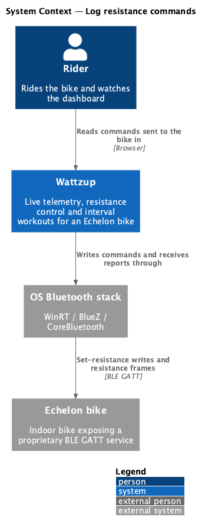
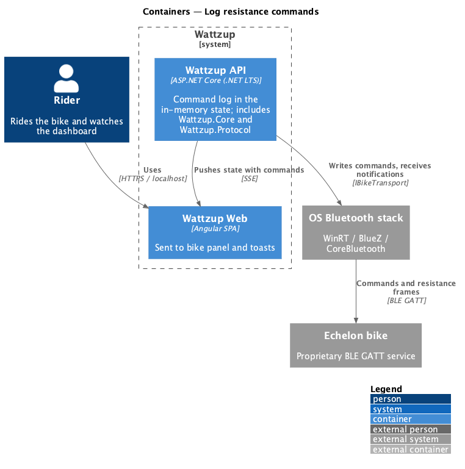
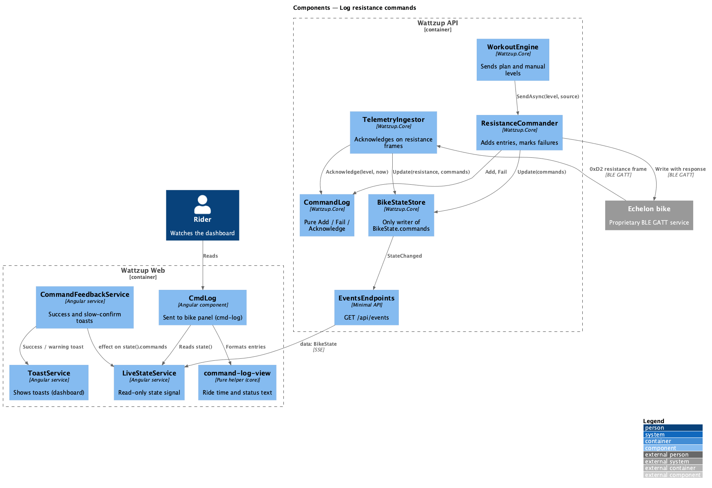
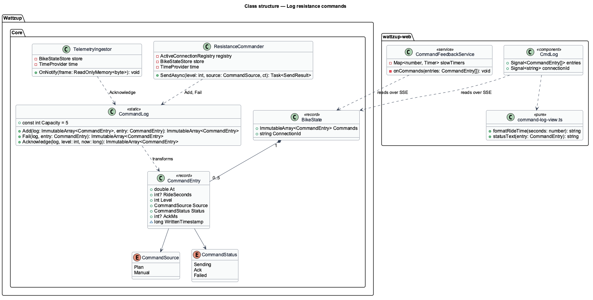
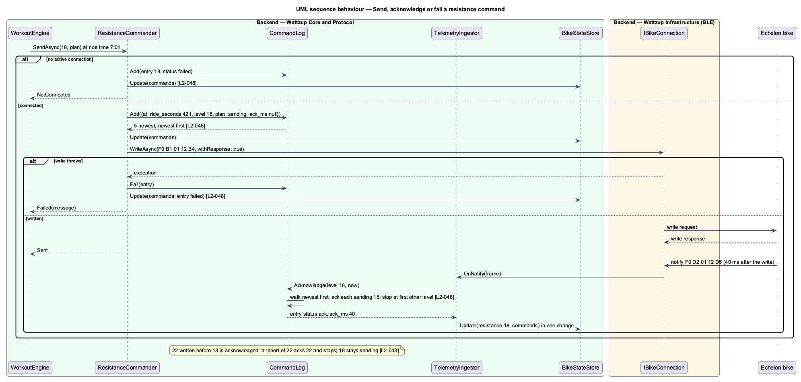
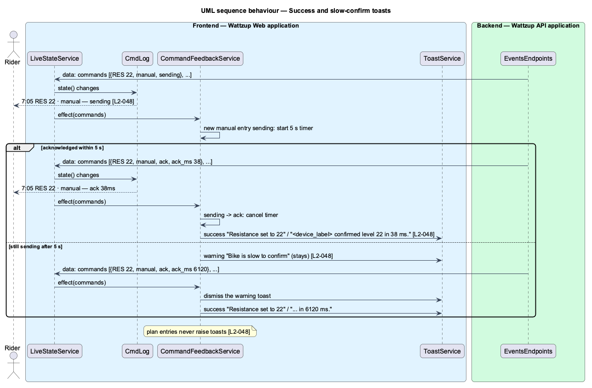

# Log resistance commands

## Overview

A resistance command is a Bluetooth write that asks the bike for a level. The bike does not answer the write with its new level; it reports the level later in a resistance frame, or not at all. The command log records each command and whether the bike has confirmed it, so the rider can see that the bike follows the plan and how quickly it responds. The dashboard shows the log in the `Sent to bike` panel and raises a toast when a manual change is confirmed or is slow.

**command log** — list of the 5 newest resistance commands in the state, newest first (`commands`)

**command source** — origin of a command: `plan` (sent by the workout engine) or `manual` (sent for the rider)

**acknowledgement** — the bike reporting, in a `0xD2` resistance frame, the level a pending command asked for

**ack latency** — whole milliseconds from the write of a command to its acknowledgement (`ack_ms`)

**ride time** — `workout.elapsed_seconds` when the command was written (`ride_seconds`)

Each entry is `{at, ride_seconds, level, source, status, ack_ms}`. `status` is `sending` from the write until the acknowledgement, then `ack`. A write that throws, or an attempt with no bike connected, is `failed`. The log lives in memory with the rest of the state (ADR 0004) and starts empty with each backend process.

The feature sits between `set-resistance`, which sends commands, and `telemetry/decode-bike-telemetry`, which decodes the frames that acknowledge them.

## Description

Backend (`Wattzup.Core`):

- **`CommandEntry`** — immutable record serialised as `{at, ride_seconds, level, source, status, ack_ms}`. `at` is Unix epoch seconds. `ride_seconds` is `workout.elapsed_seconds`, or `null` with no workout. `WrittenTimestamp` is a `TimeProvider` timestamp kept for the latency and is not serialised.
- **`CommandLog`** — pure static functions over `ImmutableArray<CommandEntry>`, with a unit test per row of L2-048:
  - `Add(log, entry)` — puts the entry at the front and keeps the 5 newest (L2-048).
  - `Fail(log, entry)` — sets that entry's `status` to `failed`.
  - `Acknowledge(log, level, now)` — walks the log from the newest entry. It sets each `sending` entry whose level equals the reported level to `ack`, with `ack_ms = floor(elapsed ms since WrittenTimestamp)`. It stops at the first entry of a different level. An older entry behind a newer command for a different level therefore stays `sending` and is never acknowledged by the newer level (L2-048).
- **`ResistanceCommander.SendAsync(level, source, ct)`** (see `set-resistance`) — records every attempt through `BikeStateStore.Update`:
  1. With no active connection, it adds an entry with `status` `failed` and returns `NotConnected` (L2-048).
  2. Otherwise it adds a `sending` entry, then writes the command. The entry is in the state before the write, so a fast report cannot arrive before it.
  3. If the write throws, it marks the entry `failed` and returns `Failed(message)` (L2-048). The engine then sets `error` to `set resistance failed: <message>` (L2-012).
- **`TelemetryIngestor`** (see `decode-bike-telemetry`) — on a `ResistanceUpdate(level)` it calls `CommandLog.Acknowledge` inside the same `BikeStateStore.Update` that sets `resistance`, so 1 broadcast carries both.
- **`ActiveConnectionRegistry`** — read by the commander to decide between `failed` and `sending`.

Frontend (`wattzup-web`):

- **`CmdLog`** (`wz-cmd-log`, `src/app/dashboard/cmd-log/`) — OnPush component, BEM block `cmd-log`, a `section` labelled by its `Sent to bike` heading. The `cmd-log__head` shows `BLE · <connection_id>`. The list renders each entry as `<time>` with the ride time, `RES <level>` with `· <source>`, and a status span with class `ack`, `sending` or `failed`. With no entries it reads `No commands yet this session.` (L2-048). The class names are kept from the mocks because e2e locators depend on them. The status is carried by text as well as colour.
- **`command-log-view.ts`** (`src/app/core/`) — pure helper. `formatRideTime(seconds)` gives `m:ss` below 1 hour and `h:mm:ss` from 1 hour, as in `docs/mocks/pages/ride/edge.html` (`1:02:00`). `statusText(entry)` gives `ack <n>ms`, `sending` or `failed`. An entry with `ride_seconds` `null` shows the local time of `at` as `h:mm:ss` (L2-048).
- **`CommandFeedbackService`** (`src/app/core/`) — reads `LiveStateService.state` in an `effect` and keys entries by `at`. For `manual` entries only (L2-048):
  - A transition from `sending` to `ack` shows a success toast `Resistance set to <n>` / `<device_label> confirmed level <n> in <ack_ms> ms.` through `ToastService` (see `dashboard`, L2-053).
  - An entry first seen as `sending` starts a 5 s timer. If the entry is still `sending` when it fires, a warning toast `Bike is slow to confirm` shows. The toast is dismissed when that entry becomes `ack`.
  - The timer uses an injected scheduler, so unit tests advance it with fake timers.

Open question: the warning toast mock (`docs/mocks/notifications/ride-toast/warning.html`) reads `Still setting level 22 — Wattzup resends every 5 seconds until the bike reports it.` L2-012 criterion 6 resends the manual level every 5 s as well, so the mock's body text stands.

Verification:

- `Wattzup.Core.Tests` — `CommandLog` table: add keeps 5 newest; ack sets `ack_ms`; a newer different level blocks the older entry; failed write; not connected. Time comes from `FakeTimeProvider`.
- `Wattzup.Api.AcceptanceTests` — through `WebApplicationFactory` with `SimulatedBikeTransport`. `SimulationControl` holds the echo of a write, the test advances `FakeTimeProvider` by 38 ms and releases it, and the event stream then shows the entry `ack` with `ack_ms` 38. A second test powers the bike off and checks the `failed` entry.
- Playwright — the `RidePage.commandLog` page object owns the selectors. Specs push stubbed state messages: an empty log, 3 entries with each status, a manual entry turning `ack` (success toast), and a manual entry left `sending` for 5 s with the page clock advanced (warning toast).

## Requirements

| L2 ID | Refines (L1) | Requirement |
|-------|--------------|-------------|
| `L2-048` | `L1-003` | Command log and acknowledgement. Every resistance command must be logged with its ride time, level, source, status and acknowledgement latency. |

## Diagrams

### System context

The rider reads, in Wattzup, what was sent to the bike and when the bike confirmed it.

### Containers

The Wattzup API records commands and acknowledgements in the state. Wattzup Web receives the log over SSE.

### Components

`ResistanceCommander` adds entries and marks failures. `TelemetryIngestor` acknowledges them. Both go through `BikeStateStore`. In the browser, `CmdLog` renders the log and `CommandFeedbackService` raises toasts.

### Class structure

`CommandLog` is a set of pure functions over an immutable list, so every rule is a unit test without Bluetooth.

### Behaviour — send, acknowledge or fail

A command enters the log as `sending` before the write. The bike's report of the same level turns it into `ack` with its latency. A throwing write or a missing connection makes it `failed` (L2-048).

### Behaviour — success and slow-confirm toasts

The browser watches manual entries. An acknowledgement shows a success toast. An entry still `sending` after 5 s shows a warning toast until it is acknowledged (L2-048).

