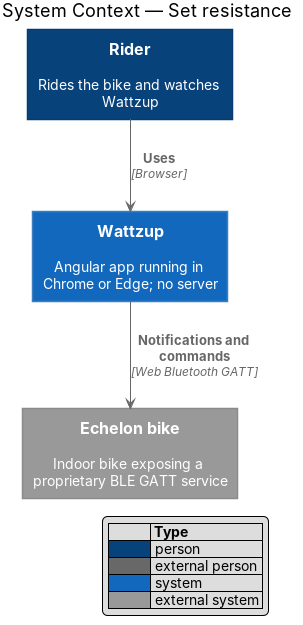
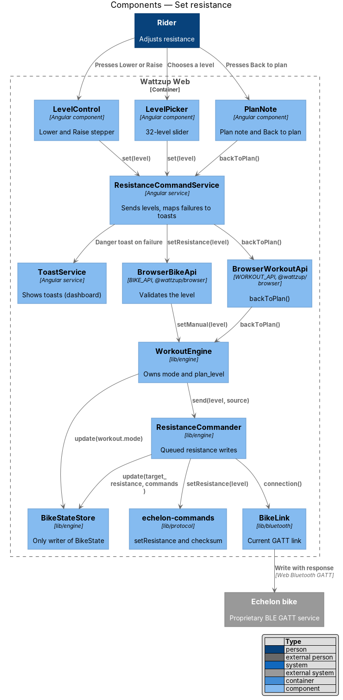
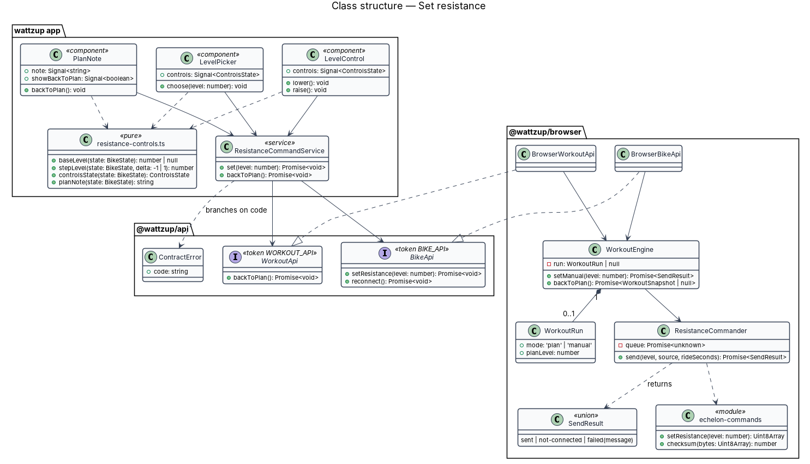
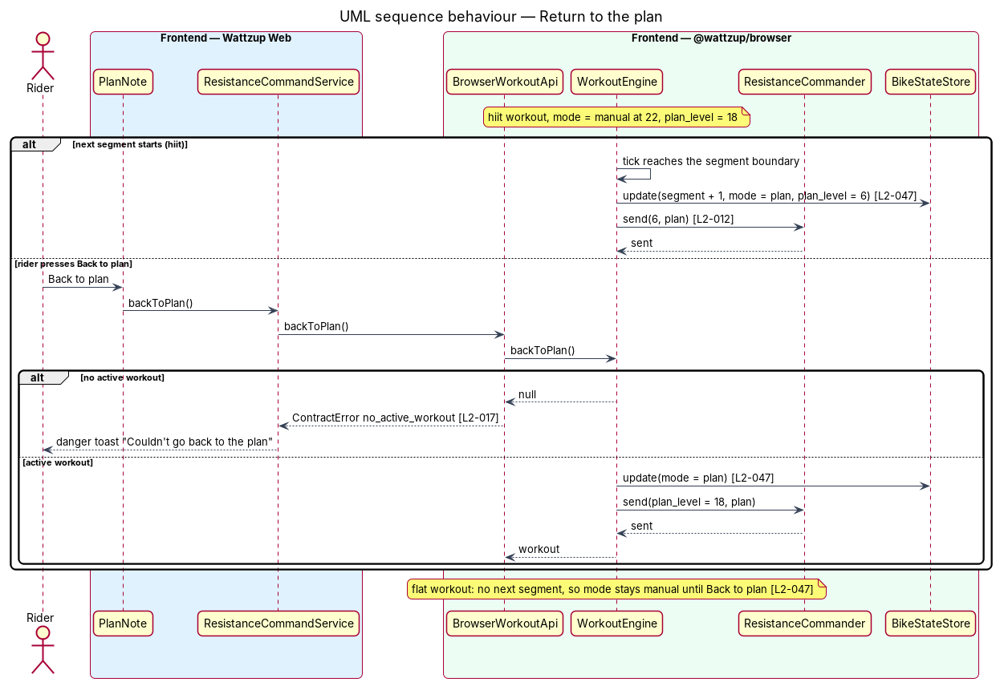

# Set resistance

## Overview

Resistance is the braking force the bike applies to the flywheel, on a scale from 1 to 32. The rider changes it from the resistance panel of the ride dashboard: a Lower button, a Raise button and a picker of 32 levels. Wattzup turns each request into a Bluetooth command and writes it to the bike. The bike then confirms its new level in a resistance frame, which `decode-bike-telemetry` applies.

**target resistance** — last level Wattzup asked the bike to apply (`target_resistance`)

**resistance** — last level the bike reported in a `0xD2` frame (`resistance`)

**checksum** — trailing byte equal to the sum of all preceding command bytes modulo 256

**stepper** — Lower and Raise buttons on either side of the resistance readout, each moving the level by 1

**level picker** — row of 32 bars, one per level, operated as one slider, that sends the chosen level

**manual override** — rider-chosen level that replaces the plan's level until the next segment starts (`mode` = `manual`)

**plan level** — level the running plan asks for in the current segment (`workout.plan_level`)

The 2 resistance values are kept apart because the bike takes a moment to apply a change and may ignore a command. The panel shows the difference while it lasts (see `show-resistance`). Every command, from the rider or from the plan, is logged with its acknowledgement (see `log-resistance-commands`).

During a workout, the plan sets the level for each segment (see `workouts/run-interval-workout`). A rider who changes the level while a plan runs makes a manual override. The plan takes over again when the next segment starts, or at once when the rider presses Back to plan. A `flat` plan has 1 segment, so its override lasts until Back to plan.

## Description

App and components (`frontend/projects/wattzup`, `frontend/projects/components`):

- **`LevelControl`** (`wz-level-control`, `frontend/projects/components/src/lib/level-control/`) — OnPush component, BEM block `level-control`. It renders the 2 `step-btn` buttons, named `Lower resistance` and `Raise resistance`, around the `level-readout` of `show-resistance`. Each press calls `ResistanceCommandService.set(stepLevel(state, ±1))` (L2-020).
- **`LevelPicker`** (`wz-level-picker`) — OnPush component, BEM block `level-picker`, one `role="slider"` named `Resistance level` (`aria-valuemin` 1, `aria-valuemax` 32, `aria-valuenow` the pressed level, `aria-valuetext` `Level <n> of 32`, `aria-disabled` until the bike connects). It renders 32 decorative bars (`level-picker__bar`, `aria-hidden`). Tapping a bar picks its level (the whole 56 px-high track is one target, so each level need not be 44 px wide); Arrow keys step one level, PageUp/PageDown four, Home/End go to 1 and 32, starting from 12 when nothing is set. The key and tap mapping is the pure helper `level-picker-input.ts` (`frontend/projects/wattzup/src/app/core/`) with a unit test per case. Choosing level n calls `ResistanceCommandService.set(n)` (L2-020). The picker was first drawn as 32 `<button>`s about 8 px wide, which fails WCAG 2.2 target size (2.5.8) and the 44 × 44 px rule of L2-041; the mocks and the design system now draw it as this slider, keeping the look and the `level-picker`, `is-lit` and `is-plan` classes. The bar heights come from the component stylesheet (one `:nth-child` rule per level, generated by a Sass loop), so the template carries no inline `style`.
- **`PlanNote`** (`wz-plan-note`) — OnPush component, BEM block `plan-note`. It shows the note from `planNote(state)` and, in `manual` mode, a `Back to plan` button that calls `ResistanceCommandService.backToPlan()` (L2-047).
- **`resistance-controls.ts`** (`frontend/projects/wattzup/src/app/core/`) — pure helpers with a unit test per case:
  - `baseLevel(state)` — `resistance ?? target_resistance`. With both `null` the base level is 12 (L2-020).
  - `stepLevel(state, delta)` — `baseLevel + delta`, clamped to 1–32. Resistance 10 gives 11 and 9; no resistance with target 15 gives 16 (L2-020).
  - `controlsState(state)` — `{ lowerDisabled, raiseDisabled, pickerDisabled, note }`. Lower is disabled at level 1 and Raise at 32. With `ble` not `connected`, all 3 are disabled and `note` is `Resistance controls wake up once the bike connects.` (L2-020).
  - `planNote(state)` — the 5 texts of L2-047: `Following the plan — levels change with each interval.` (`hiit`, `plan`), `Holding a flat level for the whole ride.` (`flat`, `plan`), `Manual level. Plan takes over next interval.` (`hiit`, `manual`), `Manual level. Plan was <plan_level>.` (`flat`, `manual`), and `Manual control — no plan is running.` with no workout.
- **`ResistanceCommandService`** (`frontend/projects/wattzup/src/app/core/`) — owns the request side. `set(level)` calls `BIKE_API.setResistance(level)` and maps a `ContractError` to a toast through `ToastService` (see `dashboard`, L2-053):
  - `code` `bike_not_connected` → danger toast `Couldn't set resistance` / `The bike isn't connected. Pedal to wake it, then try again.`
  - any other failure → danger toast `Couldn't set resistance` / `The bike didn't take it. Level <n> was not set.` with a `Retry` action that calls `set(level)` with the same level (L2-020).
  - `backToPlan()` calls `WORKOUT_API.backToPlan()`; a failure shows `Couldn't go back to the plan` / `Something went wrong. Try again.` (L2-046).

Contracts and engine (`@wattzup/api`, `@wattzup/browser`):

- **`BrowserBikeApi`** (implements `BIKE_API`, `lib/contracts/`) — `setResistance(level)` refuses a level that is not an integer in 1–32 with a `ContractError` `invalid_level`. Otherwise it calls `WorkoutEngine.setManual(level)` and maps the result: `not-connected` becomes `bike_not_connected`, `failed` becomes `send_failed` with `error` `set resistance failed: <message>` (L2-016). It holds no rule of its own.
- **`WorkoutEngine`** (`lib/engine/`, see `workouts/run-interval-workout`) — runs commands and ticks one at a time on one promise queue, so only the engine touches run state:
  - `setManual(level)` — sends the level through `ResistanceCommander` with source `manual`. If the send succeeds and a workout is active, the engine sets `mode` = `manual` and keeps `plan_level` unchanged (L2-047). A failed send leaves `mode` as it was.
  - `backToPlan()` — sets `mode` = `plan` and sends `plan_level` at once with source `plan` (L2-047). With no active workout it answers `null`, which `BrowserWorkoutApi` turns into a `ContractError` `no_active_workout` (L2-017).
  - At each segment start the engine sets `mode` = `plan` before sending the new segment's level (L2-047, L2-012). A `flat` plan has no next segment, so `manual` lasts until Back to plan.
- **`ResistanceCommander`** (`lib/engine/`) — `send(level, source, rideSeconds)` resolves a `SendResult` (`sent`, `not-connected`, `failed(message)`). Without a GATT link from `BikeLink` it writes nothing and resolves `not-connected` (L2-008). With a link it writes `setResistance(level)` with response, then sets `target_resistance` through `BikeStateStore.update` (L2-008, L2-009). It records each attempt in the command log (`log-resistance-commands`). Its own promise queue, and the link's one-write-at-a-time queue, keep a manual and a plan command from interleaving on the GATT link.
- **`setResistance(level)`** (`lib/protocol/echelon-commands.ts`) — returns `F0 B1 01 <level> <checksum>`. Level 12 yields `F0 B1 01 0C AE`; level 32 yields `F0 B1 01 20 C2` (L2-008).
- **`checksum(bytes)`** — the sum of the bytes `& 0xFF`.

Verification:

- `protocol.spec.ts` — 1 case per command row of L2-008 (levels 1, 12 and 32).
- `resistance-commander.spec.ts` and `workout-engine.spec.ts` with a fake `BikeLink` and `FakeClock` — the override cases of L2-047: override in `plan` mode, return at next segment, back-to-plan, and `flat` staying `manual`; not connected; a failed write.
- App unit tests for `resistance-controls.ts`, 1 case per row of L2-020 and L2-047.
- Playwright — the `RidePage.resistance` page object owns the selectors. Specs connect the fake bike: Raise writes level 11, the picker writes 22, controls are disabled before the bike connects, the not-connected and failed-write toasts, and Retry writing the same level again.

## Requirements

| L2 ID | Refines (L1) | Requirement |
|-------|--------------|-------------|
| `L2-008` | `L1-003` | Set resistance command. Wattzup must build the set-resistance command `F0 B1 01 <level> <checksum>` and write it with response. |
| `L2-009` | `L1-003` | Target vs. actual resistance. The state must carry `target_resistance` (last requested) separately from `resistance` (last reported by the bike). |
| `L2-016` | `L1-005` | Resistance contract. `BIKE_API.setResistance(level)` shall write the level, or refuse it with `invalid_level`, `bike_not_connected` or `send_failed`. |
| `L2-020` | `L1-006` | Resistance controls. The resistance panel must have a Lower button, a Raise button and a picker of 32 levels. |
| `L2-047` | `L1-003` | Manual resistance override. |

## Diagrams

### System context

The rider asks Wattzup for a level; Wattzup commands the bike over Web Bluetooth.

### Containers

The request stays inside the Wattzup app until it is written to the bike over Web Bluetooth.

### Components

The stepper and the picker call `ResistanceCommandService`, which calls `BIKE_API`. `BrowserBikeApi` validates the level and calls the workout engine, which applies the override and sends through `ResistanceCommander`, which builds the command and writes it.

### Class structure

The app depends only on the contracts. The engine owns `mode` and `plan_level` and depends on `ResistanceCommander`, which depends on `BikeLink`, the store and the pure command builder.

### Behaviour — set resistance from the panel

Raise computes the next level from the reported resistance. `BrowserBikeApi` validates it, the engine sends it with source `manual`, and an active workout switches to `manual` mode. A refusal becomes a danger toast (L2-016, L2-020, L2-047).

### Behaviour — return to the plan

The next segment, or Back to plan, sets `mode` back to `plan` and sends the plan's level (L2-047).

