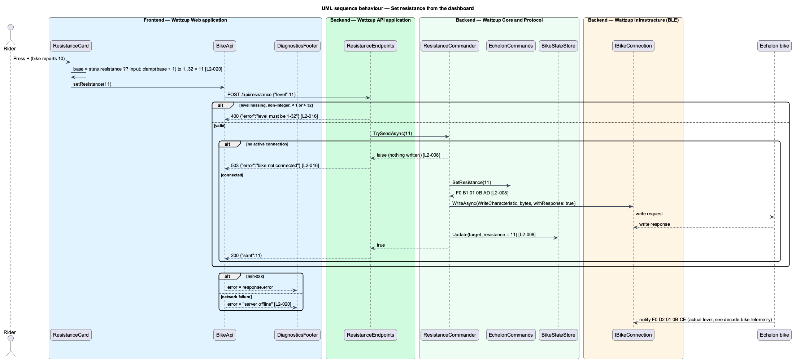

# Set resistance

## Overview

Resistance is the braking force the bike applies to the flywheel, on a scale from 1 to 32. The rider changes it from the dashboard with − and + buttons or by typing a level and pressing Set. The backend turns the request into a Bluetooth command and writes it to the bike. The bike then confirms its new level in a resistance frame, which `decode-bike-telemetry` applies.

**target resistance** — last level Wattzup asked the bike to apply (`target_resistance`)

**actual resistance** — last level the bike reported in a `0xD2` frame (`resistance`)

**checksum** — trailing byte equal to the sum of all preceding command bytes modulo 256

The 2 values are kept apart because the bike takes a moment to apply a change and may ignore a command. The dashboard shows the difference while it lasts (see `show-resistance`). The same backend path also serves `run-interval-workout`, which sets resistance automatically at each step.

## Description

Frontend (`wattzup-web`):

- **`ResistanceCard`** — standalone OnPush component. It renders the − button, the numeric `Resistance level` input (min 1, max 32, default 12), the Set button and the + button. The 3 buttons are disabled unless `state().ble === 'connected'` (L2-020).
- **`ResistanceCard.adjust(delta)`** — base level is `state().resistance` when present, otherwise the input value. It clamps `base + delta` to 1–32, writes the clamped value back to the input and calls `BikeApi.setResistance`.
- **`ResistanceCard.submit()`** — clamps and rounds the input value to 1–32, shows the clamped value, and sends it.
- **`BikeApi`** — typed HTTP client generated from the backend OpenAPI document. `setResistance(level)` posts `{"level": level}` to `/api/resistance`.
- **`DiagnosticsFooter.error`** — a writable signal. A non-2xx response puts the response's `error` text there. A network failure puts `server offline` there (L2-020).

Backend (`Wattzup.Api`, `Wattzup.Core`, `Wattzup.Protocol`):

- **`ResistanceEndpoints`** — maps `POST /api/resistance`. It binds `SetResistanceRequest { int? Level }` and returns `400 {"error":"level must be 1-32"}` for a missing, non-integer or out-of-range level. It returns `503 {"error":"bike not connected"}` when the commander reports no connection, and `200 {"sent": level}` on success (L2-016).
- **`ResistanceCommander`** (implements `IResistanceCommander`) — `TrySendAsync(level)` reads `ActiveConnectionRegistry`. Without a connection it returns `false` and writes nothing. With a connection it writes `EchelonCommands.SetResistance(level)` with response, then updates `target_resistance` in `BikeStateStore` (L2-008, L2-009).
- **`EchelonCommands.SetResistance(level)`** — returns `F0 B1 01 <level> <checksum>`. Level 12 yields `F0 B1 01 0C AE`; level 32 yields `F0 B1 01 20 C2` (L2-008).
- **`EchelonCommands.Checksum(bytes)`** — `(byte)(sum of bytes & 0xFF)`.

The commander serialises writes with a `SemaphoreSlim(1)`, so a manual change and a workout change never interleave on the GATT link.

## Requirements

| L2 ID | Refines (L1) | Requirement |
|-------|--------------|-------------|
| `L2-008` | `L1-003` | Set resistance command. The backend must build the set-resistance command `F0 B1 01 <level> <checksum>` and write it with response. |
| `L2-009` | `L1-003` | Target vs. actual resistance. The state must carry `target_resistance` (last requested) separately from `resistance` (last reported by the bike). |
| `L2-016` | `L1-005` | Resistance endpoint. `POST /api/resistance` with body `{"level": <int>}`. |
| `L2-020` | `L1-006` | Resistance controls. The card must have −, a numeric input (1–32, default 12), Set, and + controls. |

## Diagrams

### System context

The rider asks Wattzup for a level; Wattzup commands the bike through the OS Bluetooth stack.

### Containers

The request travels from Wattzup Web to the Wattzup API over JSON/HTTP, then over BLE GATT to the bike.

### Components

`ResistanceCard` calls `BikeApi`. `ResistanceEndpoints` validates the request and delegates to `ResistanceCommander`, which builds the command and writes it through the active connection.

### Class structure

The endpoint depends only on `IResistanceCommander`. The commander depends on the registry, the store and the pure command builder.

### Behaviour — set resistance from the dashboard

The card clamps the level, and the endpoint validates it. The commander writes the checksummed command and records the target. The bike later reports the actual level.

