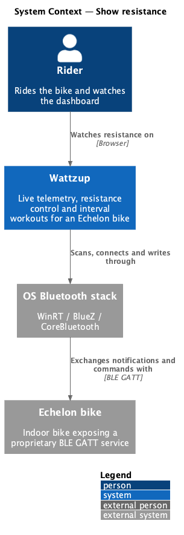
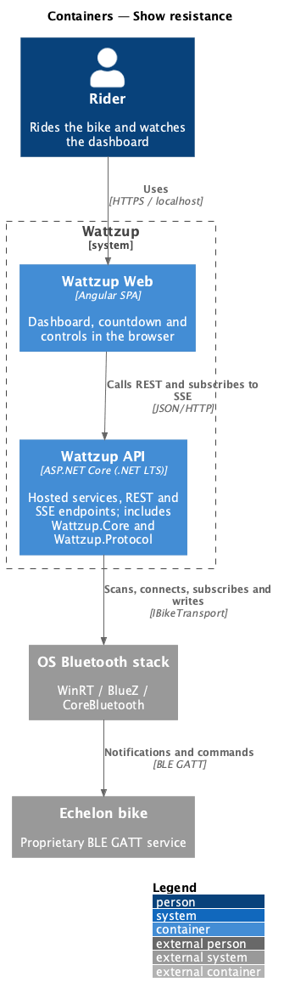
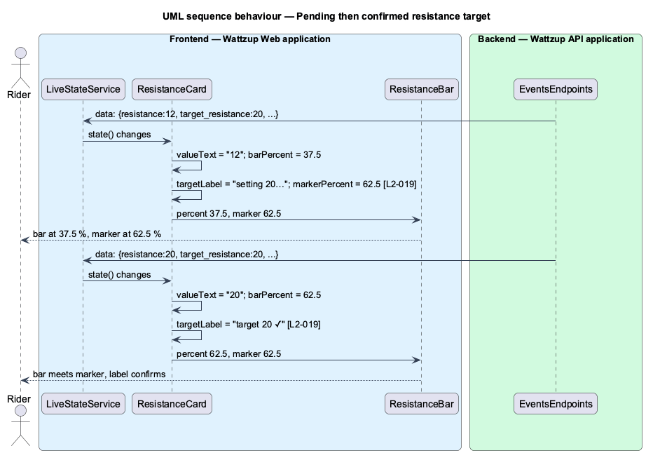

# Show resistance

## Overview

The resistance card tells the rider the bike's current resistance level, and whether a requested change has taken effect yet. A level change is not instant. The backend sends a command, and the bike confirms the new level a moment later. During that gap the card shows a pending label and a marker at the requested level, then switches to a confirmation tick once the 2 values agree.

**resistance bar** — horizontal bar filled to `resistance / 32` of its width

**target marker** — thin vertical marker drawn on the bar at `target_resistance / 32` of its width

This feature is display only. It reads the live `BikeState` signal that `stream-live-state` maintains and makes no HTTP calls. The controls on the same card belong to `set-resistance`, and the card's sparkline belongs to `show-live-metrics`.

## Description

- **`ResistanceCard`** — the same standalone component as in `set-resistance`. Its read-only part derives 4 `computed` signals from `LiveStateService.state`:
  - **`valueText`** — `resistance` as a string, or `--` when `null`.
  - **`barPercent`** — `min(100, resistance / 32 × 100)`, or `0` when `null`.
  - **`targetLabel`** — empty when `target_resistance` is `null`. Otherwise it is `setting <t>…` while `target_resistance !== resistance`, and `target <t> ✓` once they are equal.
  - **`markerPercent`** — `target_resistance / 32 × 100`, or `null` to hide the marker.
- **`ResistanceBar`** — presentational child component. Inputs are `percent` and `markerPercent`. It renders a `role="meter"` element with `aria-valuemin=1`, `aria-valuemax=32` and `aria-valuenow`, and positions the marker with `left: calc(
% - 1px)`. The fill animates width over 0.4 s unless reduced motion is requested.
- **`LiveStateService.state`** — read-only `Signal<BikeState | null>` (see `stream-live-state`).

Worked values from the specification: `resistance` 16 gives `16` and a 50 % bar. `target_resistance` 20 with `resistance` 12 gives `setting 20…` and a marker at 62.5 %. Both at 20 gives `target 20 ✓` (L2-019).

## Requirements

| L2 ID | Refines (L1) | Requirement |
|-------|--------------|-------------|
| `L2-019` | `L1-006` | Resistance card. |

## Diagrams

### System context

The rider watches resistance that Wattzup reads from the bike.

### Containers

Wattzup Web receives the state over SSE from the Wattzup API, which reads the bike over BLE.

### Components

`LiveStateService` exposes the state signal. `ResistanceCard` derives the display values, and `ResistanceBar` draws them.

### Class structure

All display values are `computed` signals. `ResistanceBar` is a pure presentational component.

### Behaviour — pending then confirmed target

A target that differs from the actual level shows `setting <t>…`. The next resistance frame that matches turns the label into `target <t> ✓` (L2-019).

