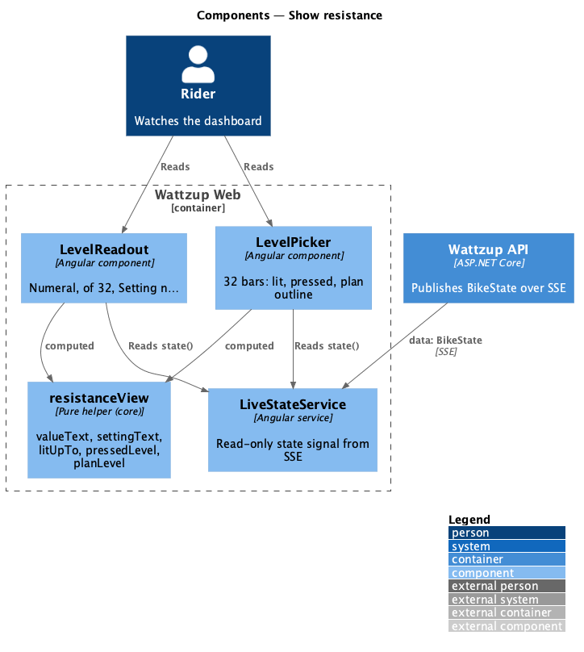
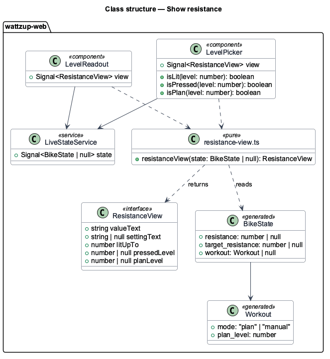

# Show resistance

## Overview

The resistance panel tells the rider the bike's current resistance level, and whether a requested change has taken effect yet. A level change is not instant. The backend sends a command, and the bike confirms the new level a moment later. During that gap the readout shows `Setting <n>…` and the requested level is marked in the level picker. Once the 2 values agree, the `Setting` text disappears.

**resistance readout** — large numeral of the reported level with the caption `of 32`, in the `level-readout` element between the stepper buttons

**lit level** — level picker bar at or below the reported resistance, drawn filled (`is-lit`)

**pressed level** — the requested level: the picker's `aria-valuenow`, its bar drawn filled (`is-set`)

**plan outline** — outline on the picker bar of the plan's level while a manual override is active (`is-plan`)

This feature is display only. It reads the live `BikeState` signal that `live-state/stream-live-state` maintains and makes no HTTP calls. The buttons in the same panel, and the request they send, belong to `set-resistance`. The command list below them belongs to `log-resistance-commands`.

## Description

- **`resistance-view.ts`** (`frontend/src/app/core/`) — pure helper `resistanceView(state)` with a unit test per case. It returns:
  - **`valueText`** — `resistance` as a string, or `--` when `null` (L2-019).
  - **`settingText`** — `Setting <target>…` when `target_resistance` is set and differs from `resistance`; otherwise `null` (L2-019).
  - **`litUpTo`** — `resistance`, or `0` when `null`, so no level is lit.
  - **`pressedLevel`** — `target_resistance ?? resistance`, or `null` when both are `null`.
  - **`planLevel`** — `workout.plan_level` when `workout.mode` is `manual`; otherwise `null` (L2-019).
- **`LevelReadout`** (`wz-level-readout`) — OnPush component inside `LevelControl`, element `level-readout`. It renders `valueText` in a `numeral` span with `aria-live="polite"`, the caption `of 32`, and `settingText` in `level-readout__target` with `role="status"`.
- **`LevelPicker`** (`wz-level-picker`, see `set-resistance`) — for each level n it sets the class `is-lit` when `n ≤ litUpTo`, the class `is-set` when `n === pressedLevel`, and the class `is-plan` when `n === planLevel`; the slider's `aria-valuenow` and `aria-valuetext` carry the pressed level, so assistive technology announces it. The plan outline is a shape cue, not a colour; the plan level is also named in the plan note (`Manual level. Plan was <plan_level>.` for `flat`). The class names `level-readout`, `level-readout__target`, `level-picker`, `is-lit` and `is-plan` are kept from the mocks because e2e locators depend on them.
- **`LiveStateService.state`** — read-only `Signal<BikeState | null>` (see `live-state/stream-live-state`). The components derive their values with `computed(() => resistanceView(state()))`.

Worked values from the specification and the mocks (`docs/mocks/pages/ride/default.html`, `manual.html`):

| `resistance` | `target_resistance` | `mode` / `plan_level` | Readout | Lit | Pressed | Plan outline |
|---|---|---|---|---|---|---|
| 18 | 18 | `plan` / 18 | `18` `of 32` | 1–18 | 18 | none |
| `null` | `null` | no workout | `--` `of 32` | none | none | none |
| 18 | 22 | `manual` / 18 | `18` `of 32`, `Setting 22…` | 1–18 | 22 | 18 |
| 20 | 20 | `manual` / 18 | `20` `of 32` | 1–20 | 20 | 18 |

Verification:

- `frontend` unit tests for `resistanceView`, 1 case per row above and per criterion of L2-019.
- Playwright — the `RidePage.resistance` page object reads the readout, the lit levels, the pressed level and the plan outline. A spec pushes 2 stubbed state messages (`resistance` 18 with target 22, then 22 with target 22) and checks that `Setting 22…` appears and then disappears.

## Requirements

| L2 ID | Refines (L1) | Requirement |
|-------|--------------|-------------|
| `L2-019` | `L1-006` | Resistance readout. |

## Diagrams

### System context

The rider watches resistance that Wattzup reads from the bike.

### Containers

Wattzup Web receives the state over SSE from the Wattzup API, which reads the bike over BLE.

### Components

`LiveStateService` exposes the state signal. `resistanceView` derives the display values, which `LevelReadout` and `LevelPicker` render.

### Class structure

All display values come from 1 pure function over `BikeState`. The components hold only `computed` signals.

### Behaviour — pending then confirmed target

A target that differs from the reported level shows `Setting <n>…` and presses the requested level. The next resistance frame that matches removes the text and lights the level (L2-019).

