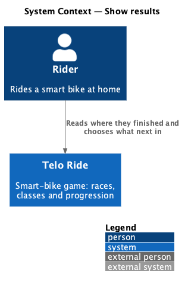
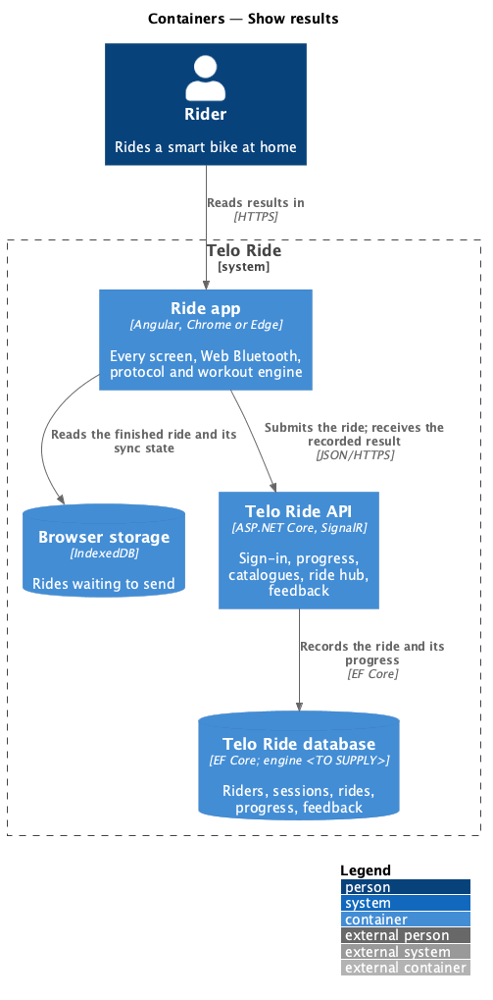
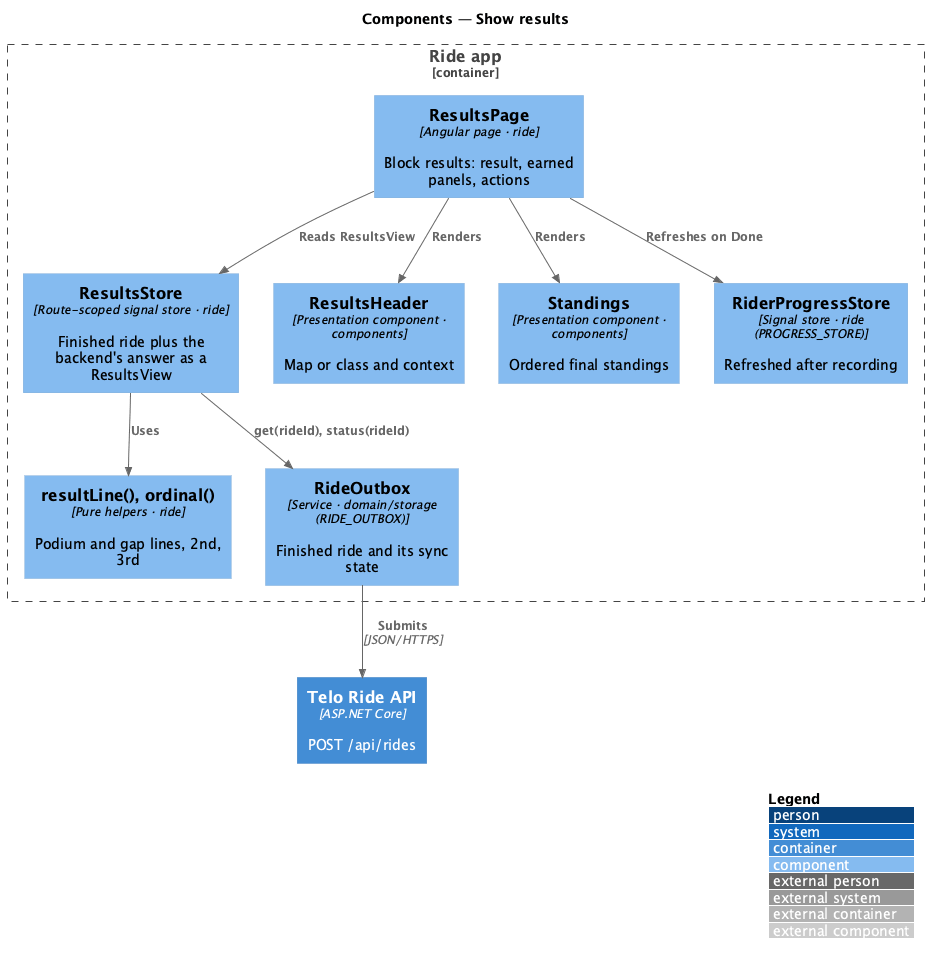
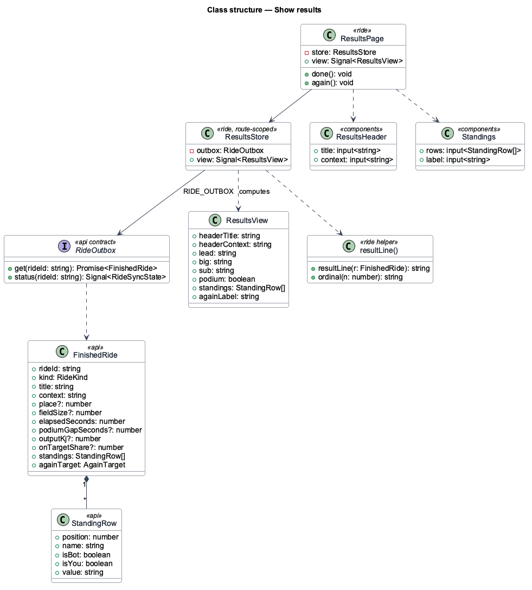
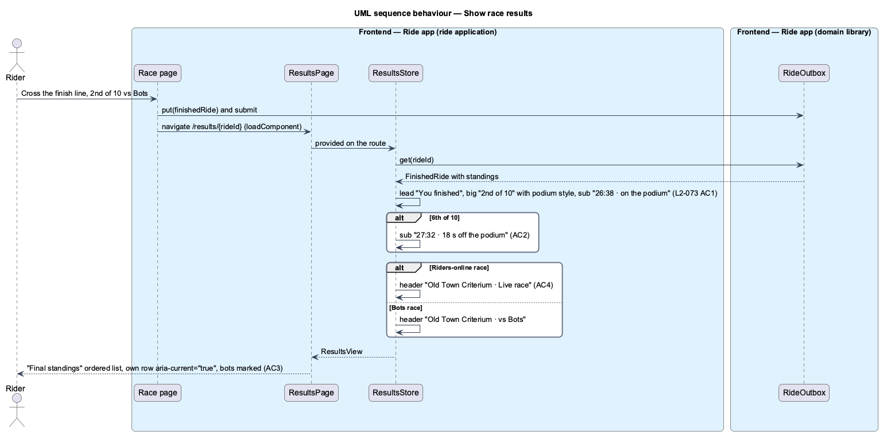
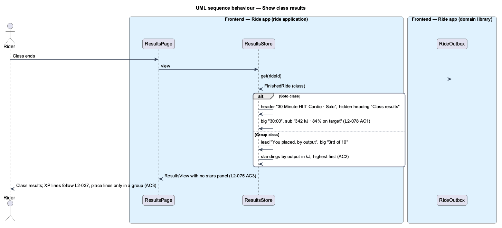
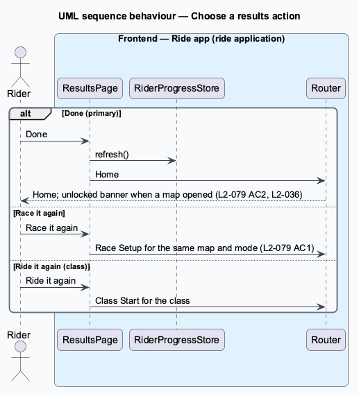

# Show results

## Overview

Results is the screen a rider lands on when a race or a class ends. It answers, in order, where
the rider finished, who finished around them, what the ride earned, and what to do next (L1-013).
The earned panels (XP, stars, personal best) and the unlock card are separate features in this
subsystem; this feature covers the result itself, the final standings and the actions.

- **result** — rider's finishing place or time, stated in one line such as "2nd of 10"
- **podium** — places 1 to 3
- **final standings** — ordered list of every rider in the ride with a finish time (race) or
  output in kilojoules (group class)
- **field** — number of riders, people and bots, in the ride
- **output** — work done over the ride, in kJ

A race is against the rider's ghost (solo), bots, or riders online. A class is solo or with a
group. Results draws the result from the finished ride kept on the device, so it shows at once
even when the network is down; the XP and stars wait for the backend
(`show-xp-stars-and-personal-best`).

## Description

- **`ResultsPage`** — routed page in the `ride` application (`wz-results-page`, block `results`)
  at `/results/:rideId`, loaded with `loadComponent`. It renders the header, the result
  (`results__lead`, `results__big`, `results__sub`), the standings, the earned panels and the
  actions. At lg (≥ 1024 px) or wider it is two columns, result then what was earned, with the
  actions pinned to the bottom (`results__actions`).
- **`ResultsStore`** — signal store provided on the Results route. It reads the finished ride
  from `RIDE_OUTBOX` and computes one `ResultsView`.
- **`RideOutbox`** — contract and `RIDE_OUTBOX` token in `api`, implemented in `domain/storage`
  and owned by `performance/ride-without-a-network`. `get(rideId)` returns the `FinishedRide`;
  `status(rideId)` returns its sync state.
- **`FinishedRide`** — record the race or class page writes when the ride ends: kind, title,
  context, place and field size, elapsed time, the gap to the podium, output, on-target share, the
  final standings and the target of the again action. A bots or ghost race takes its standings
  from the race engine; a riders-online race or group class takes them from the multiplayer
  service's final standings (`multiplayer/record-results-nobody-can-change`).
- **`resultLine()`** and **`ordinal()`** — pure helpers in `ride` with unit tests. On the podium
  the line reads "{time} · on the podium"; off it, "{time} · {n} s off the podium". `ordinal()`
  returns "1st", "2nd", "3rd", "4th" and so on.
- **`ResultsHeader`** — presentation component (`wz-results-header`, block `results-header`) with
  the title and the context: "· vs Bots", "· vs your best", "· Live race" or "· Solo".
- **`Standings`** — presentation component (`wz-standings`, block `standings`). It renders an
  ordered list labelled "Final standings"; the rider's row carries `aria-current="true"` and bots
  carry a marker that is text as well as colour. All names render as text.
- **Actions** — "Done" (primary) refreshes `PROGRESS_STORE` and goes to Home, which shows the
  unlocked banner when a map opened (L2-036). "Race it again" goes to Race Setup for the same map
  and mode; for a class, "Ride it again" goes to Class Start.

The two contradictions between mocks and requirements that touch this screen are recorded as open
questions 5 and 7 in `docs/specs/L2.md`: the third star on a personal best, and the order of the
class-group board. The design follows the requirements: the group board ranks by output, highest
first.

## Requirements

| L2 ID | Refines (L1) | Requirement |
|-------|--------------|-------------|
| `L2-073` | `L1-013` | For 2nd of 10 against bots on Old Town Criterium, the header shall read "Old Town Criterium · vs Bots" and the result shall read "You finished", "2nd of 10" styled as a podium place, and "26:38 · on the podium". |
| `L2-073` (AC2–AC3) | `L1-013` | For 6th of 10 the result shall read "27:32 · 18 s off the podium"; the final standings shall be an ordered list ("Final standings") with every rider's finish time, the rider's row carrying `aria-current="true"` and bots marked. |
| `L2-073` (AC4–AC5) | `L1-013` | For a riders-online race the header shall read "· Live race"; at lg or wider Results shall be two columns (result, then what was earned) with the actions pinned to the bottom. |
| `L2-078` | `L1-013` | For a solo class the header shall read "30 Minute HIIT Cardio · Solo" with the hidden heading "Class results", and the result shall read "30:00" and "342 kJ · 84% on target". |
| `L2-078` (AC2–AC3) | `L1-013` | For a group class the result shall read "You placed, by output" and "3rd of 10" with the standings listing every rider's output in kJ, highest first; "XP earned" shall follow L2-037 with place and podium lines only in a group. |
| `L2-079` | `L1-013` | Results shall offer "Done" (primary, to Home) and "Race it again" (to Race Setup for the same map and mode) or, for a class, "Ride it again" (to Class Start). |
| `L2-079` (AC2) | `L1-013` | When a map opened and the rider presses Done, Home shall show the unlocked banner (L2-036). |

## Diagrams

### System context

The rider reads where they finished and chooses what to ride next in Telo Ride. No external
system takes part.

### Containers

The Ride app reads the finished ride from browser storage and shows it at once; the ride's
submission to the Telo Ride API runs alongside.

### Components

`ResultsStore` reads the finished ride from `RideOutbox` and uses the line helpers to build the
view that `ResultsPage` renders through `ResultsHeader` and `Standings`.

### Class structure

`FinishedRide` holds the standings rows; `ResultsStore` turns it into a `ResultsView` with the
header, the three result lines and the again label.

### Behaviour — show race results

The race page keeps the finished ride and opens Results, which formats the place, the podium line
and the header context (L2-073).

### Behaviour — show class results

A solo class shows time, output and on-target share; a group class shows the place by output and
standings highest first (L2-078).

### Behaviour — choose a results action

Done refreshes progress and goes Home, where any unlocked banner shows; the again actions return
to Race Setup or Class Start (L2-079).

