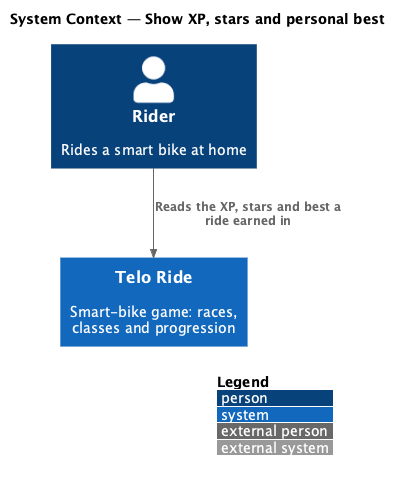
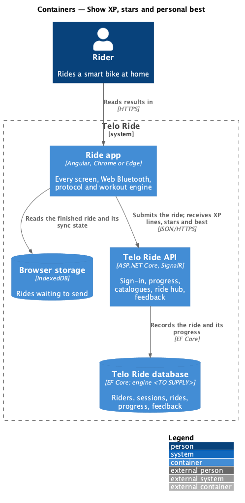
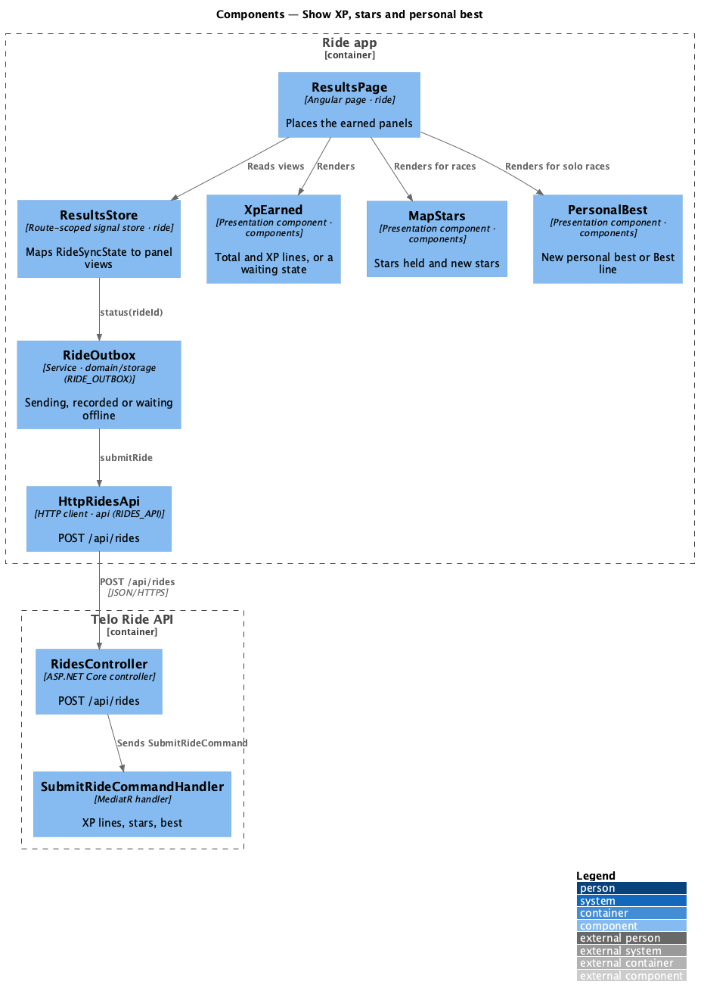
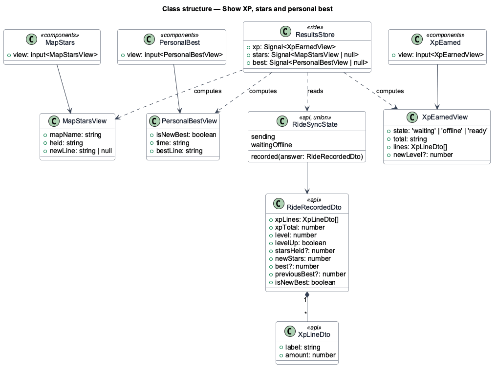
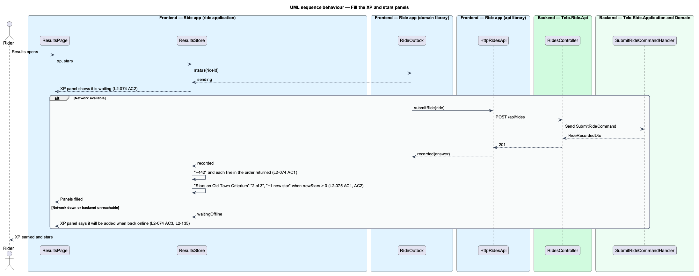
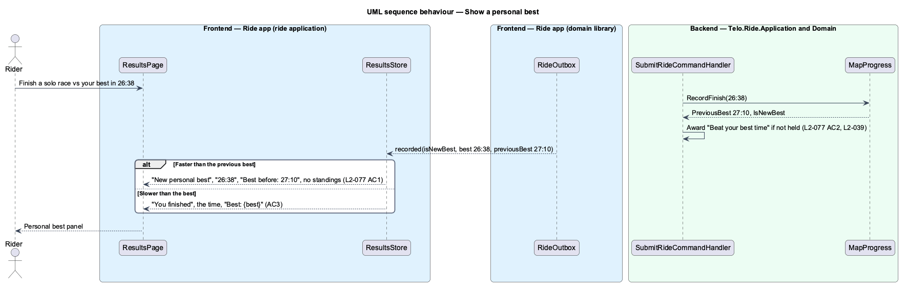

# Show XP, stars and personal best

## Overview

The right-hand column of Results shows what a ride earned: the XP, itemised line by line; the
stars the rider holds on the map; and, for a race against the rider's best time, whether the ride
set a new personal best (L1-013).

- **XP line** — one labelled reason for XP with its amount, such as "Podium" +75
- **star** — one of three awards per map, earned once and never lost
- **personal best** — rider's fastest finish on a map
- **solo race** — race against the rider's best-time ghost, with no other riders
- **sync state** — whether a finished ride is still being sent, recorded by the backend, or
  waiting for a network

Every value in these panels comes from the backend's answer to the ride's submission (L2-044).
The panels therefore have a waiting state while the answer is on its way, and an offline state
when the ride was finished without a network (L2-135). Neither state has a mock yet; both are
listed as mock gaps in `docs/specs/L2.md`.

## Description

- **`ResultsStore`** — the Results route's store (see `show-results`). It watches
  `RideOutbox.status(rideId)` and computes three views: `XpEarnedView`, `MapStarsView` (races
  only) and `PersonalBestView` (solo races only).
- **`RideSyncState`** — union in `api`: `sending`, `recorded(answer)` or `waitingOffline`.
- **`RideRecordedDto`** — the backend's answer (`progression/keep-progress-on-the-backend`): XP
  lines and total, level and `levelUp`, stars held and new stars, best, previous best and
  `isNewBest`.
- **`XpEarned`** — presentation component (`wz-xp-earned`, block `xp-earned`). It shows "XP
  earned", the total ("+442") and each line in the order the backend returned. In the waiting
  state it shows that the result is being recorded and announces the filled panel politely. In the
  offline state it says the XP will be added when the rider is back online. When `levelUp` is set
  it shows the new level with the XP (L2-038 AC3).
- **`MapStars`** — presentation component (`wz-map-stars`, block `map-stars`). It shows "Stars on
  {map}", the stars held ("2 of 3") through `Stars`, and "+1 new star" or "+2 new stars" only
  when stars were earned. A class shows no stars panel.
- **`PersonalBest`** — presentation component for a solo race. Faster than the previous best, it
  reads "New personal best", the time and "Best before: {time}", and Results shows no standings.
  Slower, it reads "You finished", the time and "Best: {best}".
- **Third star** — the backend awards "Beat your best time" on a new best in any mode, if the
  rider does not hold it (`progression/earn-stars-and-unlock-maps`). The mocks for Results
  `default` and `solo` show a new best without the third star; open question 5 in
  `docs/specs/L2.md` records the conflict, and the design follows the requirement.

## Requirements

| L2 ID | Refines (L1) | Requirement |
|-------|--------------|-------------|
| `L2-074` | `L1-013` | "XP earned" shall show the total ("+442") and each line of L2-037 in order, as the backend returned them. |
| `L2-074` (AC2–AC3) | `L1-013` | While the result is still being recorded, the XP panel shall show it is waiting and fill in when the backend answers; for a ride finished without a network, it shall say the XP will be added when the rider is back online (L2-135). |
| `L2-075` | `L1-013` | For a race on a map, "Stars on {map}" shall show the stars held ("2 of 3") and, if any were earned, "+1 new star" or "+2 new stars". |
| `L2-075` (AC2–AC3) | `L1-013` | With no new star there shall be no new-star line; a class shall show no stars panel. |
| `L2-077` | `L1-013` | For a solo race faster than the previous best, Results shall read "New personal best", the time ("26:38") and "Best before: 27:10", with no standings. |
| `L2-077` (AC2–AC3) | `L1-013` | A new best in any mode shall earn the third star if the rider does not already hold it (L2-039); a solo race slower than the best shall read "You finished" with the time and "Best: {best}". |

## Diagrams

### System context

The rider reads in Telo Ride the XP, stars and best a ride earned. No external system takes part.

### Containers

The Ride app keeps the finished ride in browser storage and submits it to the Telo Ride API, which
answers with the XP lines, stars and best.

### Components

`ResultsStore` maps the outbox's sync state to the views of `XpEarned`, `MapStars` and
`PersonalBest`; the answer comes from `SubmitRideCommandHandler` through `HttpRidesApi`.

### Class structure

`RideSyncState` carries the `RideRecordedDto` once recorded. The store derives one view per panel,
and each presentation component takes only its view.

### Behaviour — fill the XP and stars panels

The XP panel opens waiting and fills when the backend answers (L2-074 AC2). Without a network the
ride waits in the outbox and the panel says so (AC3).

### Behaviour — show a personal best

The backend compares the finish with the previous best and awards the third star if needed; the
panel reads "New personal best" or "You finished" with the best (L2-077).

