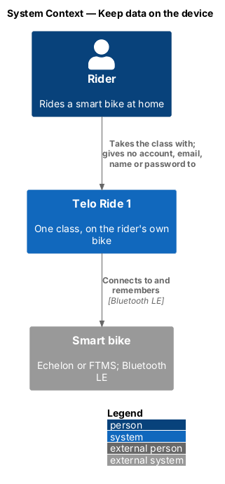
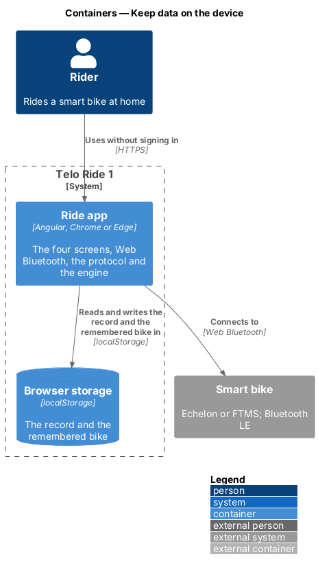
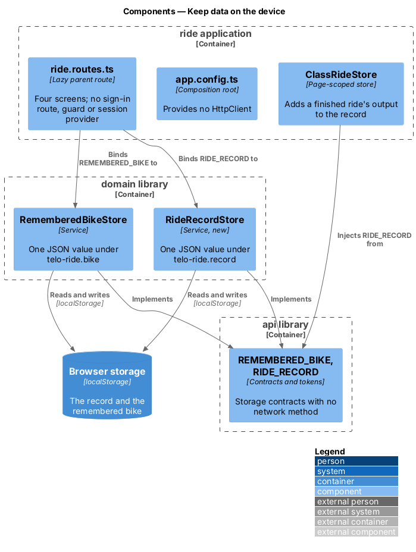
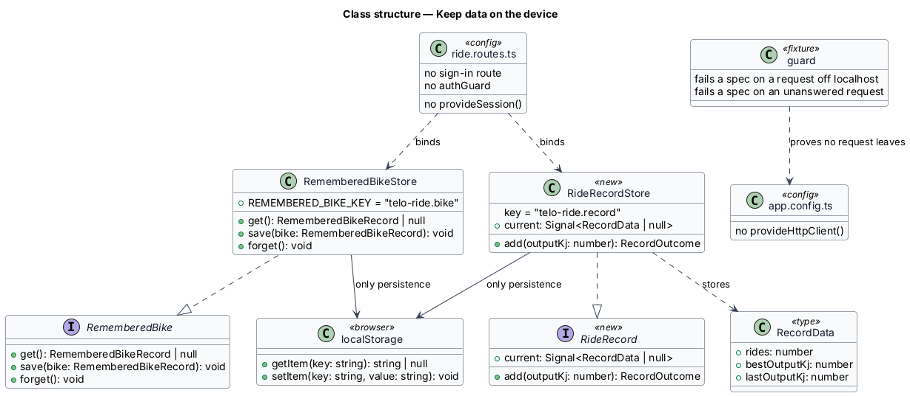
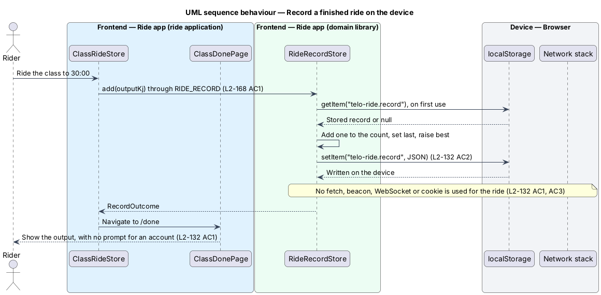
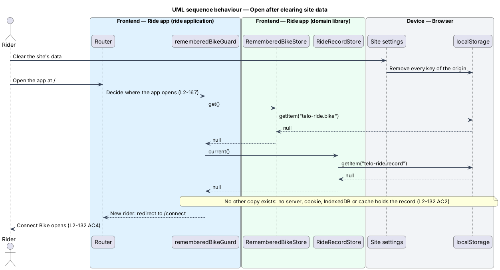

# Keep data on the device

## Overview

Telo Ride 1 has no accounts and collects nothing about the rider (`L1-021`). Two pieces of data
outlive a visit: the record, which gives the rider a number to come back and beat, and the
remembered bike, which lets the rider pair once. This feature states where those two live, that
they never leave, and that nothing else is kept. The rider's control over the data is the browser's
own: clearing the site's data removes all of it.

Local terms:

- **record**: rider's ride count, best output and last output, kept on the device (`L2-168`)
- **remembered bike**: name of the paired bike and the browser's identifier for it, kept on the device (`L2-015`)
- **browser storage**: `localStorage` of the origin that serves the app
- **site data**: everything the browser stores for the app's origin, which the rider can clear from the browser's settings
- **new rider**: rider with no remembered bike and no finished rides (`L2-167`)

Neighbouring features own the adjacent concerns:

- [Keep the record](../../class-done/keep-the-record/README.md) owns the record's rules and its
  store (`L2-168`).
- [Keep the bike connected](../../bike/keep-the-bike-connected/README.md) owns what is remembered
  about the bike (`L2-015`).
- [Open the app](../../the-class/open-the-app/README.md) owns where a new rider and a returning
  rider land (`L2-167`).
- [Treat device data as untrusted](../treat-device-data-as-untrusted/README.md) owns validating
  what is read back from storage (`L2-129` AC3).
- [Restrict third parties](../restrict-third-parties/README.md) owns the policy that allows
  connections only to the app's own origin (`L2-131`).
- [Ride without a network](../../performance/ride-without-a-network/README.md) owns finishing and
  recording a ride with no network (`L2-135`).

## Description

### No account and no cookie (`L2-132` AC1)

- **Routes** (`ride`, `ride.routes.ts`): exists and changes. Today the lazy parent route provides
  `provideSession()`, guards every child with `authGuard`, and has a `sign-in` child. Telo Ride 1
  has the four screens and Page not found only. The parent route keeps `provideBikeConnection()`
  and loses the session provider, the guard and the sign-in route, as
  [Open the app](../../the-class/open-the-app/README.md) describes.
- **No field for identity**: none of the four screens in `docs/mocks/pages/` holds an input for
  an email, a name or a password, and no screen links to one.
- **No cookie**: no code in `frontend/projects/` writes `document.cookie`, and with no backend in
  the requirements no response sets one. The class video is embedded from
  `www.youtube-nocookie.com` ([Restrict third parties](../restrict-third-parties/README.md)).
- **Carried over**: `ride/src/app/sign-in/`, `ride/src/app/session/`, and `auth/`, `riders/` and
  `riders/session.interceptor.ts` in `api` belong to Telo Ride's sign-in. They are not routed, not
  bound and not extended, and each is removed in a change of its own.

### Stored on the device only (`L2-132` AC2)

- **`RememberedBikeStore`** (`domain`, `storage/remembered-bike-store.ts`): exists, implementing
  `RememberedBike` behind `REMEMBERED_BIKE` (`api`, `bike/remembered-bike.ts`). It keeps one JSON
  value under the `localStorage` key `telo-ride.bike` and has no other dependency than the
  document's window. Today the value holds `id`, `name`, `identifier`, `kind` and `pairedAt`;
  `L2-015` AC4 asks for the name and the browser's identifier only, and
  [Keep the bike connected](../../bike/keep-the-bike-connected/README.md) reduces it to `id` and
  `name`.
- **`RideRecordStore`** (`domain`, `storage/ride-record-store.ts`): new, introduced by
  [Keep the record](../../class-done/keep-the-record/README.md) behind `RideRecord` and
  `RIDE_RECORD` (`api`, `rides/ride-record.ts`). It keeps one JSON value of fixed size under the
  `localStorage` key `telo-ride.record`: `rides`, `bestOutputKj` and `lastOutputKj` (`L2-168` AC5).
- **Storage contracts carry no network method**: `RememberedBike` is `get`, `save` and `forget`;
  `RideRecord` is `current` and `add`. Neither implementation injects `HttpClient`.
- **Nothing else is kept**: the app uses no IndexedDB, no `sessionStorage` and no Cache Storage
  for rider data. The theme follows the device's colour scheme and is not stored
  ([Switch theme and full screen](../../ui/switch-theme-and-full-screen/README.md)).

### No request for a ride (`L2-132` AC3)

- **`app.config.ts`** (`ride`): exists. It provides zoneless change detection, the router and the
  browser's global error listeners, and no `HttpClient`.
- **Carried over**: `HttpRidesApi` and `RideOutbox` (`api`, `rides/`), `SessionRideOutbox`
  (`domain`, `storage/session-ride-outbox.ts`), `HttpRiderProgressApi` and the SignalR client
  (`api`, `live/`) upload rides and progress for Telo Ride. `ride.routes.ts` binds
  `RIDER_PROGRESS_API` today; Telo Ride 1 binds none of them. `ClassRideStore`
  (`ride`, `class-ride/class-ride-store.ts`) exists and today hands a finished ride to
  `RIDE_OUTBOX`; for Telo Ride 1 it calls `RIDE_RECORD.add` only. Whether an HTTP client remains
  behind `CLASSES_API` for the class definition is `<TO SUPPLY>` (`L2.md` open question 1).
  Whatever is decided, the record and the remembered bike are in no request.
- **Policy backstop**: `connect-src 'self'` of `L2-131` leaves the page no connection to another
  origin.
- **Proof in the specs**: the `guard` fixture in `frontend/e2e/fixtures/test.ts` exists. It fails a
  spec on a request off localhost and on a request no fixture answers. A spec that finishes a ride
  and declares no answer therefore proves that no request leaves for it.

### Clearing site data (`L2-132` AC4)

Both stores read `localStorage` when the app opens and hold no second copy. After the rider clears
the site's data, both reads return `null`, `rememberedBikeGuard` of
[Open the app](../../the-class/open-the-app/README.md) finds a new rider, and Connect Bike opens.
The browser's Bluetooth permission for the bike is separate from site data in some browser
versions; with no remembered bike the app does not use it.

## Requirements

The feature realizes the following level-2 (L2) requirement, which refines the level-1 (L1)
requirement cited beside it.

| L2 ID | Refines (L1) | Requirement |
|-------|--------------|-------------|
| `L2-132` | `L1-021` | The app shall ask for no account, email, name or password, and shall set no cookie of its own. The record and the remembered bike shall be kept in the browser's storage on the device and shall never be sent anywhere. No request shall leave the device when a finished ride is recorded. After the rider clears the site's data in the browser, the rider shall be a new rider when the app opens again. |

## Diagrams

### System context

The rider uses Telo Ride 1 without identifying themselves. The bike is the only other system, and
no system receives data about the rider.

### Containers

The Ride app reads and writes the record and the remembered bike in the browser's storage. No
container outside the device takes part.

### Components

`ride.routes.ts` binds `REMEMBERED_BIKE` to `RememberedBikeStore` and `RIDE_RECORD` to
`RideRecordStore`, and both write to `localStorage` only. No route, guard or provider for a session
remains.

### Class structure

Both stores depend on `localStorage` and on nothing that reaches the network. The route and root
configuration hold no session and no `HttpClient`, which the `guard` fixture proves in the specs.

### Behaviour: record a finished ride on the device

When the ride clock reaches 30:00, `ClassRideStore` calls `RIDE_RECORD.add` and `RideRecordStore`
updates one `localStorage` value. The browser's network stack is not used, and Class Done shows the
result without asking for an account.

### Behaviour: open after clearing site data

The rider clears the site's data in the browser. On the next visit both stores find nothing, no
other copy exists, and the app opens on Connect Bike as for a new rider.

