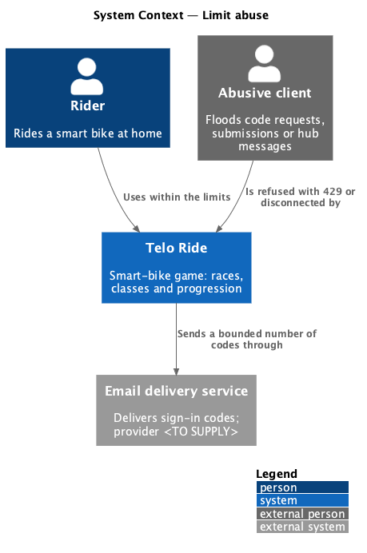
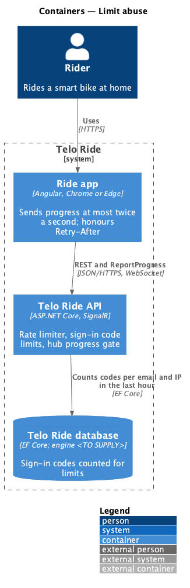
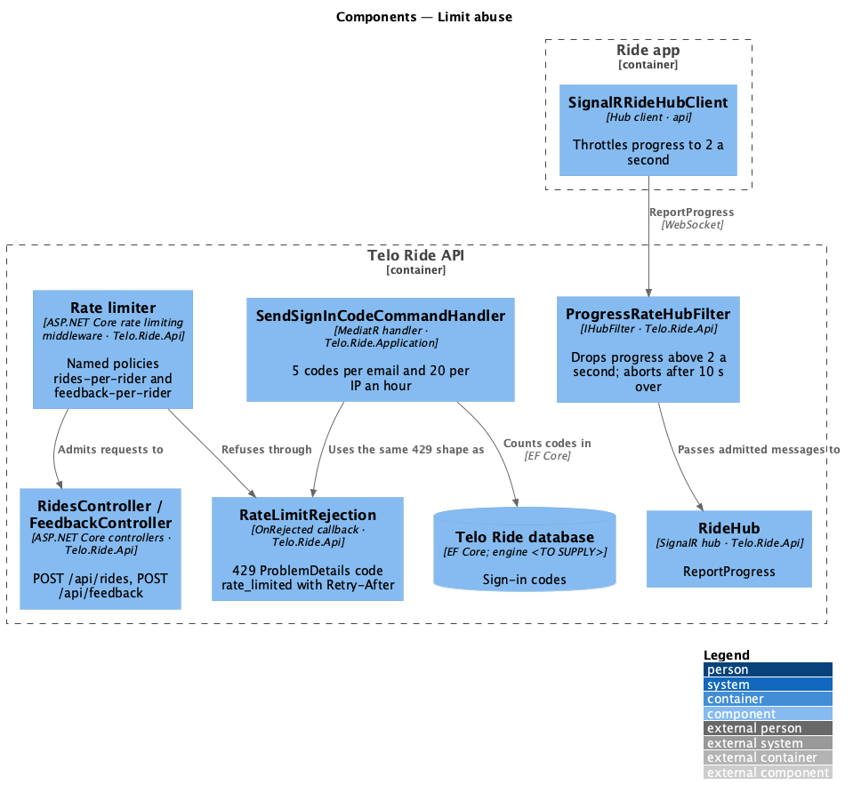
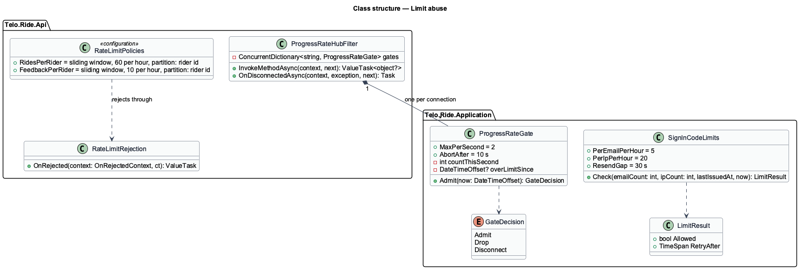
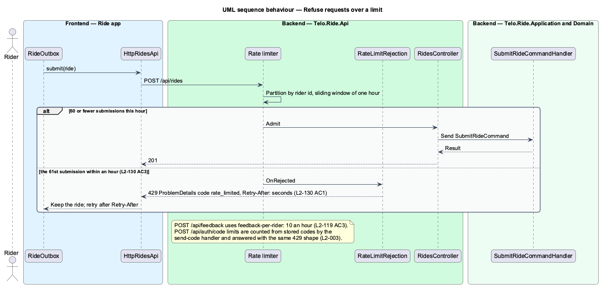
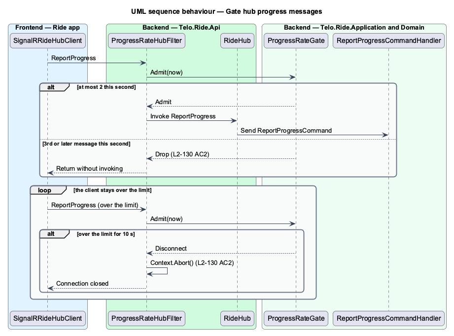

# Limit abuse

## Overview

The Telo Ride API accepts a few kinds of request that cost something when repeated without limit:
sign-in codes cost an email each and invite guessing, ride submissions and feedback reports cost
storage and processing, and hub progress messages cost the multiplayer service a share of every
second. This feature puts a ceiling on each, so one misbehaving or hostile client cannot degrade
Telo Ride for other riders.

- **rate limit** — maximum count of one kind of request from one partition (an email address, an
  IP address or a rider) within a time window
- **sliding window** — window that always covers the most recent hour, rather than a calendar hour
- **progress message** — hub message in which a client reports its rider's distance or output and
  power during a session
- **Retry-After** — HTTP response header that tells the client how many seconds to wait before
  trying again

The limits are:

| Request | Limit | Answer when passed | Source |
|---------|-------|--------------------|--------|
| Sign-in code, per email | 5 an hour | 429 with `Retry-After` | `L2-003` AC4 |
| Sign-in code, per IP address | 20 an hour | 429 with `Retry-After` | `L2-003` AC5 |
| Feedback report, per rider | 10 an hour | 429 with `Retry-After` | `L2-119` AC3 |
| Ride submission, per rider | 60 an hour | 429 with `Retry-After` | `L2-130` AC3 |
| Hub progress message, per connection | 2 a second | extra dropped; disconnected after 10 s over | `L2-130` AC2 |

The Ride app keeps within these limits in normal use: it sends progress at most twice a second
([Share progress and standings](../../multiplayer/share-progress-and-standings/README.md)), and
its ride outbox waits for `Retry-After` before submitting again.

## Description

### Telo Ride API (backend)

- **Rate limiter** (`Telo.Ride.Api`) — ASP.NET Core rate limiting middleware (`AddRateLimiter`,
  `UseRateLimiter`) with two named policies, both sliding windows of one hour partitioned by the
  signed-in rider's id: `rides-per-rider` (60) on `POST /api/rides` and `feedback-per-rider` (10)
  on `POST /api/feedback`. Policies attach to endpoints with `[EnableRateLimiting]`.
- **`RateLimitRejection`** — the limiter's `OnRejected` callback. It sets `Retry-After` from the
  lease's `RetryAfter` metadata in whole seconds and writes a 429 ProblemDetails with code
  `rate_limited`.
- **`SignInCodeLimits`** (`Telo.Ride.Application`) — the sign-in limits, applied by
  `SendSignInCodeCommandHandler` of [Sign in with an email
  code](../../accounts/sign-in-with-an-email-code/README.md). The per-email limit depends on the
  request body, so it is counted from the stored `SignInCode` rows rather than in middleware; the
  per-IP count comes from the same rows, which hold a hash of the client address. A refusal is
  answered with the same 429 shape and `Retry-After`.
- **`ProgressRateHubFilter`** — `IHubFilter` on `RideHub` that keeps one `ProgressRateGate` per
  connection and consults it for each `ReportProgress` invocation. On `Drop` it returns without
  invoking the hub method. On `Disconnect` it calls `Context.Abort()`. It discards the gate when
  the connection closes, so no state outlives a connection.
- **`ProgressRateGate`** — counts admitted messages per second. The third and later messages
  within a second are dropped. When the client has been over the limit for 10 seconds without
  falling back under it, the gate answers `Disconnect`. Time comes from `TimeProvider`, so the
  rule is unit-tested with `FakeTimeProvider` and never sleeps.
- **Client address** — behind the hosting platform's proxy, the client IP address comes from
  `ForwardedHeaders` middleware configured to trust only the platform's proxy. The proxy
  addresses are `<TO SUPPLY>`.
- **Instance count** — the rate limiter's windows are held in process memory. With more than one
  API instance, each instance would count separately. The backend's instance count, and a shared
  store if it is more than one, are `<TO SUPPLY>`. The sign-in limits are counted from the
  database and hold across instances.

### Ride app (frontend)

- **`SignalRRideHubClient`** (`api` library) — sends progress at most twice a second.
- **`toApiError`** (`api` library) — copies `Retry-After` into `ApiError.retryAfterSeconds`;
  the code screen of sign-in and the ride outbox use it to say when to try again and to schedule
  the next attempt.

## Requirements

The feature realizes the following level-2 (L2) requirements. Each L2 requirement refines a
level-1 (L1) requirement, cited by identifier.

| L2 ID | Refines (L1) | Requirement |
|-------|--------------|-------------|
| `L2-130` | `L1-021` | Requests past the limits of `L2-003` and `L2-119` shall be refused with 429 and a `Retry-After` header. A hub client that sends more than 2 progress messages a second shall have the extra messages dropped and, after 10 seconds over the limit, shall be disconnected. More than 60 ride submissions from one rider in an hour shall cause the next to be refused with 429. |

## Diagrams

### System context

Riders use Telo Ride within the limits; an abusive client is refused or disconnected, and the
number of code emails sent through the email delivery service stays bounded.

### Containers

The Telo Ride API enforces every limit; the database holds the sign-in codes the code limits are
counted from. The Ride app throttles its own progress messages and honours `Retry-After`.

### Components

The rate limiter admits ride and feedback submissions or refuses them through
`RateLimitRejection`. The send-code handler counts codes in the database. `ProgressRateHubFilter`
sits between the hub client and `RideHub`.

### Class structure

`ProgressRateHubFilter` owns one `ProgressRateGate` per connection, whose `Admit` returns a
`GateDecision`. `SignInCodeLimits` holds the sign-in thresholds, and `RateLimitPolicies` the
per-rider windows.

### Behaviour — refuse requests over a limit

The 61st ride submission within an hour is refused before the controller runs, with 429 and
`Retry-After` (`L2-130` AC1, AC3). The ride stays in the outbox until the wait has passed.

### Behaviour — gate hub progress messages

The gate admits two progress messages a second and drops the rest. A client that stays over the
limit for 10 seconds is disconnected (`L2-130` AC2).

