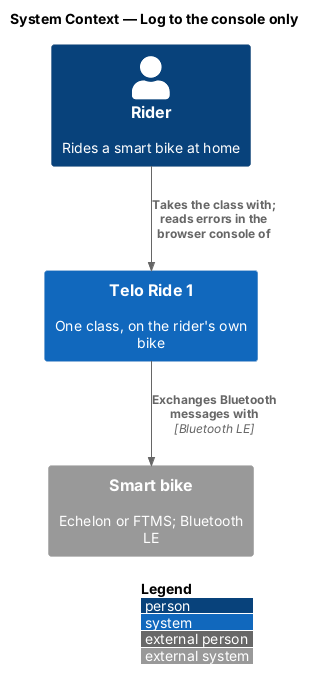
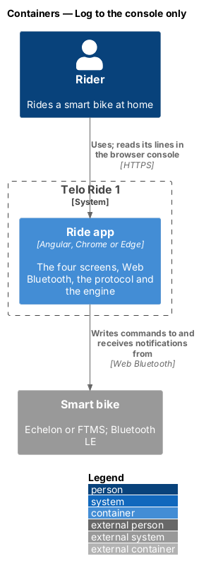
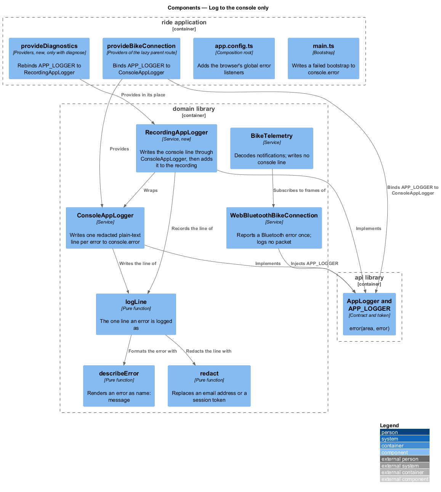
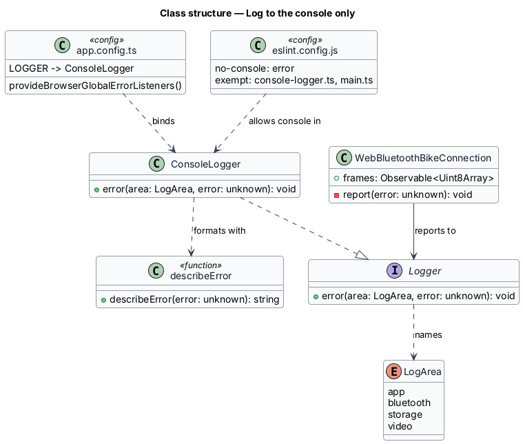
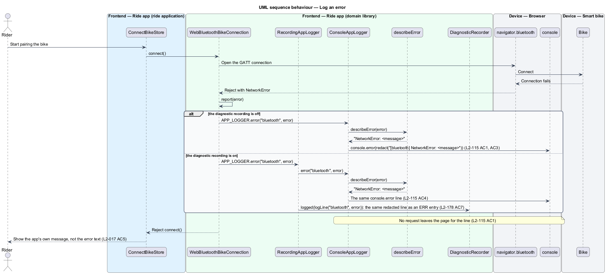
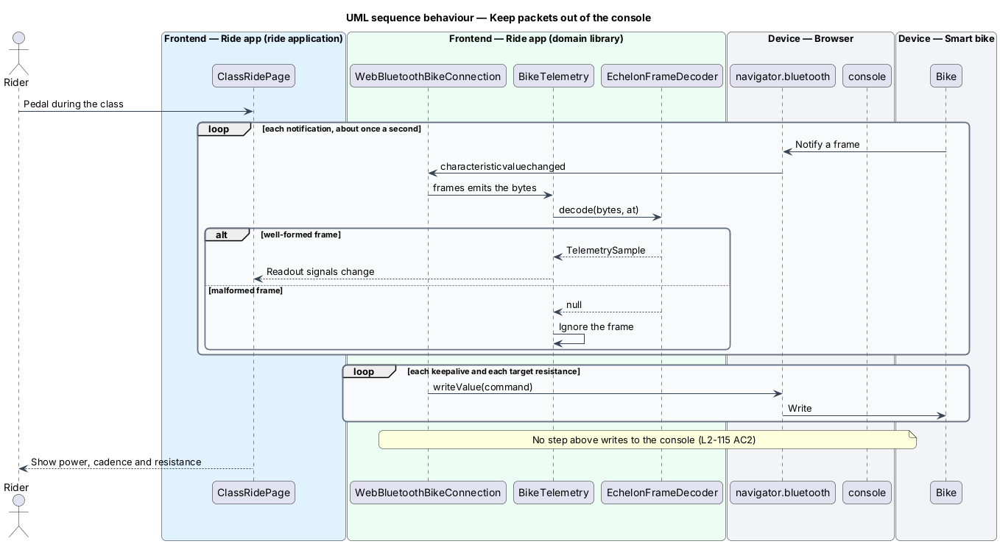

# Log to the console only

## Overview

Telo Ride 1 is one class on the rider's own bike, run in Chrome or Edge with no account and no
backend in its requirements. This feature fixes where the app's diagnostic output goes: the
browser console of the device the rider rides on, and nowhere else. It refines `L1-021`, which
asks that Telo Ride 1 collect nothing about the rider.

The feature has three parts. Each error the app handles is written once, as one plain-text line
that names the area it came from and the error. No line is written for the Bluetooth messages that
flow about once a second for 30 minutes. No logging service, crash reporter or analytics client is
part of the app.

Local terms:

- **console line**: single plain-text entry the app writes to the browser console
- **area**: part of the app an error came from, one of `app`, `bluetooth`, `storage` and `video`
- **packet**: one Bluetooth message, either a notification from the bike or a command written to it
- **remote logging service**: third-party or first-party endpoint that receives log entries over the network

Neighbouring features own the adjacent concerns:

- [Restrict third parties](../restrict-third-parties/README.md) owns the Content Security Policy
  whose `connect-src 'self'` blocks a request to any logging endpoint (`L2-131`).
- [Treat device data as untrusted](../treat-device-data-as-untrusted/README.md) owns showing a
  Bluetooth error to the rider as text (`L2-129`).
- [Keep the bike connected](../../bike/keep-the-bike-connected/README.md) owns the drop and
  recovery that produce most Bluetooth errors (`L2-017`).
- [Read bike telemetry](../../bike/read-bike-telemetry/README.md) owns decoding the notifications
  that this feature keeps out of the console (`L2-020`, `L2-021`).
- [Stay smooth on long rides](../../performance/stay-smooth-on-long-rides/README.md) owns the rule
  that nothing grows with the ride's length (`L2-138`); a per-packet console line would break it.

## Description

### What exists

- **`describeError`** (`domain`, `bluetooth/describe-error.ts`): exists. A pure function that
  renders an `Error` as `name: message` and any other value with `String()`. It stays as it is.
- **`WebBluetoothBikeConnection.report`** (`domain`, `bluetooth/web-bluetooth-bike-connection.ts`):
  exists. It sets the `lastError` signal to the text of `describeError` and calls
  `console.error(text)`. Today the line carries the error but not the area. For Telo Ride 1 the
  method calls `Logger.error('bluetooth', error)` in place of `console.error`, so the line names
  both (`L2-115` AC3).
- **`provideBrowserGlobalErrorListeners()`** (`ride`, `app.config.ts`): exists. It routes an
  uncaught error and an unhandled promise rejection to Angular's `ErrorHandler`, whose default
  implementation writes them to `console.error`. No custom `ErrorHandler` is provided.
- **`main.ts`** (`ride`): exists. A failed `bootstrapApplication` is written with
  `console.error(error)`. It stays, because no injector exists at that point.
- **Packet path** (`domain`): exists. `WebBluetoothBikeConnection.frames` emits each notification
  as raw bytes, `BikeTelemetry` decodes it with `EchelonFrameDecoder` or `IndoorBikeDataDecoder`,
  and `GattWriteQueue` and `KeepaliveScheduler` write commands. None of them calls `console`. A
  malformed frame decodes to `null` and is dropped without a line.
- **`frontend/package.json`**: exists. Its dependencies hold no logging, crash-reporting or
  analytics package.

### What is new

- **`Logger`** and **`LOGGER`** (`api`, `logging/logger.ts`): new. The contract has one method,
  `error(area: LogArea, error: unknown): void`, and `LogArea` is the union `'app' | 'bluetooth' |
  'storage' | 'video'`. Services in `domain` and pages in `ride` inject the token; none calls
  `console` directly.
- **`ConsoleLogger`** (`domain`, `browser/console-logger.ts`): new. It implements `Logger` by
  writing `<area>: <describeError(error)>` to `console.error`, for example
  `bluetooth: NetworkError: GATT Server is disconnected.`. The line is one string: no object, DOM
  node or stack is passed as a further argument. It holds no buffer and sends nothing.
- **Binding** (`ride`, `app.config.ts`): new. `{ provide: LOGGER, useClass: ConsoleLogger }`,
  bound in the composition root because every screen shares it.
- **Callers**: the record store of [Keep the record](../../class-done/keep-the-record/README.md)
  logs a refused write under `storage` (`L2-168` AC4), and the video player's failure is logged
  under `video` (`L2-088` AC4). Each caller logs an error once, where it is handled.
- **`no-console`** (`frontend/eslint.config.js`): new. The rule is set to `error` for every
  `projects/**/*.ts` file except `projects/domain/src/browser/console-logger.ts` and
  `projects/ride/src/main.ts`. A stray `console.log` in the packet path therefore fails lint
  (`L2-115` AC2).

### What is left out

Telo Ride's packet log and its Diagnostics screen are not part of Telo Ride 1. The `SentCommand`
type in `api` (`bike/sent-command.ts`) is carried over for them and is not extended. The carried-over
`WebBluetoothHeartRateStrap` also calls `console.error`; it leaves with heart rate in a change of
its own.

## Requirements

The feature realizes the following level-2 (L2) requirement, which refines the level-1 (L1)
requirement cited beside it.

| L2 ID | Refines (L1) | Requirement |
|-------|--------------|-------------|
| `L2-115` | `L1-021` | The app shall write its logs to the browser console only and shall use no remote logging service. The app shall write no per-packet line to the console while Bluetooth messages flow. Each logged error shall name the area and the error in plain text. |

## Diagrams

### System context

The rider takes the class and is the only reader of the app's console lines. The smart bike is the
source of the Bluetooth messages and of most errors. No logging system appears, because none exists.

### Containers

The Ride app is the only container involved. It exchanges Bluetooth messages with the bike and
writes its lines to the console of the browser it runs in.

### Components

`app.config.ts` binds `LOGGER` to `ConsoleLogger`. `WebBluetoothBikeConnection` reports each error
through the token, and `BikeTelemetry` decodes notifications without writing a line.

### Class structure

`ConsoleLogger` implements `Logger` and formats with `describeError`. The `no-console` rule in
`eslint.config.js` allows `console` in `ConsoleLogger` and `main.ts` only.

### Behaviour: log an error

A failed GATT connection reaches `WebBluetoothBikeConnection.report`, which sets `lastError` and
logs once under `bluetooth`. `ConsoleLogger` writes one plain-text line and no request leaves the
page.

### Behaviour: keep packets out of the console

During a ride, notifications are decoded and commands are written about once a second. No step on
either path writes to the console, whether the frame is well-formed or malformed.

