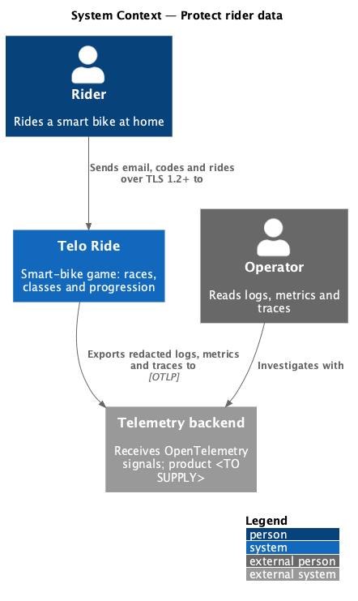
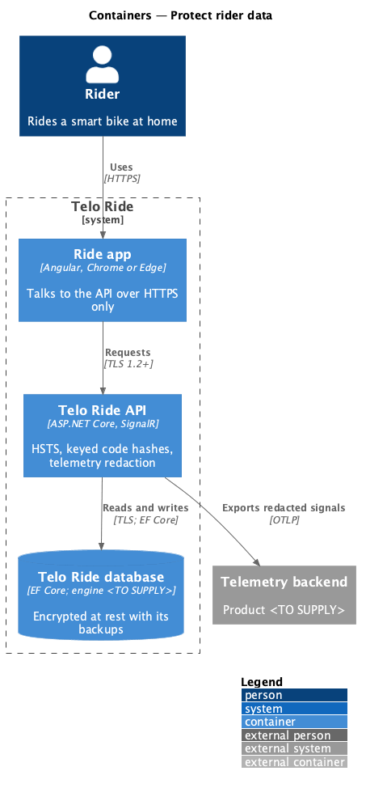
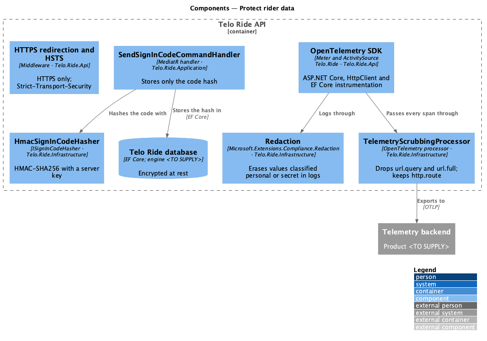
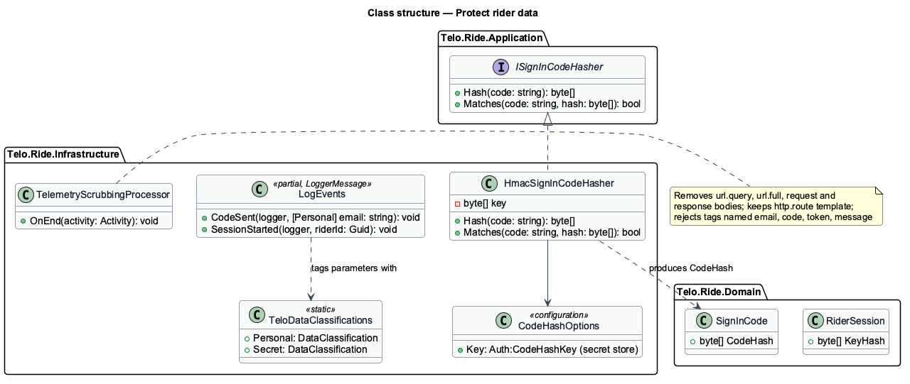
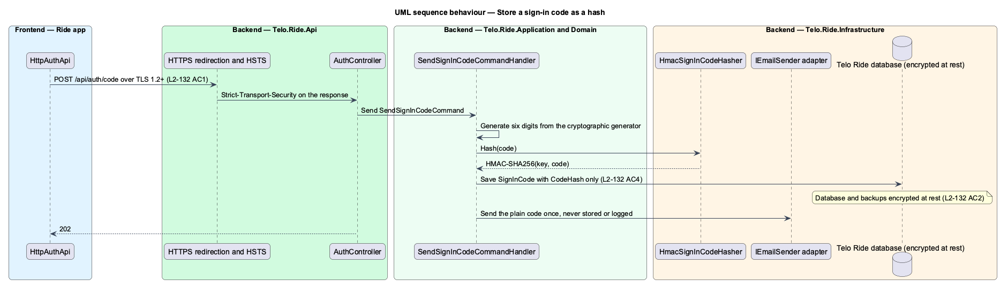
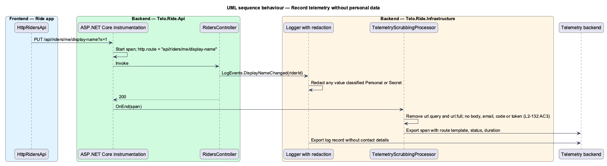

# Protect rider data

## Overview

The Telo Ride backend holds a small amount of personal data: each rider's email address, display
name, progress and rides, plus short-lived sign-in codes and session keys. This feature protects
that data on the wire, at rest and in the operational signals the backend emits, so neither a
network observer, a copied backup nor a person reading logs can recover a contact detail or a
credential.

- **in transit** — while travelling between the Ride app and the API, or between the API and its
  database
- **at rest** — while stored in the database or its backups
- **telemetry** — logs, metrics and traces the API emits through OpenTelemetry for operators
- **keyed hash** — one-way digest computed with a secret server key (HMAC), so a stolen database
  alone cannot be used to test guesses
- **route template** — path pattern of an endpoint, such as `api/rides/{rideId}`, recorded in
  place of the concrete path

Two related rules live elsewhere. Session keys are stored as hashes by [Stay signed
in](../../accounts/stay-signed-in/README.md), and the third parties that may receive any data
are fixed by [Restrict third parties](../restrict-third-parties/README.md).

## Description

### In transit

- **HTTPS redirection and HSTS** (`Telo.Ride.Api`, `Hosting/TransportSecurity.cs`) — outside
  Development, `UseHttpsRedirection` answers a plain `http` request with 308 to the same address on
  `https`, and `UseHsts` sends `Strict-Transport-Security: max-age=31536000` (one year, without
  `includeSubDomains` or `preload`) on every `https` response. The scheme is read from App Service's
  `X-Forwarded-Proto` first. The API serves the app too (ADR 0026), so the app is HTTPS only as well.
- **Minimum TLS version** — TLS 1.2 or later is set on the hosting platform for both the static
  host and the API, and on the database connection. The platform setting names are
  `<TO SUPPLY>` until the backend host is chosen.

### At rest

- **Database encryption** — the Telo Ride database and its backups use the platform's
  encryption at rest. The engine, the mechanism (for example transparent data encryption) and the
  key management are `<TO SUPPLY>`.
- **`HmacSignInCodeHasher`** (`Telo.Ride.Infrastructure`) — implements `ISignInCodeHasher` with
  HMAC-SHA256 over the code, keyed by `Auth:CodeHashKey`. `Matches`
  compares in constant time. `SignInCode` stores only `CodeHash`; the plain code exists in memory
  long enough to hand to `IEmailSender` and is never persisted or logged.
- **`Auth:CodeHashKey`** — a secret setting, read from the platform's secret store, documented
  with the backend's other settings. Rotating it invalidates codes in flight, which expire within
  10 minutes anyway.

### Telemetry

- **OpenTelemetry SDK** (`Telo.Ride.Api`) — ASP.NET Core, HttpClient and EF Core instrumentation,
  the `Telo.Ride` meter and activity source, exported over OTLP. The telemetry backend product is
  `<TO SUPPLY>`.
- **`TelemetryScrubbingProcessor`** (`Telo.Ride.Infrastructure`) — span processor that removes
  `url.query` and `url.full`, keeps `http.route` as the route template, and drops any tag whose
  name marks a contact detail, code, token or message body. EF Core instrumentation is configured
  without statement text, so no query or parameter value is exported.
- **Redaction** — `Microsoft.Extensions.Compliance.Redaction` with `TeloDataClassifications`
  (`Personal`, `Secret`). Source-generated `LogEvents` methods tag parameters with these
  classifications, and the logging pipeline erases them. Request and response body logging is off.
  Log events identify a rider by id only.

## Requirements

The feature realizes the following level-2 (L2) requirements. Each L2 requirement refines a
level-1 (L1) requirement, cited by identifier.

| L2 ID | Refines (L1) | Requirement |
|-------|--------------|-------------|
| `L2-132` | `L1-021` | Traffic between the app and the backend shall use TLS 1.2 or later. The database and its backups shall be encrypted at rest. No log, metric or trace shall carry an email, a code, a session token, a message body or a query string, and a route shall be recorded as its template. Only the hash of a sign-in code shall be kept. |

## Diagrams

### System context

The rider's data reaches Telo Ride over TLS; operators see only redacted signals in the telemetry
backend.

### Containers

The Ride app talks to the Telo Ride API over TLS 1.2 or later; the API stores data in an
encrypted database and exports redacted telemetry.

### Components

The send-code handler stores the output of `HmacSignInCodeHasher`, never the code. Every span
passes `TelemetryScrubbingProcessor` and every log passes redaction before export.

### Class structure

`HmacSignInCodeHasher` realises `ISignInCodeHasher` with the key from `CodeHashOptions` and
produces `SignInCode.CodeHash`. `LogEvents` tags personal parameters with
`TeloDataClassifications`.

### Behaviour — store a sign-in code as a hash

The request arrives over TLS; the handler hashes the new code with the server key and stores only
the hash, then hands the plain code to the email sender (`L2-132` AC1, AC2, AC4).

### Behaviour — record telemetry without personal data

The span records the route template; the processor strips the query string and any personal tag,
and the logger redacts classified values before export (`L2-132` AC3).

