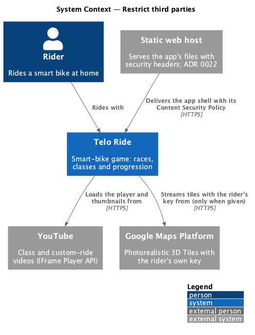
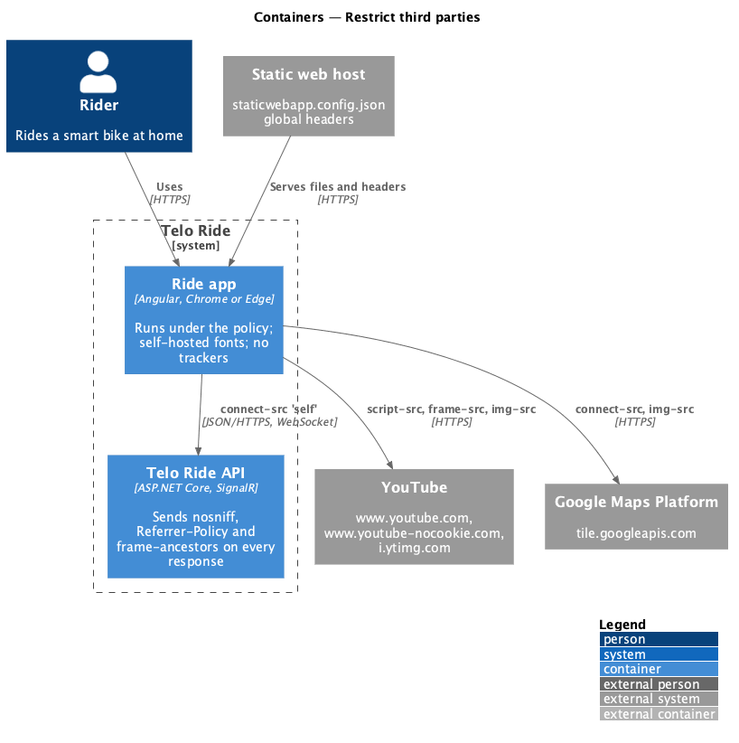
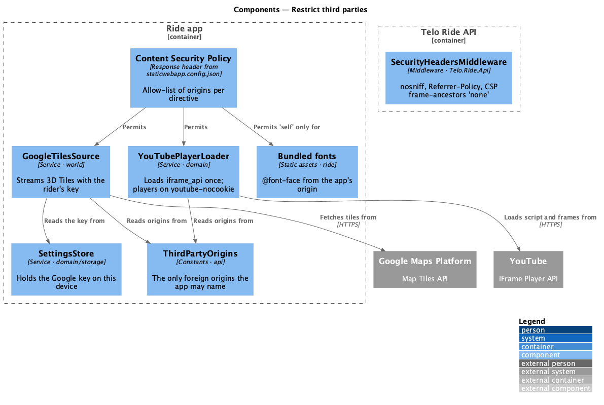
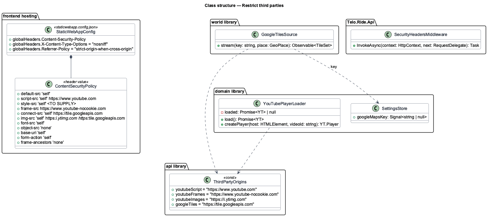
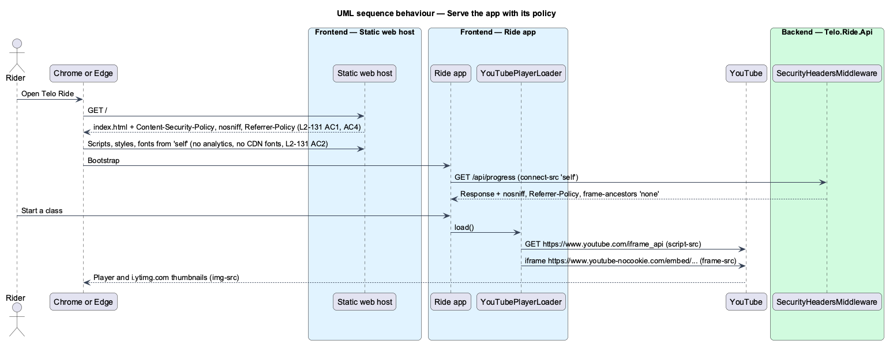
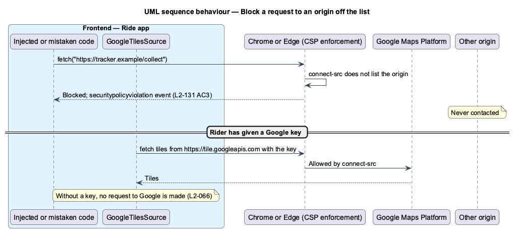

# Restrict third parties

## Overview

Telo Ride runs in the rider's browser for an hour or more at a time, next to a Bluetooth link to
their bike. Every origin the page can load code from or send data to widens what a compromised or
mistaken script could do. This feature fixes the list of foreign origins to two services the
product needs, and has the browser enforce that list.

- **Content Security Policy (CSP)** — response header that tells the browser which origins a page
  may load scripts, styles, frames, images and fonts from and connect to; the browser blocks
  everything else
- **third party** — origin other than Telo Ride's own: here only YouTube (the class and
  custom-ride video player) and Google Maps Platform (photorealistic 3D Tiles, only with the
  rider's own key)
- **app origin** — origin that serves the Ride app's files; the Telo Ride API is reached on the
  same origin under `/api` and `/hubs`

Telo Ride loads no analytics, advertising or tracking script, and its fonts are bundled and
self-hosted ([ADR 0005](../../../adr/0005-bundled-self-hosted-fonts.md)). The Google key never
reaches Telo Ride's backend; it stays in the browser and goes only to Google's Map Tiles API, as
[Render the race world](../../race/render-the-race-world/README.md) describes.

The frontend is static files ([Host and deliver](../../platform/host-and-deliver/README.md)).
[ADR 0018](../../../adr/0018-static-content-security-policy.md) and [ADR
0022](../../../adr/0022-hosted-on-azure-static-web-apps.md) record that a static host sends one
fixed policy and that `frame-ancestors` works only as a header, not in a `<meta>` element. This
design therefore sends the policy as a response header from the static host.

## Description

### Policy and headers

- **`staticwebapp.config.json`** (frontend hosting, ADR 0022) — `globalHeaders` on every response
  the static host serves:
  - `Content-Security-Policy` with the directives below;
  - `X-Content-Type-Options: nosniff`;
  - `Referrer-Policy: strict-origin-when-cross-origin`.
- **Content Security Policy** directives:

  | Directive | Value |
  |-----------|-------|
  | `default-src` | `'self'` |
  | `script-src` | `'self' https://www.youtube.com` |
  | `style-src` | `'self'` and the Angular component-style allowance, `<TO SUPPLY>` (see below) |
  | `frame-src` | `https://www.youtube-nocookie.com` |
  | `connect-src` | `'self' https://tile.googleapis.com` |
  | `img-src` | `'self' https://i.ytimg.com https://tile.googleapis.com` |
  | `font-src` | `'self'` |
  | `object-src` | `'none'` |
  | `base-uri` | `'self'` |
  | `form-action` | `'self'` |
  | `frame-ancestors` | `'none'` |

  `connect-src 'self'` covers the API and the ride hub's WebSocket because both are on the app
  origin. If the API is given its own origin, that origin is added and is `<TO SUPPLY>`.
- **Component styles** — Angular injects component styles as `<style>` elements at run time.
  `style-src 'self'` alone blocks them unless each carries a nonce, and a static host cannot mint a
  nonce per response (ADR 0018). The allowance is `<TO SUPPLY>`: either `'unsafe-inline'` for
  styles only, as ADR 0018 accepts, or a host that injects a per-response nonce written to
  `ngCspNonce`.
- **3D Tiles resources** — whether the World renderer needs `blob:` in `img-src` or `worker-src`
  (embedded glTF textures, mesh decoders) is `<TO SUPPLY>` until [Render the race
  world](../../race/render-the-race-world/README.md) settles its loaders.
- **`SecurityHeadersMiddleware`** (`Telo.Ride.Api`) — adds `X-Content-Type-Options: nosniff`,
  `Referrer-Policy: strict-origin-when-cross-origin` and
  `Content-Security-Policy: default-src 'none'; frame-ancestors 'none'` to every API response,
  so JSON and ProblemDetails bodies cannot be framed or sniffed as another type.

### Ride app (frontend)

- **`ThirdPartyOrigins`** (`api` library) — constants for the four foreign origins the policy
  lists. Code that builds a foreign URL takes its origin from here, so the code and the policy
  name the same set.
- **`YouTubePlayerLoader`** (`domain` library) — loads `https://www.youtube.com/iframe_api` once,
  creates each player with host `https://www.youtube-nocookie.com`, and destroys the player when
  its owner is destroyed.
- **`GoogleTilesSource`** — streams tiles from `https://tile.googleapis.com` only when
  `SettingsStore.googleMapsKey` holds a key the rider entered. Its library and final name belong
  to [Render the race world](../../race/render-the-race-world/README.md).
- **Bundled fonts** — `@font-face` rules in the global foundations stylesheet point at font files
  in the app's own assets.
- **End-to-end guard** — the Playwright fixture of [Test without hardware or
  databases](../../platform/test-without-hardware-or-databases/README.md) fails any spec that
  makes a request off localhost, so a new foreign request is caught before it ships.

## Requirements

The feature realizes the following level-2 (L2) requirements. Each L2 requirement refines a
level-1 (L1) requirement, cited by identifier.

| L2 ID | Refines (L1) | Requirement |
|-------|--------------|-------------|
| `L2-131` | `L1-021` | The app's pages shall be served with a Content Security Policy that allows scripts and styles only from the app's own origin and the YouTube player, frames only from `www.youtube-nocookie.com`, connections only to the app's backend and Google's Map Tiles API, and images only from the app's origin, `i.ytimg.com` and Google's tiles. The app shall load no analytics, advertising or tracking script, and fonts shall be self-hosted. Any request to another origin shall be to YouTube or, with the rider's own key, Google Map Tiles (`L2-066`). Responses shall carry `X-Content-Type-Options: nosniff`, `Referrer-Policy: strict-origin-when-cross-origin` and `frame-ancestors 'none'`. |

## Diagrams

### System context

Telo Ride reaches only two third parties: YouTube for video and, with the rider's own key, Google
Maps Platform for 3D Tiles. The static web host delivers the app with its policy.

### Containers

The Ride app runs under the policy the static host sends, connects to the Telo Ride API on its own
origin, and reaches YouTube and Google only through the directives that list them.

### Components

`YouTubePlayerLoader` and `GoogleTilesSource` build foreign URLs from `ThirdPartyOrigins`; the
policy permits exactly those origins and `'self'` for fonts. `SecurityHeadersMiddleware` adds the
response headers on the API.

### Class structure

`StaticWebAppConfig` holds the policy and the two other headers. `ThirdPartyOrigins` is the
single list the loaders read, and `GoogleTilesSource` takes the key from `SettingsStore`.

### Behaviour — serve the app with its policy

The static host sends the policy and headers with the app shell; the app's own files, the API and
the YouTube player all load within it (`L2-131` AC1, AC2, AC4).

### Behaviour — block a request to an origin off the list

The browser blocks any connection to an unlisted origin before it leaves the device. A tile
request goes to Google only when the rider has given a key (`L2-131` AC3).

