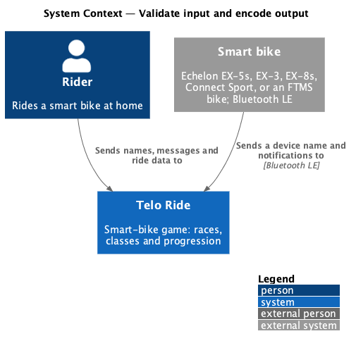
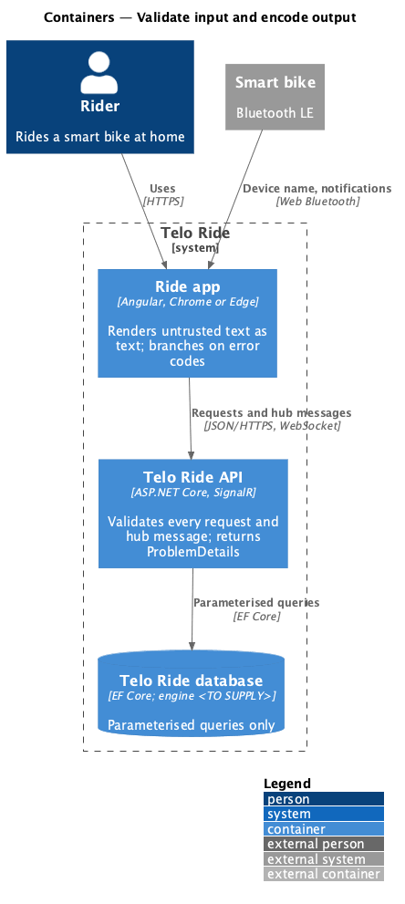
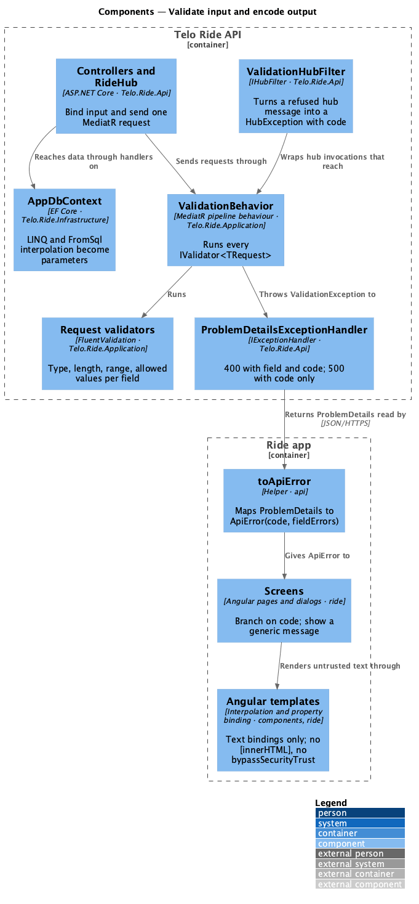
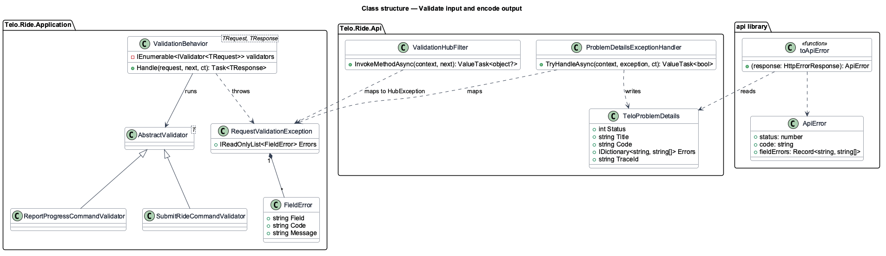
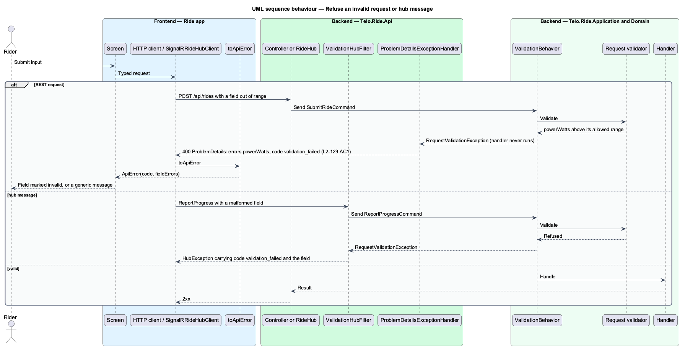
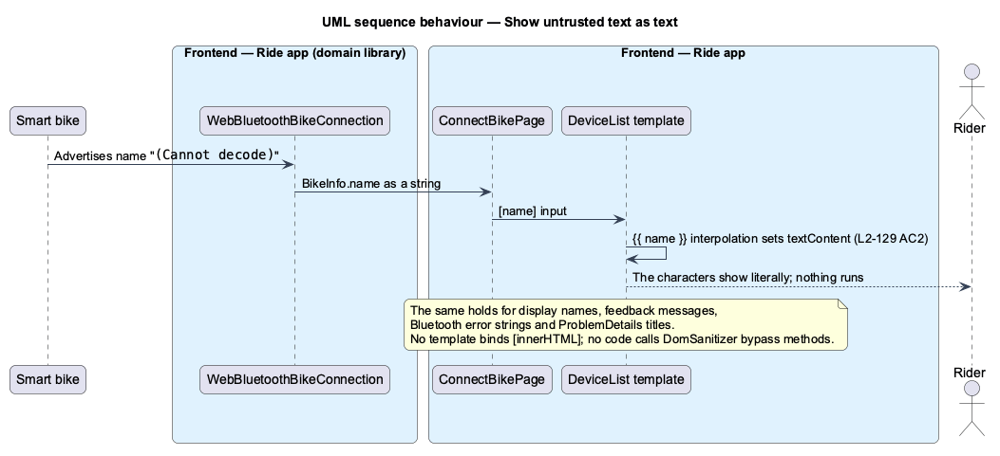
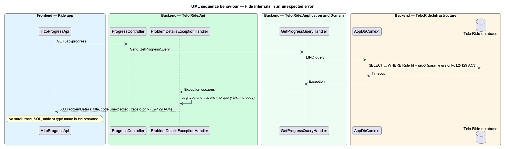

# Validate input and encode output

## Overview

Telo Ride takes text and numbers from three untrusted places: riders (display names, feedback
messages, ride submissions), the bike (its Bluetooth device name and notifications), and the
browser itself (error strings). Any of them may be malformed by accident or crafted on purpose.
This feature makes sure such input never reaches the database unchecked, never runs as code when
it is shown, and that errors never expose the backend's internals.

- **validation rule** — constraint on one field of a request or hub message: type, length, range
  or allowed values
- **ProblemDetails** — standard JSON error body (RFC 9457) that the API returns for every refused
  request, extended here with a `code` the Ride app branches on
- **untrusted text** — any string that came from a rider, a bike or Bluetooth, such as a display
  name, a feedback message, a device name or an error message
- **parameterised query** — database query whose input values travel as parameters, never joined
  into the query text

Validation sits in one place on the backend, the MediatR pipeline, so every controller action and
every hub method gets it, in line with the rule that a controller or hub method checks nothing
itself and sends one MediatR request. Encoding sits in one place on the frontend: Angular's text
bindings.

## Description

### Telo Ride API (backend)

- **Request validators** (`Telo.Ride.Application`) — one FluentValidation `AbstractValidator<T>`
  per command or query that carries input, for example `SetDisplayNameCommandValidator`,
  `SubmitRideCommandValidator`, `SubmitFeedbackCommandValidator` and
  `ReportProgressCommandValidator`. Each rule names its field and carries an error code.
- **`ValidationBehavior<TRequest, TResponse>`** — MediatR pipeline behaviour that runs every
  validator registered for the request before its handler. Any failure throws
  `RequestValidationException` holding the `FieldError` list; the handler does not run.
- **`ProblemDetailsExceptionHandler`** (`Telo.Ride.Api`) — `IExceptionHandler` registered with
  `AddProblemDetails`. It maps `RequestValidationException` to 400 with `errors` keyed by field
  and `code` `validation_failed`, and maps domain refusals to their status and `code`. Any other
  exception becomes 500 with `code` `unexpected` and a `traceId`. Outside the Development
  environment, the developer exception page is off, and no response carries a stack trace, query
  text, table name or .NET type name.
- **`ValidationHubFilter`** — `IHubFilter` on `RideHub`. Hub methods send MediatR requests, so
  they pass through the same `ValidationBehavior`; the filter turns `RequestValidationException`
  into a `HubException` whose message carries the `code` and field, and drops every other
  exception's detail.
- **`AppDbContext`** (`Telo.Ride.Infrastructure`) — every query is LINQ, which EF Core sends as
  parameters. Raw SQL, where any is needed, uses `FromSql` with interpolation, which also
  produces parameters; `FromSqlRaw` with joined strings is not used.

### Ride app (frontend)

- **Text bindings** — every component renders untrusted text with interpolation (`{{ }}`) or a
  text property binding, which sets `textContent`. No template binds `[innerHTML]`, and no code
  calls a `DomSanitizer.bypassSecurityTrust*` method. Device names, display names and error
  strings are data, rendered as text. An ESLint `no-restricted-properties` rule forbids the bypass
  methods in TypeScript; the equivalent template rule is `<TO SUPPLY>`.
- **`toApiError`** (`api` library) — maps an `HttpErrorResponse` carrying ProblemDetails into
  `ApiError` (`status`, `code`, `fieldErrors`). The SignalR client maps a `HubException` the same
  way.
- **Screens** (`ride` application) — branch on `ApiError.code`. Field errors mark the matching
  field `aria-invalid="true"`; any other refusal shows a generic message. The ProblemDetails
  `title` is never shown as markup.

## Requirements

The feature realizes the following level-2 (L2) requirements. Each L2 requirement refines a
level-1 (L1) requirement, cited by identifier.

| L2 ID | Refines (L1) | Requirement |
|-------|--------------|-------------|
| `L2-129` | `L1-021` | A request or hub message with a field that breaks its rule (type, length, range, allowed values) shall be refused with 400 and a ProblemDetails body that names the field and carries a `code`. Text from a rider, a bike or Bluetooth (names, messages, device names, errors) shall be shown as text, and nothing in it shall run. Every query shall use parameters and shall never join input into the query text. No error shall carry a stack trace, query or internal name. |

## Diagrams

### System context

Riders send names, messages and ride data; the bike sends its device name and notifications. Both
are untrusted input to Telo Ride.

### Containers

The Ride app renders untrusted text as text and branches on error codes; the Telo Ride API
validates every request and hub message and reaches the database with parameterised queries only.

### Components

Controllers and `RideHub` send requests through `ValidationBehavior`, which runs the validators
and hands refusals to `ProblemDetailsExceptionHandler` or `ValidationHubFilter`. In the Ride app,
`toApiError` gives screens a typed error, and templates render text through bindings only.

### Class structure

`ValidationBehavior` runs every `AbstractValidator` for the request and throws
`RequestValidationException`, which owns its `FieldError` entries. The exception handler writes
`TeloProblemDetails`, which the frontend's `toApiError` reads into an `ApiError`.

### Behaviour — refuse an invalid request or hub message

A field outside its rule stops the request in the pipeline before the handler runs. A REST
request returns 400 ProblemDetails naming the field; a hub message returns a `HubException` with
the same code (`L2-129` AC1).

### Behaviour — show untrusted text as text

A device name containing markup reaches the template as a string, and interpolation shows its
characters literally (`L2-129` AC2).

### Behaviour — hide internals in an unexpected error

Queries carry their values as parameters (`L2-129` AC3). An unexpected failure returns 500 with a
code and trace id only (`L2-129` AC4).

