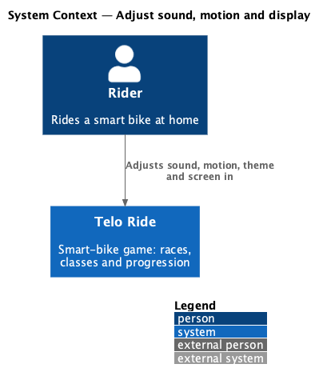
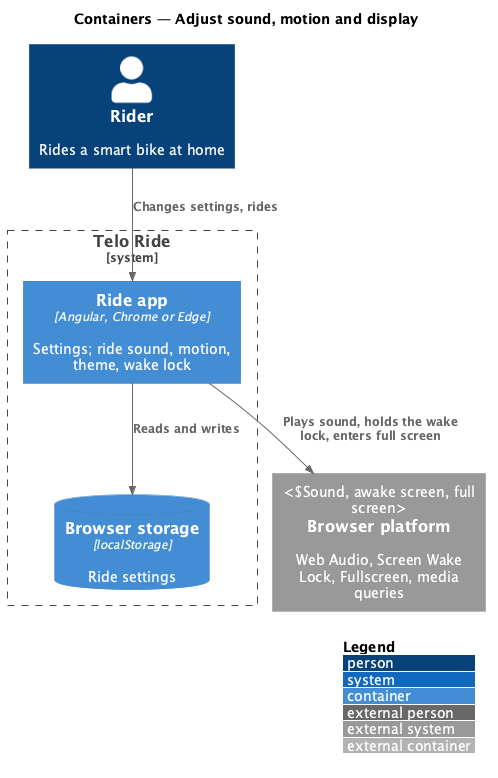
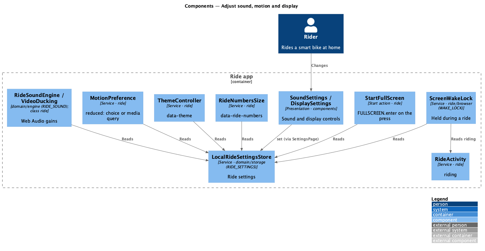
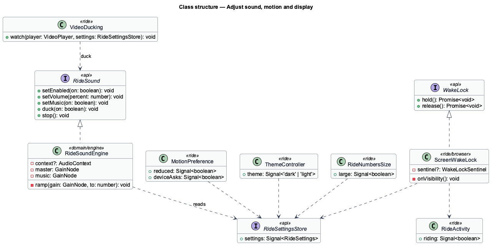
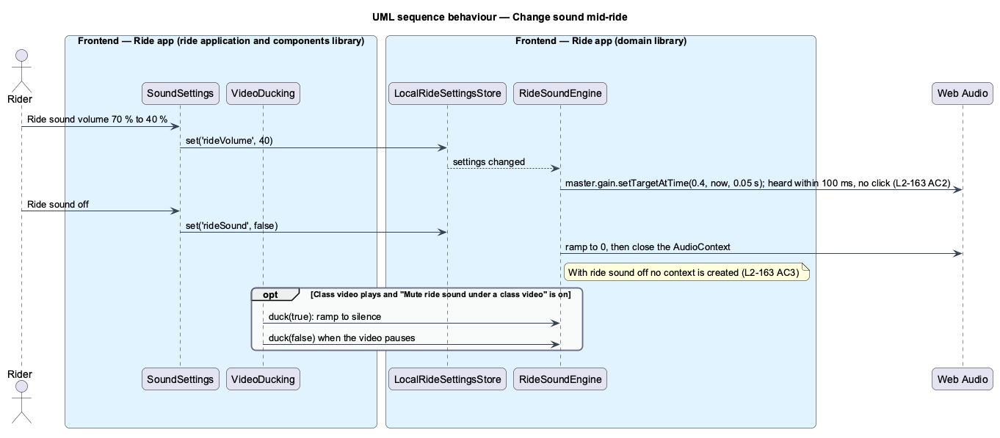
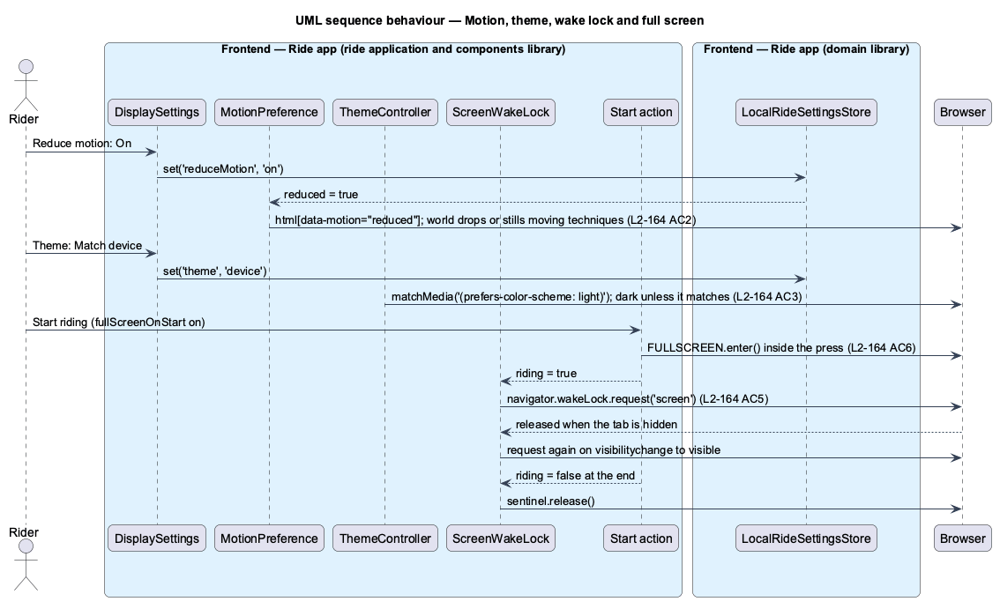

# Adjust sound, motion and display

## Overview

Two sections of Settings make a long ride more pleasant without touching the world's quality.
Sound turns the ride sound and the world music on or off, sets the ride sound's volume and mutes
it under a class video. Motion and display reduces motion, picks the theme, makes the ride
numbers larger, keeps the screen awake and can enter full screen when a ride starts.

> **ride sound** — chain, freewheel, tyre and wind sound made in the browser from the rider's pedalling

> **world music** — background track of each world, played under the ride sound

> **ducking** — muting the ride sound while a class video plays, and restoring it when the video pauses

> **ride numbers** — power, the clock and the target on every ride screen

> **screen wake lock** — browser lock that keeps the screen from dimming or locking

Each choice applies at once through the settings store (`settings/open-and-keep-settings`). The
theme rules are those of `ui/switch-theme-and-full-screen` with the rider's choice added; the
motion rules are those of `ui/support-screen-readers-and-motion` with the rider's choice added.

## Description

**Frontend — `components` library**

- **`SoundSettings`** (`wz-sound-settings`) — "Made in the browser as you ride; nothing is
  downloaded.", with "Ride sound", "Ride sound volume" (0 % to 100 % in steps of 5, "Quiet" to
  "Loud"), "World music" and "Mute ride sound under a class video" (`L2-163` AC1).
- **`DisplaySettings`** (`wz-display-settings`) — "For reading from the saddle and riding for an
  hour.", with "Reduce motion" (Match device, On, Off), "Theme" (Match device, Dark, Light),
  "Ride numbers" (Standard, Large), "Keep the screen awake" and "Go full screen when a ride
  starts" (`L2-164` AC1–AC6).

**Frontend — `ride` application and `domain`**

- **`RideSoundEngine`** (`domain/engine`, contract `RIDE_SOUND` in `api`) — generates the ride
  sound with the Web Audio API from cadence and speed. It creates its `AudioContext` only when
  ride sound is on and a ride runs (`L2-163` AC3), and closes it when the ride ends. Volume and
  on/off changes ramp the master gain over 50 ms with `setTargetAtTime`, so a change is heard
  within 100 ms with no click or gap (`L2-163` AC2). World music plays through its own gain node.
- **`VideoDucking`** — part of the class ride. While `muteUnderVideo` is on and `VideoPlayer`
  reports playing, it ramps the ride sound to silence; on pause it ramps back.
- **`MotionPreference`** (from `ui/support-screen-readers-and-motion`) — `reduced` becomes a
  computed signal: the rider's "On" or "Off" when chosen, the `prefers-reduced-motion` query when
  "Match device". The text "This device doesn’t ask for it." reads the query. With `reduced`
  true, `html` carries `data-motion="reduced"`, which the duration tokens honour, and the world
  drops or stills its moving techniques (`L2-164` AC2, ADR 0021).
- **`ThemeController`** (from `ui/switch-theme-and-full-screen`) — sets `data-theme` on `<html>`
  from the rider's choice; with "Match device" it follows `prefers-color-scheme`, dark unless the
  device asks for light (`L2-164` AC3). The open question in that design about devices that
  report no preference stands.
- **`RideNumbersSize`** — sets `data-ride-numbers="large"` on `<html>`. The ride screens' readout
  tokens scale under it; each ride screen keeps its no-sideways-scroll rule and never covers the
  road ahead (`L2-164` AC4). The scale factor is `<TO SUPPLY>` until the ride screens' large
  layouts are mocked.
- **`ScreenWakeLock`** (`browser/` folder of `ride`, contract `WAKE_LOCK` in `api`) — while
  `RideActivity.riding` is true and "Keep the screen awake" is on, holds
  `navigator.wakeLock.request('screen')`. It takes the lock again on `visibilitychange` to visible
  and releases it when the ride ends or the rider leaves (`L2-164` AC5). Where the API is missing
  it does nothing.
- **`StartFullScreen`** — part of each ride's start action (Start riding, Join). When
  `fullScreenOnStart` is on it calls `FULLSCREEN.enter()` inside that press, which supplies the
  user activation the Fullscreen API asks for (`L2-164` AC6).

## Requirements

The feature realizes the following level-2 (L2) requirements. Each L2 requirement refines a
level-1 (L1) requirement, cited by identifier.

| L2 ID | Refines (L1) | Requirement |
|-------|--------------|-------------|
| `L2-163` | `L1-026` | The Sound section shall read "Made in the browser as you ride; nothing is downloaded." and offer "Ride sound" (on), "Ride sound volume" 0 % to 100 % in steps of 5 (70 %), "World music" (on) and "Mute ride sound under a class video" (on), each with its text. A change mid-ride shall be heard within 100 ms without a click or gap. With ride sound off, no audio context shall be created for it. |
| `L2-164` | `L1-026` | The Motion and display section shall read "For reading from the saddle and riding for an hour.". "Reduce motion" shall offer "Match device" (default), "On" and "Off"; On shall behave as `prefers-reduced-motion: reduce` and drop or still the world's moving techniques. "Theme" shall offer "Match device" (default), "Dark" and "Light". "Ride numbers" shall offer "Standard" and "Large", and Large shall never make a ride screen scroll sideways or cover the road. "Keep the screen awake" (on) shall hold a screen wake lock during a ride, retake it when the tab returns and release it at the end. "Go full screen when a ride starts" (off) shall enter full screen on the Start riding or Join press. |

## Diagrams

### System context

The rider adjusts sound, motion and display in Telo Ride. No other system takes part.

### Containers

The Ride app keeps the choices in `localStorage` and uses the browser's audio, wake lock and
full-screen interfaces.

### Components

Each consumer reads the settings store: the sound engine and ducking, the motion and theme
controllers, the ride-numbers attribute, the wake lock and the full-screen start.

### Class structure

The consumers are small services over the settings signal; the sound engine and the wake lock
sit behind contracts in `api`.

### Behaviour — change sound mid-ride

The volume ramps within 100 ms. Ride sound off closes the audio context; a playing class video
ducks the ride sound.

### Behaviour — motion, theme, wake lock and full screen

The motion and theme choices set attributes on `<html>` at once. The wake lock is held for the
ride and taken again when the tab returns; full screen starts on the start press.

