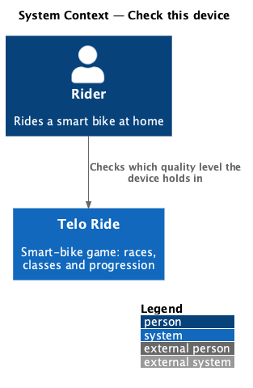
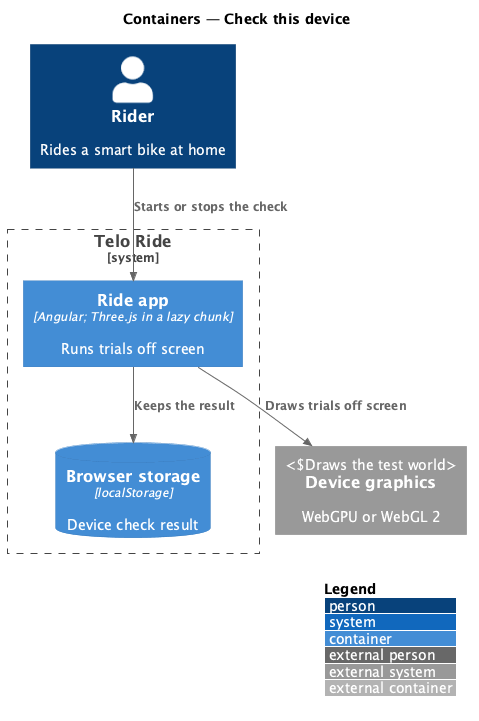
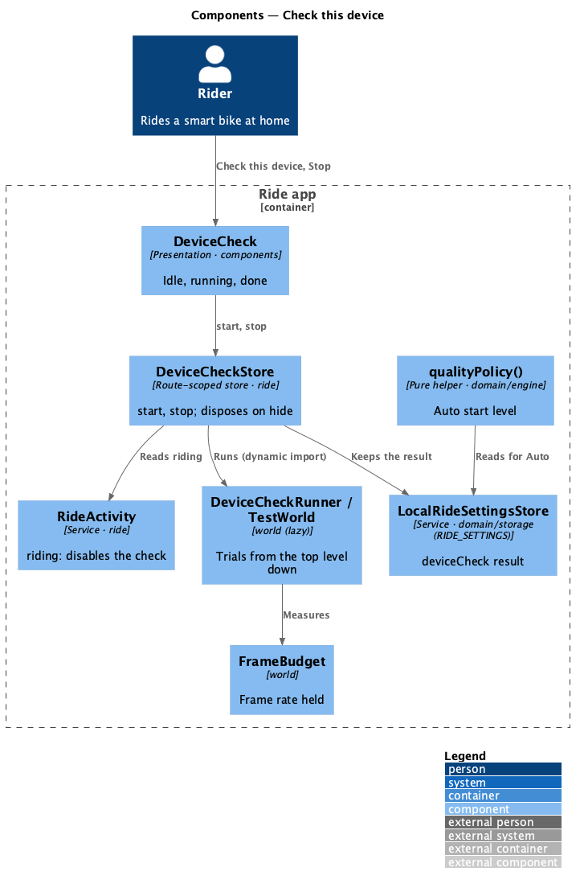
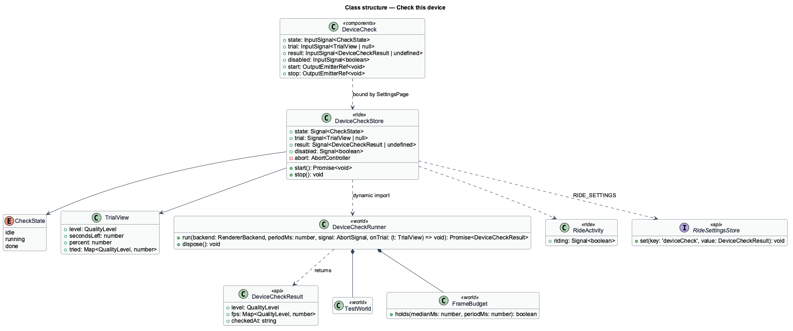
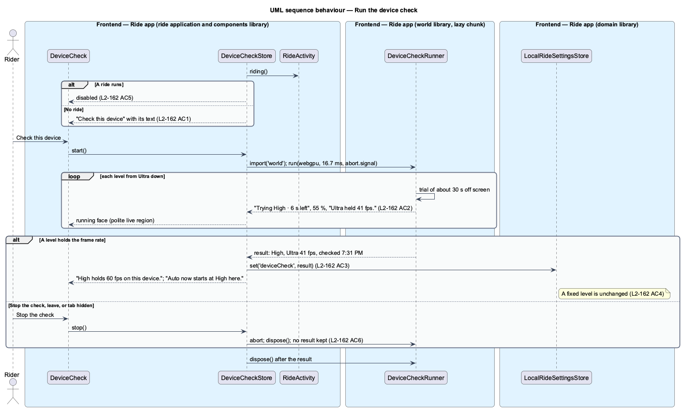

# Check this device

## Overview

Auto starts a world at a level guessed from the graphics API: Ultra with WebGPU, High with WebGL 2.
On a laptop with integrated graphics that guess can be too high, and the first minute of a ride
steps down twice. The device check measures instead: it draws a test world off screen at each
level, from the top level down, and keeps the first level that holds the display's frame rate.
Auto then starts there on this device.

> **device check** — off-screen measurement that finds the highest quality level this device holds at its display's frame rate

> **test world** — fixed scene bundled with the app for the device check, the same at every level

> **trial** — about 30 seconds of the test world drawn at one level

> **device check result** — level found, the frame rates measured and the time of the check, kept on this device

The check is part of the World section of Settings (`settings/tune-world-quality`). It changes
only where Auto starts; it never changes a fixed choice (`L2-162` AC4). It never runs while a ride
runs, so it never competes with a ride for the graphics chip (`L2-162` AC5).

## Description

**Frontend — `ride` application**

- **`DeviceCheckStore`** — provided on the Settings route. It holds `state` (`idle`, `running`,
  `done`), the current trial's level, seconds left, overall percent and the levels tried with
  their frame rates. It exposes `start()` and `stop()`. It loads the `world` library with dynamic
  `import()` on `start()`, and on stop, on destroy or when the tab is hidden it disposes the
  check's renderer and keeps no result (`L2-162` AC6).
- **`RideActivity`** — root service in `ride` exposing `riding` as a signal, true while a race,
  class or custom ride runs. The check button is disabled while it is true (`L2-162` AC5).

**Frontend — `components` library**

- **`DeviceCheck`** (`wz-device-check`, block `device-check`) — three faces:
  - idle: "Check this device" with "Rides 30 seconds of a test world off screen at each level and
    picks the best one that holds 60 fps." (`L2-162` AC1);
  - running: a progress with "Trying High · 6 s left", the percentage and "Ultra held 41 fps.
    Keep this tab open; the check rides off screen.", with "Stop the check" (`L2-162` AC2);
  - done: "High holds 60 fps on this device." and "Auto now starts at High here. Ultra held 41
    fps. Checked today at 7:31 PM.", with "Check again" (`L2-162` AC3).
  The running face is a polite live region.

**Frontend — `world` library (lazy)**

- **`DeviceCheckRunner`** — draws the test world into an off-screen render target sized to the
  display. For each level from the top the backend allows (Ultra with WebGPU, High with WebGL 2)
  it runs a trial of about 30 seconds and measures frames with `FrameBudget`. It stops at the
  first level whose trial holds the display's frame rate, and returns Low when none does. The
  exact trial length and the hold criterion are `<TO SUPPLY>`; the requirement gives "about 30
  seconds" and "holds 60 fps".
- **`TestWorld`** — the bundled test scene, built with the same techniques as the worlds at each
  level. Its contents are `<TO SUPPLY>`.

**Frontend — `domain/storage`**

- **`RideSettingsStore.set('deviceCheck', result)`** — keeps the `DeviceCheckResult` (level, fps
  per level, checked at) on this device (`settings/open-and-keep-settings`). `qualityPolicy()`
  reads it for Auto only (`settings/tune-world-quality`).

## Requirements

The feature realizes the following level-2 (L2) requirements. Each L2 requirement refines a
level-1 (L1) requirement, cited by identifier.

| L2 ID | Refines (L1) | Requirement |
|-------|--------------|-------------|
| `L2-162` | `L1-026` | "Check this device" shall read "Rides 30 seconds of a test world off screen at each level and picks the best one that holds 60 fps.". The check shall draw a test world off screen at each level from the top level the graphics API allows downward, about 30 seconds each, and stop at the first level that holds the display's frame rate, showing the level and time left, the percentage and what the levels tried held, with "Stop the check". When it finishes it shall read "High holds 60 fps on this device." with where Auto now starts and when it was checked, with "Check again", and keep the result on this device. It shall not change a fixed level. It shall be disabled while a ride runs. Stopped or hidden, it shall dispose what it drew with and keep no result. |

## Diagrams

### System context

The rider checks the device in Telo Ride. The check runs on the device's own graphics chip; no
other system takes part.

### Containers

The Ride app runs the check in its lazy world chunk and keeps the result in `localStorage`.

### Components

`DeviceCheckStore` runs `DeviceCheckRunner` and writes the result through the settings store,
which `qualityPolicy()` reads for Auto.

### Class structure

The runner returns a `DeviceCheckResult`; the store holds the running view and the result goes
into the ride settings.

### Behaviour — run the device check

Trials run from the top level down and stop at the first that holds the frame rate. Stopping or
hiding the tab disposes everything and keeps no result.

