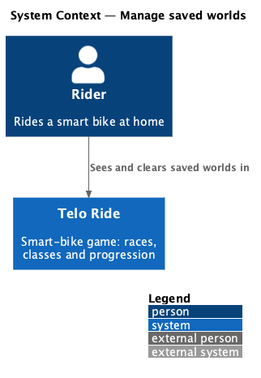
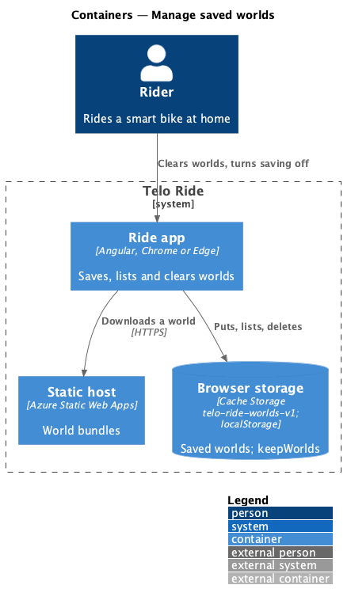
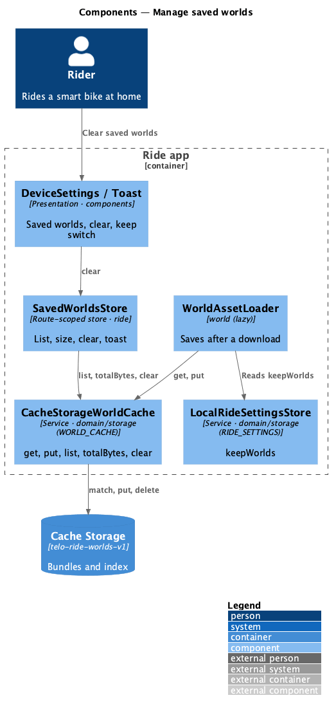
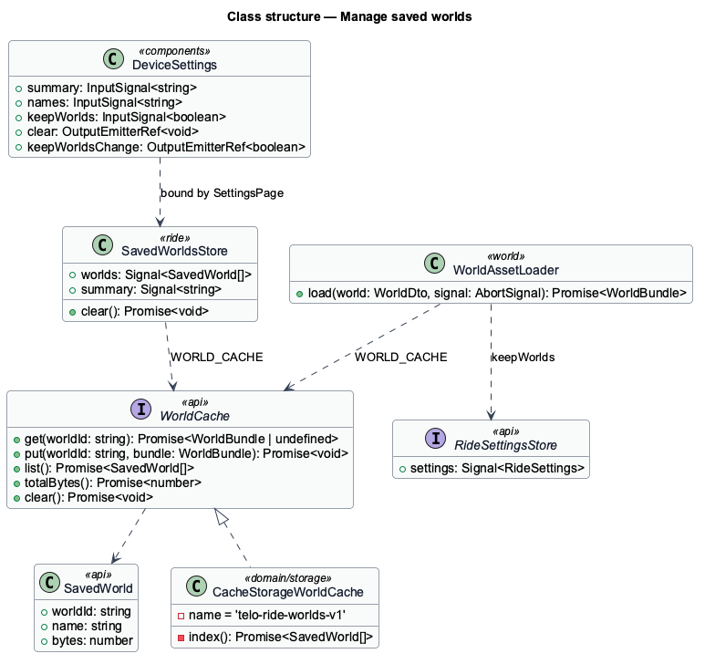
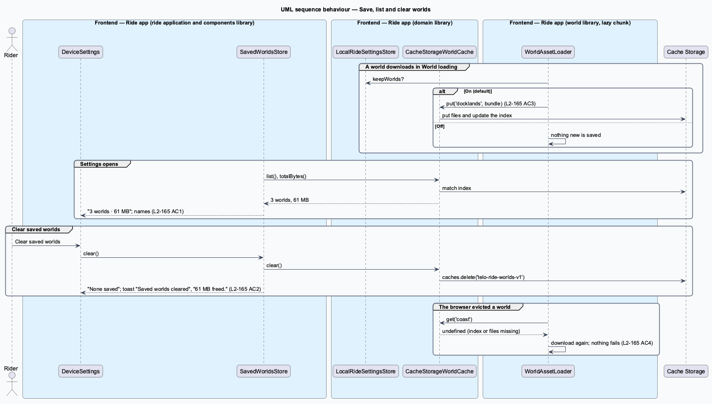

# Manage saved worlds

## Overview

A world bundle is tens of megabytes. Downloading it again before every ride wastes the rider's
time and data, and makes a world class impossible offline. Telo Ride saves each world the rider
rides on the device, so the next World loading skips the download (`classes/load-a-class-world`).
The This device section of Settings shows what is saved, clears it, and turns saving off.

> **saved world** — world bundle kept in the browser's Cache Storage after a ride, so the next load skips the download

> **world cache** — service that saves, lists, sizes and clears saved worlds

> **eviction** — the browser deleting saved data to free space, without asking the app

The section holds "Saved worlds" ("3 worlds · 61 MB", named) with "Clear saved worlds", and
"Keep worlds after a ride". The Bike section beside it holds the bike row of `L2-112`, designed in
`profile/change-settings`. The app shell and the map and class catalogues are cached by the
service worker designed in `performance/ride-without-a-network`; world bundles are kept here,
in a cache of their own, so the rider can see and clear them.

## Description

**Frontend — `components` library**

- **`DeviceSettings`** (`wz-device-settings`) — "Saved worlds" with the count and size, the names
  ("Prairie Paceline, Old Town Criterium and Cliffside Coast open in seconds, even offline.") and
  "Clear saved worlds" (`L2-165` AC1). With none saved it reads "None saved" and "Each world
  downloads again the next time you ride it." and hides the button (`L2-165` AC2). Below it,
  the "Keep worlds after a ride" switch (`L2-165` AC3).
- **`Toast`** (existing block `toast`) — "Saved worlds cleared" and "61 MB freed. Each world
  downloads again the next time you ride it.", in the page's polite toast region.

**Frontend — `api` and `domain/storage`**

- **`WorldCache`** / `WORLD_CACHE` (contract in `api`) — `get(worldId)`, `put(worldId, bundle)`,
  `list()` (world id, name and bytes), `totalBytes()` and `clear()`.
- **`CacheStorageWorldCache`** (`domain/storage`) — implements the contract on the Cache Storage
  cache `telo-ride-worlds-v1`, one request per world bundle file. It records each world's name
  and bytes in an index entry in the same cache, so listing needs no download. `clear()` deletes
  the cache.
- **`WorldAssetLoader`** (`world`, from `classes/load-a-class-world`) — calls `put()` after a
  finished download only when `keepWorlds` is on (`L2-165` AC3). A `get()` that finds a world
  partly evicted returns nothing, and the loader downloads it again (`L2-165` AC4).

**Frontend — `ride` application**

- **`SavedWorldsStore`** — provided on the Settings route. It loads `list()` and `totalBytes()`
  when the page opens, formats "3 worlds · 61 MB", and on "Clear saved worlds" calls `clear()`,
  reloads the list and raises the toast with the bytes freed.
- **Storage pressure.** The app does not call `navigator.storage.persist()`: worlds are a cache,
  and eviction costs only a download. Whether to ask for persistent storage is `<TO SUPPLY>`.

## Requirements

The feature realizes the following level-2 (L2) requirements. Each L2 requirement refines a
level-1 (L1) requirement, cited by identifier.

| L2 ID | Refines (L1) | Requirement |
|-------|--------------|-------------|
| `L2-165` | `L1-026` | "Saved worlds" shall read the number and size of the saved worlds and name them, with "Clear saved worlds". Clearing shall delete them, read "None saved" with "Each world downloads again the next time you ride it.", and show the toast "Saved worlds cleared" with the bytes freed. With "Keep worlds after a ride" on (default) a world shall be saved when a ride in it ends; off, nothing new shall be saved. A world the browser evicted shall download again in World loading and nothing shall fail. The Bike section shall hold the bike row of L2-112. |

## Diagrams

### System context

The rider sees and clears the worlds Telo Ride keeps on the device. No other system takes part.

### Containers

World bundles download from the static host and are kept in the browser's Cache Storage; the
setting that allows it is in `localStorage`.

### Components

`SavedWorldsStore` lists and clears through `WORLD_CACHE`; `WorldAssetLoader` saves through the
same contract when the rider keeps worlds.

### Class structure

`CacheStorageWorldCache` implements the contract over one named cache with an index entry.

### Behaviour — save, list and clear worlds

A finished download is saved when the rider keeps worlds. Settings lists what is saved and clears
it with a toast; an evicted world downloads again.

