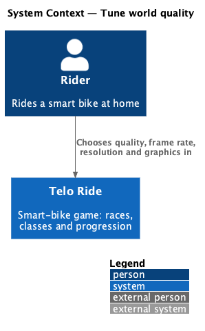
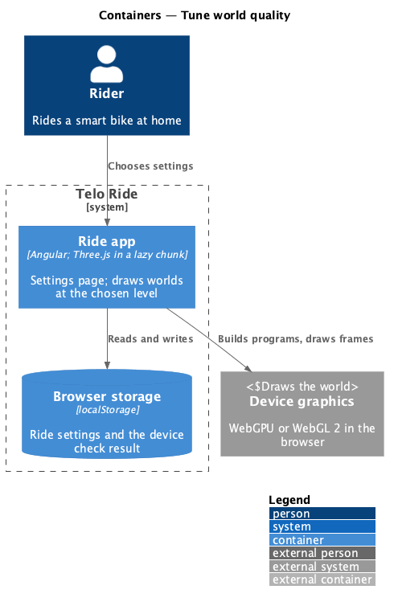
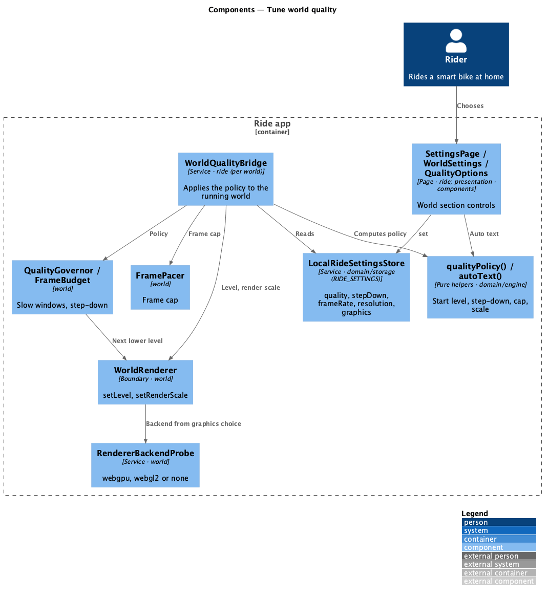
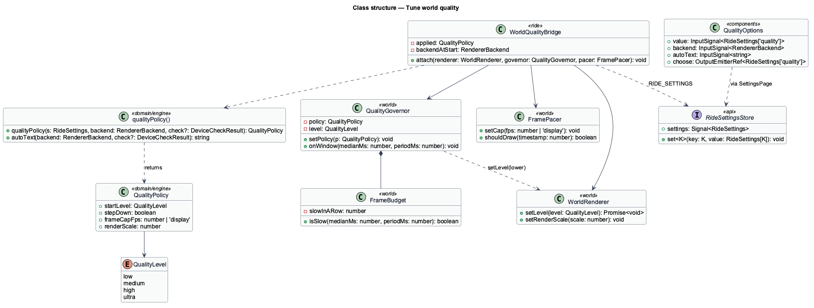
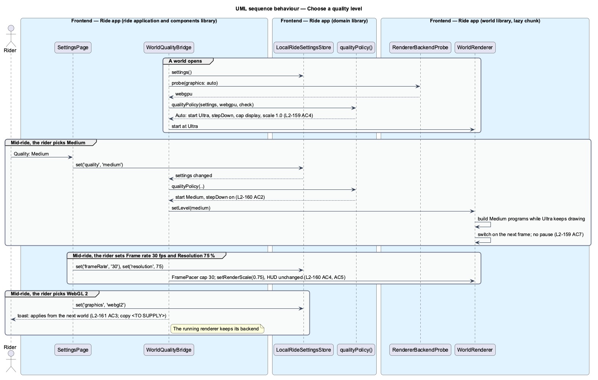
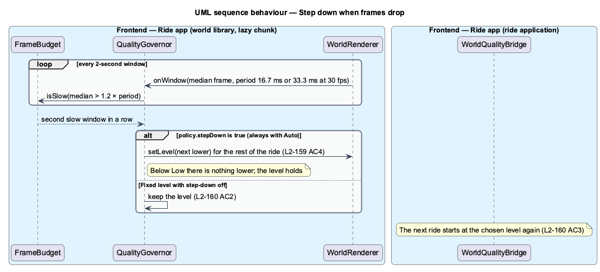

# Tune world quality

## Overview

The 3D world is drawn at one of four quality levels. Higher levels look closer to the real thing
and cost more of the graphics chip; lower levels keep the frame rate on a weak chip or a battery.
Telo Ride puts smoothness first: the power, the clock and the target never wait for the picture.
This feature is the World section of Settings, the rules that turn its choices into how the world
is drawn, and how a change reaches a ride that is already running.

> **quality level** — one of Ultra, High, Medium and Low, each a set of drawing techniques (ADR 0021)

> **Auto** — quality choice that picks the starting level for the device and steps it down when frames drop

> **step-down** — lowering the quality level by one for the rest of a ride after frames run slow

> **slow window** — 2-second window whose median frame time is more than 1.2 × the display's frame period

> **frame cap** — upper limit on frames drawn per second: the display's rate, or 30

> **render scale** — fraction of the canvas's pixels the world draws, from 50 % to 100 %; the HUD always draws at full resolution

> **graphics API** — WebGPU or WebGL 2, the browser interface that draws the world

The section reads "How the 3D world is drawn in races and world classes. Smoothness comes first:
power and the clock never wait for the picture." It offers Quality (five cards), "Step down when
frames drop", "Frame rate", "Resolution", "Graphics" and "Check this device". The device check is
designed in `settings/check-this-device`. The drawing techniques at each level are the table of
ADR 0021. The frame budget measurement is designed in `performance/meet-performance-budgets`;
this feature gives its step-down rule and its inputs.

## Description

**Frontend — `components` library**

- **`QualityOptions`** (`wz-quality-options`, block `quality-options`) — a `fieldset` "Quality"
  of five selectable cards, each with a visible radio, Auto first and tagged "Recommended". Each
  card's text is the requirement's (`L2-159` AC2). Inputs `value`, `backend`, `autoText`; output
  `choose(quality)`. With backend `webgl2` the Ultra card is disabled and tagged "Needs WebGPU"
  (`L2-159` AC6). With backend `none` the whole fieldset is disabled (`L2-161` AC4).
- **`WorldSettings`** (`wz-world-settings`) — the section: the graphics-API pill, the no-3D notice,
  `QualityOptions`, the step-down `SwitchRow`, the frame-rate `Segmented`, the resolution `Slider`
  and the graphics `Select`. Presentation only: inputs from the page, outputs to it.

**Frontend — `domain/engine` (pure, with unit tests)**

- **`qualityPolicy(settings, backend, deviceCheck)`** — returns a `QualityPolicy`:
  - `startLevel`: the fixed level when one is chosen; with Auto, the device check's level when
    there is one, otherwise Ultra with WebGPU and High with WebGL 2 (`L2-159` AC3–AC5); never
    above High with WebGL 2;
  - `stepDown`: always true with Auto; the switch's value with a fixed level (`L2-160` AC1, AC2);
  - `frameCapFps`: the display's rate or 30 (`L2-160` AC4);
  - `renderScale`: `resolution / 100` (`L2-160` AC5).
- **`autoText(backend, deviceCheck)`** — the Auto card's text: "Starts at Ultra with WebGPU, High
  with WebGL 2, …", "Starts at High with WebGL 2 …" or "Starts at High on this device (checked
  today) …".

**Frontend — `world` library (lazy)**

- **`QualityGovernor`** (from `performance/meet-performance-budgets`) — takes the `QualityPolicy`.
  It judges frames with `FrameBudget`: after two slow windows in a row it applies the next lower
  level, when `stepDown` is true, for the rest of the ride (`L2-159` AC4, `L2-160` AC3). At 30 fps
  it judges against 33.3 ms (`L2-160` AC4). The rule in `performance/meet-performance-budgets`
  (a 50-frames-a-second moving average, with a raise after a calm period) differs from
  `L2-159` AC4; which rule governs a race is `<TO SUPPLY>`. This design applies `L2-159` AC4 to
  every world and never raises a level mid-ride.
- **`FramePacer`** — skips `requestAnimationFrame` callbacks to hold the frame cap.
- **`WorldRenderer.setLevel(level)`** — builds the new level's programs ahead with
  `ProgramCompiler` while the old level keeps drawing, then switches on the next frame without
  pausing the ride (`L2-159` AC7). `WorldRenderer.setRenderScale(scale)` resizes the drawing
  buffer only.
- **`RendererBackendProbe.probe(choice)`** — with `auto`, WebGPU when an adapter is granted, else
  WebGL 2; with `webgl2`, WebGL 2 only.

**Frontend — `ride` application**

- **`WorldQualityBridge`** — provided with each world (race and world class). An `effect` over
  `qualityPolicy()` passes level, step-down, frame cap and render scale to the running renderer.
  A change to `graphics` mid-ride is not applied: it takes effect from the next world that opens,
  and the bridge raises a toast that says so (`L2-161` AC3). The toast is a mock gap; its copy
  is `<TO SUPPLY>`.

## Requirements

The feature realizes the following level-2 (L2) requirements. Each L2 requirement refines a
level-1 (L1) requirement, cited by identifier.

| L2 ID | Refines (L1) | Requirement |
|-------|--------------|-------------|
| `L2-159` | `L1-026` | The World section shall read its purpose and the graphics API in use. Quality shall be a radio group of five cards, Auto first and tagged "Recommended", then Ultra, High, Medium and Low, each with its text. Auto shall be chosen by default. Auto shall start at Ultra with WebGPU, High with WebGL 2, or the device check's level, and step down one level after two 2-second windows in a row whose median frame is more than 1.2 × the frame period. A fixed level shall start at that level. With WebGL 2 alone, Ultra shall be disabled and tagged "Needs WebGPU". A level changed mid-ride shall take over once built, without pausing the ride. |
| `L2-160` | `L1-026` | With Auto, "Step down when frames drop" shall be on and disabled; with a fixed level it shall be enabled and on by default, and off shall never lower the level. A level dropped in a ride shall return to the chosen level next ride. "Frame rate" shall offer "Match display" (default) and "30 fps"; at 30 fps the world shall draw at most 30 frames a second, judged against 33.3 ms. "Resolution" shall run 50 % to 100 % in steps of 5, default 100 %, and scale only the world's drawing buffer. |
| `L2-161` | `L1-026` | "Graphics" shall offer "Automatic · WebGPU" (default) and "WebGL 2" with WebGPU; without it, "Automatic · WebGL 2" and a disabled WebGPU option. A change mid-ride shall apply from the next world, with a toast. Without WebGPU and WebGL 2 a notice shall say the browser cannot draw 3D worlds, every World control shall be disabled, and the other sections shall still work. |

## Diagrams

### System context

The rider tunes how Telo Ride draws its worlds. No other system takes part.

### Containers

The Ride app keeps the choices in `localStorage` and draws the world on the device's graphics chip
through WebGPU or WebGL 2.

### Components

`qualityPolicy()` turns the settings, the backend and the device check into one policy; the
bridge hands it to the governor and the renderer of whatever world is running.

### Class structure

The policy is a plain value. The governor, the pacer and the renderer read it; the settings store
is its only source.

### Behaviour — choose a quality level

A world opens at the policy's starting level. A change mid-ride builds the new level ahead and
switches without a pause; a graphics API change waits for the next world.

### Behaviour — step down when frames drop

Two slow windows in a row drop one level for the rest of the ride, unless the rider turned
step-down off for a fixed level.

