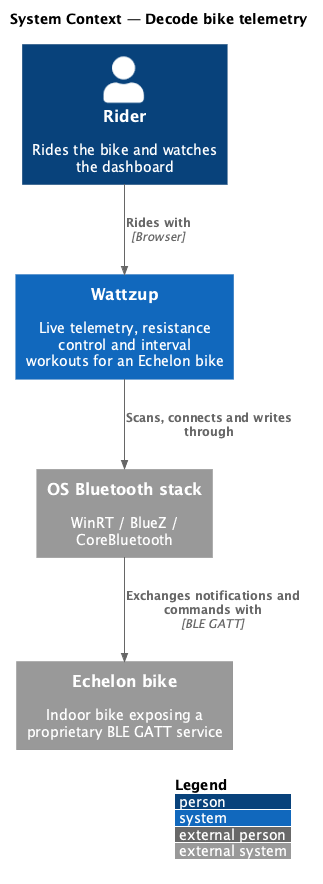
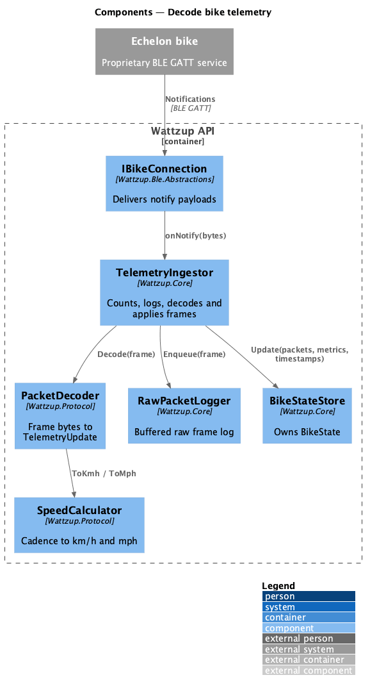

# Decode bike telemetry

## Overview

Once connected, the Echelon bike pushes BLE notifications on its notify characteristic. Each notification is a short byte frame. This feature turns those frames into the metrics the rider sees: cadence, speed and resistance. It also stamps when live data first and last arrived.

**frame** — one notification payload; byte 0 is the marker `0xF0` and byte 1 is the frame type

**workout frame** — frame of type `0xD1`, at least 13 bytes, carrying cadence as a big-endian 16-bit value at bytes 9–10

**resistance frame** — frame of type `0xD2`, carrying the bike's current resistance level at byte 3

**cadence** — pedal revolutions per minute (rpm)

The Echelon bike has no wheel-speed sensor. Speed is derived from cadence with the fixed factor 0.37497622 km/h per rpm, which matches the prototype. The decoding rules live in a pure library with no Bluetooth or HTTP dependency, so every rule is unit-testable from byte arrays alone.

## Description

- **`PacketDecoder`** (`Wattzup.Protocol`) — static `Decode(ReadOnlySpan<byte> frame)` returning a `TelemetryUpdate?`. It returns `null` for frames shorter than 4 bytes, frames not starting with `0xF0`, unknown frame types, and `0xD1` frames shorter than 13 bytes (L2-005).
- **`TelemetryUpdate`** — abstract record with 2 cases. **`ResistanceUpdate(int Level)`** carries byte 3 of a `0xD2` frame (L2-006). **`CadenceUpdate(int Rpm, double SpeedKmh, double SpeedMph)`** carries `(frame[9] << 8) | frame[10]` and the derived speeds (L2-007).
- **`SpeedCalculator`** (`Wattzup.Protocol`) — `KmhPerRpm = 0.37497622` and `KmPerMile = 1.609344`. `ToKmh(rpm)` returns `Math.Round(rpm × KmhPerRpm, 1, MidpointRounding.ToEven)`. `ToMph(rpm)` divides the **unrounded** km/h value by `KmPerMile` and then rounds to 1 decimal. Banker's rounding matches Python's `round` in the prototype.
- **`TelemetryIngestor`** (`Wattzup.Core`) — notify handler registered by `BikeConnectionService`. For every frame it increments `packets` and forwards the bytes to `RawPacketLogger` (see `log-raw-packets`), whether or not the frame decodes. It then calls `PacketDecoder`. On a non-null update it applies the metric fields, sets `last_data_at` to now and sets `first_data_at` if it is `null`, all in one `BikeStateStore.Update` call.
- **`IClock`** — injectable time source returning Unix epoch seconds as `double`, so tests control timestamps.

Example frames from the specification decode as follows. `F0 D2 01 0C CF` → `ResistanceUpdate(12)`. `F0 D1 09 00 05 00 00 00 00 00 50 00 1F` → `CadenceUpdate(80, 30.0, 18.6)`. `F0 D0 01 01 C2` → `null`. The decoder does not validate the trailing checksum, which matches the prototype's behaviour.

## Requirements

| L2 ID | Refines (L1) | Requirement |
|-------|--------------|-------------|
| `L2-005` | `L1-002` | Packet framing and counting. Every notification must be counted and logged; only well-formed packets are decoded. |
| `L2-006` | `L1-002` | Resistance packet decoding. A packet with type byte `0xD2` must set `resistance` to byte index 3. |
| `L2-007` | `L1-002` | Workout data decoding. A packet with type byte `0xD1` and at least 13 bytes must set cadence to the big-endian 16-bit value at bytes 9–10, and derive speed from it. `speed_kmh` = round(cadence × 0.37497622, 1). `speed_mph` = round(cadence × 0.37497622 ÷ 1.609344, 1), computed from the unrounded km/h value. |

## Diagrams

### System context

The bike is the only source of telemetry; it reaches Wattzup through the OS Bluetooth stack.

### Containers

Decoding happens inside the Wattzup API container as notifications arrive.

### Components

`TelemetryIngestor` receives each notification, counts and logs it, asks `PacketDecoder` for a `TelemetryUpdate`, and applies the result to `BikeStateStore`.

### Class structure

`PacketDecoder` and `SpeedCalculator` are pure static types. `TelemetryUpdate` is a closed hierarchy with one case per decoded frame type.

### Behaviour — ingest one notification

Every frame is counted and logged first (L2-005). Only well-formed `0xD2` and `0xD1` frames change metrics (L2-006, L2-007).

