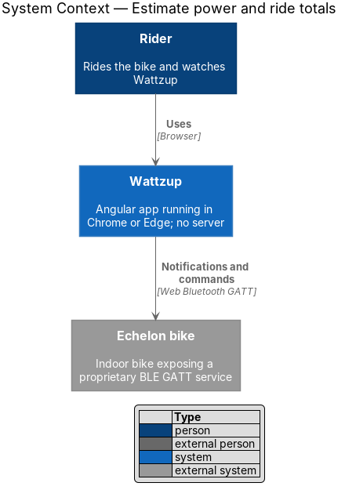
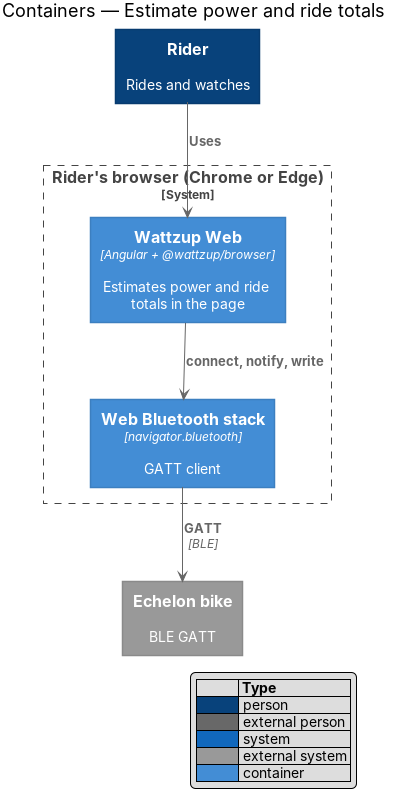
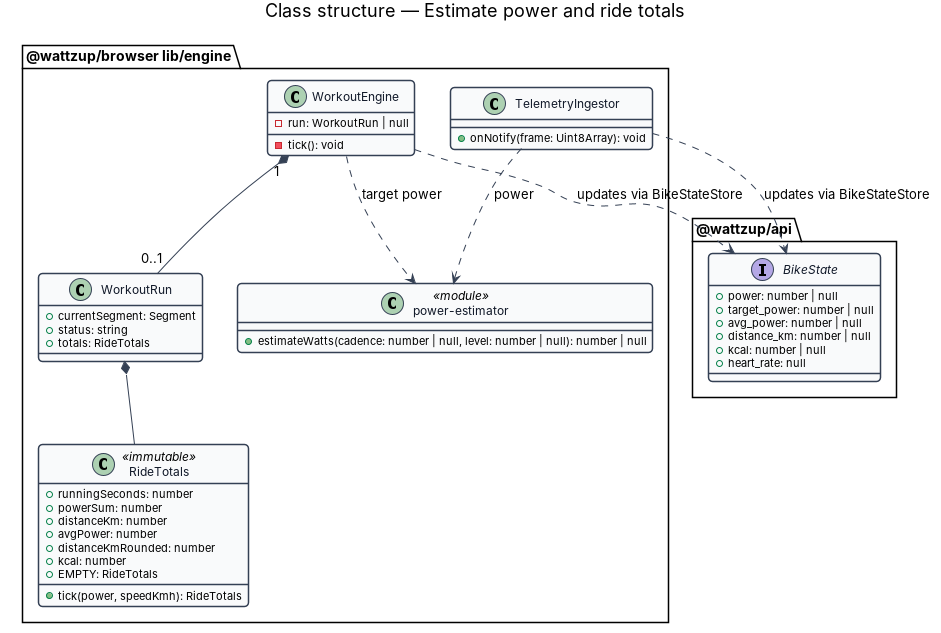
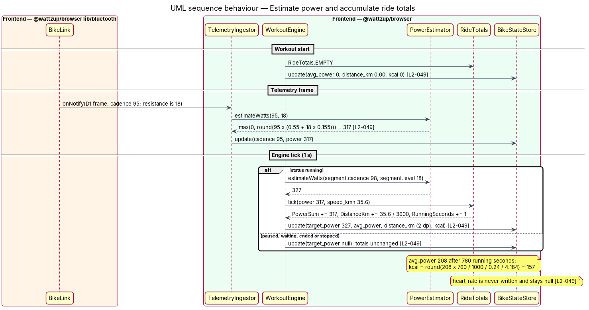

# Estimate power and ride totals

## Overview

The ride dashboard leads with power, and shows the ride's average power, distance and energy. The Echelon bike reports none of these. Its frames carry cadence and resistance only (ADR 0003). This feature estimates power from those 2 values and derives the ride totals from the estimate and from speed. The figures are comparable between rides on the same bike, not with a power meter, so the dashboard labels power as an estimate (L2-021).

**estimated power** — `max(0, round(cadence × (0.55 + resistance × 0.155)))` watts, the design's `estimateWatts` (`power`)

**target power** — estimated power at the current segment's cadence aim and level (`target_power`)

**running second** — 1 workout tick while `status` is `running`

**ride totals** — average power (`avg_power`), distance (`distance_km`) and energy (`kcal`) of the current or last workout

**energy** — `round(avg_power × running seconds ÷ 1000 ÷ 0.24 ÷ 4.184)` kilocalories, which assumes 24 % pedalling efficiency

Power follows each telemetry frame. Target power and the totals follow the workout engine's 1 s tick. Heart rate stays in the contract and the layout but is always `null`, because no heart-rate source exists (ADR 0003).

## Description

All rules live in `@wattzup/browser`'s `lib/engine/`; no rule lives in `lib/protocol/`, `lib/bluetooth/` or the contracts:

- **`estimateWatts(cadence, level)`** (`power-estimator.ts`) — pure. It returns `null` when either value is `null` (L2-049). Otherwise it returns `max(0, round(cadence × (0.55 + level × 0.155)))`, halves rounded away from zero, which matches the design's JavaScript `Math.round` for these non-negative values. Cadence 95 at level 18 gives 317; cadence 98 at level 18 gives 327 (L2-049).
- **`TelemetryIngestor`** (see `decode-bike-telemetry`) — sets `power = estimateWatts(cadence, resistance)` in the same `BikeStateStore.update` that applies each decoded frame, so `power` always matches the cadence and resistance it is shown with.
- **`RideTotals`** (`ride-totals.ts`) — immutable value owned by the engine's `WorkoutRun`: `runningSeconds`, `powerSum` and `distanceKm` (unrounded). `tick(power, speedKmh)` adds `power ?? 0` to `powerSum`, adds `(speedKmh ?? 0) ÷ 3600` to `distanceKm` and adds 1 to `runningSeconds` (L2-049). Derived values:
  - `avgPower` — `round(powerSum ÷ runningSeconds)`, or `0` before the first running second.
  - `distanceKmRounded` — `distanceKm` rounded to 2 decimals.
  - `kcal` — `round(avgPower × runningSeconds ÷ 1000 ÷ 0.24 ÷ 4.184)`. `avgPower` 208 after 760 running seconds gives 157 (L2-049).
- **`WorkoutEngine`** (see `workouts/run-interval-workout`) — on each running second it calls `RideTotals.tick` with the current `power` and `speed_kmh`, and writes `avg_power`, `distance_km`, `kcal` and `target_power` in 1 `BikeStateStore.update`:
  - `target_power` is `estimateWatts(segment.cadence, segment.level)` while `status` is `running`, and `null` otherwise (L2-049).
  - Starting a workout replaces the run, so the totals reset to `0`, `0.00` and `0` (L2-049, L2-013).
  - Ending or stopping a workout leaves the last totals in the state until the next start (L2-049).
  - Before any workout has started, the 3 totals are `null` (L2-014). The dashboard shows them as `0`, `0.00` and `0` (L2-022, see `dashboard/show-live-metrics`).
- **`heart_rate`** — always `null`. Nothing writes it (L2-049, ADR 0003).

The power readout, its delta to the target and the totals strip belong to `dashboard/show-live-metrics` (L2-021, L2-022). The setup preview's expected power and energy (L2-059) use the same estimate in the app's `core/`, tested against the same table of cases.

Verification:

- `power-estimator.spec.ts` — (95, 18) → 317; (98, 18) → 327; (`null`, 18) → `null`; (95, `null`) → `null`; (0, 18) → 0.
- `workout-engine.spec.ts` with `FakeClock` — the 760 s case giving `kcal` 157; `null` power counted as 0; distance from `speed_kmh` ÷ 3600; reset on start; values kept on stop; `target_power` while running and `null` after pause; `heart_rate` `null` throughout.

## Requirements

| L2 ID | Refines (L1) | Requirement |
|-------|--------------|-------------|
| `L2-049` | `L1-002` | Power and ride-total estimates. Power shall be estimated from cadence and resistance, target power from the segment's cadence aim and level, and the ride's average power, distance and energy accumulated each running second, reset on start and kept on end; heart rate shall stay `null`. |

## Diagrams

### System context

The bike supplies cadence and resistance; Wattzup estimates power and totals from them for the rider.

### Containers

All estimates are computed in the Wattzup app in the rider's browser and carried in the live state.

### Components

`TelemetryIngestor` and `WorkoutEngine` call `estimateWatts`. The engine keeps `RideTotals` per run. Both write through `BikeStateStore`.

### Class structure

`estimateWatts` is a pure function and `RideTotals` an immutable accumulator, so every formula is a table test.

### Behaviour — estimate on each frame and accumulate on each tick

A frame recomputes `power`. A running tick adds that power and the speed to the totals and sets `target_power`. A new workout resets the totals (L2-049).

