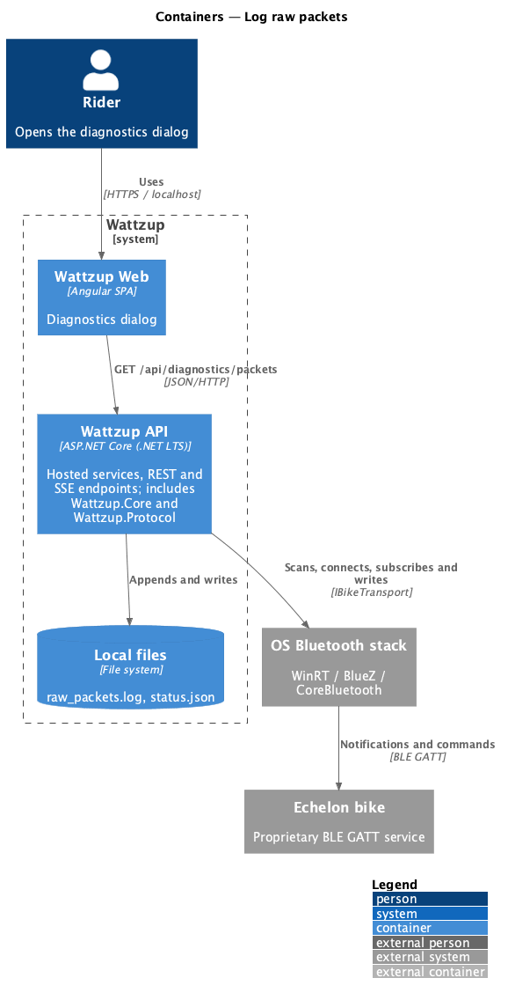
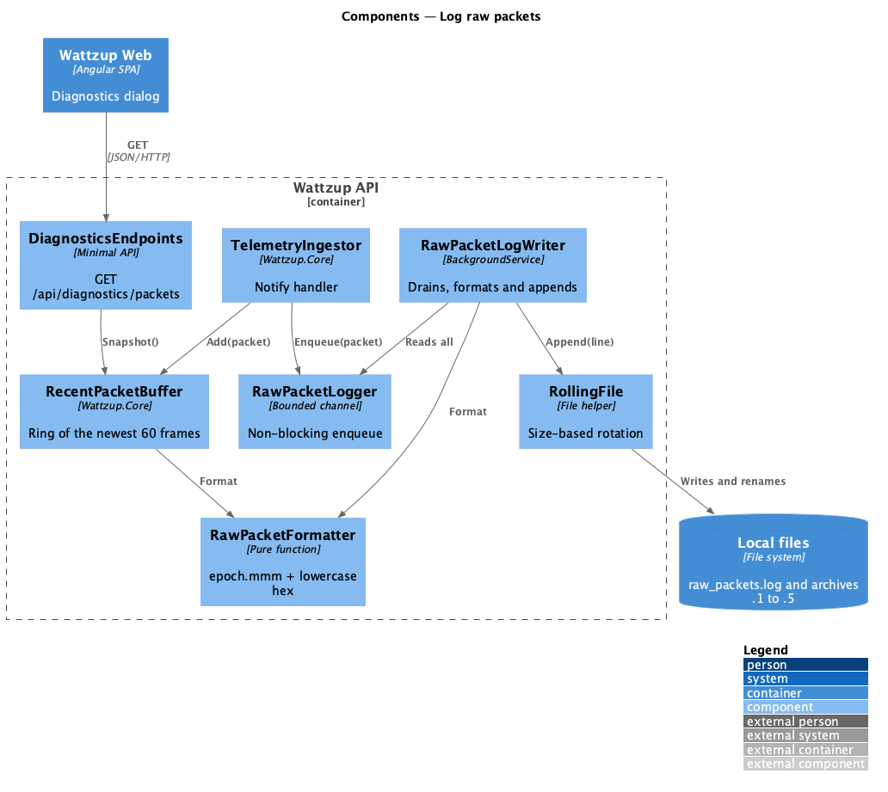
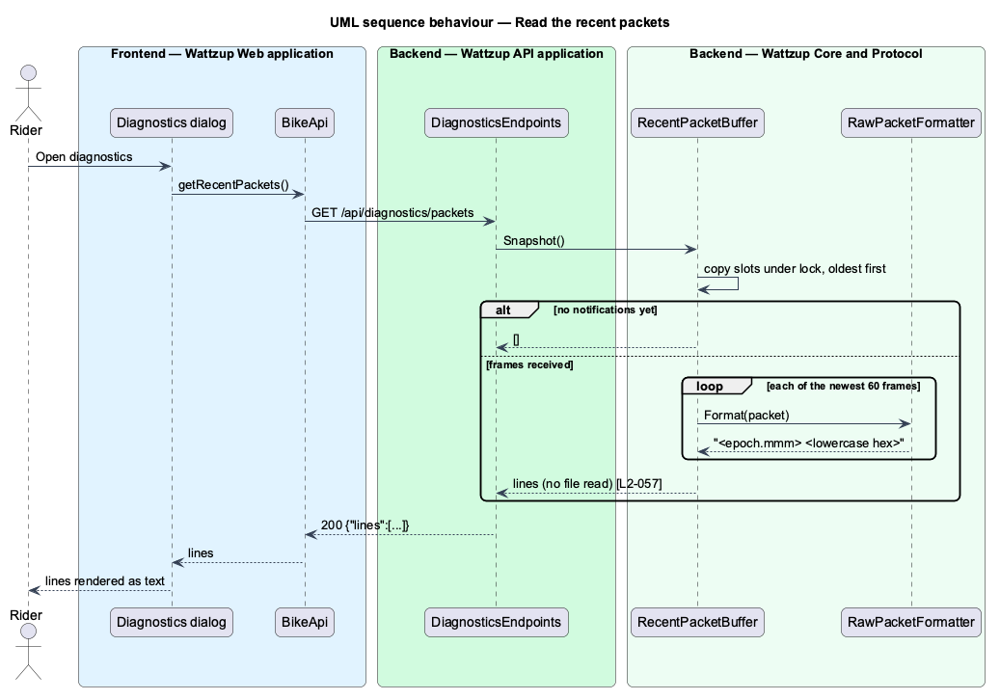

# Log raw packets

## Overview

The Echelon protocol is undocumented, and the decoder only understands 2 of the frame types the bike sends. A complete record of every received frame lets a developer study unknown frames, reproduce decoding bugs and replay a ride into the simulator. This feature appends every notification to a plain-text log file, keeps that file bounded, and never slows down notification handling. It also keeps the newest 60 lines in memory, so the diagnostics dialog can show the latest frames without reading the file.

**raw packet log** — text file `raw_packets.log`, one line per notification: Unix time with 3 decimals, a space, then the frame as lowercase space-separated hex

**rotation** — renaming the active log to a numbered archive once it reaches a size limit, and deleting the oldest archives beyond a retention count

**recent packet buffer** — in-memory ring buffer of the newest 60 frames, served by `GET /api/diagnostics/packets`

The line format is unchanged from the prototype, so existing logs and tooling stay compatible. The prototype grew the file without limit and wrote synchronously inside the notify callback; the new design adds rotation and moves file writes off the notification path. The ring buffer is in memory like the rest of the state (ADR 0004).

## Description

- **`RawPacket`** (`Wattzup.Core`) — immutable record struct of `EpochSeconds` and a copy of the frame bytes. `TelemetryIngestor` creates 1 per notification and hands the same value to the logger and to the buffer.
- **`RawPacketLogger`** — singleton with a bounded `Channel<RawPacket>` (capacity 10,000, `DropOldest`). `Enqueue(packet)` returns immediately. It never awaits I/O on the caller's thread (L2-030).
- **`RawPacketLogWriter`** — `BackgroundService` that drains the channel, formats each line with `RawPacketFormatter`, and appends through a `StreamWriter`. It flushes after each drained batch or every 1 s, whichever comes first. The 1 s interval uses the injected `TimeProvider`.
- **`RawPacketFormatter`** — pure function. `Format(1794784639.0213, [F0 D2 01 0C CF])` returns `1794784639.021 f0 d2 01 0c cf`. Seconds are formatted with `InvariantCulture` and 3 decimals.
- **`RollingFile`** — before each write, compares the file length with `MaxBytes`. At the limit it closes the stream, shifts `raw_packets.log.N` → `.N+1`, renames the active file to `.1`, deletes files beyond `RetainedFiles`, and reopens.
- **`RawPacketLogOptions`** — `Path` (default `raw_packets.log` under the content root), `MaxBytes` (10 MB), `RetainedFiles` (5), `Enabled` (`true`). Each setting is documented in the README.
- **`RecentPacketBuffer`** (`Wattzup.Core`) — singleton ring of 60 `RawPacket` slots. `Add(packet)` overwrites the oldest slot under a short lock and does no formatting, so the notify path stays cheap. `Snapshot()` copies the slots, oldest first, and formats each with `RawPacketFormatter` (L2-057). The buffer fills whether or not the file log is enabled, and never reads the file (L2-057).
- **`DiagnosticsEndpoints`** (`Wattzup.Api`) — maps `GET /api/diagnostics/packets` and returns `200 {"lines": RecentPacketBuffer.Snapshot()}`. With no notifications yet, `lines` is `[]` (L2-057). The endpoint holds no rule. It sits under `/api`, so the API key applies when one is configured (see `platform/secure-api`).
- **Frontend** — `BikeApi.getRecentPackets()` reads the endpoint for the diagnostics dialog (L2-023, see `dashboard`). The dialog renders each line as text, never as HTML.

When the channel is full, the oldest unwritten line is dropped and a counter is logged at Warning level once per minute. The decoder and the state store do not depend on the log or the buffer.

Verification:

- `Wattzup.Core.Tests` — `RawPacketFormatter` with the L2-030 example; `RollingFile` rotation at a small `MaxBytes` in a per-test temporary directory; `RecentPacketBuffer` with 0, 1, 60 and 61 frames (oldest dropped, order oldest first).
- `Wattzup.Api.AcceptanceTests` — with `SimulatedBikeTransport` writing to a per-test temporary directory: `GET /api/diagnostics/packets` returns `[]` before the first notification and the newest lines in the L2-030 format afterwards. A test double of `IBikeConnection` delivers 61 frames to check the 60-line limit.

## Requirements

| L2 ID | Refines (L1) | Requirement |
|-------|--------------|-------------|
| `L2-030` | `L1-008` | Raw packet log. Every notification must be appended to `raw_packets.log` as `<epoch seconds, 3 decimals> <hex bytes, lowercase, space-separated>`. |
| `L2-057` | `L1-008` | Diagnostics packets endpoint. |

## Diagrams

### System context

Frames originate at the bike and are recorded by Wattzup on the host's disk and in memory for the diagnostics view.

### Containers

The Wattzup API container appends to the local file store and serves the recent lines to Wattzup Web.

### Components

`TelemetryIngestor` enqueues each frame for the file and adds it to the ring buffer. `RawPacketLogWriter` formats and appends lines through `RollingFile` on its own task. `DiagnosticsEndpoints` serves the ring buffer.

### Class structure

The file logger is a producer/consumer pair joined by a bounded channel. The ring buffer is a separate type. Formatting and rotation are separate, testable types shared by both paths.

### Behaviour — record and rotate

The notify path only enqueues and adds. The writer drains, formats and rotates at 10 MB, keeping 5 archives (L2-030).

### Behaviour — read the recent packets

The diagnostics dialog asks for the recent lines. The endpoint formats the ring buffer's 60 newest frames, oldest first (L2-057).

