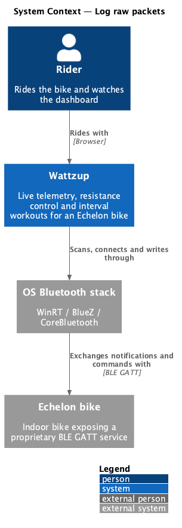
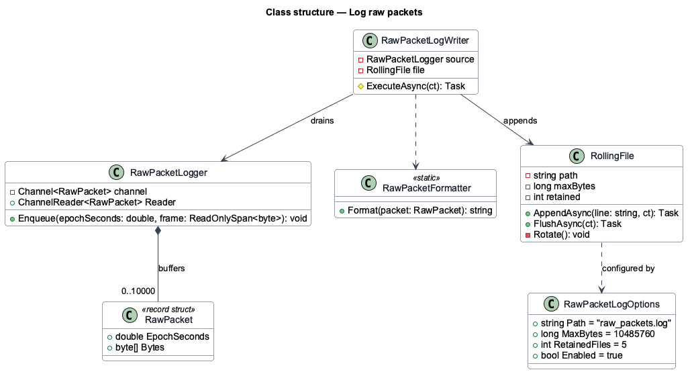
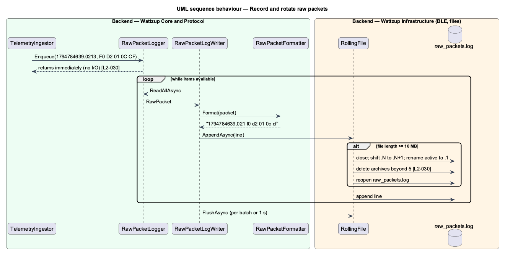

# Log raw packets

## Overview

The Echelon protocol is undocumented, and the decoder only understands 2 of the frame types the bike sends. A complete record of every received frame lets a developer study unknown frames, reproduce decoding bugs and replay a ride into the simulator. This feature appends every notification to a plain-text log file, keeps that file bounded, and never slows down notification handling.

**raw packet log** — text file `raw_packets.log`, one line per notification: Unix time with 3 decimals, a space, then the frame as lowercase space-separated hex

**rotation** — renaming the active log to a numbered archive once it reaches a size limit, and deleting the oldest archives beyond a retention count

The line format is unchanged from the prototype, so existing logs and tooling stay compatible. The prototype grew the file without limit and wrote synchronously inside the notify callback; the new design adds rotation and moves file writes off the notification path.

## Description

- **`RawPacketLogger`** (`Wattzup.Core`) — singleton with a bounded `Channel<RawPacket>` (capacity 10,000, `DropOldest`). `Enqueue(epochSeconds, frame)` copies the bytes and returns immediately. It never awaits I/O on the caller's thread (L2-030).
- **`RawPacketLogWriter`** — `BackgroundService` that drains the channel, formats each line with `RawPacketFormatter`, and appends through a `StreamWriter`. It flushes after each drained batch or every 1 s, whichever comes first.
- **`RawPacketFormatter`** — pure function. `Format(1794784639.0213, [F0 D2 01 0C CF])` returns `1794784639.021 f0 d2 01 0c cf`. Seconds are formatted with `InvariantCulture` and 3 decimals.
- **`RollingFile`** — before each write, compares the file length with `MaxBytes`. At the limit it closes the stream, shifts `raw_packets.log.N` → `.N+1`, renames the active file to `.1`, deletes files beyond `RetainedFiles`, and reopens.
- **`RawPacketLogOptions`** — `Path` (default `raw_packets.log` under the content root), `MaxBytes` (10 MB), `RetainedFiles` (5), `Enabled` (`true`).

When the channel is full, the oldest unwritten line is dropped and a counter is logged at Warning level once per minute. The decoder and the state store do not depend on the log at all.

## Requirements

| L2 ID | Refines (L1) | Requirement |
|-------|--------------|-------------|
| `L2-030` | `L1-008` | Raw packet log. Every notification must be appended to `raw_packets.log` as `<epoch seconds, 3 decimals> <hex bytes, lowercase, space-separated>`. |

## Diagrams

### System context

Frames originate at the bike and are recorded by Wattzup on the host's disk.

### Containers

The Wattzup API container appends to the local file store.

### Components

`TelemetryIngestor` enqueues each frame. `RawPacketLogWriter` formats and appends lines through `RollingFile` on its own task.

### Class structure

The logger is a producer/consumer pair joined by a bounded channel. Formatting and rotation are separate, testable types.

### Behaviour — record and rotate

The notify path only enqueues. The writer drains, formats and rotates at 10 MB, keeping 5 archives (L2-030).

