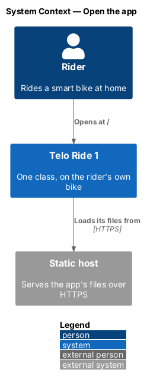
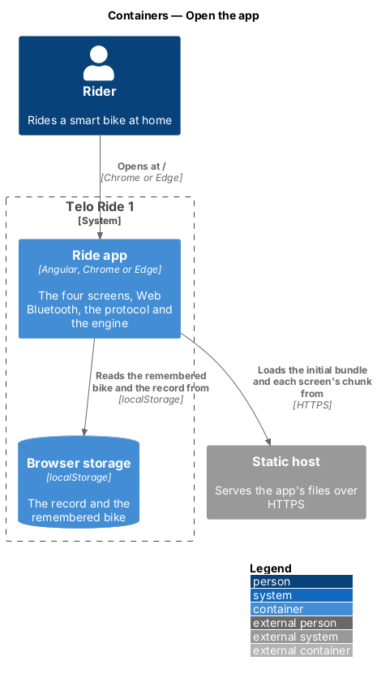
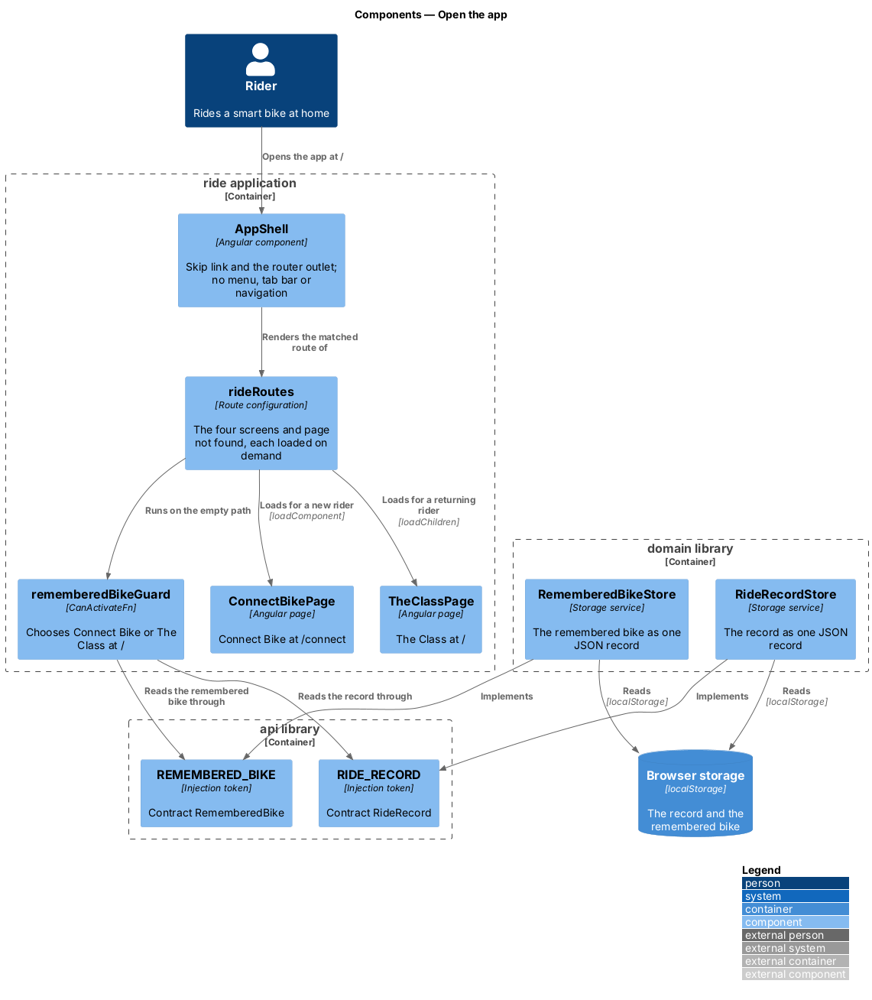
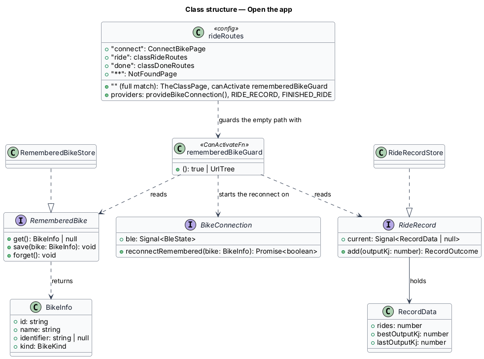
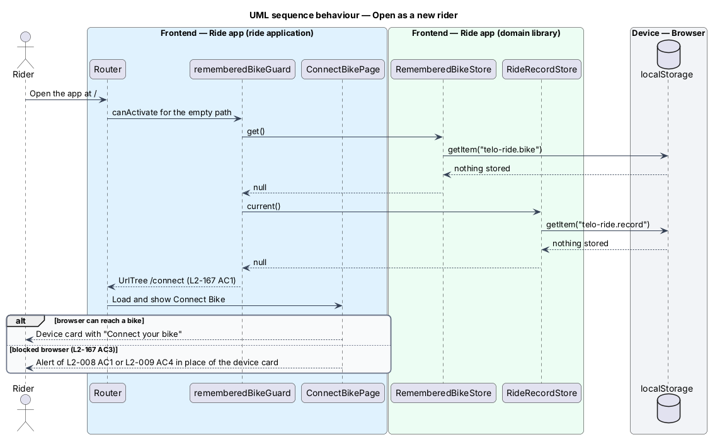
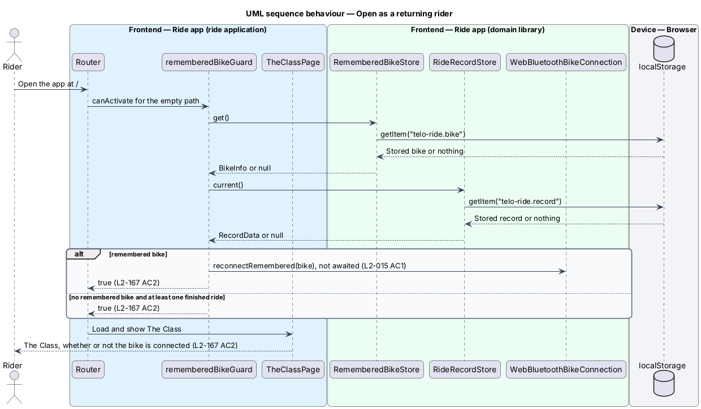

# Open the app

## Overview

Telo Ride 1 is one class on the rider's own smart bike, in four screens: Connect Bike (`/connect`),
The Class (`/`), Class Ride (`/ride`) and Class Done (`/done`). This feature decides which screen
shows when the app opens at `/`, and keeps the app free of any menu, tab bar or navigation.

A rider who has never paired a bike and never finished a ride has nothing to see on The Class but a
button that leads to Connect Bike, so the app opens there. Every other rider opens on The Class,
the home screen, whether or not the bike is connected at that moment.

- **new rider**: rider with no remembered bike and no finished ride on this device
- **returning rider**: rider with a remembered bike or at least one finished ride on this device
- **remembered bike**: name and browser identifier of the bike last paired in this browser, kept in
  browser storage
- **record**: rider's ride count, best output and last output, kept in browser storage
- **blocked browser**: browser that cannot reach a bike, because it has no Web Bluetooth or the page
  is not secure

Neighbouring features own the adjacent concerns:

- [Show the class](../show-the-class/README.md) draws The Class once this feature has chosen it.
- [Connect a bike](../../bike/connect-a-bike/README.md) draws Connect Bike and pairs the bike.
- [Check bike and browser support](../../bike/check-bike-and-browser-support/README.md) owns the
  alerts a blocked browser shows on Connect Bike (L2-008 AC1, L2-009 AC4).
- [Keep the bike connected](../../bike/keep-the-bike-connected/README.md) owns the remembered bike
  and its reconnection without the chooser (L2-015).
- [Keep the record](../../class-done/keep-the-record/README.md) owns the record this feature reads.
- [Show page not found](../../ui/show-page-not-found/README.md) owns the address that matches no
  screen; its "Back to the class" link opens `/` and so passes through this feature (L2-145 AC2).

The four addresses are assumptions the specs and the mocks share (L2 open question 7).

## Description

The slice lives in the `ride` application's routing. It reads two contracts from the `api` library
and adds no screen of its own.

- **`routes`** (`ride/src/app/app.routes.ts`, exists): the root route table. It lazy-loads
  `rideRoutes`, so the screens and their shared providers stay out of the initial bundle. It does
  not change.
- **`rideRoutes`** (`ride/src/app/ride.routes.ts`, exists, reshaped): one parent route whose
  providers every screen shares, with one child per screen. Today it holds Telo Ride's routes
  (`sign-in`, `classes/:id`, `classes/:id/ride`, `race/:mapId`, `results`, and the `MainShell`
  children Home, `race`, `classes` and `profile`), the `authGuard` and `provideSession()`. For
  Telo Ride 1 its children are exactly five:

  | Path | Screen | Loads |
  |---|---|---|
  | `connect` | Connect Bike | `ConnectBikePage` (exists, `connect/connect-bike-page`) |
  | `` (full match) | The Class | `theClassRoutes` (new, `the-class/the-class.routes`), behind `rememberedBikeGuard` |
  | `ride` | Class Ride | `classRideRoutes` (exists, today at `classes/:id/ride`) |
  | `done` | Class Done | `classDoneRoutes` (new, replaces `results/results.routes`) |
  | `**` | Page not found | `NotFoundPage` (exists, `not-found/not-found-page`) |

  The parent route keeps `provideBikeConnection()` and gains the bindings of `RIDE_RECORD` and
  `FINISHED_RIDE`. It drops `authGuard`, `provideSession()` and every other route.
- **`rememberedBikeGuard`** (`ride/src/app/bike/remembered-bike.guard.ts`, exists, changed): the
  `CanActivateFn` on the empty path. Today it sends a rider with no remembered bike to Connect Bike
  only when `BLUETOOTH_SUPPORT` reads `'ready'`, and leaves a blocked browser on Home. For
  Telo Ride 1 it reads `REMEMBERED_BIKE.get()` and `RIDE_RECORD.current()`. When both are absent it
  returns the `UrlTree` for `/connect`, in a blocked browser too (L2-167 AC1, AC3). Otherwise it
  returns `true` (AC2). It no longer reads `BLUETOOTH_SUPPORT`. It still calls
  `BIKE_CONNECTION.reconnectRemembered(bike)` without awaiting it when a bike is remembered
  (L2-015 AC1).
- **`REMEMBERED_BIKE`** and **`RememberedBike`** (`api/src/bike/remembered-bike.ts`, exist): the
  contract of the remembered bike. `RememberedBikeStore` (`domain/src/storage/`, exists) implements
  it over the `localStorage` key `telo-ride.bike`. A record it cannot parse counts as no bike.
- **`RIDE_RECORD`** and **`RideRecord`** (`api/src/rides/ride-record.ts`, new): the contract of the
  record, introduced by [Keep the record](../../class-done/keep-the-record/README.md).
  `RideRecordStore` implements it. `current()` is `null` for a rider with no finished ride, and
  for a stored record that is missing or malformed (L2-129 AC3).
- **`AppShell`** (`ride/src/app/app-shell.ts`, exists): the root component, a "Skip to content"
  link and the router outlet. It draws no navigation, so each screen shows only its own header
  (L2-167 AC4).
- **`MainShell`** (`ride/src/app/main-shell/`, exists, not used): Telo Ride's shell with the app
  header and its navigation. No Telo Ride 1 route loads it; its removal is a change of its own.

No screen holds a link beyond those the requirements name: the bike status link and the start
button on The Class, **Done** on Class Done, Leave on Class Ride and "Back to the class" on the
page-not-found screen (L2-167 AC4). The Playwright page objects `the-class.page.ts` and
`connect-bike.page.ts` (`frontend/e2e/pages/`, the first new, the second existing) own the
selectors the acceptance test of this slice uses.

## Requirements

The feature realizes the following level-2 (L2) requirement, which refines a level-1 (L1)
requirement cited by identifier.

| L2 ID | Refines (L1) | Requirement |
|-------|--------------|-------------|
| `L2-167` | `L1-014` | The app shall open Connect Bike when a new rider, with no remembered bike and no finished rides, opens it at `/`. The app shall open The Class when a rider with a remembered bike or at least one finished ride opens it at `/`, whether or not the bike is connected. The app shall open Connect Bike with the alert of L2-008 AC1 or L2-009 AC4 when a new rider opens it at `/` in a blocked browser. A screen shall have no menu, tab bar or navigation beyond the links the requirements name. |

## Diagrams

### System context

The rider opens Telo Ride 1, whose files a static host serves. No other system takes part in
choosing the first screen.

### Containers

The Ride app loads from the static host and reads the remembered bike and the record from browser
storage. Those two records are all the choice depends on.

### Components

`rideRoutes` runs `rememberedBikeGuard` on the empty path. The guard reads `REMEMBERED_BIKE` and
`RIDE_RECORD`, which the `domain` library's stores implement over `localStorage`, and the router
then loads Connect Bike or The Class.

### Class structure

`rideRoutes` is configuration, shown with the `<<config>>` stereotype. `rememberedBikeGuard`
depends on the `RememberedBike` and `RideRecord` contracts and on `BikeConnection` for the
reconnect.

### Behaviour: open as a new rider

With no remembered bike and no record, the guard redirects to `/connect` (L2-167 AC1). In a
blocked browser Connect Bike shows its alert in place of the device card (L2-167 AC3).

### Behaviour: open as a returning rider

A remembered bike or a record with at least one finished ride lets the navigation through, and The
Class shows whether or not the bike is connected (L2-167 AC2). A remembered bike also starts its
reconnection, which the guard does not wait for.

