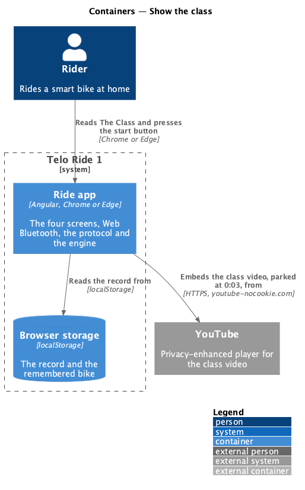
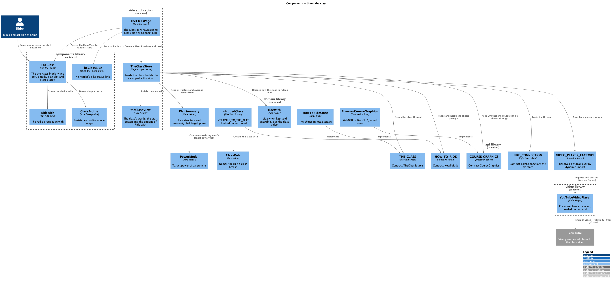
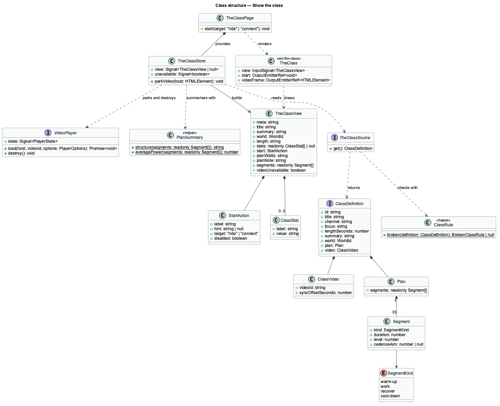
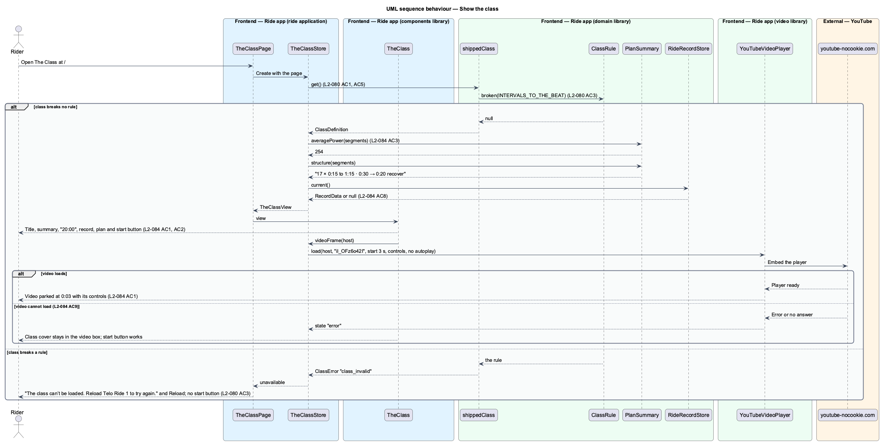

# Show the class

## Overview

Telo Ride 1 offers exactly one class, 30 Minute HIIT Cardio by GCN Training, with the id
`gcn-30-hiit`. The Class is the home screen, at `/`. It shows the class video, the title and
length, a chart of what the bike will do, and one start button. A returning rider also sees the
ride count, the best output and the last output.

This feature defines the class and its plan, validates them, draws The Class and starts the ride.
The rider chooses nothing: there is no other class and no way to pick one.

- **class**: timed workout the rider follows along to a video; Telo Ride 1 has one
- **plan**: timed segments the class follows, 17 in all and 30:00 long
- **segment**: part of the plan with a kind (warm-up, work, recover, cool-down), a duration, a
  level and a cadence aim
- **effort**: one of the plan's eight work segments
- **level**: target resistance a segment asks of the bike, 1 to 32
- **cadence aim**: cadence in rpm a segment asks of the rider
- **target power**: power of a segment's cadence aim at its level, by the estimate of L2-023 AC3
- **sync offset**: video time at which ride 0:00 starts, 0:12.0 for this class
- **record**: rider's ride count, best output and last output, kept on the device
- **start button**: the one primary action of The Class, which reads "Start class", "Ride it
  again" or "Connect your bike"

Neighbouring features own the adjacent concerns:

- [Open the app](../open-the-app/README.md) decides whether The Class or Connect Bike opens at `/`.
- [Keep the bike connected](../../bike/keep-the-bike-connected/README.md) owns the bike status link
  in the header (L2-019) and the `ble` state the start button follows.
- [Check bike and browser support](../../bike/check-bike-and-browser-support/README.md) owns the
  alerts under the header and the disabled start button of a blocked browser (L2-008, L2-009,
  L2-010).
- [Keep the record](../../class-done/keep-the-record/README.md) owns the record The Class reads.
- [Ride the class](../../class-ride/ride-the-class/README.md) owns Class Ride, which the start
  button opens.
- [Read bike telemetry](../../bike/read-bike-telemetry/README.md) owns the power estimate
  (L2-023) the target power uses.
- [Fit The Class to every form factor](../../ui/fit-the-class-to-every-form-factor/README.md) owns
  the one-screen and one-column layouts and the pinned start button (L2-171).
- [Show the wordmark](../../ui/show-the-wordmark/README.md) and
  [Switch theme and full screen](../../ui/switch-theme-and-full-screen/README.md) own the header's
  wordmark and Full screen button.
- [Restrict third parties](../../security/restrict-third-parties/README.md) owns the Content
  Security Policy that admits the YouTube player.

## Description

The codebase holds Telo Ride's Class Start at `/classes/:id` (`ClassStartPage`, `ClassStartStore`,
`classStartRoutes`, `classUnlockedGuard`, and the components `ClassStartHeader`, `ClassStartVideo`,
`ClassPlan`, `ClassSync`, `RideChoice` and `BackLink`). The Class replaces it. The blocks below
either survive from it or are new.

**The class definition**

- **`ClassDto`** (`api/src/classes/class-dto.ts`, exists, reduced): the class as the frontend holds
  it. Telo Ride 1 keeps `id`, `title`, `channel`, `focus`, `lengthSeconds`, `summary`, `plan` and
  `video`, and drops `opensAtLevel`, `shelfId` and `world`. For the one class the values are
  `gcn-30-hiit`, "30 Minute HIIT Cardio", "GCN Training", "HIIT", 1800 s and the summary of
  L2-080 AC1.
- **`VideoDto`** (`api/src/classes/video-dto.ts`, exists): `videoId` (`QUoToFsMNig`) and
  `syncOffsetSeconds` (12.0).
- **`Plan`** and **`Segment`** (`api/src/workout/plan.ts`, exist, changed): the plan and its
  segments. `Segment.cadenceAim` becomes `number | null`, because a segment may have no aim
  (L2-089 AC3, L2-170 AC4). `SegmentKind` loses `'steady'`, which the Telo Ride 1 plan does not use.
  The plan of L2-080 AC2 is:

  | Segment | `kind` | `duration` | `level` | `cadenceAim` |
  |---|---|---|---|---|
  | 1 | `warm-up` | 300 s | 8 | `<TO SUPPLY>` (L2 open question 11) |
  | 2 to 16, even | `work` | 30 s each | 24 | 98 |
  | 3 to 15, odd | `recover` | 180, 150, 150, 120, 120, 90 and 90 s | 6 | 72 |
  | 17 | `cool-down` | 360 s | 6 | `<TO SUPPLY>` (L2 open question 11) |

- **`CLASSES_API`** and **`ClassesApi`** (`api/src/classes/classes-api.ts`, exist, reduced): the
  contract the screens read the class through. `get(id)` returns the `ClassDto` and refuses with a
  `ClassesApiError` whose `code` the store branches on. `list()` and `ClassCatalogueDto` are not
  used. Today `provideClasses()` (`ride/src/app/classes/provide-classes.ts`) binds the token to
  `CachedClassesApi` over `HttpClassesApi`, which read Telo Ride's backend catalogue (ADR 0028).
  The source of the class definition for Telo Ride 1, and so the implementation bound to
  `CLASSES_API`, is `<TO SUPPLY>` (L2 open question 1). The implementation shall return the class
  without a network once the app has been opened on the device (L2-080 AC5); how it does so is
  `<TO SUPPLY>` with the same decision (L2 open questions 1 and 8).
- **`THE_CLASS_ID`** (`ride/src/app/classes/the-class-id.ts`, new): the constant `'gcn-30-hiit'`.
  No route carries a class id, and no screen lists classes, so no other class can be reached
  (L2-080 AC4).
- **`ClassRule`** (`domain/src/engine/class-rule.ts`, new): pure helper with unit tests.
  `ClassRule.valid(dto)` is `true` when every segment's level is 1 to 32, the plan has exactly eight
  `work` segments and the durations add up to 1800 s (L2-080 AC3).

**The screen**

- **`theClassRoutes`** (`ride/src/app/the-class/the-class.routes.ts`, new): the route of the empty
  path. It binds `provideClasses()` and `provideClassVideo()` (both exist, in
  `ride/src/app/classes/`) and loads `TheClassPage` with `loadComponent`, so the class and the
  player's factory load with the screen.
- **`TheClassPage`** (`ride/src/app/the-class/the-class-page.ts`, `.html`, `.scss`, new;
  `wz-the-class-page`): the page. It provides `TheClassStore`, passes its view to `wz-the-class`,
  projects the bike status link and the Full screen button into the header, and navigates on
  `start`: to `/ride` for "Start class" and "Ride it again" (L2-084 AC7), to `/connect` for
  "Connect your bike" (AC6).
- **`TheClassStore`** (`ride/src/app/the-class/the-class-store.ts`, new, modelled on
  `ClassStartStore`): the page-scoped state. It reads the class from `CLASSES_API`, validates it
  with `ClassRule`, and exposes `view` as a computed signal over the class, `RIDE_RECORD.current`,
  `BIKE_CONNECTION.ble` and `BLUETOOTH_SUPPORT.state`. An invalid or unreadable class sets
  `unavailable`; the page then offers no start button and says the class cannot be loaded, with
  copy `<TO SUPPLY>` (mock gap: the class that cannot be loaded, L2-080 AC3).
  `parkVideo(host)` keeps the behaviour of `ClassStartStore.parkVideo`: it resolves a player from
  `VIDEO_PLAYER_FACTORY` and loads the video at `syncOffsetSeconds` with `controls: true` and
  `autoplay: false` (L2-084 AC1). A factory that rejects, or a player whose `state` is `'error'`,
  sets `videoUnavailable` and changes nothing else (AC9). The store destroys the player when the
  rider leaves the page.
- **`theClassView`** (`ride/src/app/the-class/the-class-view.ts`, new): pure helper with unit
  tests, one case per row of the table below. It builds the `TheClassView`: the meta line
  "GCN Training · HIIT" from `channel` and `focus`, the length "30:00" with "start to finish", the
  record figures, the start action and the plan texts.

  | `ble` | Finished rides | Browser | Label | Hint | Opens |
  |---|---|---|---|---|---|
  | `connected` | 0 | supported | "Start class" | none | `/ride` |
  | `connected` | 1 or more | supported | "Ride it again" | none | `/ride` |
  | not `connected` | any | supported | "Connect your bike" | "The class needs the bike to set resistance." | `/connect` |
  | any | any | blocked | "Connect your bike", disabled | the same hint | nothing (L2-010 AC1) |

  The record figures are "Rides", "Best output" and "Last time", the outputs with " kJ"; a rider
  with no finished rides gets none of the three (L2-084 AC8).
- **`TheClassView`** (`api/src/classes/the-class-view.ts`, new): the view type the page and the
  presentation component share, in `api` because `components` imports `api` for types only.
- **`TheClass`** (`components/src/the-class/the-class.ts`, `.html`, `.scss`, new; `wz-the-class`):
  the presentation component of the design-system block `the-class`, with the mock's BEM classes
  (`the-class__video`, `the-class__title`, `the-class__stats`, `the-class__start`,
  `the-class__start-hint`, `the-class__plan` and the rest). It takes `view`, emits `start` and
  `videoFrame` (the element the player embeds in, as `ClassStartVideo.frame` does today), and has
  the slots `[slot=bike]`, `[slot=end]` and `[slot=notice]` for the bike status link, the Full
  screen button and the blocked-browser alert. It renders the start button itself in the details
  column and in the pinned footer, of which the layout shows one (L2-171 AC5). The class cover
  fills the video box until the player paints over it, with the text alternative
  "Video: 30 Minute HIIT Cardio, GCN Training". The mock bundles the cover as
  `assets/images/classes/gcn-30-hiit.jpg`, while `ClassStartVideo` reads it from `i.ytimg.com`;
  which of the two The Class uses is `<TO SUPPLY>` (mock gap: the video that cannot play,
  L2-084 AC9).
- **`ClassProfile`** (`components/src/class-library/class-profile.ts`, exists; `wz-class-profile`):
  the resistance profile as one inline SVG with `role="img"`. `TheClass` passes it the segments and
  the label "Resistance profile" (L2-084 AC2).
- **`PlanSummary`** (`domain/src/engine/plan-summary.ts`, exists): `structure(segments)` returns
  "8 × 0:30 · 3:00 → 1:30 recover" and `averagePower(segments)` the plan's time-weighted target
  power, rounded (L2-084 AC3). Class Start joined the two in one line. The Class shows
  "~154 W average" beside the heading "What the bike will do", and the structure followed by
  ". Resistance changes on its own; you just pedal." under the profile. The value 154 depends on
  the warm-up and cool-down aims, and how `averagePower` treats a segment with no aim is
  `<TO SUPPLY>` (L2 open question 11).
- **`PowerModel`** (`domain/src/engine/power-model.ts`, exists): `target(cadenceAim, level)`, the
  target power of L2-023 AC3 that `PlanSummary.averagePower` weights by duration.
- **`VIDEO_PLAYER_FACTORY`**, **`VideoPlayer`** (`api/src/video/video-player.ts`, exist) and
  **`YouTubeVideoPlayer`** (`video/src/youtube-video-player.ts`, exists): the player contract and
  its YouTube implementation. `provideClassVideo()` binds the factory to a dynamic import of
  `@telo/video`, so the player's code loads only on a screen that shows the video.

The Playwright page object `the-class.page.ts` (`frontend/e2e/pages/`, new, replacing
`class-start.page.ts`) owns the selectors, and the existing `youtube.ts` fixture answers the
player's requests.

## Requirements

The feature realizes the following level-2 (L2) requirements. Each L2 requirement refines a
level-1 (L1) requirement, cited by identifier.

| L2 ID | Refines (L1) | Requirement |
|-------|--------------|-------------|
| `L2-080` | `L1-014` | The app shall define one class, with the id `gcn-30-hiit`: "30 Minute HIIT Cardio" by "GCN Training", focus "HIIT", 30:00 long, with the summary "Eight 30-second maximal efforts with a recovery that shrinks each round. The classic.", the YouTube video `QUoToFsMNig` and a sync offset of 0:12.0, the video time at which ride 0:00 starts. The plan shall be a 5:00 warm-up at level 8; eight 0:30 work segments, the efforts, at level 24 with a cadence aim of 98 rpm; seven recoveries of 3:00, 2:30, 2:30, 2:00, 2:00, 1:30 and 1:30 at level 6 with a cadence aim of 72 rpm, one between each pair of efforts; and a 6:00 cool-down at level 6. The warm-up and cool-down cadence aims are `<TO SUPPLY>` (open question 11). The app shall validate that every level is 1 to 32, that there are exactly eight work segments and that the segment lengths add up to 30:00; it shall not offer an invalid class, and The Class shall say the class cannot be loaded. The app shall offer no other class and no way to choose one. Once the app has been opened on the device, The Class shall show the class's title, length, summary and plan chart without a network. |
| `L2-084` | `L1-014` | The Class, at `/`, shall show the header with the wordmark, the bike status (L2-019) and Full screen; the video player with its controls, parked at the sync offset (0:12); "GCN Training · HIIT", the title as the `h1`, and the summary; and "30:00" with "start to finish". "What the bike will do" shall read "~154 W average", a resistance profile of the plan (`role="img"`, "Resistance profile") and "8 × 0:30 · 3:00 → 1:30 recover. Resistance changes on its own; you just pedal.". The average shall be the plan's time-weighted target power (L2-023 AC3), rounded. With a connected bike the start button shall read "Start class" for a rider with no finished rides and "Ride it again" for a rider with at least one. With no connected bike in a supported browser it shall read "Connect your bike", be followed by "The class needs the bike to set resistance.", and open Connect Bike. When the rider presses "Start class" or "Ride it again" with the bike connected, Class Ride shall open and the ride shall start at 0:00. For a returning rider The Class shall read "Rides" with the ride count ("6"), "Best output" with the best ("342 kJ") and "Last time" with the last output ("318 kJ"); a rider with no finished rides shall see none of the three. When the video cannot load, the class cover shall stand in its box, and the rest of the screen, the start button included, shall work. |

## Diagrams

### System context

The rider reads the class on Telo Ride 1, which embeds the class video from YouTube's
privacy-enhanced domain. The video is the only part of the screen that leaves the device.

### Containers

The Ride app reads the record from browser storage and embeds the YouTube player. The class
definition is held by the app; its source is `<TO SUPPLY>` (L2 open question 1), so no container
is drawn for it.

### Components

`TheClassPage` provides `TheClassStore`, which reads the class through `CLASSES_API`, validates it
with `ClassRule`, builds the view with `theClassView` and `PlanSummary`, and parks the video
through `VIDEO_PLAYER_FACTORY`. `TheClass` in the `components` library draws the view.

### Class structure

`ClassDto` composes a `Plan` of 17 `Segment` values and a `VideoDto`. `TheClassStore` turns it
into a `TheClassView`, whose `StartAction` carries the start button's label, hint and target.

### Behaviour: show the class

The store reads and validates the class, builds the view and parks the video at 0:12 (L2-084 AC1).
A video that cannot load leaves the cover in place (AC9); an invalid class leaves the screen
without a start button (L2-080 AC3). The home of the `ClassesApi` implementation is `<TO SUPPLY>`
(L2 open question 1); the diagram draws it beside the engine helpers.

### Behaviour: start the class

The start button's label follows the `ble` state and the record (L2-084 AC4 to AC6). Pressing it
opens Class Ride when the bike is connected (AC7) and Connect Bike otherwise (AC6); either way the
store destroys the player as the page closes.

