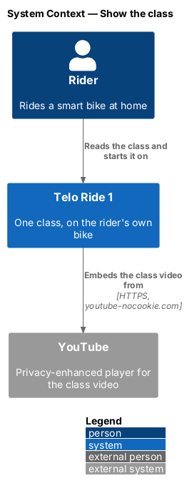
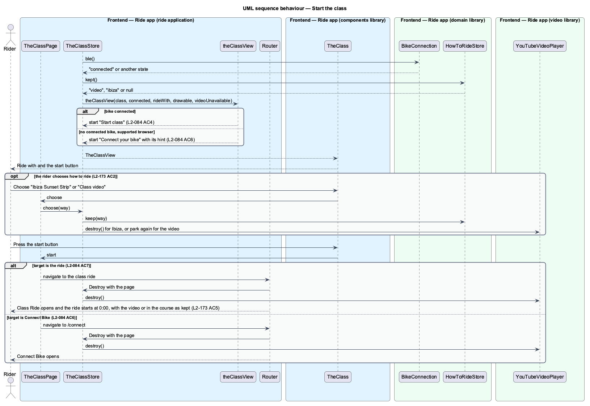

# Show the class

## Overview

Telo Ride 1 offers exactly one class, Intervals to the Beat by GCN Training, with the id
`intervals-to-the-beat`. It ships with the app (ADR 0037, ADR 0042). The Class is the home screen,
at `/`. It shows the class video, the title and length, a chart of what the bike will do, and one
start button. A returning rider also sees the
ride count, the best output and the last output.

This feature defines the class and its plan, validates them, draws The Class and starts the ride.
The rider chooses nothing: there is no other class and no way to pick one.

- **class**: timed workout the rider follows along to a video; Telo Ride 1 has one
- **plan**: timed segments the class follows, 33 in all and 20:00 long
- **segment**: part of the plan with a kind (warm-up, work, recover, cool-down), a duration, a
  level and a cadence aim
- **effort**: one of the plan's 17 work segments
- **level**: target resistance a segment asks of the bike, 1 to 32
- **cadence aim**: cadence in rpm a segment asks of the rider
- **target power**: power of a segment's cadence aim at its level, by the estimate of L2-023 AC3
- **sync offset**: video time at which ride 0:00 starts, 0:03.0 for this class
- **record**: rider's ride count, best output and last output, kept on the device
- **start button**: the one primary action of The Class, which reads "Start class", "Ride it
  again" or "Connect your bike"

Neighbouring features own the adjacent concerns:

- [Open the app](../open-the-app/README.md) decides whether The Class or Connect Bike opens at `/`.
- [Keep the bike connected](../../bike/keep-the-bike-connected/README.md) owns the bike status link
  in the header (L2-019) and the `ble` state the start button follows.
- [Check bike and browser support](../../bike/check-bike-and-browser-support/README.md) owns the
  alerts under the header and the disabled start button of a blocked browser (L2-008, L2-009,
  L2-010).
- [Keep the record](../../class-done/keep-the-record/README.md) owns the record The Class reads.
- [Ride the class](../../class-ride/ride-the-class/README.md) owns Class Ride, which the start
  button opens.
- [Read bike telemetry](../../bike/read-bike-telemetry/README.md) owns the power estimate
  (L2-023) the target power uses.
- [Fit The Class to every form factor](../../ui/fit-the-class-to-every-form-factor/README.md) owns
  the one-screen and one-column layouts and the pinned start button (L2-171).
- [Show the wordmark](../../ui/show-the-wordmark/README.md) and
  [Switch theme and full screen](../../ui/switch-theme-and-full-screen/README.md) own the header's
  wordmark and Full screen button.
- [Restrict third parties](../../security/restrict-third-parties/README.md) owns the Content
  Security Policy that admits the YouTube player.

## Description

The codebase holds Telo Ride's Class Start at `/classes/:id` (`ClassStartPage`, `ClassStartStore`,
`classStartRoutes`, `classUnlockedGuard`, and the components `ClassStartHeader`, `ClassStartVideo`,
`ClassPlan`, `ClassSync`, `RideChoice` and `BackLink`). The Class replaces it. The blocks below
either survive from it or are new. Slice 30.1 built the class definition; until The Class is built
(slices 30.2 and 30.3), `ClassStartPage` and `ClassStartStore` show it at `/` and read it the same
way.

**The class definition**

- **`ClassDefinition`** (`api/src/classes/class-definition.ts`, built in slice 30.1): the class as
  the app holds it: `id`, `title`, `channel`, `focus`, `lengthSeconds`, `summary`, `world`, `plan`
  and `video`. It replaces Telo Ride's `ClassDto`, without `opensAtLevel` and `shelfId`.
- **`ClassVideo`** (same file): `videoId` (`il_OFz6o42I`) and `syncOffsetSeconds` (3.0).
- **`Plan`** and **`Segment`** (`api/src/workout/plan.ts`, exist): the plan and its segments.
  Every segment of the class has a cadence aim (L2-080 AC2).
- **`INTERVALS_TO_THE_BEAT`** (`domain/src/engine/intervals-to-the-beat.ts`, built in slice 30.1):
  the class, a typed constant: `intervals-to-the-beat`, "Intervals to the Beat", "GCN Training",
  "Intervals", 1200 s, the summary of L2-080 AC1, the world `ibiza`, and the plan of L2-080 AC2,
  which is the plan of `tools/blender/courses/ibiza.json` segment for segment:

  | Segment | `kind` | Starts | `duration` | `level` | `cadenceAim` |
  |---|---|---|---|---|---|
  | 1 | `warm-up` | 0:00 | 150 s | 14 | 80 |
  | 2 | `work` (effort 1) | 2:30 | 45 s | 19 | 70 |
  | 3 | `recover` | 3:15 | 30 s | 14 | 90 |
  | 4 | `work` (effort 2) | 3:45 | 75 s | 21 | 80 |
  | 5 | `recover` | 5:00 | 60 s | 13 | 90 |
  | 6, 8, 10 | `work` (efforts 3 to 5) | 6:00, 7:00, 8:00 | 30 s each | 21 | 74 |
  | 7, 9, 11 | `recover` | 6:30, 7:30, 8:30 | 30 s each | 13 | 90 |
  | 12, 14, 16 | `work` (efforts 6 to 8) | 9:00, 10:00, 11:00 | 30 s each | 22 | 65 |
  | 13, 15, 17 | `recover` | 9:30, 10:30, 11:30 | 30 s each | 11 | 90 |
  | 18 to 32 | the rest of L2-080 AC2's table, row for row | 12:00 to 18:15 | | | |
  | 33 | `cool-down` | 18:15 | 105 s | 12 | 81 |

  L2-080 AC2 holds every row; `intervals-to-the-beat.spec.ts` has one case per row of it.
- **`THE_CLASS`** and **`TheClassSource`** (`api/src/classes/the-class.ts`, built in slice 30.1):
  the contract the screens read the class through. `get()` answers the `ClassDefinition` at once,
  with no network (L2-080 AC5), and refuses with a `ClassError` (`api/src/classes/class-error.ts`)
  whose `code` is `class_invalid`. `shippedClass()` (`domain/src/engine/shipped-class.ts`)
  implements it over `INTERVALS_TO_THE_BEAT` and checks it with `ClassRule` on each read.
  `provideTheClass()` (`ride/src/app/classes/provide-the-class.ts`) binds the token on the lazy
  routes that read it, so the class's data is not in the initial bundle. It replaces `CLASSES_API`,
  `HttpClassesApi`, `CachedClassesApi` and `CatalogueCache`, which are removed (ADR 0042).
- **`THE_CLASS_ID`** (`ride/src/app/classes/the-class.ts`, exists): the constant
  `'intervals-to-the-beat'`, which the class ride's route is written from. No screen lists classes
  and no other id has a route, so no other class can be reached (L2-080 AC4).
- **`ClassRule`** (`domain/src/engine/class-rule.ts`, built in slice 30.1): pure helper with unit
  tests. `ClassRule.broken(definition)` names the first rule the class breaks, `'level'` (a level
  outside 1 to 32), `'cadence_aim'` (a segment with none), `'efforts'` (not exactly 17 `work`
  segments) or `'length'` (a segment under a second, or lengths that do not add up to
  `lengthSeconds`), or `null` (L2-080 AC3).
- **`theClassGuard`** (`ride/src/app/classes/the-class.guard.ts`, built in slice 30.1): sends the
  class ride's address to `/` when `get()` refuses, so a class that breaks a rule is never ridden.

**The screen**

- **`theClassRoutes`** (`ride/src/app/the-class/the-class.routes.ts`, new): the route of the empty
  path. It binds `provideTheClass()` and `provideClassVideo()` (both exist, in
  `ride/src/app/classes/`) and loads `TheClassPage` with `loadComponent`, so the class and the
  player's factory load with the screen.
- **`TheClassPage`** (`ride/src/app/the-class/the-class-page.ts`, `.html`, `.scss`, new;
  `wz-the-class-page`): the page. It provides `TheClassStore`, passes its view to `wz-the-class`,
  projects the bike status link and the Full screen button into the header, and navigates on
  `start`: to `/ride` for "Start class" and "Ride it again" (L2-084 AC7), to `/connect` for
  "Connect your bike" (AC6).
- **`TheClassStore`** (`ride/src/app/the-class/the-class-store.ts`, new, modelled on
  `ClassStartStore`): the page-scoped state. It reads the class from `THE_CLASS`, which has
  checked it with `ClassRule`, and exposes `view` as a computed signal over the class, `RIDE_RECORD.current`,
  `BIKE_CONNECTION.ble` and `BLUETOOTH_SUPPORT.state`. A class that breaks a rule sets
  `unavailable`; the page then shows no video, plan or start button, and says "The class can’t be
  loaded. Reload Telo Ride 1 to try again." (`role="alert"`) with **Reload**, which reloads the
  page (mock `the-class/cannot-load`, L2-080 AC3). `ClassStartStore` does this today.
  `parkVideo(host)` keeps the behaviour of `ClassStartStore.parkVideo`: it resolves a player from
  `VIDEO_PLAYER_FACTORY` and loads the video at `syncOffsetSeconds` with `controls: true` and
  `autoplay: false` (L2-084 AC1). A factory that rejects, or a player whose `state` is `'error'`,
  sets `videoUnavailable` and changes nothing else (AC9). The store destroys the player when the
  rider leaves the page.
- **`theClassView`** (`ride/src/app/the-class/the-class-view.ts`, new): pure helper with unit
  tests, one case per row of the table below. It builds the `TheClassView`: the meta line
  "GCN Training · Intervals" from `channel` and `focus`, the length "20:00" with "start to finish", the
  record figures, the start action and the plan texts.

  | `ble` | Finished rides | Browser | Label | Hint | Opens |
  |---|---|---|---|---|---|
  | `connected` | 0 | supported | "Start class" | none | `/ride` |
  | `connected` | 1 or more | supported | "Ride it again" | none | `/ride` |
  | not `connected` | any | supported | "Connect your bike" | "The class needs the bike to set resistance." | `/connect` |
  | any | any | blocked | "Connect your bike", disabled | the same hint | nothing (L2-010 AC1) |

  The record figures are "Rides", "Best output" and "Last time", the outputs with " kJ"; a rider
  with no finished rides gets none of the three (L2-084 AC8).
- **`TheClassView`** (`api/src/classes/the-class-view.ts`, new): the view type the page and the
  presentation component share, in `api` because `components` imports `api` for types only.
- **`TheClass`** (`components/src/the-class/the-class.ts`, `.html`, `.scss`, new; `wz-the-class`):
  the presentation component of the design-system block `the-class`, with the mock's BEM classes
  (`the-class__video`, `the-class__title`, `the-class__stats`, `the-class__start`,
  `the-class__start-hint`, `the-class__plan` and the rest). It takes `view`, emits `start` and
  `videoFrame` (the element the player embeds in, as `ClassStartVideo.frame` does today), and has
  the slots `[slot=bike]`, `[slot=end]` and `[slot=notice]` for the bike status link, the Full
  screen button and the blocked-browser alert. Its header is `ScreenHeader` (`wz-screen-header`,
  new, owned by [Show the wordmark](../../ui/show-the-wordmark/README.md)), which draws the
  mock's `class-header` block with the wordmark; `TheClass` passes the bike status link to its
  default slot and the Full screen button to its `[slot=end]`. It renders the start button itself in the details
  column and in the pinned footer, of which the layout shows one (L2-171 AC5). The class cover
  fills the video box until the player paints over it, with the text alternative
  "Video: Intervals to the Beat, GCN Training". The mock bundles the cover as
  `assets/images/classes/intervals-to-the-beat.jpg`, while `ClassStartVideo` reads it from `i.ytimg.com`;
  which of the two The Class uses is `<TO SUPPLY>` (mock gap: the video that cannot play,
  L2-084 AC9).
- **`ClassProfile`** (`components/src/class-library/class-profile.ts`, exists; `wz-class-profile`):
  the resistance profile as one inline SVG with `role="img"`. `TheClass` passes it the segments and
  the label "Resistance profile" (L2-084 AC2).
- **`PlanSummary`** (`domain/src/engine/plan-summary.ts`, exists): `averagePower(segments)` is the
  plan's time-weighted target power, rounded (L2-084 AC3): 254 W for this plan, so The Class shows
  "~254 W average" beside the heading "What the bike will do". Under the profile it shows
  "17 efforts · 0:15 to 1:15. Resistance changes on its own; you just pedal." (L2-084 AC2), a line
  slice 30.3 builds; `structure(segments)`, which Class Start still shows as
  "17 × 0:15 to 1:15 · 0:30 → 0:20 recover", goes with Class Start.
- **`PowerModel`** (`domain/src/engine/power-model.ts`, exists): `target(cadenceAim, level)`, the
  target power of L2-023 AC3 that `PlanSummary.averagePower` weights by duration.
- **`VIDEO_PLAYER_FACTORY`**, **`VideoPlayer`** (`api/src/video/video-player.ts`, exist) and
  **`YouTubeVideoPlayer`** (`video/src/youtube-video-player.ts`, exists): the player contract and
  its YouTube implementation. `provideClassVideo()` binds the factory to a dynamic import of
  `@telo/video`, so the player's code loads only on a screen that shows the video.

The Playwright page object `the-class.page.ts` (`frontend/e2e/pages/`, new, replacing
`class-start.page.ts`) owns the selectors, and the existing `youtube.ts` fixture answers the
player's requests.

## Requirements

The feature realizes the following level-2 (L2) requirements. Each L2 requirement refines a
level-1 (L1) requirement, cited by identifier.

| L2 ID | Refines (L1) | Requirement |
|-------|--------------|-------------|
| `L2-080` | `L1-014` | The app shall define one class, with the id `intervals-to-the-beat`: "Intervals to the Beat" by "GCN Training", focus "Intervals", 20:00 long, with the summary "Seventeen efforts from 15 seconds to 1:15, ridden to the beat, with five fast sprints to finish.", the YouTube video `il_OFz6o42I` and a sync offset of 0:03.0, the video time at which ride 0:00 starts. Its plan shall be the 33 segments of L2-080 AC2, the plan Ibiza Sunset Strip was built from (`tools/blender/courses/ibiza.json`): 17 efforts, each segment with a level and a cadence aim. The app shall validate that every level is 1 to 32, that every segment has a cadence aim, that there are exactly 17 work segments and that the segment lengths add up to 20:00; it shall not offer an invalid class, and The Class shall then say "The class can’t be loaded. Reload Telo Ride 1 to try again." with **Reload**. No other class shall be reachable, and the class shall show without a network once the app has been opened on the device. |
| `L2-084` | `L1-014` | The Class, at `/`, shall show the header with the wordmark, the bike status (L2-019) and Full screen; the video player with its controls, parked at the sync offset (0:03); "GCN Training · Intervals", the title as the `h1`, and the summary; and "20:00" with "start to finish". "What the bike will do" shall read "~254 W average", a resistance profile of the plan (`role="img"`, "Resistance profile") and "17 efforts · 0:15 to 1:15. Resistance changes on its own; you just pedal.". The average shall be the plan's time-weighted target power (L2-023 AC3), rounded. With a connected bike the start button shall read "Start class" for a rider with no finished rides and "Ride it again" for a rider with at least one. With no connected bike in a supported browser it shall read "Connect your bike", be followed by "The class needs the bike to set resistance.", and open Connect Bike. When the rider presses "Start class" or "Ride it again" with the bike connected, Class Ride shall open and the ride shall start at 0:00. For a returning rider The Class shall read "Rides" with the ride count ("6"), "Best output" with the best ("342 kJ") and "Last time" with the last output ("318 kJ"); a rider with no finished rides shall see none of the three. When the video cannot load, the class cover shall stand in its box, and the rest of the screen, the start button included, shall work. |

## Diagrams

### System context

The rider reads the class on Telo Ride 1, which embeds the class video from YouTube's
privacy-enhanced domain. The video is the only part of the screen that leaves the device.

### Containers

The Ride app reads the record from browser storage and embeds the YouTube player. The class
definition is part of the app's own code (ADR 0042), so no container is drawn for it.

### Components

`TheClassPage` provides `TheClassStore`, which reads the class through `THE_CLASS`, whose
`shippedClass` checks it with `ClassRule`, builds the view with `theClassView` and `PlanSummary`, and parks the video
through `VIDEO_PLAYER_FACTORY`. `TheClass` in the `components` library draws the view.

### Class structure

`ClassDefinition` composes a `Plan` of 33 `Segment` values and a `ClassVideo`. `TheClassStore` turns it
into a `TheClassView`, whose `StartAction` carries the start button's label, hint and target.

### Behaviour: show the class

The store reads the class, which `shippedClass` checks, builds the view and parks the video at
0:03 (L2-084 AC1). A video that cannot load leaves the cover in place (AC9); a class that breaks a
rule leaves the screen with the message and **Reload**, and no start button (L2-080 AC3).

### Behaviour: start the class

The start button's label follows the `ble` state and the record (L2-084 AC4 to AC6). Pressing it
opens Class Ride when the bike is connected (AC7) and Connect Bike otherwise (AC6); either way the
store destroys the player as the page closes.

