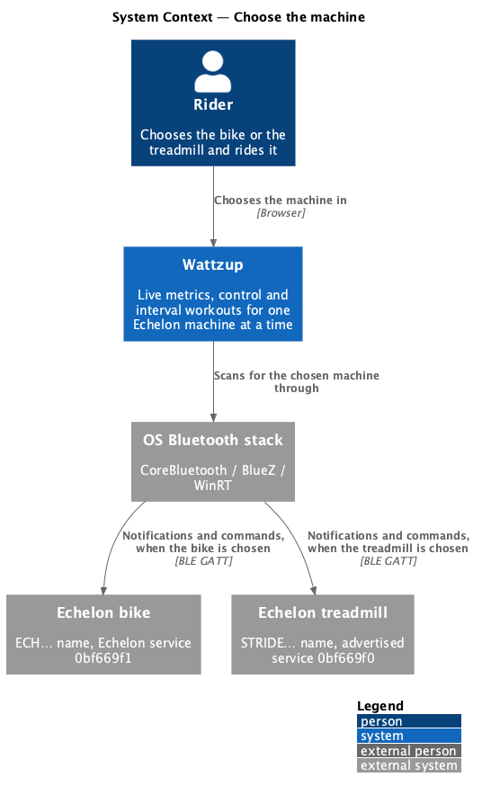
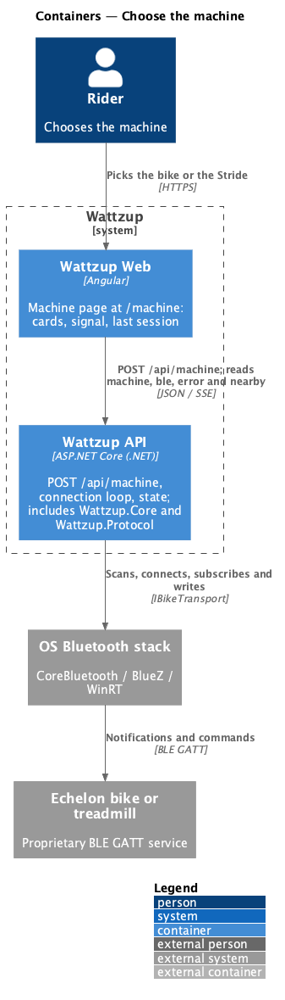
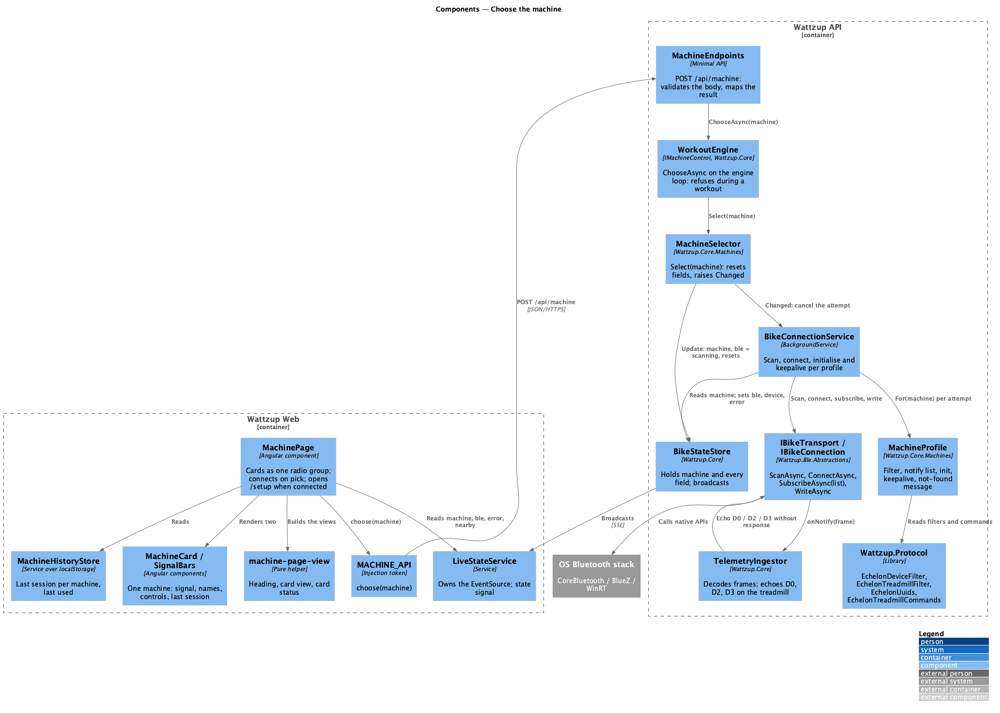
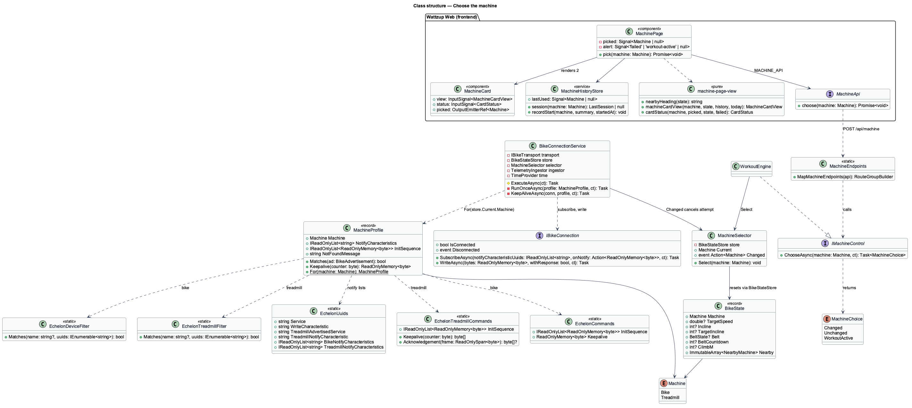
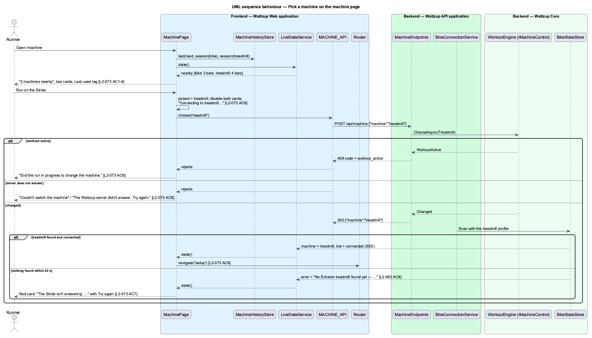
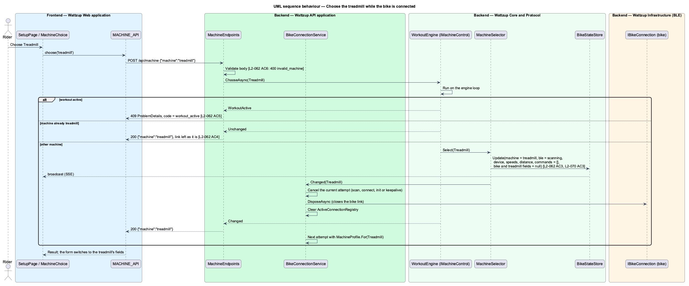
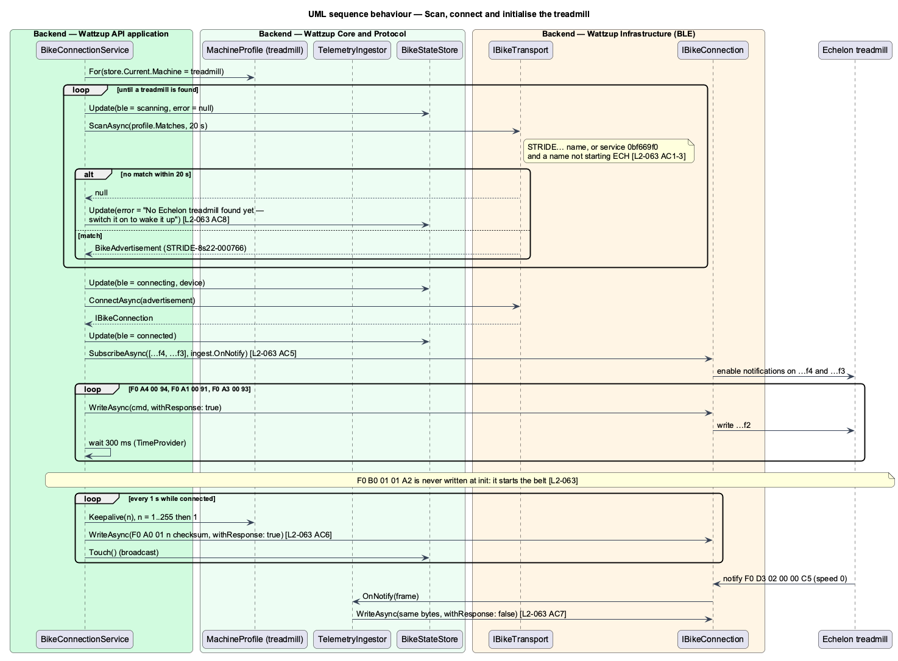

# Choose the machine

## Overview

Wattzup drives one Echelon machine at a time: the bike or the treadmill (ADR 0009). Both machines use the same Echelon GATT service, the same `F0` framing and the same checksum, but the same bytes mean different things on each. On the bike, `F0 B0 01 01 A2` starts the data stream; on the treadmill, it starts the belt. The backend therefore has to know which machine it is looking for before it scans, and it has to keep the two machines apart at every step: the device filter, the notify subscriptions, the init commands and the keepalive. This feature covers the choice of machine, from the machine page at `/machine` to the backend, the per-machine connection profile, and the scan, connect and initialise path of the treadmill (ADR 0010).

**machine** — the Echelon device Wattzup drives, `bike` or `treadmill`, carried in the state as `machine` (L2-062)

**machine profile** — fixed set of per-machine connection facts: device filter, notify characteristics, init sequence, keepalive frame and not-found message

**machine-specific field** — state field that only one machine writes and that is `null` on the other machine (L2-070)

**machine page** — the screen at `/machine` where the rider picks the bike or the Stride; picking connects at once (L2-073)

**last session** — the summary and start time of the last plan started on a machine, kept in the browser's local storage, not on the server (L2-072 criterion 10, L2-073)

**last used machine** — the machine of the most recent last session, marked on the machine page with a *Last used* tag

**treadmill keepalive** — command `F0 A0 01 <n> <checksum>` written once per second, where `<n>` counts 1 to 255 and then starts again at 1 (L2-063)

**acknowledgement echo** — treadmill frame of type `D0`, `D2` or `D3` written back unchanged to the write characteristic without response (L2-063)

The setting `Wattzup:Machine` (command line `--machine treadmill`, environment `WATTZUP__MACHINE`) chooses the machine at start-up, default `bike`. `POST /api/machine` changes it while Wattzup runs and no workout is active. A change closes the open link, resets the machine-specific fields and scans for the other machine. The choice is held in memory for the life of the process, like the rest of the state (ADR 0004); a restart returns to the setting.

The feature extends `bike-connectivity/discover-and-connect-bike` and `bike-connectivity/maintain-bike-connection`: the same `BikeConnectionService` loop runs for both machines and reads the profile of the chosen machine at the start of each attempt. Decoding the treadmill's frames belongs to `treadmill/decode-treadmill-telemetry`. The list of nearby machines and their signal, which the machine page shows, belongs to `bike-connectivity/list-nearby-machines` (L2-074). The setup screen no longer chooses the machine; its *Switch to …* link leads here (`treadmill/treadmill-dashboard-and-setup`).

## Description

### Protocol (`Wattzup.Protocol`)

- **`EchelonDeviceFilter.Matches(name, uuids)`** — the bike's filter (L2-001). It accepts a name starting with `ECH` or the Echelon service `…f1`, as before, and now rejects any name starting with `STRIDE` (ordinal, case-insensitive), even when the device advertises the Echelon service (L2-063 criterion 4).
- **`EchelonTreadmillFilter.Matches(name, uuids)`** — the treadmill's filter (L2-063). It accepts a name starting with `STRIDE` (case-insensitive). It also accepts a device that advertises `EchelonUuids.TreadmillAdvertisedService` (`0bf669f0-…`, case-insensitive) and whose name does not start with `ECH`. A device with no name that advertises the service is accepted.
- **`EchelonUuids`** — gains `TreadmillAdvertisedService` (`0bf669f0-45f2-11e7-9598-0800200c9a66`) and `TreadmillNotifyCharacteristic` (`0bf669f3-…`). It lists `BikeNotifyCharacteristics` as `[…f4]` and `TreadmillNotifyCharacteristics` as `[…f4, …f3]`. `WriteCharacteristic` (`…f2`) stays the only characteristic Wattzup writes on either machine (L2-063 criterion 10).
- **`EchelonTreadmillCommands`** — the treadmill's command builder. `InitSequence` is `F0 A4 00 94`, `F0 A1 00 91`, `F0 A3 00 93`, in that order; it never contains `F0 B0 01 01 A2` (L2-063). `Keepalive(byte counter)` returns `F0 A0 01 <counter> <checksum>` with the checksum `(0x91 + counter) mod 256`. `Acknowledgement(frame)` returns the frame's bytes for a `D0`, `D2` or `D3` frame and `null` for any other frame. The speed, incline and belt builders are described in `treadmill/control-speed-and-incline` and `treadmill/control-the-belt`.

### Abstractions (`Wattzup.Ble.Abstractions`)

- **`IBikeConnection.SubscribeAsync(notifyCharacteristicUuids, onNotify, ct)`** — takes the list of notify characteristics to subscribe. Each transport subscribes every listed characteristic that the Echelon service has, before it returns, and hands every frame from any of them to the same `onNotify` (ADR 0009). The bike's list is `[…f4]`, so the bike's behaviour is unchanged. See `bike-connectivity/bluetooth-platform-transports`.

### Core (`Wattzup.Core`)

- **`Machine`** (`Wattzup.Core.State`) — enum `Bike`, `Treadmill`, serialised as `bike` and `treadmill`.
- **`BikeState`** — gains `Machine`, `TargetSpeed`, `Incline`, `TargetIncline`, `Belt` (`BeltState?`) and `BeltCountdown` (L2-014, L2-070). The initial state's `Machine` comes from `Wattzup:Machine`.
- **`MachineProfile.For(machine)`** (`Wattzup.Core.Machines`) — returns the profile of a machine:

  | Member | Bike | Treadmill |
  |---|---|---|
  | `Matches(advertisement)` | `EchelonDeviceFilter.Matches` | `EchelonTreadmillFilter.Matches` |
  | `NotifyCharacteristics` | `EchelonUuids.BikeNotifyCharacteristics` | `EchelonUuids.TreadmillNotifyCharacteristics` |
  | `InitSequence` | `EchelonCommands.InitSequence` | `EchelonTreadmillCommands.InitSequence` |
  | `Keepalive(counter)` | `EchelonCommands.Keepalive` (counter ignored) | `EchelonTreadmillCommands.Keepalive(counter)` |
  | `NotFoundMessage` | `No Echelon bike found yet — pedal to wake it up` | `No Echelon treadmill found yet — switch it on to wake it up` |

- **`MachineSelector`** (`Wattzup.Core.Machines`) — singleton. `Current` reads `BikeStateStore.Current.Machine`, so the store stays the only holder of the choice. `Select(machine)` does nothing when `machine` equals `Current`. Otherwise it applies one `BikeStateStore.Update` that sets `machine`, sets `ble` to `scanning`, and resets `device`, `device_label`, `workout`, `speed_kmh`, `speed_mph`, `distance_km`, `kcal`, `commands` (to `[]`) and every machine-specific field of L2-070 criteria 1 and 2, `climb_m` among them (L2-070 criterion 3). `nearby` is kept, because both machines' entries stay true. That update broadcasts the new state. It then raises `Changed`.
- **`IMachineControl.ChooseAsync(machine, ct)`** — the one Core service behind `POST /api/machine`, implemented by `WorkoutEngine`. It runs on the engine loop, so the check for an active workout and the change happen with no workout command in between. It returns `MachineChoice.Unchanged` when the machine is already chosen (L2-062 criterion 4), `MachineChoice.WorkoutActive` when a workout is active (L2-062 criterion 5), and otherwise calls `MachineSelector.Select` and returns `MachineChoice.Changed`.
- **`TelemetryIngestor`** — after each frame, on the treadmill, writes `EchelonTreadmillCommands.Acknowledgement(frame)` back through `ActiveConnectionRegistry.Current` without response, when it is not `null` (L2-063 criterion 7). Decoding is described in `treadmill/decode-treadmill-telemetry`.

### API (`Wattzup.Api`)

- **`MachineEndpoints`** — `POST /api/machine` with body `{"machine": "bike"|"treadmill"}` (L2-062):
  - A body whose `machine` is missing or not `bike` or `treadmill` answers 400 ProblemDetails with `code` = `invalid_machine` and `error` = `machine must be bike or treadmill`.
  - `Changed` and `Unchanged` answer 200 `{"machine": "<machine>"}`.
  - `WorkoutActive` answers 409 ProblemDetails with `code` = `workout_active`, and nothing changes.
  - The endpoint carries the control rate limit of L2-036 and the API key of L2-035 (`platform/secure-api`).
- **`BikeConnectionService`** — reads `MachineProfile.For(store.Current.Machine)` at the start of each attempt:
  1. It scans with `profile.Matches` and, when nothing matches within 20 s, sets `error` to `profile.NotFoundMessage` and scans again at once (L2-063 criterion 8).
  2. On a match it connects and calls `SubscribeAsync(profile.NotifyCharacteristics, ingestor.OnNotify, ct)` before any write (L2-063 criterion 5).
  3. It writes `profile.InitSequence`, each with response, 300 ms apart.
  4. Its keepalive writes `profile.Keepalive(counter)` with response once per second and calls `BikeStateStore.Touch()` (L2-063 criterion 6). The counter starts at 1 on each connection, counts to 255 and wraps to 1, never 0.
  5. Disconnects and Bluetooth exceptions recover as L2-004 (L2-063 criterion 9).
- **Cancel on change** — `BikeConnectionService` subscribes to `MachineSelector.Changed`. The handler cancels the whole current attempt: the scan, the connection being opened, the init sequence or the keepalive. The loop disposes the connection, clears `ActiveConnectionRegistry` and starts the next attempt at once with the new profile. Unlike a link drop, a cancelled attempt does not write `ble = disconnected`, because `Select` has already set `scanning`.
- **`WattzupOptions.Machine`** — bound from `Wattzup:Machine`, `bike` or `treadmill`, default `bike`, validated at start-up. `Program.cs` maps `--machine treadmill` to it. The setting is documented in the README.
- **OpenAPI** — the schema transformer describes `machine`, `target_speed`, `incline`, `target_incline`, `belt`, `belt_countdown` and `climb_m` with their types and nullability, and the frontend's generated types come from it (L2-070 criterion 4).

### Simulator (`Wattzup.Ble.Simulated`)

`SimulatedBikeTransport` advertises both `ECHSIM-0001` (the Echelon service `…f1`) and `STRIDE-SIM-0001` (the treadmill's advertised service `…f0`), so each filter finds its own machine and rejects the other. Connecting to `STRIDE-SIM-0001` returns a `SimulatedTreadmillConnection`. On subscribe it reports a `D3` speed of 0 and a `D2` incline of 0; it notifies only on change, like the real treadmill. Its behaviour for belt, speed and incline commands is described in `treadmill/control-the-belt` and `treadmill/control-speed-and-incline`. `--simulate --machine treadmill` therefore runs the treadmill with no hardware.

### Frontend (`frontend/src/app/`)

The machine page follows the mocks `docs/mocks/pages/choose-machine/` (states `default`, `connecting`, `not-found`, `not-found-bike`, `loading`, `empty`, `error`). It replaces the Machine radio group that the setup screen used to show; `MachineChoice` (`wz-machine-choice`) is removed with its `machine-choice.html` and `machine-choice.scss`.

- **Route** — `app.routes.ts` gains `{ path: 'machine', loadComponent: MachinePage }`, titled `Choose machine · Wattzup`.
- **`machine-history.store.ts`** (`core/`, new) — `MachineHistoryStore`, root-provided, over `SafeStorage` and the `localStorage` key `wattzup.machineHistory`. It holds `{lastUsed: Machine | null, sessions: {bike?: LastSession, treadmill?: LastSession}}` with `LastSession` = `{machine, summary, started_at}` (ISO 8601). `recordStart(machine, summary, startedAt)` writes the machine's session and sets `lastUsed`; `SetupPage` calls it when `WORKOUT_API.start` succeeds (L2-072 criterion 10). Missing or unreadable data yields no sessions and no last used machine.
- **`machine-page-view.ts`** (`core/`, new, pure) — builds what the page shows from the live state, the history and today's date:
  - `nearbyHeading(state)` returns `Looking for machines…` while `state` is `null`, `No machines nearby` when `nearby` is empty, else `<n> machines nearby` (L2-073 criterion 4).
  - `machineCardView(machine, state, history, today)` returns `{kind, name, advertisedName, signal, signalLabel, controls, lastSession, lastUsed, cta}`. `kind` is `Bike` or `Treadmill`. `name` is the `nearby` entry's `label`, else `Echelon bike` or `Echelon Stride`. `advertisedName` is the entry's `name`, else `Not heard yet`. `signal` is the entry's `signal`, else 0, with `signalLabel` `Signal <n> of 4`. `controls` is `Resistance, levels 1–32` or `Speed 0.8–19.3 km/h, incline 0–10%`. `lastSession` is `
 · today`, `· yesterday` or `· <n> days ago`, else `None yet`. `cta` is `Ride the bike` or `Run on the Stride` (L2-073 criteria 2 and 3).
  - `cardStatus(machine, picked, state, failed)` returns `idle`, `connecting` (`Connecting to bike…` or `Connecting to treadmill…`) or `not-found` (`The bike isn't answering. Give the pedals a turn to wake it.` or `The Stride isn't answering. Check it's switched on and the safety key is clipped in.`) (L2-073 criteria 6 and 7).
- **`MachinePage`** (`dashboard/machine-page/`, `wz-machine-page`, new) — reads `LiveStateService.state` and `MachineHistoryStore`, and holds two signals: `picked` (`Machine | null`) and `alert` (`null`, `failed` or `workout-active`).
  - Its heading reads `What are you training on?` with the lead `Wattzup drives one machine at a time. Pick one — the other stays disconnected until you switch.`, and the status line reads `nearbyHeading` (L2-073 criteria 1 and 4).
  - The two cards form one `role="radiogroup"`; arrow keys move focus and selection between them, as a native radio group does (L2-073 criterion 1).
  - Picking a card sets `picked` and calls `MACHINE_API.choose(machine)`; both cards are disabled while `picked` is set (L2-073 criterion 6). An effect navigates to `/setup` once `state.machine` equals `picked` and `ble` is `connected`.
  - A not-found `error` from the backend (`profile.NotFoundMessage`, L2-063 criterion 8) while `picked` is set and `ble` is `scanning` marks that card `not-found`; its `Try again` button picks it again (L2-073 criterion 7).
  - A rejected `choose` clears `picked` and shows the danger alert `Couldn't switch the machine` / `The Wattzup server didn't answer. Try again.`; a 409 with `code` `workout_active` shows `End the run in progress to change the machine.` (L2-073 criterion 8).
  - With `nearby` empty, a notice reads `No machines nearby` / `Switch the bike's console on, or switch on the Stride and clip in its safety key. Wattzup keeps looking.`, and both cards stay pickable (L2-073 criterion 5).
- **`MachineCard`** (`dashboard/machine-card/`, `wz-machine-card`, new) — renders one `machineCardView` as a `label` around a visually hidden radio input (`machine-card__input`), with the decorative photo (`alt=""`), `wz-signal-bars`, the definition list of `Wattzup controls` and `Last session`, the *Last used* tag and the call to action (volt on the last used machine). The `--failed` modifier and the `aria-invalid` attribute carry the not-found state; text carries it too. Each card is at least 44 × 44 px with a visible focus ring; under 768 px the cards stack (L2-073 criterion 10).
- **`SignalBars`** (`dashboard/signal-bars/`, `wz-signal-bars`, new) — 4 bars, the first `signal` lit, with `role="img"` and the label `Signal <n> of 4`.
- **Reaching the page** — `RideActions.switchMachine(target)` (`core/ride-actions.ts`) serves the dashboards' `End and switch to bike` / `End and switch to treadmill` and the setup's `Switch to …` link. With a workout active it opens the end dialog through `DialogLauncher`; once the workout has ended it navigates to `/machine`. With no workout it navigates at once (L2-073 criterion 9).

### Acceptance tests

`Wattzup.Api.AcceptanceTests` run the host through `WebApplicationFactory` with `SimulatedBikeTransport` and `FakeTimeProvider`, and await SSE messages with a timeout that names the last message received.

- `Given_the_treadmill_is_chosen_when_the_backend_starts_then_it_streams_the_treadmill_state` (L2-062 AC2, L2-063 AC1)
- `Given_the_bike_is_connected_when_the_treadmill_is_chosen_then_the_backend_switches_and_connects_to_it` (L2-062 AC3, L2-070 AC3)
- `Given_the_chosen_machine_is_posted_then_the_answer_is_200_and_the_link_stays` (L2-062 AC4)
- `Given_a_workout_is_active_then_choosing_the_other_machine_answers_409_workout_active` (L2-062 AC5)
- `Given_an_invalid_machine_then_the_answer_is_400_invalid_machine` (L2-062 AC6)
- `Given_the_treadmill_link_opens_then_both_notifies_are_subscribed_before_A4_A1_A3_300_ms_apart` (L2-063 AC5)
- `Given_the_treadmill_is_connected_then_the_keepalive_counts_up_once_a_second_with_response` (L2-063 AC6)
- `Given_no_treadmill_answers_for_20_seconds_then_the_scan_reports_it_and_keeps_scanning` (L2-063 AC8)
- `A_dropped_treadmill_link_recovers_as_the_bike_does` (L2-063 AC9)
- `Given_the_bike_is_chosen_then_machine_is_bike_and_the_treadmill_fields_are_null` (L2-070 AC1, AC2)
- `Given_a_treadmill_ride_with_climb_when_the_bike_is_chosen_then_climb_kcal_and_device_label_reset` (L2-070 AC3)

`Wattzup.Protocol.Tests` hold the tables, one case per row: `EchelonTreadmillFilterTests` (`STRIDE-8s22-000766`, `stride-8s`, no name with `0BF669F0-…`, `ECHEX-3-141844` with `…f0`), `EchelonDeviceFilterTests` (the L2-001 rows plus `STRIDE-8s22-000766` with `…f1`), and `EchelonTreadmillCommandsTests` (`InitSequence`, `Keepalive` at counters 1 and 255, `Acknowledgement` for `D0`, `D2`, `D3` and `D1`). `Wattzup.Core.Tests` cover `MachineSelector.Select` (no-op on the same machine, the reset list of L2-070 criterion 3, one broadcast) and `MachineProfile.For`.

The rate limit and API key of `POST /api/machine` follow the representative paths of `platform/secure-api` (L2-062 criterion 7).

Playwright (`frontend/e2e/`, Chromium only) drives the machine page through the page object `e2e/pages/machine.page.ts`, with the shared fixture answering every `/api/**` request and the SSE fixture pushing state messages. The `POST /api/machine` answers are recorded against the backend running with `--simulate`. `e2e/machine.spec.ts`:

- `shows the title, the lead and both cards as one radio group moved by arrow keys` (L2-073 AC1)
- `shows each card's kind, signal, name, advertised name, controls and last session` (L2-073 AC2)
- `marks the last used machine with a tag and a volt call to action` (L2-073 AC3)
- `reads the nearby count, No machines nearby, or Looking for machines` (L2-073 AC4)
- `shows the no-machines notice and keeps both cards pickable` (L2-073 AC5)
- `connects on pick, disables both cards, and opens setup once connected` (L2-073 AC6)
- `shows the not-found card with Try again after the scan error` (L2-073 AC7)
- `shows an alert when the switch fails or a run is in progress` (L2-073 AC8)
- `ends the workout through the end dialog before opening the machine page` (L2-073 AC9)
- `stacks the cards under 768 px` (L2-073 AC10)

Unit tests in `src/app/core/`: `machine-page-view.spec.ts` (the heading's 3 cases, each card field with and without a `nearby` entry, the last-session ages today, yesterday and 3 days ago, and each card status) and `machine-history.store.spec.ts` (record, read back, unreadable data).

### Open questions

- **Choice not persisted on the server.** The chosen machine lasts until the process restarts, then returns to `Wattzup:Machine` (L2-062, ADR 0009). The browser remembers the last used machine for display only (L2-073 criterion 3); it does not choose it on load. Choosing it automatically needs a requirement first.
- **Count wording.** L2-073 criterion 4 reads `<n> machines nearby` for every count, so 1 reads `1 machines nearby`. `<TO SUPPLY>` whether the requirement should read `1 machine nearby`.
- **Not-found detection.** The page reads the not-found state from `error` while its pick is scanning, so it depends on the exact wording of L2-063 criterion 8. A `code`-like field for the scan error would decouple them; adding one changes the contract and needs a requirement first.
- **Acknowledgement echo.** The echo of `D0`, `D2` and `D3` frames follows the reference implementation; whether the treadmill needs it is Unknown (protocol reference, hardware item 5). The echo is written without response. A failed echo write should be logged and ignored rather than treated as a link failure, so a treadmill that rejects it does not drop the link; how the implementation handles it is `<TO SUPPLY>`, as is the hardware result.
- **Keepalive cadence.** The reference sends `A0` about every 2 seconds; Wattzup sends it once per second, like the bike (hardware item 3).
- **Unlock challenge.** A treadmill that sends an `E0` challenge and ignores commands until it is answered is not supported (hardware item 12).

## Requirements

| L2 ID | Refines (L1) | Requirement |
|-------|--------------|-------------|
| `L2-062` | `L1-013` | Machine choice. Wattzup drives one machine at a time, `bike` or `treadmill`. `Wattzup:Machine` chooses it at start-up, default `bike`, and `POST /api/machine` changes it while no workout is active; the choice holds until it is changed or the process restarts. |
| `L2-063` | `L1-013` | Treadmill scanning and connection. With the treadmill chosen, the backend scans for a `STRIDE` name or the treadmill's advertised service, subscribes to both notify characteristics, writes `F0 A4 00 94`, `F0 A1 00 91` and `F0 A3 00 93` 300 ms apart, never writes `F0 B0 01 01 A2` at init, sends a counting keepalive and echoes `D0`, `D2` and `D3` frames. |
| `L2-070` | `L1-013` | Machine-specific state fields. The state carries both machines' fields, with the other machine's fields `null`, and a machine change resets them. |
| `L2-073` | `L1-013` | Choose the machine. The machine page at `/machine` lets the rider pick the bike or the Stride; picking connects at once. |

## Diagrams

### System context

The rider picks the machine on Wattzup's machine page, and Wattzup then finds and drives only that machine through the operating system's Bluetooth stack.

### Containers

Wattzup Web's machine page sends the choice to the Wattzup API, which scans, connects and initialises the chosen machine through `IBikeTransport`.

### Components

`MachineEndpoints` calls `IMachineControl`, which `WorkoutEngine` implements. `MachineSelector` resets the state and raises `Changed`, which cancels the attempt of `BikeConnectionService`. The service reads `MachineProfile` for each attempt.

### Class structure

`MachineProfile` gathers the per-machine protocol facts from `Wattzup.Protocol`, so `BikeConnectionService` holds no machine-specific branch of its own.

### Behaviour — pick a machine on the machine page

The rider picks the Stride's card. The page posts the choice, disables both cards and shows `Connecting to treadmill…`, then opens `/setup` once the treadmill is connected. A scan that finds nothing turns the card red with `Try again`; a failed post shows an alert (L2-073 criteria 6 to 8).

### Behaviour — choose the treadmill while connected to the bike

The choice is checked against the workout on the engine loop. The selector resets the machine-specific fields and broadcasts `scanning`, the connection service cancels the bike's link, and the next attempt scans for the treadmill (L2-062, L2-070).

### Behaviour — scan, connect and initialise the treadmill

The treadmill's profile drives the same loop as the bike's: the treadmill filter, both notify subscriptions before any write, the three treadmill init commands 300 ms apart, and the counting keepalive (L2-063).

