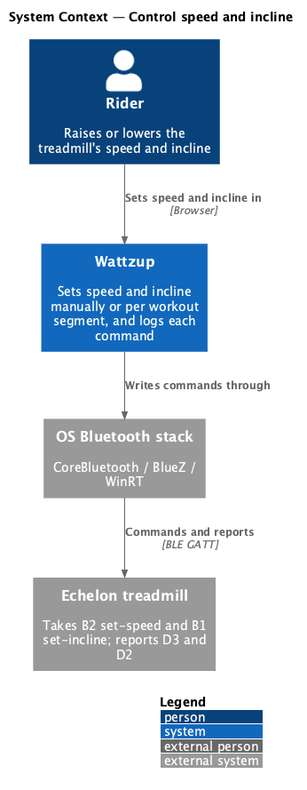
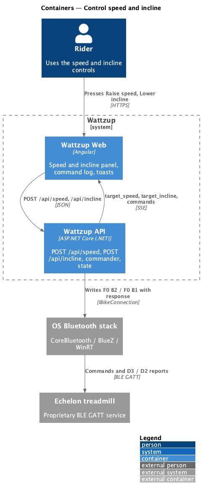
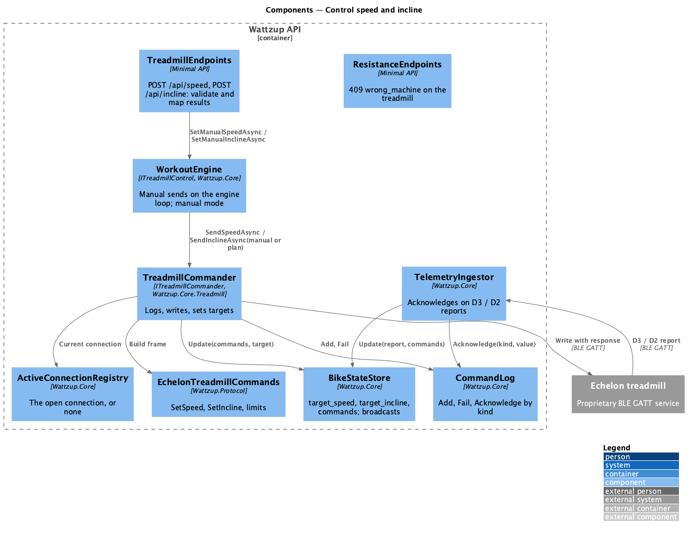
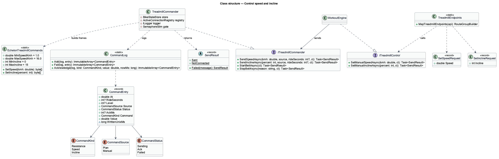
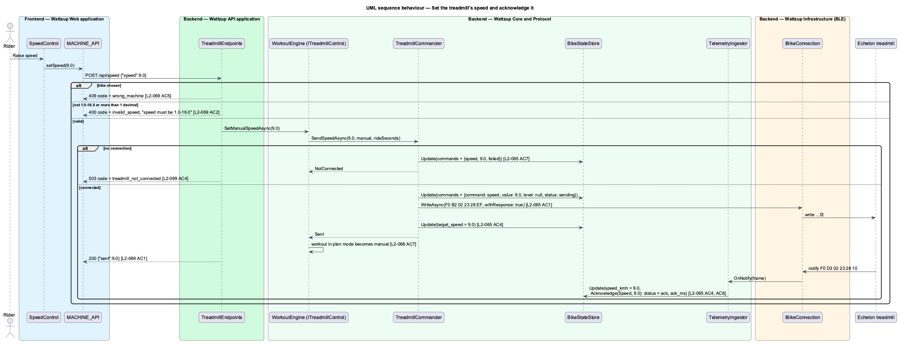

# Control speed and incline

## Overview

On the treadmill, speed and incline take the place of the bike's resistance level. The rider sets them from the dashboard, and the workout engine sets them for each segment of a plan. Each request is a Bluetooth write to the treadmill. The treadmill does not answer the write with its new value; it reports the speed and incline later in its `D3` and `D2` frames, or not at all. Wattzup therefore keeps the requested value (the target) apart from the reported value, and logs each command until the treadmill confirms it.

**set-speed command** — frame `F0 B2 02 <hi> <lo> <checksum>`, where `<hi> <lo>` is round(km/h × 1000) as a big-endian 16-bit value (L2-065)

**set-incline command** — frame `F0 B1 01 <incline> <checksum>`, incline in whole percent (L2-065)

**target speed** — the last requested speed, `target_speed`, in km/h to 1 decimal

**target incline** — the last requested incline, `target_incline`, in whole percent

**command kind** — what a command entry sets: `resistance`, `speed` or `incline`, carried as `command`

Speed is accepted from 1.0 to 16.0 km/h in steps of 0.1, and incline from 0 to 15 %. The upper speed limit is deliberately below the reference implementation's 22 km/h (ADR 0009). Both commands are written with response to the write characteristic `…f2` only. The bike's `F0 B1` frame sets resistance; on the treadmill the same type sets incline, so the builder is chosen by the machine, never by the caller's guess.

The feature mirrors `resistance-control/set-resistance` and `resistance-control/log-resistance-commands` for the treadmill. The engine's use of these commands during a workout (plan and manual mode, resends) belongs to `treadmill/run-treadmill-workout`. The dashboard controls and toasts belong to `treadmill/treadmill-dashboard-and-setup`.

## Description

### Protocol (`Wattzup.Protocol`)

- **`EchelonTreadmillCommands.SetSpeed(double kmh)`** — throws `ArgumentOutOfRangeException` below `MinSpeedKmh` (1.0) or above `MaxSpeedKmh` (16.0), so nothing is written (L2-065 criterion 3). Otherwise it returns `F0 B2 02 <hi> <lo> <checksum>` with `value = round(kmh × 1000)` and the checksum of the frame reference.
- **`EchelonTreadmillCommands.SetIncline(int percent)`** — throws below `MinIncline` (0) or above `MaxIncline` (15). Otherwise it returns `F0 B1 01 <percent> <checksum>`.
- The checksum is `EchelonCommands.Checksum`, the sum of the preceding bytes masked to 8 bits, shared with the bike.

### Core (`Wattzup.Core`)

- **`CommandKind`** (`Wattzup.Core.State`) — enum `Resistance`, `Speed`, `Incline`, serialised as `resistance`, `speed` and `incline`.
- **`CommandEntry`** — gains `Command` (`CommandKind`) and `Value` (`double`); `Level` becomes `int?`. It is serialised as `{at, ride_seconds, level, source, status, ack_ms, command, value}` (L2-014). A speed or incline entry has `level` `null` and `value` the requested value. A resistance entry has `command` `resistance` and `value` equal to its `level` (L2-065).
- **`CommandLog.Acknowledge(log, kind, value, nowMs)`** — walks the log from the newest entry and considers only entries of `kind`. It sets each `sending` entry whose `value` equals the reported value to `ack` with `ack_ms`. It stops at the first entry of the same kind with a different value. An older speed entry behind a newer speed entry for another value therefore stays `sending`, and a speed report never acknowledges an incline entry, nor the reverse (L2-065 criterion 6). Speeds compare after rounding both to 1 decimal.
- **`ITreadmillCommander` / `TreadmillCommander`** (`Wattzup.Core.Treadmill`) — the treadmill counterpart of `ResistanceCommander`. One `SemaphoreSlim` serialises its writes, so a manual and a plan command never interleave on the link.
  - `SendSpeedAsync(kmh, source, rideSeconds, ct)` and `SendInclineAsync(percent, source, rideSeconds, ct)` return the shared `SendResult` (`Sent`, `NotConnected`, `Failed(message)`).
  - With no connection in `ActiveConnectionRegistry`, the entry is added as `failed`, nothing is written, and the result is `NotConnected` (L2-065 criterion 7).
  - Otherwise the `sending` entry is added before the write, so a fast report cannot arrive before it. Then the frame is written with response.
  - A write that throws marks the entry `failed` and returns `Failed(message)`.
  - A write that succeeds sets `target_speed` or `target_incline` and returns `Sent` (L2-065 criteria 4 and 5).
  - The belt commands of the same commander are described in `treadmill/control-the-belt`.
- **`ITreadmillControl`** — the one Core service behind the two endpoints, implemented by `WorkoutEngine`. `SetManualSpeedAsync(kmh, ct)` and `SetManualInclineAsync(percent, ct)` run on the engine loop and send with source `manual`. With a workout in `plan` mode they switch it to `manual` (L2-068 criterion 7). With no workout they send and never start the belt (L2-068 criterion 8).
- **`TelemetryIngestor`** — acknowledges speed entries on a `SpeedUpdate` and incline entries on an `InclineUpdate`, in the same store update that sets the reported value (`treadmill/decode-treadmill-telemetry`).

### API (`Wattzup.Api`)

- **`TreadmillEndpoints`** — `POST /api/speed` with body `{"speed": <number>}` and `POST /api/incline` with body `{"incline": <int>}` (L2-069). Each validates the body and calls one `ITreadmillControl` method:

  | Case | Answer |
  |---|---|
  | Speed 1.0–16.0 with at most 1 decimal | 200 `{"sent": <speed>}` |
  | Speed out of range, more than 1 decimal, not a number, or no body | 400, `code` `invalid_speed`, `error` `speed must be 1.0-16.0` |
  | Incline integer 0–15 | 200 `{"sent": <incline>}` |
  | Incline out of range, not an integer, or no body | 400, `code` `invalid_incline`, `error` `incline must be 0-15` |
  | Treadmill not connected | 503, `code` `treadmill_not_connected`, `error` `treadmill not connected` |
  | Write failed | 503, `code` `send_failed` |
  | Bike chosen | 409, `code` `wrong_machine` |

  The bodies are `SetSpeedRequest(double Speed)` and `SetInclineRequest(int Incline)`; the answers are `SpeedSent(double Sent)` and `InclineSent(int Sent)`. Both endpoints carry the control rate limit of L2-036 and the API key of L2-035 (L2-069 criterion 6).
- **`ResistanceEndpoints`** — `POST /api/resistance` answers 409 with `code` = `wrong_machine` when the treadmill is chosen (L2-069 criterion 5), before it calls `IResistanceControl`.
- The machine check compares the request with the chosen machine (`MachineSelector.Current`). AGENTS.md keeps rules out of endpoints, so the check should sit in the Core service the endpoint calls rather than in the endpoint. Where it sits, and whether it runs before or after validation of the value, is `<TO SUPPLY>` by the implementation; L2-069 does not fix the order.

### Simulator (`Wattzup.Ble.Simulated`)

`SimulatedTreadmillConnection` records every write. On a set-incline write it reports that incline in a `D2` frame. On a set-speed write while its belt runs it reports that speed in a `D3` frame; with the belt stopped it reports nothing. It notifies only when a value changes. `SimulationControl.HoldEchoes` and `ReleaseEchoes()` hold its reports, so a test measures `ack_ms` on virtual time, as for the bike.

### Acceptance tests

`Wattzup.Protocol.Tests` hold `EchelonTreadmillCommandsTests`, one case per row of L2-065 criteria 1–3: speeds 9.0, 7.0, 1.0 and 16.0; inclines 0, 5 and 15; speeds 0.9 and 16.1 and inclines −1 and 16 refused.

`Wattzup.Core.Tests` hold `CommandLogTests` for the kind-aware acknowledgement: a speed report acknowledges a speed entry; a newer speed entry for another value blocks an older one; a speed report leaves an incline entry `sending`; an incline report leaves a speed entry `sending`; a resistance entry carries `command` `resistance` and `value` equal to its level.

`Wattzup.Api.AcceptanceTests` run the host with `SimulatedBikeTransport`, `--machine treadmill` and `FakeTimeProvider`:

- `Given_the_treadmill_is_connected_when_speed_8_5_is_posted_then_it_is_written_and_logged` (L2-065 AC4, L2-069 AC1)
- `Given_the_treadmill_is_connected_when_incline_3_is_posted_then_it_is_written_and_acknowledged` (L2-065 AC5, L2-069 AC1)
- `Given_an_invalid_speed_then_the_answer_is_400_invalid_speed` (L2-069 AC2)
- `Given_an_invalid_incline_then_the_answer_is_400_invalid_incline` (L2-069 AC3)
- `Given_the_treadmill_is_not_connected_then_a_valid_speed_answers_503` (L2-065 AC7, L2-069 AC4)
- `A_failing_write_answers_503_send_failed` (L2-069 AC4)
- `Given_the_bike_is_chosen_then_speed_and_incline_answer_409_wrong_machine` (L2-069 AC5)

The rate limit and API key follow the representative paths of `platform/secure-api` (L2-069 criterion 6).

### Open questions

- **Speed acknowledgement precision.** The treadmill reports metres per hour, so a requested 9.0 km/h is confirmed by a report that rounds to 9.0. A console that moves in its own steps (for example 0.5 km/h) would never confirm 9.1; the entry then stays `sending` and the engine resends on the 5-second rule. Steps of 0.1 and 0.5 km/h are on the hardware list (item 8).
- **Treadmill limits.** 16.0 km/h and 15 % are assumed to be within the treadmill's own maxima (hardware items 8 and 9).

## Requirements

| L2 ID | Refines (L1) | Requirement |
|-------|--------------|-------------|
| `L2-065` | `L1-013` | Speed and incline commands. The backend builds `F0 B2 02 <hi> <lo> <checksum>` for 1.0–16.0 km/h and `F0 B1 01 <incline> <checksum>` for 0–15 %, writes each with response, sets `target_speed` or `target_incline`, and logs each in `commands` with `command` and `value`; a report acknowledges only entries of its own kind. |
| `L2-069` | `L1-013` | Speed and incline endpoints. `POST /api/speed {"speed"}` and `POST /api/incline {"incline"}` answer 200 `{"sent"}`, 400 `invalid_speed` or `invalid_incline`, 503 `treadmill_not_connected` or `send_failed`, and 409 `wrong_machine` on the bike; `POST /api/resistance` answers 409 `wrong_machine` on the treadmill. |

## Diagrams

### System context

The rider, or the workout engine on the rider's behalf, sets the treadmill's speed and incline through Wattzup.

### Containers

Wattzup Web sends the request to the Wattzup API, which writes the command to the treadmill and streams the target, the report and the command log back.

### Components

`TreadmillEndpoints` validates and calls `ITreadmillControl` on the engine loop. `TreadmillCommander` builds the frame with `EchelonTreadmillCommands`, logs the entry through `CommandLog` and writes it. `TelemetryIngestor` acknowledges the entry when the treadmill reports the value.

### Class structure

`CommandEntry` carries its kind and value, so one log holds resistance, speed and incline entries, and `CommandLog.Acknowledge` keeps the kinds apart.

### Behaviour — set speed and acknowledge

A valid request on the treadmill adds a `sending` entry, writes the command, sets `target_speed` and answers 200. The treadmill's report of the same speed turns the entry into `ack` (L2-065, L2-069).

