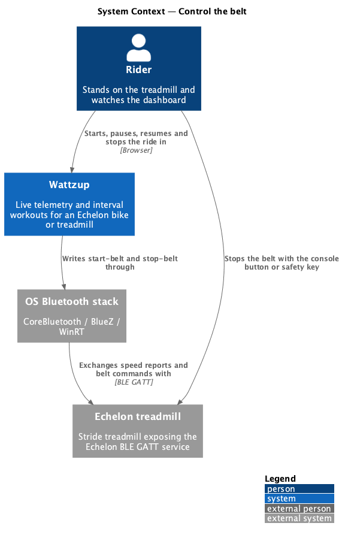
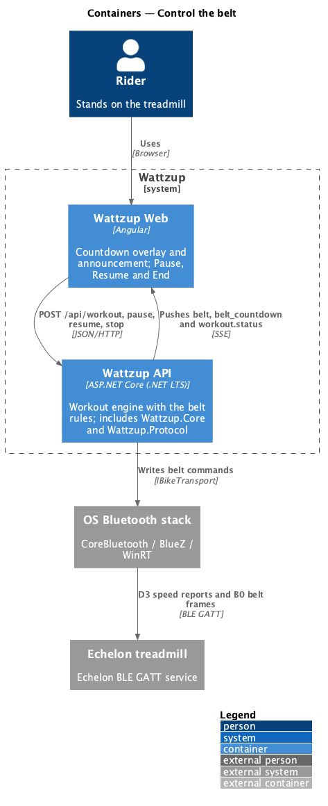
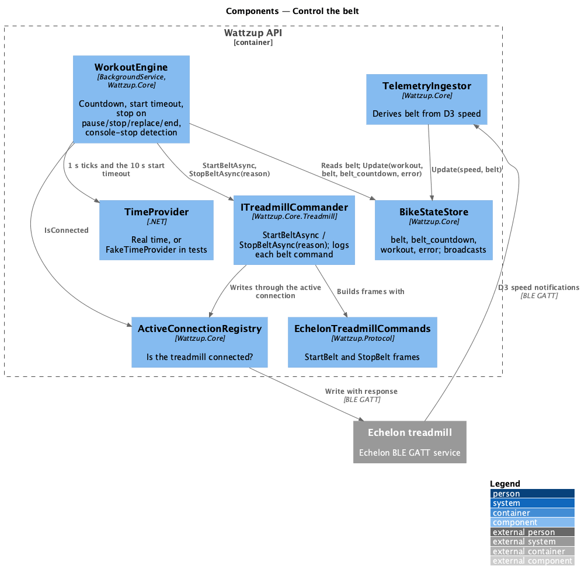
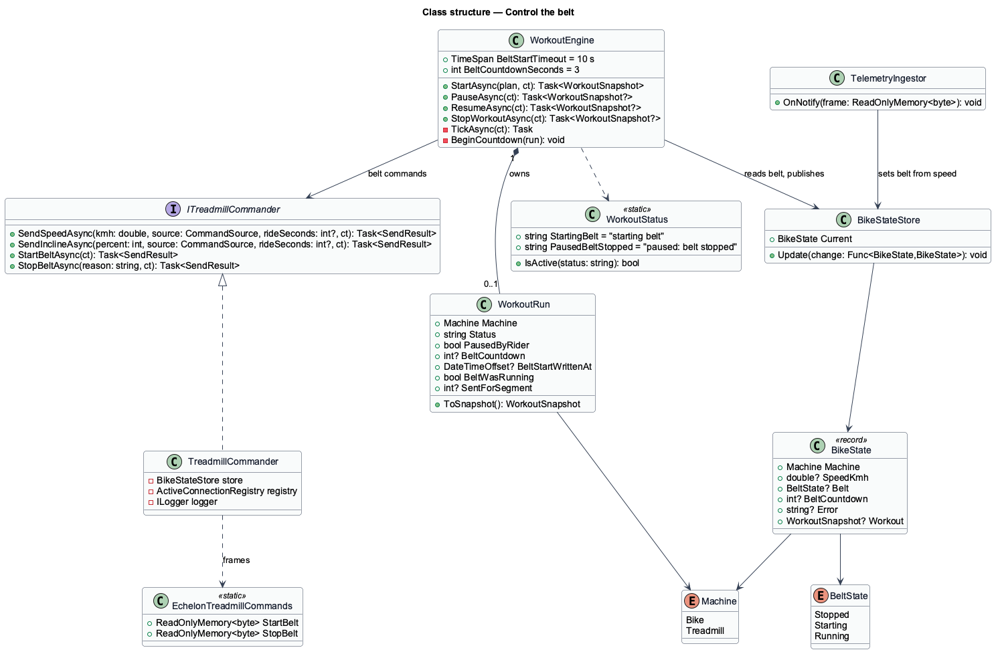
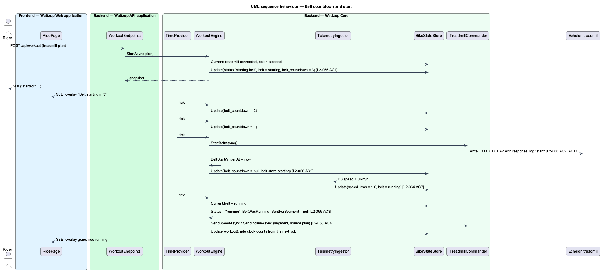
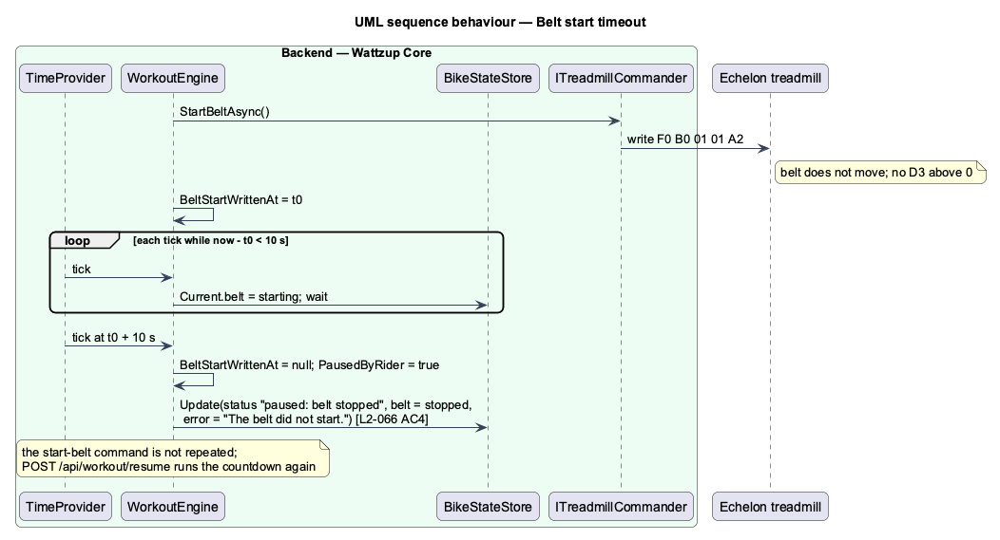
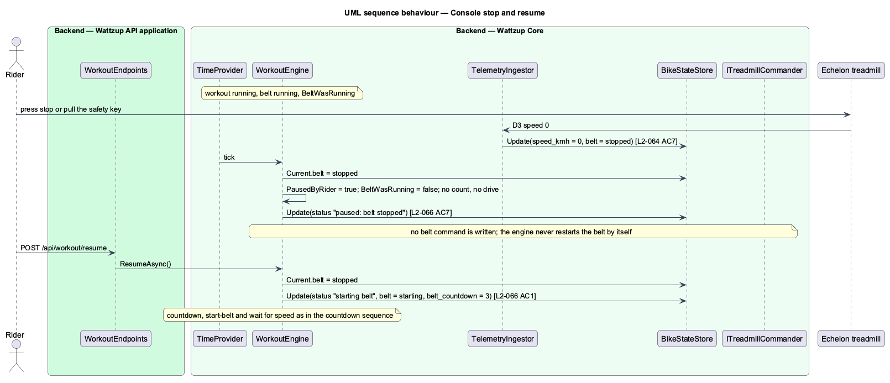
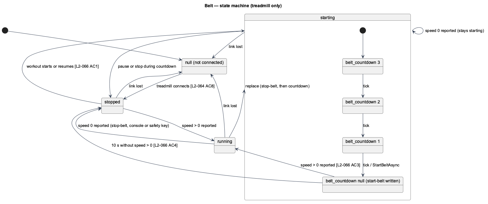

# Control the belt

## Overview

The Echelon treadmill moves a belt with a person standing on it. Wattzup starts that belt only to start or resume a workout, and only after a 3-second countdown that the dashboard shows and announces. It stops the belt whenever the workout is paused, stopped, replaced or ends. When the treadmill reports that its belt stopped on its own (console stop button or safety key), Wattzup pauses the ride and never restarts the belt by itself; the rider resumes through the countdown again (ADR 0009, L2-066).

**belt** — the treadmill's moving surface; its state in the contract is `belt`: `stopped`, `starting` or `running`, and `null` on the bike or while the treadmill is not connected

**start-belt command** — frame `F0 B0 01 01 A2`, written with response; the same five bytes as the bike's start-data-stream init command (`docs/protocol/echelon-treadmill-frames.md`)

**stop-belt command** — frame `F0 B0 01 00 A1`, written with response

**belt countdown** — three successive engine ticks during which `belt_countdown` reads 3, 2 and 1 before the start-belt command is written

**start timeout** — 10 s period after the start-belt command within which the treadmill shall report a speed above 0

**console stop** — the treadmill reporting speed 0 while the belt was running, because the rider pressed the console's stop button or pulled the safety key

**stop reason** — word logged with each belt command: `start`, `pause`, `stop`, `replace` or `end`

The feature sits in the treadmill subsystem, inside the workout engine that `workouts/run-interval-workout` describes for the bike. The engine stays the single loop for both machines; the belt rules apply only when the run's machine is the treadmill. Speed and incline per segment belong to `treadmill/run-treadmill-workout`. The frames that report speed, and the derivation of `belt` from that speed, belong to `treadmill/decode-treadmill-telemetry`. The countdown overlay, its live-region announcement and the safety-key sentences belong to `treadmill/treadmill-dashboard-and-setup`. With the bike chosen, no belt command is ever written and `belt` and `belt_countdown` stay `null` (L2-066 criterion 10, L2-070).

## Description

All types live in `Wattzup.Core` unless stated otherwise.

- **`BeltState`** (`Wattzup.Core.State`) — enum `Stopped`, `Starting`, `Running`, serialised as `stopped`, `starting`, `running` in `belt`.
- **`BikeState`** — gains `Belt` (`BeltState?`) and `BeltCountdown` (`int?`), with `Machine`, `TargetSpeed`, `Incline` and `TargetIncline` (L2-014). All writes go through `BikeStateStore.Update`.
- **`EchelonTreadmillCommands`** (`Wattzup.Protocol`) — `StartBelt` returns `F0 B0 01 01 A2` and `StopBelt` returns `F0 B0 01 00 A1`. The treadmill's `InitSequence` (`A4`, `A1`, `A3`) never contains `StartBelt` (L2-063).
- **`ITreadmillCommander` / `TreadmillCommander`** (`Wattzup.Core.Treadmill`) — shared with `treadmill/control-speed-and-incline`.
  - `StartBeltAsync(ct)` writes `StartBelt` with response through the active connection and logs `Belt command start` through `ILogger` at Information level (L2-066 criterion 11).
  - `StopBeltAsync(reason, ct)` writes `StopBelt` with response and logs `Belt command <reason>` at Information level.
  - Both return `SendResult` (`Sent`, `NotConnected`, `Failed(message)`), as the resistance commander does. With no active connection they write nothing. Belt commands are not added to `commands`, because the command log holds resistance, speed and incline entries only (L2-065).
- **`TelemetryIngestor`** (`treadmill/decode-treadmill-telemetry`) — sets `belt` from each `D3` speed report: above 0 is `running`; 0 is `stopped`, except while `belt` is `starting`, when it stays `starting` (L2-064 criterion 7). `BikeConnectionService` sets `belt` to `stopped` in the update that marks the treadmill connected, and to `null` when the link drops (L2-064 criterion 8).
- **`WorkoutStatus`** — gains `StartingBelt` = `starting belt` and `PausedBeltStopped` = `paused: belt stopped`. Both are active statuses: `IsActive` stays "not `ended`, `ended: bike shut off` or `stopped`".
- **`WorkoutRun`** — carries `Machine` (copied from the store when the run starts) and gains the belt fields, touched only by the engine loop:
  - `BeltCountdown` (`int?`) — 3, 2, 1 during the countdown, else `null`; published as `belt_countdown`.
  - `BeltStartWrittenAt` (`DateTimeOffset?`) — when the start-belt command was written; `null` outside the start timeout.
  - `BeltWasRunning` — the belt has reported running since the ride last ran; set when the status becomes `running`, cleared on every pause.
- **`WorkoutEngine`** — gains the constants `BeltCountdownSeconds` = 3 and `BeltStartTimeout` = 10 s. It depends on `ITreadmillCommander` besides `IResistanceCommander`. The belt rules run on the same loop as every other command and tick, on `TimeProvider`, so no lock guards them.

### Starting the belt

1. **Begin the countdown.** A start command, or a resume command, on a treadmill run with the treadmill connected and `belt` not `running`, sets the status to `starting belt`, `BeltCountdown` to 3 and `belt` to `starting`, and publishes at once (L2-066 criterion 1). `elapsed_seconds` and `remaining` do not change. A run that started while the treadmill was not connected is `waiting for bike` (L2-013); the first tick that finds it connected begins the countdown instead of running (L2-066 criterion 9).
2. **Count down.** Each tick with `BeltCountdown` 3 or 2 decrements it and publishes, so the overlay reads 3, 2 and 1 on successive ticks.
3. **Write the start.** The tick that finds `BeltCountdown` 1 calls `StartBeltAsync`, sets `BeltCountdown` to `null` and `BeltStartWrittenAt` to now. `belt` stays `starting` and the status stays `starting belt` (L2-066 criterion 2). A failed write is handled as the start timeout below, with `error` set to `The belt did not start.`
4. **Wait for movement.** Each later tick reads `store.Current.Belt`. When it is `running` (the treadmill reported speed above 0), the tick clears `BeltStartWrittenAt`, sets `BeltWasRunning`, sets the status to `running`, clears `SentForSegment` and drives the segment's speed and incline (`treadmill/run-treadmill-workout`, L2-068). The ride clock does not move on this tick, as on the bike's start-up tick; it counts from the next one (L2-066 criterion 3).
5. **Start timeout.** When `now − BeltStartWrittenAt ≥ BeltStartTimeout` with no speed above 0, the tick sets the status to `paused: belt stopped`, `belt` to `stopped` and `error` to `The belt did not start.`, clears `BeltStartWrittenAt` and sets `PausedByRider`. The start-belt command is not written again (L2-066 criterion 4).

Resume while `belt` is already `running` skips the countdown: the status becomes `running` and the ride continues at once (L2-066 criterion 5).

### Stopping the belt

On a treadmill run, each of these writes the stop-belt command once, with response, if the treadmill is connected (L2-066 criterion 6). `target_speed` keeps its last value.

| Event | Stop reason | Then |
|---|---|---|
| `POST /api/workout/pause` | `pause` | status `paused`, `BeltCountdown` and `BeltStartWrittenAt` cleared |
| `POST /api/workout/stop` | `stop` | status `stopped` |
| `POST /api/workout` while a run is active | `replace` | the new run always begins with the countdown, whatever `belt` reads |
| the ride clock reaches `total_seconds` | `end` | status `ended` |

A pause during the countdown also writes the stop-belt command; the start-belt command may not have been written yet, and the stop is harmless then. A replaced run's countdown does not wait for the treadmill to report speed 0: the engine sets `belt` to `starting` itself, and a later speed-0 report keeps it `starting` (L2-064 criterion 7).

### Console stop

A tick on a `running` treadmill run reads `store.Current.Belt`. When it is `stopped` while `BeltWasRunning` is set, the treadmill's console or safety key stopped the belt. The tick sets the status to `paused: belt stopped`, sets `PausedByRider`, clears `BeltWasRunning`, does not count and does not drive (L2-066 criterion 7). The engine writes no belt command. `POST /api/workout/resume` restarts the belt through the countdown of *Starting the belt*.

### Disconnect

A treadmill run follows the bike's disconnect rules with one change. The not-connected tick sets the status to `paused: bike disconnected` and starts the 90-second shut-off grace of L2-013. It also clears the countdown fields and sets `PausedByRider`. A reconnect within 90 s therefore lands in `paused`, not `running`, and the belt starts only through the countdown after the rider resumes (L2-066 criterion 8). Wattzup cannot stop the belt while disconnected; the treadmill's safety key and stop button always can, and the dashboard says so (L2-071). A run that never started stays `waiting for bike` across a disconnect and begins the countdown again on reconnect.

### Acceptance tests

Each test runs `Wattzup.Api.AcceptanceTests` through `WebApplicationFactory` with `--machine treadmill`, `SimulatedBikeTransport` (which advertises `STRIDE-SIM-0001` and connects a `SimulatedTreadmillConnection`) and `FakeTimeProvider`. The test advances the clock one second at a time and awaits the expected SSE message from `/api/events` with a timeout that fails naming the last message received; it never sleeps. Belt writes are read from `SimulationControl.Writes`. `SimulationControl.IgnoreBeltStart` makes the simulator ignore the start-belt command, and `SimulationControl.StopBeltFromConsole()` reports speed 0 as a console stop would.

- `Starting_a_workout_counts_down_3_2_1_without_moving_the_clock` (L2-066 AC1)
- `The_tick_after_1_writes_start_belt_once_and_keeps_belt_starting` (L2-066 AC2)
- `A_reported_speed_above_0_runs_the_ride_and_sends_the_segment_speed` (L2-066 AC3)
- `No_speed_within_10_seconds_pauses_with_the_belt_did_not_start` (L2-066 AC4)
- `Resume_with_the_belt_running_skips_the_countdown` (L2-066 AC5)
- `Pause_stop_replace_and_end_each_write_stop_belt_once` (L2-066 AC6, one case per event)
- `A_console_stop_pauses_with_belt_stopped_and_never_restarts` (L2-066 AC7)
- `Resume_after_a_console_stop_counts_down_again` (L2-066 AC7)
- `A_reconnect_within_90_seconds_stays_paused_until_resumed` (L2-066 AC8)
- `A_workout_started_before_the_treadmill_connects_counts_down_on_connect` (L2-066 AC9)
- `The_bike_never_receives_a_belt_command` (L2-066 AC10)

`Wattzup.Core.Tests` drives `WorkoutEngine` directly with a test double of `ITreadmillCommander` and `FakeTimeProvider`, one case per row of the stop table and per countdown step. A captured `ILogger` checks the Information entry and stop reason of each belt command (L2-066 AC11). `Wattzup.Protocol.Tests` checks the `StartBelt` and `StopBelt` bytes.

### Open questions

- **Late start after the timeout.** L2-066 criterion 4 leaves the run `paused: belt stopped` without a stop-belt command. If the treadmill reports a speed above 0 after the timeout, the belt moves while the ride is paused. Writing the stop-belt command at the timeout, or on such a late report, would be safer; it needs a stop reason the requirement does not list.
- **Resume with the belt still running.** Pause always writes the stop-belt command (L2-066 criterion 6), so criterion 5 is reached only when the resume arrives before the treadmill reports speed 0, or when the stop did not take. In the first case the ride continues and the following speed-0 report then pauses it as a console stop.
- **Console countdown.** The treadmill may run a countdown of its own after the start-belt command (`echelon-treadmill-frames.md`, hardware item 6). The 10 s start timeout should cover it; the hardware smoke test confirms the figure.
- **First countdown second.** The countdown begins on the start or resume command, between ticks, so the number 3 shows for less than 1 s. The 1-second spacing applies to 2 and 1 and to the start write.
- **Detection latency.** The engine reads `belt` on its 1-second tick, so a reported start or console stop takes effect up to 1 s later. An event from `TelemetryIngestor` to the engine loop would remove that delay at the cost of a second entry into the loop.

## Requirements

| L2 ID | Refines (L1) | Requirement |
|-------|--------------|-------------|
| `L2-066` | `L1-013` | Belt control. Wattzup starts the treadmill's belt only to start or resume a workout, and only after a 3-second countdown the UI shows and announces, and stops the belt whenever a workout on the treadmill pauses, is stopped, is replaced or ends. |
| `L2-064` | `L1-013` | Treadmill telemetry decoding. A reported speed above 0 means `belt` is `running`; 0 means `stopped`, except while `belt` is `starting` (criteria 7 and 8). |

## Diagrams

### System context

The rider stands on the treadmill and starts, pauses and stops the ride in the browser. Wattzup turns those actions into belt commands through the OS Bluetooth stack; the treadmill's own stop button and safety key act on the belt directly.

### Containers

The belt rules run inside the Wattzup API container. Wattzup Web shows the countdown it receives over SSE.

### Components

`WorkoutEngine` runs the countdown and the timeout on `TimeProvider` ticks and writes belt commands through `ITreadmillCommander`. `TelemetryIngestor` turns speed reports into `belt`, which the engine reads from `BikeStateStore` on each tick.

### Class structure

The run carries its machine and the belt fields. The commander builds frames with `EchelonTreadmillCommands` and writes them through the active connection.

### Behaviour — countdown and start

A start counts down 3, 2 and 1 on successive ticks, writes the start-belt command once, and runs the ride when the treadmill reports a speed above 0 (L2-066 criteria 1 to 3).

### Behaviour — start timeout

When no speed above 0 arrives within 10 s of the start-belt command, the ride pauses with `paused: belt stopped` and the start is not repeated (L2-066 criterion 4).

### Behaviour — console stop and resume

A speed-0 report while the belt was running pauses the ride without a belt command. Resume restarts the belt only through the countdown (L2-066 criterion 7).

### State machine — belt

`belt` is `null` while the treadmill is not connected. On connection it is `stopped`; the countdown makes it `starting`; a speed report makes it `running` or `stopped`, except that speed 0 keeps it `starting`.

