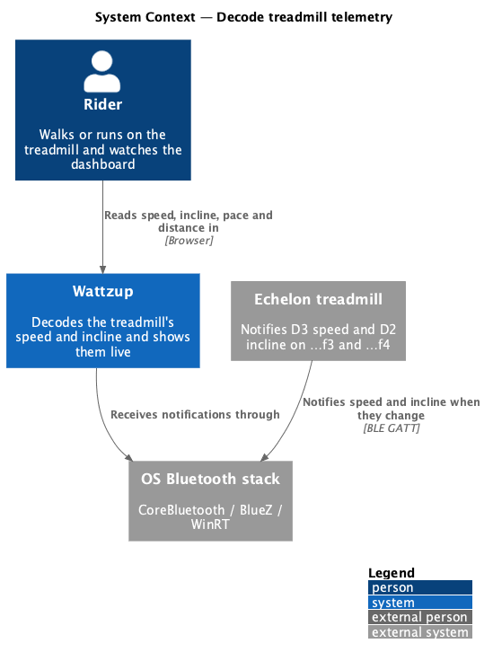
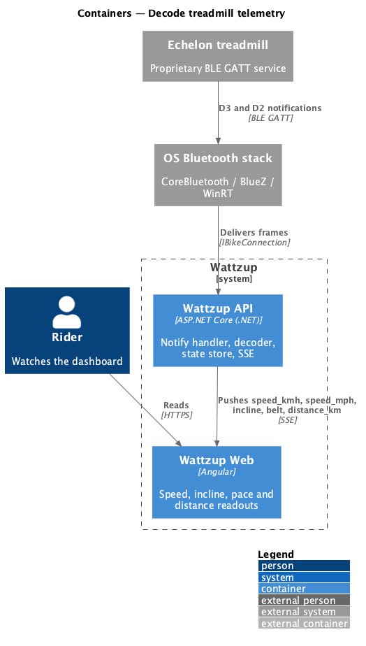
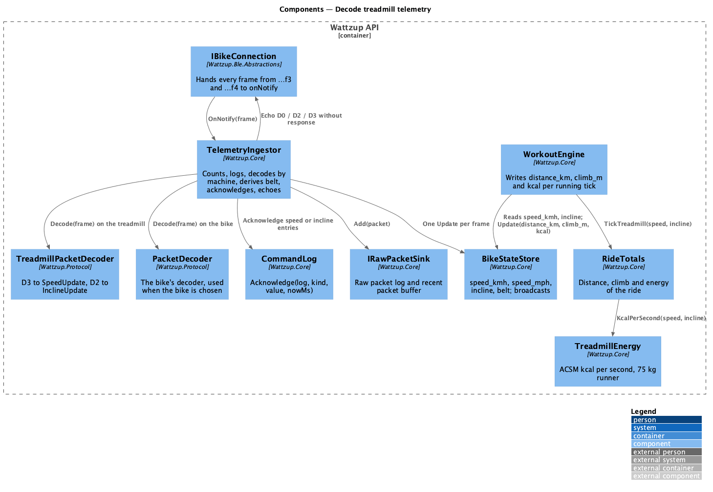
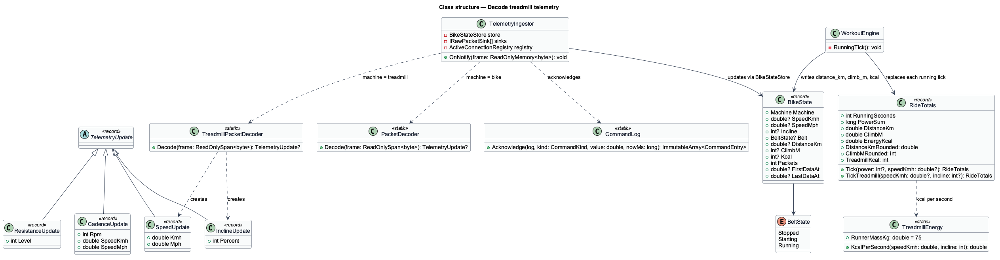
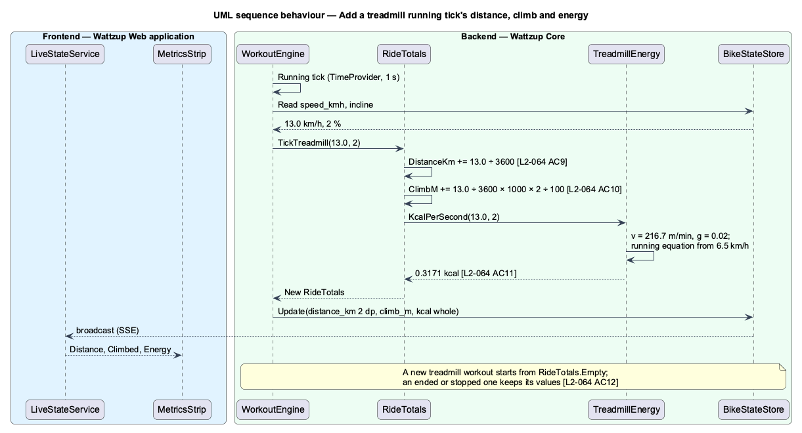

# Decode treadmill telemetry

## Overview

Once connected, the Echelon treadmill notifies short byte frames on its two notify characteristics, `…f3` and `…f4`. Two frame types carry the metrics the rider sees: `D3` carries the belt speed and `D2` the incline. This feature turns those frames into `speed_kmh`, `speed_mph` and `incline`, derives the state of the belt from the speed, and adds up the ride's distance, climb and estimated energy. The treadmill notifies speed and incline only when they change, so the last reported value stands until the next frame.

**speed frame** — frame of type `0xD3`, at least 6 bytes, carrying the belt speed in metres per hour as a big-endian 16-bit value at bytes 3–4

**incline frame** — frame of type `0xD2`, at least 5 bytes, carrying the incline in whole percent at byte 3

**belt state** — whether the belt is moving, `stopped`, `starting` or `running`, carried as `belt` (L2-064, L2-066)

**ride distance** — kilometres covered while a workout is running, `distance_km`, integrated from the reported speed once per running second

**ride climb** — metres climbed while a workout is running, `climb_m`, integrated from the reported speed and incline once per running second (L2-064 criterion 10)

**treadmill energy estimate** — kilocalories a 75 kg runner spends at the reported speed and incline, from the ACSM walking and running equations, carried as `kcal` (L2-064 criterion 11, ADR 0010)

The same type byte means different things on the two machines: on the bike `D2` is resistance, on the treadmill it is incline. The decoder is chosen by the chosen machine, never by the frame (ADR 0009). The treadmill's `D1` frame is ignored and its `D0` frame changes no metric. The bike's decoding stays in `telemetry/decode-bike-telemetry`; the echo of `D0`, `D2` and `D3` frames is described in `treadmill/choose-machine`.

## Description

- **`TreadmillPacketDecoder`** (`Wattzup.Protocol`) — static `Decode(ReadOnlySpan<byte> frame)` returning a `TelemetryUpdate?` (L2-064):
  - It returns `null` for a frame shorter than 4 bytes or not starting with `0xF0`, for an unknown type, and for `D0`, `D1` and `E0` frames.
  - A `D3` frame of at least 6 bytes yields `SpeedUpdate(Kmh, Mph)` with `value = (frame[3] << 8) | frame[4]`, `Kmh = round(value ÷ 1000, 1)` and `Mph = round(value ÷ 1000 ÷ 1.609344, 1)` from the unrounded km/h value, both with `MidpointRounding.ToEven`.
  - A `D2` frame of at least 5 bytes yields `InclineUpdate(frame[3])`.
  - Shorter `D3` and `D2` frames return `null` and raise nothing (L2-064 criterion 5). The trailing checksum is not checked, as on the bike.
- **`SpeedUpdate(double Kmh, double Mph)`** and **`InclineUpdate(int Percent)`** — new cases of the `TelemetryUpdate` record, beside the bike's `ResistanceUpdate` and `CadenceUpdate`.
- **`BeltState`** (`Wattzup.Core.State`) — enum `Stopped`, `Starting`, `Running`, serialised as `stopped`, `starting` and `running`.
- **`TelemetryIngestor`** (`Wattzup.Core`) — the notify handler for both machines. For every frame it counts `packets` and hands the bytes to the raw packet sinks, as on the bike (L2-005, L2-030). It then decodes with `TreadmillPacketDecoder` when `store.Current.Machine` is `Treadmill`, else with `PacketDecoder`. In one `BikeStateStore.Update` it applies the result, so one frame produces one broadcast:
  - `SpeedUpdate` sets `speed_kmh` and `speed_mph`. It derives `belt`: above 0 is `running`; 0 is `stopped`, except while `belt` is `starting`, when it stays `starting` (L2-064 criterion 7). It acknowledges pending `speed` commands with `CommandLog.Acknowledge(log, CommandKind.Speed, kmh, nowMs)` (`treadmill/control-speed-and-incline`).
  - `InclineUpdate` sets `incline` and acknowledges pending `incline` commands. It never touches `resistance` (L2-064 criterion 4).
  - A decoded update sets `last_data_at` to now and `first_data_at` if it is `null` (L2-064 criterion 6). On the treadmill `power` is not computed.
  - After the update it writes the acknowledgement echo (`treadmill/choose-machine`).
- **Belt on connect and disconnect** — `BikeConnectionService` sets `belt` to `stopped` in the update that sets `ble = connected` on the treadmill, and to `null` in every update that leaves `connected` (L2-064 criterion 8). On the bike `belt` stays `null` (L2-066 criterion 10).
- **`TreadmillEnergy`** (`Wattzup.Core.Workouts`, new) — static `KcalPerSecond(double speedKmh, int incline)`, a pure function of L2-064 criterion 11. With v = speed × 1000 ÷ 60 m/min and g = incline ÷ 100, it uses the walking equation `0.1·v + 1.8·v·g + 3.5` below 6.5 km/h and the running equation `0.2·v + 0.9·v·g + 3.5` from 6.5 km/h, then returns VO2 × 75 × 5 ÷ 1000 ÷ 60. At 13.0 km/h and 2 % it returns 0.3171. The runner's weight is the constant `RunnerMassKg` = 75; a setting for it needs a requirement first (ADR 0010).
- **`RideTotals`** (`Wattzup.Core.Workouts`) — the ride's immutable running totals, which the engine replaces each running second. It gains `ClimbM` (double) and `EnergyKcal` (double). `TickTreadmill(double? speedKmh, int? incline)` adds one running second: `speed ÷ 3600` km to `DistanceKm`, `speed ÷ 3600 × 1000 × incline ÷ 100` m to `ClimbM`, and `TreadmillEnergy.KcalPerSecond(speed, incline)` to `EnergyKcal`; a `null` speed or incline counts as 0. `ClimbMRounded` and `TreadmillKcal` round to whole numbers with `MidpointRounding.AwayFromZero`, as `DistanceKmRounded` does. The bike's `Tick(power, speedKmh)` and `Kcal` are unchanged.
- **`WorkoutEngine`** — on each running tick of a treadmill workout, calls `run.Totals.TickTreadmill(speed_kmh, incline)`. In the same store update it writes `distance_km` (2 decimals, as L2-049 criterion 4 does on the bike), `climb_m` and `kcal` (L2-064 criteria 9 to 11). A new treadmill workout starts from `RideTotals.Empty`, so the three reset to 0; at the end or stop they keep their final values (L2-064 criterion 12). `power`, `target_power` and `avg_power` stay `null` on the treadmill, because the power estimate of ADR 0003 needs cadence and resistance. The engine also reads `belt` and `speed_kmh` to start the ride clock and to detect a stopped belt (`treadmill/control-the-belt`).
- **`BikeState`** — gains `ClimbM` (`int?`, serialised `climb_m`), `null` on the bike and outside a treadmill workout's lifetime, as `distance_km` is (L2-014). `MachineSelector.Select` resets it with the other machine-specific fields (L2-070).

The protocol reference's example frames decode as follows. `F0 D3 02 23 28 10` → `SpeedUpdate(9.0, 5.6)`. `F0 D3 02 1B 58 38` → `SpeedUpdate(7.0, 4.3)`. `F0 D3 02 00 00 C5` → `SpeedUpdate(0.0, 0.0)`. `F0 D2 01 05 C8` → `InclineUpdate(5)`. `F0 D0 01 00 C1` → `null`.

### Acceptance tests

`Wattzup.Protocol.Tests` hold `TreadmillPacketDecoderTests`, one case per row: 9.0 km/h and 5.6 mph; 0.0; 7.0; incline 5; a 5-byte `D3`; a 3-byte `D2`; `D0`; a `D1` frame; a frame with the wrong marker; and a midpoint value that rounds to even.

`Wattzup.Core.Tests` cover `TelemetryIngestor` against a test double of `IBikeConnection` and `FakeTimeProvider`: the decoder follows the machine (one `F0 D2 01 05 C8` frame sets `resistance` on the bike and `incline` on the treadmill); the `belt` derivation table of L2-064 criterion 7 (`stopped` to `running`, `running` to `stopped`, `starting` held at speed 0, `starting` to `running`); and one broadcast per frame.

`Wattzup.Api.AcceptanceTests` run the host with `SimulatedBikeTransport`, `--machine treadmill` and `FakeTimeProvider`:

- `A_speed_frame_sets_kmh_and_mph_and_stamps_the_data_time` (L2-064 AC1, AC6)
- `On_the_treadmill_D3_sets_speed_and_a_running_belt_and_D2_sets_incline_not_resistance` (L2-064 AC4)
- `A_connected_treadmill_reports_belt_stopped_until_it_moves` (L2-064 AC8)
- `A_disconnected_treadmill_reports_belt_null` (L2-064 AC8)
- `A_running_treadmill_workout_adds_speed_to_the_distance_each_second` (L2-064 AC9)
- `Sixty_ticks_at_13_km_h_and_2_percent_climb_4_metres_and_spend_19_kcal` (L2-064 AC10, AC11)
- `A_new_treadmill_workout_resets_distance_climb_and_kcal_and_an_ended_one_keeps_them` (L2-064 AC12)

`Wattzup.Core.Tests` also hold `TreadmillEnergyTests`, one case per row: 13.0 km/h at 2 % (0.3171 kcal/s); 6.4 km/h at 0 % (walking equation); 6.5 km/h at 0 % (running equation); 0 km/h (rest, 3.5 ml/kg/min). `RideTotalsTests` cover 60 treadmill ticks at 13.0 km/h and 2 % (`ClimbM` 4.33, `TreadmillKcal` 19) and `null` speed or incline.

The simulator injects frames through `SimulationControl.Notify(frame)`.

### Open questions

- **Miles consoles.** The reference has a setting that multiplies the `D3` value by 1.60934 for consoles that count in miles. Wattzup assumes kilometres (protocol reference, hardware item 4). `<TO SUPPLY>`: the hardware result.
- **Characteristic per frame.** Which of `…f3` and `…f4` carries `D2` and `D3` is Unknown; both are subscribed and decoded the same way (hardware item 4).
- **Energy at the boundary.** The ACSM equations switch from walking to running at 6.5 km/h (L2-064 criterion 11); a runner who walks fast or jogs slowly near that speed gets a step change in the estimate. The figure is an estimate for an assumed 75 kg runner and is labelled as one in the UI.
- **Reported speed while starting.** A speed of 0 reported while `belt` is `starting` keeps `starting`; the 10-second start timeout of `treadmill/control-the-belt` ends that state.

## Requirements

| L2 ID | Refines (L1) | Requirement |
|-------|--------------|-------------|
| `L2-064` | `L1-013` | Treadmill telemetry decoding. With the treadmill chosen, a `0xD3` frame of at least 6 bytes sets `speed_kmh` and `speed_mph` from metres per hour at bytes 3–4, a `0xD2` frame sets `incline` to byte 3, `0xD0` changes no metric and `0xD1` is not decoded; the speed sets `belt`, and each running tick adds the speed to `distance_km`, the climb to `climb_m` and the ACSM energy estimate to `kcal`. |
| `L2-014` | `L1-005` | State model contract. The JSON state must keep the prototype's snake_case field names so the contract is stable across the rewrite, and add the fields the design needs. |

## Diagrams

### System context

The treadmill is the only source of its speed and incline; the frames reach Wattzup through the operating system's Bluetooth stack.

### Containers

Decoding runs inside the Wattzup API container. Wattzup Web receives the decoded speed, incline and belt state, and the ride's distance, climb and energy, over SSE.

### Components

`TelemetryIngestor` picks `TreadmillPacketDecoder` by the store's machine, applies the result and the belt derivation in one store update, and acknowledges pending commands through `CommandLog`. `WorkoutEngine` adds the distance, climb and energy on each running tick through `RideTotals` and `TreadmillEnergy`.

### Class structure

The two treadmill updates extend the existing `TelemetryUpdate` record. The decoder and `TreadmillEnergy` are pure and need no Bluetooth to test; `RideTotals` carries the treadmill's climb and energy beside the bike's power sum.

### Behaviour — decode a speed or incline frame

A frame is counted and logged, decoded by the treadmill's decoder, applied with the belt derivation in one update, broadcast, and echoed back to the treadmill (L2-063, L2-064).

### Behaviour — add a running tick's distance, climb and energy

On each running tick of a treadmill workout, the engine adds one second to `RideTotals` from the reported speed and incline, and writes `distance_km`, `climb_m` and `kcal` in one store update (L2-064 criteria 9 to 12).

